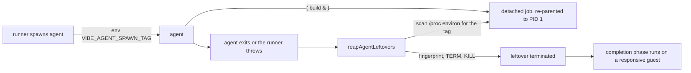

# PR Summary — Issue #4815

## Summary

An agent run now terminates every process it leaves running once the agent has
exited. The archived kills on this issue were all wedged in the completion phase
with a guest that stopped answering its probe: something the agent started kept
running after the agent itself was gone and starved the container guest. The
descendant collector (Issue #4382) could not see it. A detached `( … & )` job is
re-parented to PID 1 at once, so it never appears in a descendant snapshot, and
on a normal exit the collector is not run at all.

Every agent spawn now carries a unique `VIBE_AGENT_SPAWN_TAG` in its
environment. After the agent exits, by any path, `reapAgentLeftovers` in
`worker/deno/lib/agent_leftover_reaper.ts` finds each same-user process whose
`/proc/<pid>/environ` still holds that tag, sends TERM, then KILL after the
runner's kill-after bound. `runClaudeWithTimeoutBody` in
`worker/deno/lib/claude_runner.ts` calls it after the descendant tracker settles
on the normal path, and again in the catch path, so a throw cannot abandon a
live agent or its leftovers. Closes #4815.

## Spec

### Intent and Rationale

- The hard-kill facts posted on this issue name the completion phase, the
  `pre-PR verifier` or `agent turn` as the last step logged, an hour of silence
  before capture, and a guest probe that did not answer. That pattern is a guest
  starved by work still running after the agent exited, not a hang in the
  worker's own code
- PR #5312 showed the guest VM itself stopped answering and that the
  launcher's early silent-guest reap (#5161) only shortens such a hang. Guest
  memory read `not available`, so the cause was left open. A heavy build or
  watcher the agent left behind is a cause that fits every posted kill and that
  nothing in the worker bounded. This PR removes it; #5161 still bounds any
  other hang. A recurrence after this merges is auto-filed as a new issue, and
  the new events say whether a leftover was found
- A detached job is the case nothing collected before: it leaves the agent's
  process tree at once. The environment is the one thing it keeps, so the tag is
  the only reliable way to find it again
- The tag is set on the child environment only (`baseEnv`), before the gh guard
  shim and the pre-push hook copy it. The worker's own later subprocesses, such
  as the completion phase's git and gh calls, never carry it and are never
  reaped

### Essential Design Decisions

- Linux only. The scan runs a small `sh` script that reads `/proc/<pid>/environ`
  through `grep -z -x -F`, because Deno refuses that file under `--allow-read`
  alone. The tag is passed as an argument, never interpolated, and only the UUID
  shape `newAgentSpawnTag` produces is accepted
- Each pid is fingerprinted (`captureProcessIdentity`) after the scan and
  re-checked (`isSameProcess`) immediately before every TERM and KILL. A reused
  pid, or one with no fingerprint, is never signalled and is reported as skipped
- The worker's own pid is never signalled. Signals go to single pids, never
  groups
- The reaper never throws. A failed scan logs its cause and emits
  `AGENT_LEFTOVERS_UNCHECKED`. A signal, identity or probe that throws stops the
  pass and lists every pid not proven gone. A successful pass emits
  `AGENT_LEFTOVERS_COLLECTED`
- `VIBE_AGENT_SPAWN_TAG` is registered in `vibe_env_registry.ts` as launch
  plumbing

### Undiscoverable Facts

None. The raw evidence stays on the host in `~/logs/hard-kill-archive/`; this
fix rests only on the redacted facts already posted on the issue.

## Evidence

Backend-only change; verified by tests, including two that drive real processes
on Linux.

- Docs: `docs/INTERNALS.md` describes the spawn tag, the reaper, its identity
  checks and both events, next to the orphan collector it complements
- Coverage ledger: `docs/audits/lib-sweep-coverage/top-up-4815.json` lists the
  new module
- Issue numbers this diff cites: #4815 (this issue), #4382 (the descendant
  collector it complements), #5312 and #5161 (the earlier diagnosis and the
  silent-guest reap)

## Test Plan

- New `worker/deno/tests/agent_leftover_reaper_4815_test.ts` (12 tests):
  - terminates tagged processes, spares its own pid, names them in the warning
  - KILLs a pid that ignores TERM after the wait, and names a survivor that
    outlives KILL
  - a scan failure logs its cause and signals nothing; nothing tagged means no
    signal and no warning; an unsupported platform never scans; a malformed tag
    is refused before any scan
  - a signal that throws stops the pass and names what was done
  - a pid replaced between TERM and KILL is never KILLed; a pid with no identity
    is never signalled
  - Linux, real processes: a detached tagged `sleep` is terminated while an
    untagged control keeps running
  - Linux, real runner: a stub agent that leaves `( sleep … & )` behind has it
    terminated by `runClaudeWithRetry`
- `worker/deno/tests/claude_runner_killed_test.ts`: the drain-cap test (#325)
  disables the reaper, because it deliberately leaves a descendant holding
  stdout and asserts only the drain cap
- Red on base: with `worker/deno/lib/claude_runner.ts` restored from
  `origin/main`, the real-runner test fails and the other 11 pass
- `deno fmt --check` and `deno lint`: clean. `deno check` on the changed files:
  clean
- `deno test` on `tests/agent_leftover_reaper_4815_test.ts`,
  `tests/claude_runner*_test.ts`, `tests/vibe_env_registry_test.ts` and
  `tests/lib_sweep*_test.ts`: 245 passed, 3 failed. The three failures are the
  #3394 pre-push tests, which spawn a nested Deno that could not reach the
  package registry from this host; they do not touch this change, and CI runs
  them
- Not done or not checked: the full `./quality.sh`, which needs registry access
  this host lacked; CI runs it on this PR. A live recurrence on a fleet host is
  the final proof, and the new events make one easy to spot

🤖 Generated with [Claude Code](https://claude.com/claude-code)
