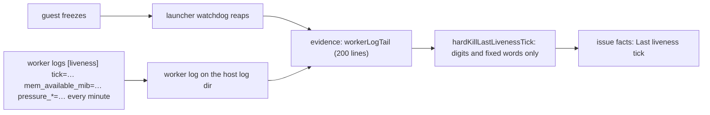

# PR Summary — Issue #4815

## Summary

The public hard-kill facts now carry a `**Last liveness tick:**` line. It holds
the guest's last-known `MemAvailable` and its memory and CPU pressure averages,
read from the newest `[liveness] tick=` line in the worker log tail that the
evidence record already holds. Every kill posted on this issue has
`Guest probe: did not answer`, so `Guest memory` and `Guest pressure` read
`not available`. The leading explanation for a frozen guest, memory starvation
during the `quality gate` or the `pre-PR verifier`, could therefore never be
confirmed or ruled out from the posted facts. The worker writes the tick line
every minute while the guest is alive. Since #5388 it carries real memory and
pressure readings, so the line survives a guest that stops answering.

This adds evidence; it does not repair the wedge. The cause is still not
established, so this PR does not close the issue. Part of #4815.

## Spec

### Intent and Rationale

- The issue asks to "make the necessary redacted cause/last-step evidence
  available to the automated diagnostic path". The last step is already posted
  (PR #4819). The missing piece is the guest's state just before it froze, and
  the probe taken at capture time can never supply it from a frozen guest
- Reading the tick from the existing `workerLogTail` field needs no change to
  the persisted evidence file, so evidence files written by older workers are
  read unchanged. A file whose tail has no tick reads `not in the log tail`

### Essential Design Decisions

- Only digits and fixed words leave the tick line, the same rule as the sibling
  figures in `worker/deno/lib/hard_kill_guest_facts.ts`. Each figure is captured
  by a bounded pattern behind a fixed literal (`mem_available_mib=`,
  `pressure_memory=`, `pressure_cpu=`), and the line is cut to 2000 characters
  first. Hook fields and any other text on the line are never copied
- The newest tick in the tail wins, and its own log time is appended as
  `(logged <time>Z)`, so a reader can see how stale the figures are next to the
  `Last log time` line
- The new line sits directly after `**Guest pressure:**` in `hardKillFactLines`,
  so the issue body and the facts backfill both carry it. The shorter recurrence
  follow-up line is unchanged, because the backfill posts the full facts for
  each recurrence

### Undiscoverable Facts

- The raw evidence for all four posted kills is in `~/logs/hard-kill-archive/`
  on GRQ-3 and was not readable from this host. The backfill has already posted
  facts for those archived files, so this line appears from the next recurrence
  on

## Evidence

Backend only; no UI files. Verified by unit tests.

- Producer read: `formatLivenessPressureFields` in
  `worker/deno/lib/liveness_guard.ts` writes the fields, and the tick line is
  logged in `worker/deno/lib/run_core_production_deps.ts`. The parser's contract
  test builds its input with that serialiser
- Docs: the **Filing.** bullet in `docs/CALLBACKS.md` names the new figure and
  its `not in the log tail` value. The module comments of
  `worker/deno/lib/hard_kill_guest_facts.ts` and
  `worker/deno/lib/hard_kill_report.ts` now count seven figures, and the list of
  fact lines in `worker/deno/lib/hard_kill_facts_backfill.ts` names the new line
- Issue numbers this diff cites: #4815 (this issue)

## Reproduction

- **symptom** — every kill posted here shows `Guest memory: not available` and
  `Guest pressure: not available`, so the facts cannot tell a starved guest from
  any other freeze
- **status** — `partial` — reason: the wedge itself was not reproduced (its
  evidence is on GRQ-3). The new tests went red before the fact existed: the
  test file failed type-check with
  `TS2305 … has no exported member
  'hardKillLastLivenessTick'`. After the
  change they pass
- **regression test** —
  `worker/deno/tests/hard_kill_guest_facts_test.ts::the tick line the liveness guard writes is read back (Issue #4815)`

## Acceptance Criteria

- **missing** — "use a bounded replay or the next applicable recurrence to
  diagnose and repair the completion failure" — reason: no recurrence carries
  the guest's pre-freeze memory yet. This PR adds that figure, so the next
  recurrence can confirm or rule out memory starvation. A repair before then
  would be a speculative fix for an undiagnosed fault

## Test Plan

- New, in `worker/deno/tests/hard_kill_guest_facts_test.ts`, the section "The
  last liveness tick in the worker log tail (Issue #4815)":
  - the newest tick wins over an older one, and the literal figures and log time
    are read back
  - a tail with no tick, and an `unavailable: …` tail, read
    `not in the log tail`
  - `mem_available_mib=unavailable` with unreadable pressure gives
    `MemAvailable unavailable`
  - a tick carrying a path and a `ghp_` token in other fields, plus the
    malformed `avg10=1234.5` and `avg10=9.999`, gives only `MemAvailable 77 MiB`
    and none of that text. The memory figure is the allowed control
  - a tick that is only garbage gives `no readable figures`
  - hostile lines (200,000 `a` characters, and 200,000 commas after
    `pressure_memory=`) return the exact expected value
  - the tick line built with the liveness guard's own
    `formatLivenessPressureFields` and `collapseProcPressureText` is read back
- Edited, `worker/deno/tests/hard_kill_report_test.ts`, "the body carries the
  guest and host figures under the last log time". The expected fact list gains
  `**Last liveness tick:** not in the log tail` (that fixture has no tick), and
  the blank-line check moves down by one. Every earlier expected line is kept
- New, same file: "a liveness tick in the log tail shows in the body (Issue
  #4815)" drives `formatHardKillBody` and asserts the new line's value
- Results on the head:
  `deno test --allow-all tests/hard_kill_guest_facts_test.ts
  tests/hard_kill_report_test.ts tests/hard_kill_facts_backfill_4815_test.ts`
  from `worker/deno` passed (128 tests; the contract test was then added, and
  `hard_kill_guest_facts_test.ts` passed 39 of 39). `./quality.sh`:
  `Result: PASSED (with skipped checks)`. Config integration was skipped (no
  `.config.json`) and checkov was skipped (not installed)
