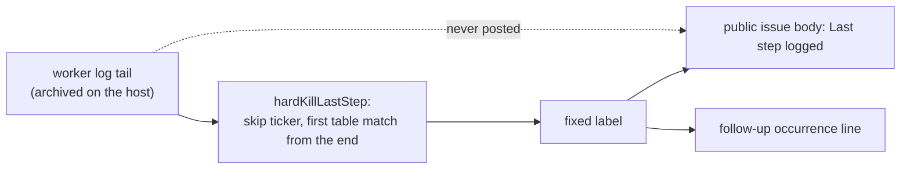

## Summary

The hard-kill issue for run `vibe-mw2hlf2s-1125d1` says only "wedged in
completion", the same words as #4743, so nobody can tell which completion step
froze. The filed issue and its follow-up lines now also carry a **last step
logged** taken from a fixed list (`pre-PR verifier`, `mutation check`,
`coverage carry-over check`, `quality gate`, `agent turn`, `unknown`). The wedge
itself is not fixed and not diagnosed: this change makes the next recurrence
narrow it: the label is the last step the log reported, and the wedge is in that
step or a later one that logs nothing as it starts (the mutation check and the
coverage check log nothing at their start; the verifier's agent session does log
its start, which the table labels `agent turn`). Part of #4815.

Version bump: `VERSION` is not touched by this change.

## Spec

### Intent and Rationale

- Third recorded hard kill of this class (#4743 and its fix #4760 are the
  earlier ones). The in-guest evidence (`~/logs/hard-kill-archive/` on GRQ-3) is
  not readable from the worker that ran this change, so the cause cannot be
  proven. Changing run behaviour on a guess already failed once: #4760 released
  the verifier's cargo target directory and the wedge recurred.
- The only evidence in the logs repository is the agent session for each run.
  For all three runs (`vibe-mvzlnl5o-40feb4`, `vibe-mw011ned-c6f0d4`,
  `vibe-mw2hlf2s-1125d1`) it is a GRQ-AutoTrader run whose last agent session
  ends with a successful pre-PR verifier result. For `vibe-mw2hlf2s-1125d1` the
  session ended 20:25:29Z, the last worker log line is 21:16:02Z and the
  watchdog fired 22:17:09Z, which is 3 h 11 m after the run started (19:05:30Z,
  decoded from the run id), the same offset as the other two. The worker kept
  logging for 50 minutes after that agent finished. That points at a later
  completion step, but the archive is needed to confirm it: a later agent turn
  may have replaced this transcript.

### Essential Design Decisions

- The step comes from an ordered table of patterns over the last log lines, with
  one precedence rule ahead of it: an `[agent-progress]` line yields the agent
  step before the noise skip and the table are read (`AGENT_PROGRESS_LINE` early
  return, ahead of `STEP_NOISE`). It is published only as a label, never as log
  text: the issue is public and the run may be on a private repository (module
  comment of `worker/deno/lib/hard_kill_report.ts`).
- Phase ticker lines (`[phase] … still running`) are skipped, since the ticker
  is the last line of a healthy run and names no step. The redundant liveness
  and status filters were removed: their real log shapes match no step pattern.
- The table matches the lines each step logs when it ends, built from the gates'
  own notes: `N of M mutants killed`, `mutation cap reached: …`,
  `mutation budget exhausted …`, `mutation check not applicable: …`,
  `N of M carried-over lines still covered`,
  `coverage carry-over budget
  exhausted …` and
  `coverage carry-over check not applicable: …`. Because no start line exists,
  the body reads `**Last step logged:** \`x\` (the wedge is in or after this
  step)`and the
  follow-up line reads`last step logged \`x\``. (PR #4819 review
  chose naming the field honestly over adding start log lines to the completion
  phase.)
- The step is not part of the signature `hard-kill-<handler>-<phase>`, so
  existing dedup and the marker are unchanged.

### Undiscoverable Facts

- Which step froze in `vibe-mw2hlf2s-1125d1` is unknown: the worker log tail is
  only in the GRQ-3 archive. After the verifier the completion phase runs the
  mutation check, which on GRQ-AutoTrader runs `cargo mutants` (300 s budget in
  the logs seen on other hosts); this is a lead, not a finding.

## Evidence

Backend change, no UI. The shape of the log lines the table matches was taken
from this host's worker logs (`~/logs/worker-20261103-2*.log.gz`, run for
GRQ-AutoTrader#4972): `Pre-PR verifier released its disposable checkout`,
`mutation budget exhausted after 7 of 7 mutants (300 s)`,
`coverage carry-over check not applicable: …`, `Quality gate passed attempt=1`
and the `[phase] completion (…): still running · …` ticker.

## Reproduction

- **symptom** — the container wedges in `completion` and is reaped by the 11400
  s launcher watchdog; the filed issue cannot say which step.
- **status** — `not-run` — the wedge was not reproduced and is not claimed
  fixed.
- **regression test** —
  `worker/deno/tests/hard_kill_report_test.ts::hardKillLastStep takes the mutation check from the tail and skips the ticker (Issue #4815)`
- reason: the freeze is a guest-wide stall on GRQ-3 (Apple `container`); no
  in-guest evidence is readable from this host, so only the diagnostic gap (the
  missing step in the issue) is covered by a test.

## Acceptance Criteria

- **missing** — the container no longer wedges in completion (the hard kill
  recurs) — reason: the cause is undiagnosed; no evidence of which step froze is
  readable here, and a behaviour change on a guess is what #4760 was

## Test Plan

- CI repair (PR #4819): in
  `worker/deno/tests/loop_supervisor_test.ts::loop.sh #4568 - a registered orphan with a different command survives`
  the orphan wait is a bounded poll for the final `<marker> 300` command line
  and re-parenting to init, and it fails with the observed command and parent
  if it never settles. The `pgrep -f` snapshot (and its helper) is removed: it
  returned `[]` on CI although the process was alive. The test still asserts
  the registered unrelated process survives the reaper. Local `deno fmt
  --check`, `deno lint`, `deno check` and the test pass; the failure itself did
  not reproduce locally, so the integration workflow stays the authoritative
  check.
- Added to `worker/deno/tests/hard_kill_report_test.ts`:
  - `hardKillLastStep takes the mutation check from the tail and skips the ticker (Issue #4815)`
  - `hardKillLastStep: the later tail line wins over an earlier one (Issue #4815)`
  - `hardKillLastStep is unknown when no table entry matches or the tail is empty (Issue #4815)`
  - `hardKillLastStep posts the fixed label, never the private log text (Issue #4815)`
  - `hardKillLastStep returns promptly on 64 KiB lines (Issue #4815)` (hostile
    long-line cases; results asserted, no timing)
  - `a repeat kill's follow-up occurrence line names its last step (Issue #4815)`
  - `hardKillLastStep names the step for every note the two gates log (Issue #4815 review)`
    (fixtures are the `note` of `evaluateMutationGate` and
    `evaluateCoverageCarryOverGate` for the clean, capped, budget and
    not-applicable results, each after a
    `Pre-PR verifier released its
    disposable checkout` line)
  - `hardKillLastStep after the verifier's checkout line is the verifier: the wedge is in or after it (Issue #4815 review)`
  - `hardKillLastStep: an agent-progress line is the agent turn whatever its tool detail names (Issue #4815 review)`
    (must-not-fire table: agent-progress lines whose `(last: Bash grep ...)`
    detail names `mutation check`, `Pre-PR verifier`, `Quality gate`,
    `carried-over lines`, or the noise markers `Status:`, `[liveness]` and
    `[phase] x: still running`, must give `agent turn`; controls: the same text
    outside an agent-progress line still matches its own step, and a ticker is
    still skipped as noise)
  - `hardKillLastStep: each table operand names its step from the log shapes the worker writes (PR #4819 review)`
    (one case per operand the other tests did not reach, in the real logger
    shape and after a `Pre-PR verifier released its disposable checkout` line:
    `Quality gate passed attempt=1`, `[phase] quality_gate (o/r#N): started`,
    `Running Claude Code with 3600s timeout ...`, and
    `Mutation gate reported findings reason=1 mutant of changed lines survived ...`,
    whose reason names no other entry so only `gate` matches)
- Per-operand red checks (PR #4819 review; each operand deleted on its own from
  `STEP_PATTERNS`, `deno test` of `tests/hard_kill_report_test.ts`, then
  restored): `\bQuality gate\b` → 1 failed (new test); `\[phase\] quality_gate`
  → 1 failed (new test); `Running <provider> with Ns timeout` (restored to the
  earlier Claude-only literal) → 1 failed
  (`hardKillLastStep recognises each provider's session ...`); mutation `gate` →
  1 failed (new test); mutation `check` → 3 failed; `budget` → 3 failed
  (`mutation budget` case of the gate-notes test); `cap` → 1 failed
  (`mutation capped`); `mutants? killed` → 1 failed; `coverage carry-over` → 1
  failed (`coverage budget`); `carried-over lines` → 1 failed. The dead
  `/\[agent-progress\]/` operand of the `agent turn` entry is removed:
  `AGENT_PROGRESS_LINE` in `hardKillLastStep` returns first, so no input reached
  it; the agent-progress test still covers that label.
- Red checks (each break made on its own, test run, then restored): ticker
  filter removed → test 1 red; scan made forward → tests 1 and 2 red; fallback
  `unknown` changed → tests 3 and 5 red; raw line returned instead of the label
  → tests 1, 2, 4, 5, 6 red; body line removed → tests 1, 3, 4 red; occurrence
  suffix removed → test 6 red; per-line cap shrunk → tests 1, 2, 4, 5, 6 red.
  Review fix 2: with the `AGENT_PROGRESS_LINE` early return removed, the
  agent-progress test went red at `grep -rn "mutation check" docs`. Review fix
  3: with the agent-progress check moved back below the `STEP_NOISE` skip, the
  same test went red at `grep -rn "Status: " docs`. Review fix: with the pattern
  table, body line and occurrence line restored to the earlier commit, the new
  gate-notes test went red at `mutation clean: 7 of 7 mutants killed`, the
  verifier-then-ticker test and the follow-up test went red on the old wording.
- Edited `worker/deno/tests/run_failure_issue_test.ts`: the hard-kill fixture
  gained `evidence` and `lastLogLine` fields, because `formatHardKillBody` now
  reads them; no assertion was removed or changed. Production evidence always
  passes the strict parser, which fills both.
- Docs: `docs/CALLBACKS.md` (Filing bullet) and `docs/TROUBLESHOOTING.md`
  (wedged-container paragraph) name the last step logged, say the wedge is in or
  after it and say it is not in the dedup signature.
- Twin check: `grep -rn "Last log time\|\*\*Phase:\*\*"` finds only
  `hard_kill_report.ts` and its tests; `run_failure_issue.ts` only mentions the
  `**Phase:**` field in a comment.
- `deno task test:unit`, run from `worker/deno`, one file at a time, 0 failed
  in each (re-run on the head of PR #4819):
  - `worker/deno/tests/hard_kill_report_test.ts` (61 tests at head)
  - `worker/deno/tests/run_failure_issue_test.ts` (26 tests at head)
- `./quality.sh` (run on an earlier head, before review fix 3; not re-run after
  it, skipped for budget): every stage passed except `deno tests`. The parallel
  pass ran 32534 passed, 2 failed; the failures are
  `completion - an unformatted Rust change is formatted and committed, then passes the gate`
  and
  `completion - cargo fmt stages only the branch's .rs files, not an unrelated uncommitted edit`
  in `worker/deno/tests/completion_phase_repo_formatters_test.ts` (lines 480 and
  567), which this change does not touch; the same two failed in the #4743 work.
  I did not compare against `main`. The serial pass did not run because the
  parallel pass failed.

Not done: the wedge itself is not diagnosed or fixed; the GRQ-3 archive was not
read; the serial test pass of the gate did not run.

- Corpus run (PR #4819 review): `hardKillLastStep` over every line of the 45
  production worker logs on this host (`~/logs/worker-*.log.gz`, 2026-11-02 to
  2026-11-05), each line as the last log line, 38140 lines. Base has no matcher,
  so there is no base count: the base branch cannot label a step. Head result:
  1875 `agent turn` (1363 `[agent-progress]` tickers, 512
  `Running Claude Code ...` lines, including health checks), 262 `quality gate`
  (80 `Quality gate
  passed`, 82 `Quality gate stage outcomes`, 2
  `Quality gate failed, running
  Claude fix attempt`, the rest
  `[phase] quality_gate` started/continue lines), 252 `pre-PR verifier`, 139
  `mutation check`, 82 `coverage carry-over check`, 35530 `unknown`. Every
  `agent turn` line is an agent-progress or claude_runner line, but the old
  matcher also counted health-check announcements and sessions as turns; the
  previous claim of zero false positives was incorrect. The old corpus did not
  record their separate counts, so the exact false-positive count is unknown.
  Every note the two gates log (`N of M mutants killed`,
  `mutation budget exhausted ...`, `mutation check not
  applicable ...`,
  `N of M carried-over lines still covered`,
  `coverage
  carry-over check not applicable ...`) is labelled: 0 false
  negatives for the step-ending lines. Observed look-alikes, accepted: 4
  `Drift check reported
  residual drift ...` lines and the
  `Completion gates reported findings`, `PR-summary rule block` and
  `Completion-gate findings remain` lines quote a gate's finding text in
  `reason=`, so they take that gate's label (these are logged after that gate
  ran, so the label is never earlier than the real position). A scan of the 207
  lines with a broad independent pattern
  (`mutant|mutation|carried-over|carry-over|verifier|quality gate|claude code`)
  that came out `unknown` found none a step logs on finishing; they are
  `Claude Code health check passed` (94),
  `Mutation survivors remain ... raising
  a draft` (15), drift-check,
  review-fix and cycle-timing lines and quoted PR text. The multi-line
  `Quality gate failed after fix attempt output=...` dump does not occur in
  these logs (two `Quality gate failed, running Claude fix
  attempt` lines
  only), so that shape is not covered by the corpus.

- PR #4819 review: session starts now match the runner shape for every
  registered provider.
  `worker/deno/tests/hard_kill_report_test.ts::hardKillLastStep recognises each provider's session and distinguishes the health announcement`
  derives names from the registry and covers normal sessions, health
  announcements and probe sessions after a quality gate. The old Claude-only
  matcher failed this test. Health announcements no longer match; probe sessions
  still count as agent turns because the runner logs the same shape for them and
  ordinary sessions. A current 30-file host-log sample contains 23 Claude health
  announcements and 23 matching 30-second session lines; it is not the original
  45-file corpus.
- TDD rule 3: the obsolete behaviour was skipping liveness and status lines and
  treating any `Running Claude Code` text as a session. Phase tickers are still
  skipped, and provider session starts remain labelled; coverage is
  `worker/deno/tests/hard_kill_report_test.ts::hardKillLastStep: an agent-progress line is the agent turn whatever its tool detail names (Issue #4815 review)`
  and the provider session test above. No twin matcher was found.
