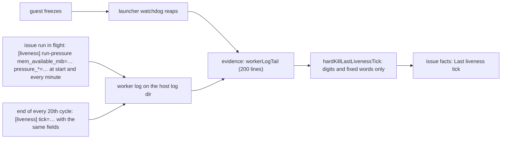

# PR Summary — Issue #4815

## Summary

The public hard-kill facts now carry a `**Last liveness tick:**` line. It holds
the guest's last-known `MemAvailable` and its memory and CPU pressure averages,
read from the newest `[liveness] run-pressure` or `[liveness] tick=` line in the
worker log tail that the evidence record already holds. Every kill posted on
this issue has `Guest probe: did not answer`, so `Guest memory` and
`Guest pressure` read `not available`. The leading explanation for a frozen
guest, memory starvation during the `quality gate` or the `pre-PR verifier`,
could therefore never be confirmed or ruled out from the posted facts.

The end-of-cycle `[liveness] tick=` line runs only once every 20 loop cycles
(about every forty minutes) and never while an issue run is in flight, so on its
own it would show a reading from before the wedged run was claimed. This PR
therefore also wraps the production `processIssue` in `withRunPressureTicks`:
each issue run logs `[liveness] run-pressure` followed by the same
`mem_available_mib=… pressure_memory=… pressure_cpu=…` fields when it starts and
every minute until it settles. The worker log lives on the host log dir, so the
last line written before the freeze survives a guest that stops answering.

This adds evidence; it does not repair the wedge. The cause is still not
established, so this PR does not close the issue. Part of #4815.

## Spec

### Intent and Rationale

- The issue asks to "make the necessary redacted cause/last-step evidence
  available to the automated diagnostic path". The last step is already posted
  (PR #4819). The missing piece is the guest's state during the run, up to a
  minute before it froze, and the probe taken at capture time can never supply
  it from a frozen guest
- Reading the tick from the existing `workerLogTail` field needs no change to
  the persisted evidence file, so evidence files written by older workers are
  read unchanged. A file whose tail has no tick reads `not in the log tail`

### Essential Design Decisions

- The in-run line is logged by `withRunPressureTicks` in
  `worker/deno/lib/liveness_guard.ts`, around the production `processIssue` in
  `worker/deno/lib/run_core_production_deps.ts`, so every lane's run is covered
  without touching `run_core.ts`. It logs once at the start, then every
  `RUN_PRESSURE_INTERVAL_MS` (60 s). A reading still pending when the timer
  fires skips that beat, so a stuck `cat` cannot pile up readers. The timer is
  cleared when the run settles, and a failed reading never fails the run
- The writers and the parser share the marker constants `LIVENESS_TICK_MARKER`
  and `RUN_PRESSURE_MARKER`, both exported from `liveness_guard.ts`

- Only digits and fixed words leave the tick line, the same rule as the sibling
  figures in `worker/deno/lib/hard_kill_guest_facts.ts`. Each figure is captured
  by a bounded pattern behind a fixed literal (`mem_available_mib=`,
  `pressure_memory=`, `pressure_cpu=`), and the line is cut to 2000 characters
  first. Hook fields and any other text on the line are never copied
- The newest line with either marker in the tail wins, and its own log time is
  appended as `(logged <time>Z)`, so a reader can see how stale the figures are
  next to the `Last log time` line
- The new line sits directly after `**Guest pressure:**` in `hardKillFactLines`,
  so the issue body and the facts backfill both carry it. The shorter recurrence
  follow-up line is unchanged, because the backfill posts the full facts for
  each recurrence

### Undiscoverable Facts

- The fact reads the 200-line worker log tail. If more than 200 lines are logged
  after the last `[liveness] run-pressure` line and before the freeze, the fact
  falls back to an older tick or reads `not in the log tail`

- The raw evidence for all four posted kills is in `~/logs/hard-kill-archive/`
  on GRQ-3 and was not readable from this host. The backfill has already posted
  facts for those archived files, so this line appears from the next recurrence
  on

## Evidence

Backend only; no UI files. Verified by unit tests.

- Producer read: `formatLivenessPressureFields` in
  `worker/deno/lib/liveness_guard.ts` writes the fields for both lines. The
  end-of-cycle tick is logged in `worker/deno/lib/run_core_production_deps.ts`
  under `livenessTick % LIVENESS_CHECK_CADENCE === 1`
  (`LIVENESS_CHECK_CADENCE = 20`, `worker/deno/lib/run_core.ts`), and the in-run
  line is logged by `withRunPressureTicks`. The tests drive the real writer
  (`withRunPressureTicks` through the real `createLogger`, and the production
  `processIssue`), not a hand-placed line
- Docs: the **Filing.** bullet in `docs/CALLBACKS.md` names the new figure, the
  two lines it reads (and that a run logs the first every minute), and its
  `not in the log tail` value. The module comments of
  `worker/deno/lib/hard_kill_guest_facts.ts` and
  `worker/deno/lib/hard_kill_report.ts` now count seven figures, and the list of
  fact lines in `worker/deno/lib/hard_kill_facts_backfill.ts` names the new line
- Issue numbers this diff cites: #4815 (this issue)

## Reproduction

- **symptom** — every kill posted here shows `Guest memory: not available` and
  `Guest pressure: not available`, so the facts cannot tell a starved guest from
  any other freeze
- **status** — `partial` — reason: the wedge itself was not reproduced (its
  evidence is on GRQ-3). The new tests went red before the fact existed: the
  test file failed type-check with
  `TS2305 … has no exported member
  'hardKillLastLivenessTick'`. After the
  change they pass
- **regression test** —
  `worker/deno/tests/hard_kill_guest_facts_test.ts::a reading taken during the run is what the fact reports (Issue #4815)`
  and
  `worker/deno/tests/run_pressure_wiring_4815_test.ts::production processIssue logs the run pressure line while the run is in flight (Issue #4815)`.
  Red-checked: with the parser limited to the `[liveness] tick=` marker, the
  first fails with `MemAvailable 4000 MiB …` (the pre-claim tick). With the
  `withRunPressureTicks` wrap removed from `processIssue`, the second fails

## Acceptance Criteria

<!-- vibe-spec-review inputs="diff+issue-body" -->

- **met** — "preserve the existing private diagnostic boundary" — evidence:
  `worker/deno/tests/hard_kill_guest_facts_test.ts::tick text never leaks and malformed numbers are dropped (Issue #4815)`
  — reviewer: met
- **partial** — "make the necessary redacted cause/last-step evidence available
  to the automated diagnostic path" — evidence:
  `worker/deno/tests/hard_kill_guest_facts_test.ts::a reading taken during the run is what the fact reports (Issue #4815)`
  — reviewer: partial — reason: this adds the guest's in-run memory and
  pressure, not the cause, and only recurrences after this change carry it
- **missing** — "use a bounded replay or the next applicable recurrence to
  diagnose and repair the completion failure" — reviewer: missing — reason: the
  wedge's raw evidence is on GRQ-3 and no recurrence yet carries an in-run
  reading, so the cause is not diagnosed and a repair now would be speculative;
  this PR adds the reading the next recurrence needs
- **met** — "Do not publish raw private repository logs here." — evidence:
  `worker/deno/tests/hard_kill_guest_facts_test.ts::hostile tick lines return promptly with a fixed result (Issue #4815)`
  — reviewer: met
- **missing** — "A missing evidence file on the claiming host, repeated
  deferral, or exhausted retry counter alone must not turn this implementation
  issue into `needs-human`. Keep automatic recheck/resumption and independent
  eligible work moving." — reviewer: missing — reason: a constraint on how the
  issue is handled; the diff does not touch deferral, retry or label logic, and
  does not break it
- **partial** — "Complete the issue through an implemented fix and automated
  regression/recovery evidence; no supervised test or manual acceptance step is
  required." — evidence:
  `worker/deno/tests/run_pressure_wiring_4815_test.ts::production processIssue logs the run pressure line while the run is in flight (Issue #4815)`
  — reviewer: partial — reason: the new evidence path is tested automatically,
  but there is no fix for the wedge, so no regression evidence for it
- **met** — "Do not repeat the instrumentation work or close the incident merely
  because that PR merged." — evidence: this summary says `Part of #4815`; the
  new fact is separate from the last-step label of #4819 — reviewer: met

## Test Plan

- New, in `worker/deno/tests/hard_kill_guest_facts_test.ts`, the section "The
  last liveness tick in the worker log tail (Issue #4815)":
  - the newest tick wins over an older one, and the literal figures and log time
    are read back
  - a tail with no tick, and an `unavailable: …` tail, read
    `not in the log tail`
  - `mem_available_mib=unavailable` with unreadable pressure gives
    `MemAvailable unavailable`
  - a tick carrying a path and a `ghp_` token in other fields, plus the
    malformed `avg10=1234.5` and `avg10=9.999`, gives only `MemAvailable 77 MiB`
    and none of that text. The memory figure is the allowed control
  - a tick that is only garbage gives `no readable figures`
  - hostile lines (200,000 `a` characters, and 200,000 commas after
    `pressure_memory=`) return the exact expected value
  - the tick line built with the liveness guard's own
    `formatLivenessPressureFields` and `collapseProcPressureText` is read back
  - "a reading taken during the run is what the fact reports": a pre-claim
    `[liveness] tick=` line with a healthy reading, then a claim line, then
    `withRunPressureTicks` logging through the real `createLogger`. The fact
    reports the last in-run reading (`MemAvailable 120 MiB`, memory
    `avg10=85.25`), and every run line comes after the claim
  - the run line is logged at the start, a pending reading skips later beats,
    and a reading that settles after the run is not logged
  - a failed reading does not fail the run and logs nothing
- New, `worker/deno/tests/run_pressure_wiring_4815_test.ts`: the production
  `createProductionRunCoreDeps(...).deps.processIssue` logs a
  `[liveness] run-pressure` line while the run is held inside its first `gh`
  call
- Edited, `worker/deno/tests/hard_kill_report_test.ts`, "the body carries the
  guest and host figures under the last log time". The expected fact list gains
  `**Last liveness tick:** not in the log tail` (that fixture has no tick), and
  the blank-line check moves down by one. Every earlier expected line is kept
- New, same file: "a liveness tick in the log tail shows in the body (Issue
  #4815)" drives `formatHardKillBody` and asserts the new line's value
- Results on the head: from `worker/deno`,
  `deno test --allow-all tests/hard_kill_guest_facts_test.ts
  tests/hard_kill_report_test.ts tests/hard_kill_facts_backfill_4815_test.ts
  tests/run_pressure_wiring_4815_test.ts tests/liveness_guard_test.ts
  tests/liveness_pressure_4225_test.ts tests/run_core_liveness_test.ts
  tests/custom_label_dispatch_test.ts`
  passed 168 of 168, with stdin from `/dev/null`. `deno fmt` and `deno lint` are
  clean on the changed files. The worker re-runs `./quality.sh` over this tree
  before the PR is raised
