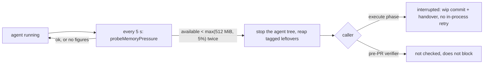

# PR Summary — Issue #4815

## Summary

While an agent runs, the worker now checks the guest's memory every 5 s. When
available memory is below the floor (the larger of 512 MiB and 5% of total) on
two readings in a row, it stops the agent's process tree and reaps the run's
tagged leftovers. The guest then keeps answering instead of freezing until the
launcher watchdog reaps the whole container. In the execute phase the stop is
released as `interrupted`, the work is kept on the issue branch in a `wip:`
commit with a handover note, and the run is not retried in-process. In the
pre-PR verifier the stop makes that pass `not checked`. Closes #4815.

## Spec

### Intent and Rationale

- Every kill posted on this issue has `Guest probe: did not answer`. The last
  steps logged were `agent turn` twice, `pre-PR verifier` once and
  `quality gate` twice. `quality gate` matches `Quality gate passed`, and the
  pre-PR verifier logs nothing as it starts, so those two kills are in or after
  the gate, where the next agent run is the verifier.
- The 2026-11-25 kill (`vibe-coder-41088`) carries the in-run reading from the
  previous PR: `MemAvailable 2344 MiB (logged 2026-11-25 09:44:07Z)`. The
  per-minute line then stopped, and the last log line was two minutes later. Its
  container held two GRQ-AutoTrader claims at once (#4404 and #4598), and so did
  the 2026-11-23 one (#5944 and #5595).
- Issue #4225 already found this mechanism. On a guest with no swap, running out
  of memory without an OOM kill stops the guest scheduling. Its job cap
  (`CARGO_BUILD_JOBS=2` in `container/entrypoint.sh`) limits one cargo, not two
  slots of agents, tests and the verifier together. The slot governor
  (`slot_governor.ts`) only stops new slots starting, and the existing in-run
  memory watch (Issue #4384) only logs evidence.
- So the repair stops the run that would exhaust memory, the same way the host
  disk floor already stops one (Issue #4360). A loud, retried failure of one run
  replaces a frozen guest that loses every slot and an hour or more.

### Essential Design Decisions

- The check is armed only in the worker process, beside
  `enableInFlightHostDiskGate(true)` in `worker/deno/commands/run_core.ts`, so a
  unit test never reads the host's memory. An explicit `guestMemoryPollMs` arms
  it in a test, and `0` disables it.
- It needs both figures. A reading without them (unreadable, or macOS's
  level-only reading) resets the count and never stops a run. Two readings in a
  row are required, so one dip does not kill a run. The watch trips once per
  run.
- It reads through the existing `probeMemoryPressure` seam
  (`Deno.systemMemoryInfo()` on Linux), which forks nothing, so it still works
  when spawning gets slow under pressure.
- An `[GUEST_MEMORY_FLOOR]` stop is not retried in-process. The retry would
  start the same workload into the same low memory, the same reasoning as the
  existing #4374 branch beside it.

### Undiscoverable Facts

- The raw evidence stays in `~/logs/hard-kill-archive/` on GRQ-3 and was not
  read. The diagnosis uses only the posted facts and the claim comments on the
  GRQ-AutoTrader issues named above.
- The quality gate and pre-flight commands are not watched, because they are not
  agent runs.

## Evidence

Backend only, with no UI files.

- Code: `worker/deno/lib/guest_memory_floor.ts` (new),
  `worker/deno/lib/claude_runner.ts` (the `guestMemoryPoll` block,
  `GuestMemoryFloorError` after the leftover reap),
  `worker/deno/lib/phases/execute_phase.ts`, `worker/deno/lib/wip_checkpoint.ts`
  (the `guest-memory-floor` cause), `worker/deno/commands/run_core.ts`.
- Docs: `docs/CONTAINER.md`, section "A running agent stops at the guest memory
  floor (Issue #4815)", and a `[GUEST_MEMORY_FLOOR]` paragraph in
  `docs/TROUBLESHOOTING.md`. The pre-PR verifier statement was checked against
  `runPrePrVerifier` in `worker/deno/lib/pre_pr_verifier.ts`, where every
  failure to run yields `not_checked`.
- `docs/audits/lib-sweep-coverage/top-up-4815.json` claims the new module, as
  `worker/deno/tests/lib_sweep_coverage_test.ts` requires.
- Issue numbers cited: #4225: Worker container locks up during agent cargo/deno
  test builds: guest-wide stall, no OOM, reaped only by the 11400s watchdog (8×
  in 32h on GRQ-3). #4360: Host disk filled mid-run (60 GB → 0 in 40 min,
  2026-10-25): the floor only gates claims, and the read-only fallout is charged
  to the issue. #5077: A host-disk park mid-execute is still logged as ERROR and
  released as internal_error. #4374 is cited because the existing code beside
  the new branch already cites it.

## Reproduction

- **symptom** — the guest stopped answering its exec probe during agent work,
  and the launcher watchdog reaped the container with the claims unreleased
- **status** — `partial` — reason: the guest freeze itself was not reproduced,
  because its evidence is on GRQ-3 and freezing a VM is not something a unit
  test can do. The tests reproduce the missing guard: against `main`'s
  `claude_runner.ts`, `execute_phase.ts` and `wip_checkpoint.ts`, the runner
  test "a low guest stops the agent" failed, and the execute-phase test never
  finished: the gated agent was never stopped, and a 120 s bound ended the run.
  Both pass at the head.
- **regression test** —
  `worker/deno/tests/claude_runner_guest_memory_floor_4815_test.ts::guest memory watch - a low guest stops the agent (Issue #4815)`
  and
  `worker/deno/tests/execute_phase_guest_memory_floor_4815_test.ts::execute_phase #4815 - a guest memory stop mid-execute is preserved and released as interrupted`

## Test Plan

- New, `worker/deno/tests/guest_memory_floor_4815_test.ts`: floor sizes (4 GiB
  and 8 GiB give 512 MiB, 16 GiB gives 5%, zero or NaN give 512 MiB). Two low
  readings trip it with the exact reason. Low, then ok, then low does not trip.
  A reading with no figures, or a `high` level with none, never trips. Exactly
  at the floor does not trip. It trips only once.
- New, `worker/deno/tests/claude_runner_guest_memory_floor_4815_test.ts`,
  through the real `runClaudeWithTimeout` with a stub agent:
  - a low probe stops a long-running agent with a `GuestMemoryFloorError` whose
    message opens with `[GUEST_MEMORY_FLOOR]`;
  - control: a healthy probe lets the same run complete `ok`;
  - not armed (no `guestMemoryPollMs`), a low probe does not stop the run.
- New, `worker/deno/tests/execute_phase_guest_memory_floor_4815_test.ts`,
  through `workOnIssueExecuteClaude` and the real runner:
  - the result is `interrupted` with the marker in its reason;
  - the agent's file and a handover naming the guest memory floor are on the
    remote branch, and the local tree is clean;
  - `state.preservedWip` is set;
  - the agent started once and never finished, so there was no in-process retry.
- No existing test was edited.
- Results at the head (from `worker/deno`, stdin from `/dev/null`):
  - the three new files with `tests/claude_runner_host_disk_4390_test.ts`,
    `tests/execute_phase_host_disk_park_5077_test.ts` and
    `tests/wip_checkpoint_test.ts`: 33 passed, 0 failed;
  - `tests/lib_sweep_coverage_test.ts`: 39 passed;
  - every `claude_runner*`, `execute_phase*`, `pre_pr_verifier*`,
    `wip_checkpoint*` and `guest_memory*` test file, plus
    `lib_sweep_coverage_test.ts`, with `--parallel`: 507 passed, 11 failed. The
    same 11 fail on an unmodified `origin/main` checkout in this container, with
    the same names. They are in
    `claude_runner_model_unavailable_fallback_test.ts`,
    `claude_runner_provider_fallback_4034_test.ts`,
    `claude_runner_invocation_budget_3648_test.ts`,
    `claude_runner_rate_limit_fallback_test.ts` and
    `execute_phase_assignment_3718_test.ts`. One of them fails with
    `The running container image did not install the "codex" coding-agent provider`.
  - `deno fmt`, `deno lint` and `deno check` are clean on the changed TypeScript
    files, and markdownlint found 0 issues in the two docs.
- `./quality.sh` was started once, but on a tree where a WIP checkpoint had
  reverted the runner change; that is fixed in a later commit on the branch.
  That run reported `completeness checks: FAILED`: the new module was not in the
  sweep ledger, which `top-up-4815.json` now fixes. It then ran out its 1,500 s
  bound in the whole-suite Deno test stage. Every other stage passed, apart from
  config integration and checkov, which were skipped. There was no runway to
  re-run the full gate on the final head.

<!-- vibe-quality-gate-skipped reason="the one full ./quality.sh run hit its 1500 s bound in the whole-suite deno test stage; no runway remained to re-run it on the final head. Targeted suites above were run on the final head." -->

Not checked: the full `./quality.sh` on the final head (the worker re-runs it);
the guest freeze itself (evidence on GRQ-3). Remaining risk: a freeze caused by
the quality gate or a pre-flight command, rather than an agent run, is not
stopped by this change.
