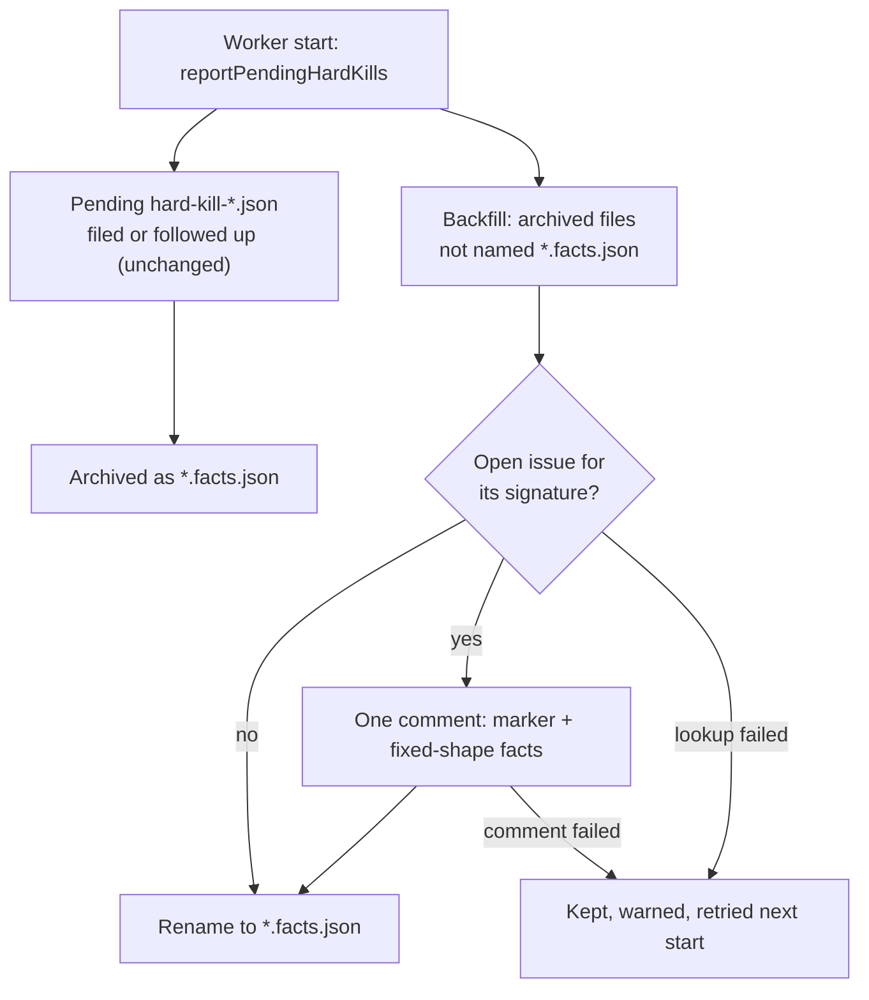

# PR Summary — Issue #4815

## Summary

The completion wedge of run `vibe-mw2hlf2s-1125d1` (GRQ-3, 4 November) cannot be
diagnosed from any host other than GRQ-3. It was filed before the public **Last
step logged**, **Silent before capture** and guest-probe lines existed, and its
evidence is only in `~/logs/hard-kill-archive/` there. This change gets those
redacted facts to the automated diagnostic path. On every hard-kill reporting
pass, the worker posts one comment on the open issue for each archived evidence
file whose facts were never posted. The comment carries the same fixed-shape
facts the issue body uses, and the file is then renamed to `*.facts.json`. Newly
reported files are archived under that name, because their filing already posted
the facts. Once GRQ-3's worker restarts, #4815 gets the host's own last step,
silence, guest probe, memory and pressure for the kill. The cause of the wedge
is not diagnosed or repaired here. Part of #4815.

## Spec

### Intent and Rationale

- The audit of 8 November asks that the redacted cause and last-step evidence
  reach the automated diagnostic path, with the private boundary kept. The
  archive outlives the kill by 30 days (the transcript retention), so the facts
  are still on GRQ-3 for `vibe-mw2hlf2s-1125d1`. Only that host can read them,
  so the host that filed the kill publishes them.
- No completion recurrence has been filed since 4 November, so no newer evidence
  exists. The coding standards forbid a speculative fix for an unreproduced
  fault, so this change only publishes evidence and changes nothing a run does.

### Essential Design Decisions

- Only the fixed-shape facts are published, never log text. `hardKillFactLines`
  is taken out of `formatHardKillBody` and used by both the body and the new
  comment, so the two cannot drift. The body is byte-identical to before.
- The "posted" record is the archived file's own name (`*.facts.json`), not
  GitHub state. That name still matches `HARD_KILL_FILE_PATTERN`, so retention
  pruning applies to it unchanged, and no comment search runs on later starts.
- A file whose signature has no verified open issue is kept for a later start. A failed lookup, a failed comment or a malformed
  file keeps the file as it is, logs a warning with the cause, and is retried on
  the next start. The backfill never throws out of `reportPendingHardKills`,
  fires no callback and counts nothing.
- Files archived by an older worker after the fields were published also get one
  comment, because nothing on disk tells them apart. The comment's wording says
  it was "added once … even when it was filed before these fields were
  published", which is true in both cases.

### Undiscoverable Facts

- The earlier analysis is in PR #4819's summary and PR #4760. All three
  completion kills (`vibe-mvzlnl5o-40feb4`, `vibe-mw011ned-c6f0d4`,
  `vibe-mw2hlf2s-1125d1`) were GRQ-AutoTrader runs on GRQ-3. The worker log
  stayed silent for 61 minutes (run 3) and 90 minutes (run 1) before capture,
  while every phase logs a heartbeat every 60 s
  (`worker/deno/lib/phase_progress.ts`, `lib/issue_worker.ts` `runPhase`). So no
  timer in the worker was firing. Either the guest froze or the worker's event
  loop was blocked. The archived guest probe tells these apart, and it is the
  fact this change publishes.
- The private logs repository (`stSoftwareAU/GRQ-VibeCoder-logs`) holds only the
  agent session and callback metadata for these runs. It has no worker log tail
  or guest probe.
- Since the kill: #5095 retired the mutation check (the step after the verifier
  in all three runs), #5105 fixed rootfs growth from agent-owned cargo target
  directories, and #5266 reaps a silent guest that stops answering after 15
  minutes. Whether any of these is the cause cannot be checked without the
  archived probe.

## Evidence

Backend change, no UI files. Tests under `worker/deno/tests/`:

- `hard_kill_facts_backfill_4815_test.ts` uses real temporary directories and a
  fake `gh` that answers the open-issue search by its input. The cases:
  - An archived completion kill gets one comment with its run-id marker,
    `**Phase:** \`completion\``, the last step and the guest probe. The file
    becomes`*.facts.json`. A second pass posts nothing. A private token in the
    log tail never reaches a`gh`
    argument.
  - An empty search and unresolved fleet authors both keep the file. Once the
    issue can be verified, the next pass posts the facts.
  - A failed comment keeps the file name and warns with the cause; the next pass
    posts it.
  - A failed issue lookup (the `gh issue list` search rejects) keeps the file
    name, posts no comment and warns with the gh error's first line; once the
    lookup succeeds, the next pass posts the comment and renames the file.
  - A malformed archived file is left byte-for-byte as it was, with a warning.
  - A newly reported file is archived as `*.facts.json`. Its newly filed issue
    receives an older file’s facts even when search still returns no rows.
  - The backfill runs through `reportPendingHardKills` and logs its count line.
  - A symlinked archive directory is refused.

## Reproduction

- **symptom** — the launcher watchdog reaped a container wedged in the
  completion phase of a GRQ-AutoTrader run on GRQ-3, after 61 minutes of worker
  log silence
- **status** — `not-run` — reason: the wedge's evidence is only in GRQ-3's
  private archive, and no recurrence has been filed since 4 November, so the
  freeze could not be replayed. The new test covers the diagnostic gap (no facts
  reach the open issue), not the wedge itself.
- **regression test** —
  `worker/deno/tests/hard_kill_facts_backfill_4815_test.ts::backfill posts one facts comment for an archived pre-change file, then never again`

## Acceptance Criteria

<!-- vibe-spec-review inputs="diff+issue-body" -->

- **missing** — "use a bounded replay or the next applicable recurrence to
  diagnose and repair the completion failure" — reviewer: missing — reason: no
  recurrence has been filed since 4 November (a search for
  `hard-kill-watchdog-completion` issues created after it returns none), and the
  evidence is only on GRQ-3, so there is nothing to replay. The diff publishes
  that evidence for the next run, but does not diagnose or repair the wedge.
- **missing** — "Complete the issue through an implemented fix and automated
  regression/recovery evidence" — reviewer: missing — reason: no fix to the
  wedge is made, because a speculative fix for an unreproduced fault is not
  allowed. The tests cover the backfill, not recovery from the wedge.
- **partial** — "make the necessary redacted cause/last-step evidence available
  to the automated diagnostic path" — evidence:
  `worker/deno/lib/hard_kill_facts_backfill.ts`,
  `tests/hard_kill_facts_backfill_4815_test.ts::backfill posts one facts comment for an archived pre-change file, then never again`
  — reviewer: partial — reason: the fixed-shape facts reach the open issue as a
  comment, but only once GRQ-3's worker restarts, and the reviewer did not check
  that the diagnostic path reads that comment.
- **met** — "preserve the existing private diagnostic boundary … Do not publish
  raw private repository logs here" — evidence:
  `tests/hard_kill_facts_backfill_4815_test.ts::backfill posts one facts comment for an archived pre-change file, then never again`
  (asserts that no `gh` argument carries the log tail's token) — reviewer: met
- **unrequested** — `docs/audits/lib-sweep-coverage/top-up-4815.json`, the
  `*.facts.json` archive name and the new exports `factsPostedName` and
  `HARD_KILL_ARCHIVE_SENTENCE` — reviewer: unrequested — reason: support for the
  backfill (the coverage ledger claims the new module, and the name records that
  a file's facts were posted).

## Standards Review

<!-- vibe-standards-review inputs="diff+CODING-STANDARDS.md" -->

- **violation** — readable comments — evidence:
  `worker/deno/lib/hard_kill_facts_backfill.ts:7` — reason: not fixed in this
  diff. The header paragraph repeats itself and one line runs past the wrap
  width.
- **violation** — KISS/DRY (low) — evidence:
  `worker/deno/lib/hard_kill_facts_backfill.ts:36`,
  `worker/deno/lib/hard_kill_report.ts:70` — reason: not fixed in this diff. The
  two modules import each other. This works because each import is used only
  inside functions.
- **violation** — KISS/DRY (low) — evidence:
  `worker/deno/lib/hard_kill_facts_backfill.ts:74` — reason: not fixed in this
  diff. The plain-directory check and the rename repeat the archive handling in
  `defaultHardKillSeams`.
- **clean** — Australian English, behaviour tests (8 pass, including the
  failed-lookup retry), security (facts only, no log text, a symlinked archive
  is refused), docs (`docs/CALLBACKS.md` and the coverage ledger), and Deno and
  TypeScript conventions.

## Test Plan

- **Added** `worker/deno/tests/hard_kill_facts_backfill_4815_test.ts` (8 tests,
  listed under Evidence). On the base branch they fail, because the module does
  not exist and the archive name is unchanged.
- **Red-checked** the failed-lookup test: with the lookup's catch changed to
  fall through as `issue = null`, it fails (7 passed, 1 failed), because the
  file is renamed to `*.facts.json` with no comment. With the head's code
  restored it passes (8 passed, 0 failed).
- **Unchanged and re-run** `worker/deno/tests/hard_kill_report_test.ts`. Its
  fake filesystem records archived names, so the suffix is visible only through
  the default seam, which the new test covers. No assertion was removed.
- **Added** `docs/audits/lib-sweep-coverage/top-up-4815.json` to claim the new
  module, which `tests/lib_sweep_coverage_test.ts` requires.
- **Ran**
  `deno test -A tests/hard_kill_facts_backfill_4815_test.ts
  tests/hard_kill_report_test.ts tests/hard_kill_guest_facts_test.ts
  tests/hard_kill_evidence_test.ts tests/run_core_production_deps_hard_kill_test.ts
  tests/run_core_hard_kill_test.ts tests/lib_sweep_coverage_test.ts`
  from `worker/deno` after adding the failed-lookup test: 185 passed, 0 failed.
  `deno task check:manifests` passed (876 passed, 0 failed).
- **Ran** `./quality.sh < /dev/null`. Every stage passed except `deno tests`,
  where one test failed, `tests/pr_summary_ci_workflow_3768_test.ts`, because
  this host has no DNS (`Failed caching npm package 'minimist@1.2.8'`). After I
  seeded the host's Deno npm cache from the worker cache (not a repository
  change), that test passed (11 passed). I then re-ran
  `./quality.sh <
  /dev/null` on the head. Result:
  `PASSED (with skipped checks)`, with both the parallel and the serial Deno
  test passes green. The gate itself skipped `config integration` and `checkov`.
- **Docs:** `docs/CALLBACKS.md`, section "A hard-killed run". The Lifecycle
  bullet now names the archived `*.facts.json` file, and a new **Facts backfill
  (Issue #4815)** bullet describes the backfill. `deno fmt` re-wrapped the
  nearby prose there without changing its wording. I grepped `docs/` (outside
  `docs/archive/`) and `README.md` for `hard-kill-archive` and the evidence file
  name. Every other hit names the pending file or only the directory, and stays
  true.

## Not done or not checked

- The wedge's cause and its repair are not done (see Acceptance Criteria).
- The issue also says a missing evidence file, repeated deferral or exhausted
  retries must not turn the issue into `needs-human`. The spec reviewer found
  nothing in the diff that touches that logic, so this PR neither changes nor
  proves it.
- `hard_kill_report.ts` and `hard_kill_facts_backfill.ts` import each other.
  This works, because each uses the other's exports only inside functions.
- When the pending evidence directory cannot be listed, `reportPendingHardKills`
  returns early and the backfill does not run on that pass.
