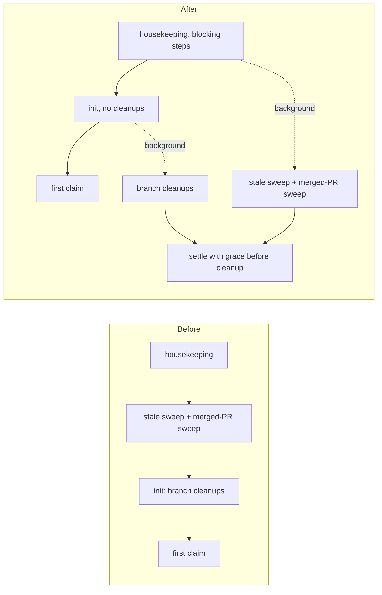

## Summary

The GitHub-touching startup sweeps no longer run before the first claim. `branch-cleanup-stale` and `merged-pr-issue-sweep` (housekeeping) and the stale and merged branch cleanups in `runInitialisation` now start in the background alongside the main loop, and the run gives them a bounded grace when the loop ends. The stale-branch sweep also answers its merged-PR lookups from one batched, cached query instead of one `gh pr list` per branch. The sweep logic and its safety checks are unchanged. Closes #4822.

Version bump: `VERSION` is not changed by this PR.

## Spec

### Intent and Rationale

- On GRQ-23 about 26 minutes of a run went on sweeps that deleted nothing before the first claim. The cheapest fix that leaves every sweep and its safety checks as they are is to stop awaiting them before the loop.
- The batching change covers the remaining per-branch quota cost the issue names. `cleanupStaleRemoteBranches` already prefetched merged PRs in one query when given a cache; the `cleanup-stale` command never passed one.

### Essential Design Decisions

- A shared helper, `worker/deno/lib/deferred_startup_sweep.ts`, starts a sweep without awaiting it (a failure is logged, never thrown) and settles it with a grace (`DEFERRED_SWEEP_GRACE_MS`, 120 s). A sweep still running at the grace is abandoned, not killed; its processed-set and cache progress persist and the next run resumes it. The trade-off is up to 120 s of extra exit time on a run whose sweep outlives its loop.
- `runStartupHousekeeping` gains a `scope` (`all` default, `blocking`, `deferred`). The deferred pass skips the CLI-state sweep and the decision-store setup, because by then agents are running and the sweep would delete their live registries.
- The housekeeping sweeps and the run-core cleanups can now run at the same time as each other and as the scan. Each stale-branch deletion still runs the per-branch open-PR and stacked-child safety check first; that check is unchanged.
- The `cleanup-stale` merged-PR lookups use the durable on-volume `IssueCache` (`<workDir>/.gh-scan-cache`, TTL 600 s), the same cache `run_core_production_deps.ts` builds. The per-branch open-PR and base-branch safety check still runs once per branch.

### Undiscoverable Facts

- None.

## Evidence

Backend-only change; there is no UI. Production callers of `runStartupHousekeeping`: `worker/deno/lib/run_worker.ts` (now `blocking` then `deferred`) and `worker/deno/commands/run_housekeeping.ts` (no scope, so `all`, unchanged). Callers of `cleanupStaleRemoteBranches` through the command: `worker/deno/commands/branch_cleanup.ts` only.

## Test Plan

- `worker/deno/tests/deferred_startup_sweep_test.ts`: the helper starts without awaiting, logs a rejecting or throwing sweep, settles, abandons a sweep at the grace through a fake timer, and starts no timer for no sweeps.
- `worker/deno/tests/run_housekeeping_test.ts`: `blocking` runs every step but the deferred ones in order, `deferred` runs only those and repeats neither the decision-store setup nor the CLI-state sweep, the two scopes cover every step once, the default scope is unchanged, and a failing deferred step is recorded not thrown.
- `worker/deno/tests/run_worker_test.ts`: call order is housekeeping, deferred start, main loop, deferred finished, cleanup (the issue's ordering test); a rejecting sweep leaves the outcome and cleanup unchanged; a never-finishing sweep is abandoned and logged.
- `worker/deno/tests/run_core_deferred_branch_cleanup_test.ts`: the loop reaches its first issue scan while the merged cleanup is still blocked and the result resolves only after it finishes; stale runs before merged; a failing cleanup is logged and does not stop the other; an abandoned cleanup is logged.
- `worker/deno/tests/branch_cleanup_command_stale_batch_test.ts`: one batched merged-PR query for two branches, a second run answered from the cache with no query, an open-PR head and a stacked child still not deleted, and the per-branch fallback still deletes a branch missing from the batch.
- Red checks (change broken on purpose, then restored): awaiting the deferred sweep before the main loop turns the `run_worker_test.ts` ordering and never-finishing tests red; dropping the settle in `finally` turns the `run_worker_test.ts` ordering and abandoned-sweep tests red; including the deferred ids in the `blocking` scope turns the scope tests red; restoring `await deps.cleanupMergedBranches()` in `runInitialisation` turns the first-scan test and the never-finishing test red; dropping the settle in `runCoreLoop`'s `finally` turns the result-after-cleanup and abandoned-log tests red; removing the `cache` option from `executeCleanupStale` turns the batched test and the fallback test red (through the deletion count, since the fake has no per-branch answers for the uncached path).
- No existing test was edited or had an assertion removed; 43 existing suites that mention the cleanups pass unchanged.
- `./quality.sh < /dev/null` on the final head: passed (config integration, semgrep, checkov and release-tag ruleset skipped: no network or tool in the sandbox).
- Not done: a Standards and Spec reviewer pass was not dispatched (the issue states no `## Acceptance Criteria` heading). No test reproduces the 25-minute wall-clock figure; the ordering tests prove the first claim no longer waits on the sweeps.
- Docs: `docs/INTERNALS.md` (startup housekeeping step) and `docs/workflows/resilience-and-concurrency.md` (run-entrypoint driver step) updated; `worker/README.md` lines 16 and 23 read and still true. Added `docs/audits/lib-sweep-coverage/top-up-4822.json` for the new module.
