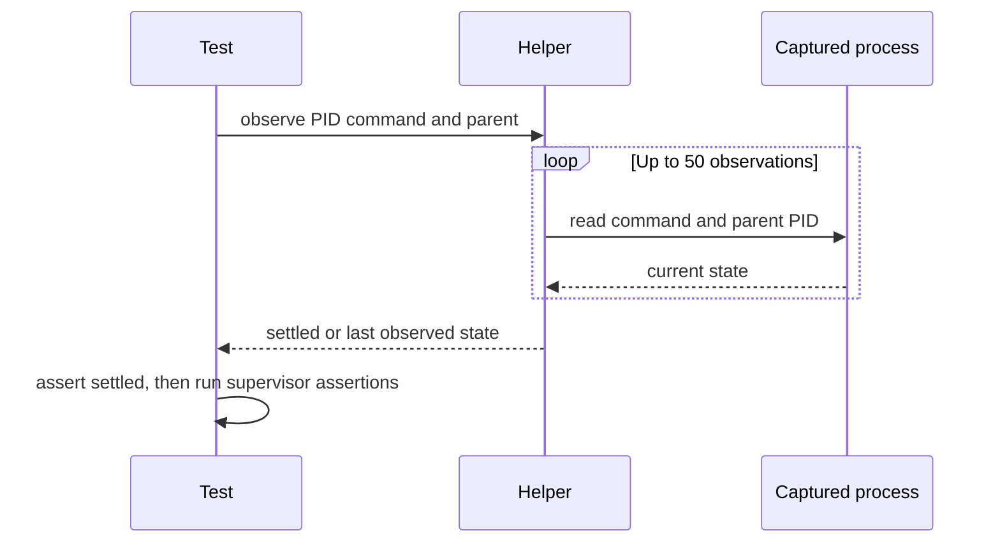

## Summary

Extracted the registered-orphan setup's existing PID settlement loop into a bounded test-support helper and added deterministic tests for late appearance, absence, command mismatch and parent mismatch. The test still asserts that the unrelated orphan survives and that no reaping message is logged; `loop.sh` is unchanged. Closes #4825.

Version bump: none; this change does not update version metadata.

## Spec

### Intent and Rationale

- The branch already tracked the spawned PID and polled its command and parent. Extracting that wait makes each readiness condition directly testable without restoring a process-name lookup.

### Essential Design Decisions

- The helper makes at most 50 observations at 100 ms intervals, waits for the exact command `sleep 300` and parent PID 1, and returns the last observed state on timeout for the integration test's assertion message.
- Observation and sleep are injected so helper tests are deterministic and do not wait on the system clock.

### Undiscoverable Facts

- The base branch did not match the issue's described one-shot `pgrep` setup: it already captured the PID and polled up to 100 times. The original intermittent CI race remains unconfirmed; no production defect was observed.

## Evidence

Backend/test-only change. No production behaviour or `loop.sh` changed. The existing `assert(await isRunning(pid), "unrelated orphan must survive")` and no-reaping-log assertion remain in `worker/deno/tests/loop_supervisor_test.ts`.

Independent spec and standards reviewers were not dispatched because the run instructions explicitly prohibited delegation; no reviewer verdict is claimed.

## Acceptance Criteria

- **met** — The setup no longer depends on the orphan being visible immediately. A test of the wait helper covers a process that appears late and one that never appears. — evidence: `worker/deno/tests/process_settlement_test.ts::waitForSettledOrphan waits for a late adopted process`, `worker/deno/tests/process_settlement_test.ts::waitForSettledOrphan reports when the process never appears` — reviewer: missing — reason: independent review was not run because delegation was prohibited; these tests passed on the final head.
- **met** — If investigation shows the cause is something else, such as `loop.sh` or the runner, fix that instead and say so on the PR. — evidence: base-branch test setup inspected; no production defect was observed, `loop.sh` is unchanged, and the original intermittent failure remains unconfirmed — reviewer: missing — reason: independent review was not run because delegation was prohibited; no alternative cause was found.

## Standards Review

- **not run** — Independent standards review was not performed because the run instructions prohibited delegation. No independent clean verdict is claimed.

## Test Plan

- `worker/deno/tests/process_settlement_test.ts`: four injected-observation tests passed through `deno task test:unit tests/process_settlement_test.ts`.
- `worker/deno/tests/loop_supervisor_test.ts::loop.sh #4568 - a registered orphan with a different command survives`: passed via direct filtered `deno test`; the unrelated orphan and no-reaping assertions remain.
- Readiness mutation checks each went red: bypassing the command comparison failed the wrong-command test; bypassing the PID-1 comparison failed the wrong-parent test; returning success when no process appeared failed the never-appears test. Mutations were restored.
- Targeted `deno fmt --check`, `deno lint` and `deno check` passed for the changed TypeScript files.
- `./quality.sh < /dev/null`: passed, including all Deno tests, lint, type check and formatting. Config integration and Checkov were skipped: `.config.json` was unavailable and Checkov was not installed.
- `deno task pr-summary-check --base main --issue-body-file /tmp/issue-4825-body.md --labels work-on ../../docs/archive/pr-summaries/pr-summary-4825.md`: passed with 0 blocked and 0 not-checked gates. Markdownlint and Mermaid checks after adding this summary also passed.
- No assertions protecting orphan survival, absence of a reaping log, or cleanup were removed.
