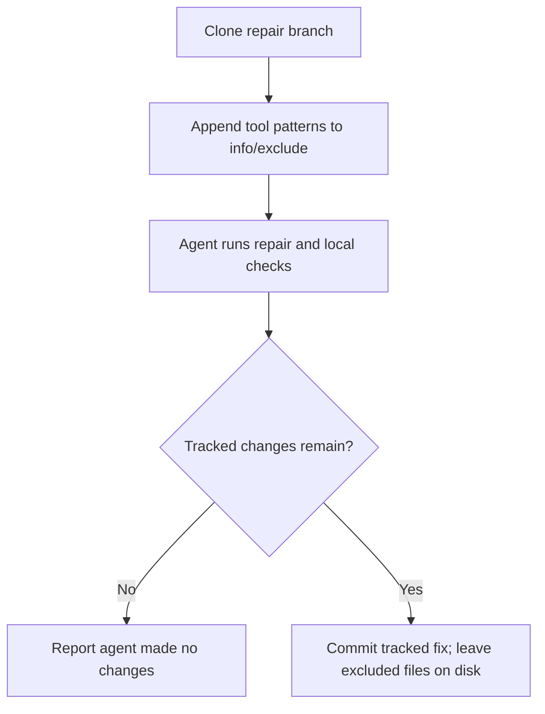

## Summary

The babysitter repair clone now excludes the five coverage and mutation output
patterns in its local `info/exclude`. Tracked fixes are still committed, while
untracked byproducts stay on disk and do not trigger an empty repair commit.
Closes #4827.

Version bump: `VERSION` is not touched by this change.

## Spec

### Intent and Rationale

- The babysitter stages all changes with `git add -A`; excluding known tool
  output makes its existing status and staging flow distinguish real edits from
  local coverage and mutation artifacts.

### Essential Design Decisions

- Use the clone's `info/exclude`, not the repository's `.gitignore`, so no
  tracked repository configuration changes and existing tracked outputs remain
  editable.
- Resolve the exclude path through `git rev-parse --git-path info/exclude`;
  preparation fails loudly if git or filesystem access cannot prepare it.
- Preserve existing exclude content and append only missing patterns.

### Undiscoverable Facts

- None.

## Evidence

Backend/CLI change; no UI. The repair flow now prepares the local exclude file
before the agent runs; its existing status check and staging command then ignore
those untracked paths.

## Test Plan

- `worker/deno/tests/fleet_pr_babysitter_test.ts`: real temporary git
  repositories verify all five output types stay on disk and out of a fix
  commit; byproducts alone produce "agent made no changes" without calling
  `validateAndCommit`; a tracked `lcov.info` edit is committed; repeated
  preparation preserves existing exclude lines; unresolved git output and
  filesystem errors fail loudly.
- Regression wiring check: removing only the `cloneForRepair` preparation call
  made the tracked-fix and byproducts-only tests fail (118 passed, 2 failed).
- `deno task test:unit tests/fleet_pr_babysitter_test.ts tests/fleet_pr_babysitter_single_push_test.ts tests/fleet_babysitter_app_test.ts`
  — 152 passed, 0 failed (after merging the latest `origin/main`).
- `deno task test:unit tests/completion_phase_repo_formatters_test.ts` — 8
  passed, 0 failed; the earlier checkpoint's cargo-fmt failures did not
  reproduce.
- `deno lint`, `deno check` on the changed TypeScript files, `deno fmt --check`
  on the changed TypeScript and manual, and `deno task check:manifests` —
  passed; manifest check ran 847 tests (0 failed, 1 ignored).
- `./quality.sh < /dev/null` — failed in the Deno test stage on
  `tests/merge_fallback_issue_test.ts::createFallbackFlagFiler - routes the label creation through the caller's gh (Issue #2310)`:
  expected the label creation through the injected `gh`, but observed
  `gh issue create`. The same test fails on clean `origin/main` (28 passed, 1
  failed), so it is a pre-existing base-branch failure; this change does not
  touch that code or test. Quality-gate config integration and Checkov were
  skipped by the gate because their local prerequisites were unavailable.
- Documentation: `docs/workflows/fleet-pr-babysitter.md`, repair-clone section
  updated. No existing test assertions were removed.

### Deno regression avoided

- Kept implementation and validation Deno-native; added no Node tooling or
  dependencies.
