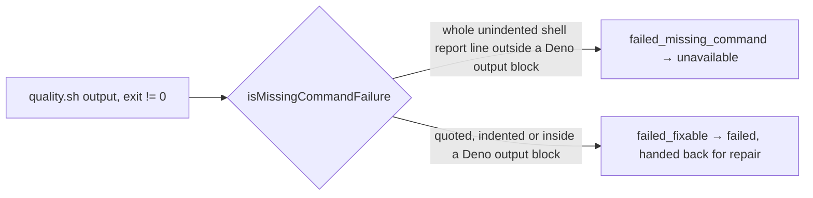

## Summary

`isMissingCommandFailure` now treats a gate run as a missing command only when
the output holds a shell's own missing-command report, so a failing gate whose
output merely quotes `command not found` is a `failed` verdict again, not
`unavailable`. Closes #4829.

Version bump: `VERSION` is not touched by this change.

## Spec

### Intent and Rationale

- The old check was `output.includes("command not found")` over the whole
  output, applied to every non-zero exit. A passing test that prints the text
  (Deno shows it inside `------- output -------` … `----- output end -----`)
  hid a real failure behind an infrastructure deferral.

### Essential Design Decisions

- Line-anchored match, not an exit-code-127 requirement: `npm run` and similar
  wrappers turn a missing tool into exit 1 while still printing the shell's
  `sh: eslint: command not found`, so requiring 127 would regress that case.
- The regex `^(?:[^\s:]+: (?:line \d+: )?)?[^\s:]+: command not found$` is linear
  (each run stops at `:` or a space). The bare `eslint: command not found` form
  still matches, so the existing test is unchanged.
- An unclosed Deno output block stays skipped (fail towards `failed`, which is
  handed back for repair rather than deferred).
- `QUOTED_TEXT_LINE` in `publication_validation.ts` is not reused: the anchored
  whole-line pattern already rejects every line it covers, and importing it
  would add a module cycle with `quality_gate_phase.ts`.

### Undiscoverable Facts

- Observed with the real tool: a Deno test that `console.log`s
  `foo: command not found` prints it between `------- output -------` and
  `----- output end -----`, on its own line, so line anchoring alone cannot
  tell it from a shell report.

## Evidence

Backend-only change, no UI. The shared classifier `isMissingCommandFailure`
(`worker/deno/lib/quality_gate_phase.ts`) feeds `runQualityGateCheck`, whose
`failed_missing_command` action `classify` in
`worker/deno/lib/publication_validation.ts` maps to `unavailable`. Callers of
`isMissingCommandFailure`: only `runQualityGateCheck` (and its tests).

## Acceptance Criteria

The issue states no acceptance-criteria heading and nothing it asks is left
undone, so no block is needed.

## Test Plan

- `worker/deno/tests/quality_gate_phase_test.ts`: new `isMissingCommandFailure`
  tests (shell reports with and without `line N:`, among other output; rejects
  an indented quote, `12 | …`, `error: Error: …`, trailing prose, a passing test
  line, a Deno output block, an unclosed block; a real report after a block; a
  200000-character hostile line returns false).
- `worker/deno/tests/publication_validation_test.ts`: `the real quality gate: a
  failing gate whose output quotes "command not found" is a failed verdict, not
  unavailable (Issue #4829)` — step one is the quoting gate (`failed`, output
  names `other test ... FAILED`); step two is the positive control, a gate that
  really lacks the tool (`unavailable`, `failed_missing_command`).
- Red check: with `isMissingCommandFailure` reverted to `output.includes(...)`,
  the real-gate test's first step and six `isMissingCommandFailure` tests (indented,
  numbered, prefixed, trailing prose, Deno block, unclosed block) went red; the
  true-case tests and the positive control stay green by design.
- Edited existing test: `runQualityGateCheck - passes baseline context to failure
  message` fed the bare output `command not found`, which is not a shell report;
  its fixture is now `foo: command not found` and no assertion was removed.
  Without the fixture change the run takes `failed_fixable` and the test goes
  red, so it still guards the `failed_missing_command` path.
- `deno task test:unit` on both files: 113 passed, 0 failed. `deno fmt`,
  `deno lint`, `deno check` on the three changed files: clean.
- `./quality.sh < /dev/null`: every stage passed except `deno tests`, whose only
  2 failures are `worker/deno/tests/completion_phase_repo_formatters_test.ts`
  lines 480 and 567 (a Rust formatter case this change does not touch; it also
  failed on #4741's run; not compared against `main`).
- No twinned rule found; other `command not found` matchers
  (`failure_diagnosis.ts`, `babysitter_retry_state.ts`, `software_updates.ts`)
  classify other text and are out of this issue's scope.

Not checked: other classifiers that match the substring (listed above) were not
changed or audited for the same weakness.
