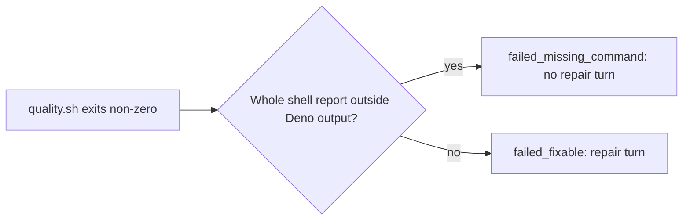

## Summary

Recognise shell missing-command reports outside Deno's captured test output, so
quoted test output does not defer an unrelated quality failure. Closes #4829.

Version bump: none; `VERSION` is unchanged.

## Spec

### Intent and Rationale

The previous substring check treated test output as host failure evidence. The
matcher recognises whole shell-shaped lines and skips captured Deno output.

### Essential Design Decisions

- Do not require exit code 127: a wrapper can preserve Bash's report but exit 1.
- Separate non-empty stdout and stderr when stdout lacks a final newline, so a
  shell report on stderr remains a whole line.
- Strip ANSI colour before matching reports and ordinary, pre-test and post-test
  output boundaries. Recognise an end marker appended to a test name or output
  without a newline, using a linear search and an anchored marker match.
- An unclosed output block stays ignored. `pr_ci_processor.ts` starts a repair
  turn for `failed_fixable`; missing commands return `failed_missing_command`.

### Undiscoverable Facts

- Bash prints `bash: line 1: vibe-no-such-command-4829: command not found` and
  exits 127; a wrapper can retain that report while exiting 1.
- Deno colours output markers on the gate's pipe. Module output uses pre-test
  markers, and parallel output or output without a final newline can put an end
  marker after other text on the same line.

## Evidence

Backend-only change; no UI. `runQualityGateCheck` classifies the output and
`worker/deno/commands/quality_gate_phase.ts` exposes the result to callers.

## Test Plan

- `worker/deno/tests/quality_gate_phase_test.ts::runQualityGateCheck - preserves stderr after unterminated stdout`
  runs a subprocess with unterminated stdout and a shell report on stderr. It
  failed before the stream separator and classifies the report as missing after
  it.
- `worker/deno/tests/quality_gate_phase_test.ts::isMissingCommandFailure - detects reports after inline Deno end markers`
  and
  `worker/deno/tests/quality_gate_phase_test.ts::runQualityGateCheck - detects missing commands after inline Deno end markers`
  cover coloured parallel output and output without a final newline followed by
  a real shell report. Both failed before the review fix and pass after it.
- `worker/deno/tests/quality_gate_phase_test.ts::runQualityGateCheck - coloured Deno output remains fixable`
  covers coloured ordinary and pre-test blocks; matcher tests also cover
  post-test blocks, shell reports, lookalikes and long malformed lines.
- The old bare `command not found` baseline fixture is obsolete because a
  fragment alone is no longer a shell report. Whole shell reports remain covered
  by
  `worker/deno/tests/quality_gate_phase_test.ts::isMissingCommandFailure - detects a bare shell report`,
  and the baseline context test still covers the failure message.
- No twinned matcher or gate rule was found; other missing-command checks
  classify different failure text.
- `deno task test:unit tests/quality_gate_phase_test.ts` passed 75 tests;
  `deno fmt --check`, `deno lint`, `deno task check` and
  `deno task check:manifests` passed (848 passed, 1 ignored).
