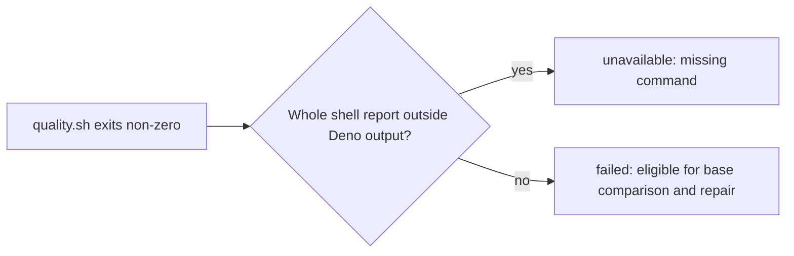

## Summary

`isMissingCommandFailure` now recognises a whole shell missing-command report
outside Deno's captured test-output block. A passing test that prints the same
text no longer turns an unrelated failing gate into an infrastructure deferral.
Closes #4829.

Version bump: none; `VERSION` is unchanged by this change.

## Spec

### Intent and Rationale

- The substring check treated test output as host failure evidence. The matcher
  now recognises shell-shaped lines and skips Deno's captured test output.

### Essential Design Decisions

- Do not require exit code 127: a wrapper can preserve Bash's real missing-command
  report but exit 1.
- An unclosed Deno output block stays ignored so malformed captured output is
  classified as a content failure, not an infrastructure deferral.
- `QUOTED_TEXT_LINE` in `publication_validation.ts` is not reused. The
  whole-line matcher already rejects quoted and indented reports, and importing
  that helper would create a module cycle.

### Undiscoverable Facts

- Real Bash printed `bash: line 1: vibe-no-such-command-4829: command not found`
  and exited 127. A wrapper that then exits 1 kept the same Bash report.
- Real Deno output placed a test's `foo: command not found` between
  `------- output -------` and `----- output end -----`, followed by the failed
  test line.

## Evidence

Backend-only change; no UI. `runQualityGateCheck` calls the updated matcher,
`publication_validation.ts` maps `failed_missing_command` to `unavailable`, and
its `failed_fixable` result remains eligible for base comparison. The completion
phase's existing failed-verdict path passes the failure to a repair turn.

## Test Plan

- `worker/deno/tests/quality_gate_phase_test.ts` exercises bare Bash and
  script-with-line-number reports, reports among other lines, quoted/indented
  lookalikes, Deno output boundaries, unclosed and malformed blocks, a report
  after a block, and 200,000-character hostile lines for each matcher regex.
  Disabling the shell-report regex made 7 tests fail; disabling the Deno start
  regex made the captured-block tests fail; disabling the Deno end regex made
  both the post-block report tests fail.
- `worker/deno/tests/publication_validation_test.ts` runs a failing shell gate
  containing Deno-style captured test output and expects `failed`. A genuine
  Bash report remains `unavailable` both at exit 127 and when a wrapper exits 1.
  A feature-branch case asserts that the head and base gates both run and that a
  new failure stays `failed` when the base gate passes.
- `worker/deno/tests/completion_phase_publication_validation_4625_test.ts`
  drives the real completion phase with the quoted-output failure and asserts
  that it reaches the repair turn and then publishes after a passing recheck.
- Base-production red check: restoring `quality_gate_phase.ts` from
  `origin/main` while keeping these tests produced 9 failures, including the
  quoted-output verdict and the matcher lookalikes. Restoring the branch code
  returned the three-file suite to green.
- `deno task test:unit tests/quality_gate_phase_test.ts tests/publication_validation_test.ts tests/completion_phase_publication_validation_4625_test.ts`:
  136 passed, 0 failed.
- `deno fmt --check`, `deno lint` and `deno check` on the four changed TypeScript
  files passed.
- `deno task pr-summary-check --base origin/main` passed all applicable gates:
  0 blocked and 0 not checked.
- The two formatter tests previously recorded as failing were not reproduced:
  `deno task test:unit tests/completion_phase_repo_formatters_test.ts` passed
  with 8 tests on both this branch and a detached `origin/main` worktree. Their
  earlier cause remains undetermined.
- `./quality.sh < /dev/null` failed its Deno test-time budget: 83 unit tests
  exceeded one second, including every test in the unchanged
  `tests/fleet_pr_babysitter_validation_test.ts` and
  `tests/launcher_harness_reclaim_stub_test.ts`. The parallel and serial Deno
  test runs themselves passed; lint, type check and formatting passed. This
  full-gate budget failure was not compared against `origin/main`.
- No twinned matcher or gate rule was found. Other `command not found` checks
  classify different failure text and were not changed.

Not checked: whether the full-gate test-time budget failure also occurs on
`origin/main`; the recorded formatter failures were not reproducible, so their
cause is unknown.
