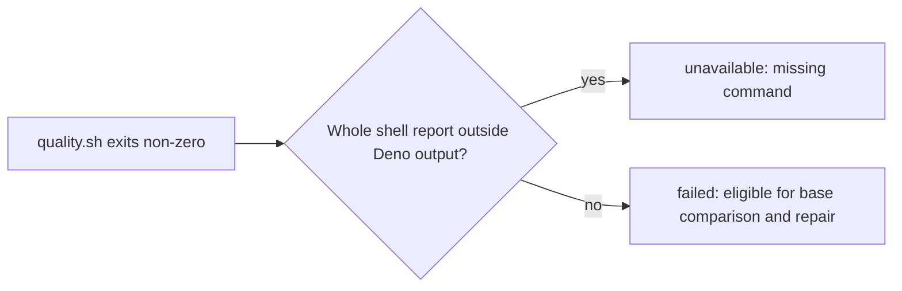

## Summary

`isMissingCommandFailure` now recognises a whole shell missing-command report
outside Deno's captured test-output block. A passing test that prints the same
text no longer turns an unrelated failing gate into an infrastructure deferral.
Closes #4829.

Version bump: none; `VERSION` is unchanged by this change.

## Spec

### Intent and Rationale

- The substring check treated test output as host failure evidence. The matcher
  now recognises shell-shaped lines and skips Deno's captured test output.

### Essential Design Decisions

- Do not require exit code 127: a wrapper can preserve Bash's real
  missing-command report but exit 1.
- An unclosed Deno output block stays ignored so malformed captured output is
  classified as a content failure, not an infrastructure deferral.
- Strip ANSI colour codes before matching shell reports and Deno's ordinary,
  pre-test and post-test output boundaries.

### Undiscoverable Facts

- Real Bash printed `bash: line 1: vibe-no-such-command-4829: command not found`
  and exited 127. A wrapper that then exits 1 kept the same Bash report.
- Real Deno output places a test's `foo: command not found` between output
  markers followed by the failed test line. On the gate's pipe the markers
  carry ANSI colour codes; module output uses pre-test markers.

## Evidence

Backend-only change; no UI. `runQualityGateCheck` calls the updated matcher.
`pr_ci_processor.ts` starts repair for `failed_fixable`, while
`worker/deno/commands/quality_gate_phase.ts` exposes the result to callers.

## Test Plan

- Review regression: `worker/deno/tests/quality_gate_phase_test.ts::runQualityGateCheck - coloured Deno output remains fixable`
  covers coloured ordinary and pre-test markers; the matcher test also covers
  post-test markers and reports after each block. Both new tests failed before
  the fix. The former bare `command not found` fixture is obsolete because a
  fragment is no longer a shell report; whole shell reports remain covered by
  `worker/deno/tests/quality_gate_phase_test.ts::isMissingCommandFailure - detects a bare shell report`
  and the baseline context test continues to cover its failure message.
- `worker/deno/tests/quality_gate_phase_test.ts` exercises bare Bash and
  script-with-line-number reports, reports among other lines, quoted/indented
  lookalikes, Deno output boundaries, unclosed and malformed blocks, a report
  after a block, and 200,000-character hostile lines for each matcher regex.
  Disabling the shell-report regex made 7 tests fail; disabling the Deno start
  regex made the captured-block tests fail; disabling the Deno end regex made
  both the post-block report tests fail.
- The same file drives `runQualityGateCheck` end to end with two tests. A
  non-zero run whose output holds a Deno output block quoting
  `foo: command not found` followed by a failed-tests line returns
  `failed_fixable` (not `failed_missing_command`) and its retry prompt carries
  the output. A genuine `bash: foo: command not found` line at exit 1 returns
  `failed_missing_command` with a failure message.
- Base-production red check: restoring `quality_gate_phase.ts` from
  `origin/main` while keeping `quality_gate_phase_test.ts` produced 7 failures
  (63 passed), including the quoted-output `runQualityGateCheck` test and the
  lookalike/Deno-block matcher tests. Restoring the branch code returned the
  file to green.
- After the review fix, `deno task test:unit tests/quality_gate_phase_test.ts`
  passed 72 tests; full-tree `deno fmt --check`, `deno lint` and
  `deno task check` passed.
- Pre-push recovery: `deno task check:manifests` passed (847 passed, 0 failed, 1
  ignored), `deno task check` passed, and the production `runSemgrepCheck`
  passed over four changed files with Semgrep 1.182.1. The reported JSR manifest
  fetch failure and 10-second Semgrep probe timeout did not recur; no source or
  gate-limit change was needed for these rechecks.
- `deno task pr-summary-check --base origin/main` passed all applicable gates: 0
  blocked and 0 not checked.
- The two formatter tests previously recorded as failing were not reproduced:
  `deno task test:unit tests/completion_phase_repo_formatters_test.ts` passed
  with 8 tests on both this branch and a detached `origin/main` worktree. Their
  earlier cause remains undetermined.
- The worker's pre-push gate reported JSR manifest-loading failures in
  completeness, type checking and tests, plus a Semgrep probe timeout. The
  recovery rechecks above did not reproduce those errors.
- Recovery `deno task test:unit < /dev/null`: the parallel pass reported 32,656
  passed, 0 failed and 5 ignored. The command exited 1 on its one-second
  unit-test budget, reporting every test in the unchanged
  `worker/deno/tests/fleet_pr_babysitter_validation_test.ts` and
  `worker/deno/tests/launcher_harness_reclaim_stub_test.ts` over budget. No
  timing threshold or test was changed.
- Mutation check: it failed to run because the baseline run of seven other test
  files (`fence_coverage_verifier_test.ts`,
  `quality_gate_credentials_4705_test.ts`, `quality_gate_phase_test.ts`,
  `repo_formatters_4113_test.ts`, `tool_output_treat_as_data_3046_test.ts`,
  `untrusted_command_env_test.ts`, `untrusted_gate_spawn_test.ts`) failed in the
  harness. It listed no unpinned mutation. Run directly,
  `quality_gate_phase_test.ts`, `untrusted_gate_spawn_test.ts`,
  `repo_formatters_4113_test.ts` and `fence_coverage_verifier_test.ts` pass
  together (115 passed, 0 failed), so the failure is environmental, not a test
  gap in the changed lines.
- No twinned matcher or gate rule was found. Other `command not found` checks
  classify different failure text and were not changed.

Not checked: the full gate after recovery, or whether the unit-test budget
failure also occurs on `origin/main`. The causes of the unreproduced JSR,
Semgrep probe and formatter failures remain unknown.
