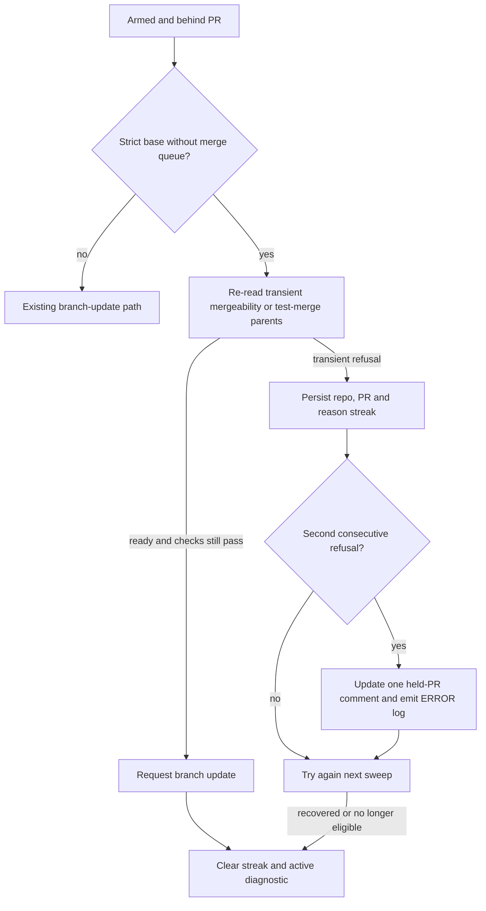

# Strict-base branch refresh retries and escalation

## Summary

Strict-base refreshes now re-read transient mergeability and stale test-merge
states within the same pass. Repeated same-reason refusals persist across sweeps
and produce one held-PR diagnostic comment plus an `ERROR` fleet-health log;
refresh attempts continue automatically. Closes #4831.

Version bump: No version change was made for this fix.

## Spec

### Intent and Rationale

- GitHub may report `UNKNOWN` mergeability or stale test-merge parents after a
  base move; bounded reads let an otherwise-ready PR recover without waiting for
  another hourly sweep, and a persisted streak makes repeated refusals visible.

### Essential Design Decisions

- Only strict-base, non-queue refreshes retry an otherwise-ready PR with
  `UNKNOWN`/`null` mergeability, a REST test merge still being computed
  (`mergeable: null` or no `merge_commit_sha`) or stale test-merge parents. The
  non-strict path is unchanged from the base: it sends the update at once with
  no mergeability check, so every other `requestReadyBranchUpdate` caller keeps
  its previous result there. Each retry path uses `retryWithBackoff` with four
  total reads and its normal 2/4/8-second delays plus jitter.
- Refusal streaks are keyed by repository, PR and stable transient reason in the
  versioned `.branch_refresh_refusals_v1` file. The second consecutive matching
  refusal raises the diagnostic; a reason change starts a new streak.
- Approval, required-check, target-SHA, merge-queue and strict-base ownership
  guards remain in the refresh path. Recovery, loss of eligibility and unrelated
  refusals clear the streak and any active diagnostic.

### Undiscoverable Facts

- The private-fleet merge-rate observation in #4831 is reporter evidence; this
  run reproduced the refusal with scripted GitHub responses, not against that
  private repository.

## Evidence

Backend-only change; no browser check applies. The scripted refresh tests cover
the same-pass read path, while sweep tests cover persistence, notification and
recovery.

- Operator documentation updated in `docs/MERGE.md` and
  `docs/workflows/pr-feedback.md` to describe same-pass retries and the
  diagnostic exception to conflict-only no-comment wording.
- Registered the new refusal-streak module in the lib-sweep coverage ledger at
  `docs/audits/lib-sweep-coverage/top-up-4831.json`.
- No `deno.lock` dependency changes; Deno-native tooling was used.

## Reproduction

- **symptom** — the reported
  `branch update failed: PR no longer ready for a
  branch update` and
  `branch update failed: required-check read failed: PR
  test merge parents do not match its head and base`
  refusals held an otherwise ready PR until a later sweep.
- **status** — `verified` — the scripted regression failed with the
  `origin/main` version of `required_branch_checks_4613.ts` and passed with the
  fix.
- **regression test** —
  `worker/deno/tests/required_branch_checks_4613_test.ts::ready updater checks the live head and sends its SHA`

## Test Plan

- `worker/deno/tests/required_branch_checks_4613_test.ts::ready updater checks the live head and sends its SHA`
  — covers `UNKNOWN` and `null` to ready, stale parents to matching parents,
  REST `mergeable: null` to ready and its four-read exhaustion (classified as a
  transient `mergeability-unknown` streak reason), four-read exhaustion,
  non-strict `null` still sending the update, changed targets, failed checks,
  review holds, merge queues and base ownership. It failed against `origin/main`
  at the stale-then-current success assertion; removing the `null` retry
  condition also made it fail.
- `worker/deno/tests/auto_merge_sweep_test.ts::repeated transient branch refresh refusals persist, notify once, and clear on recovery (Issue #4831)`
  — persists through a new sweep read, posts once at streak two, and clears on
  recovery. Removing the streak threshold, persisted read or recovery clear made
  the corresponding assertion fail.
- `worker/deno/tests/auto_merge_sweep_test.ts::a different or permanent refusal does not advance a transient streak (Issue #4831)`
  — checks reason changes, permanent refusals and eligibility loss.
- `worker/deno/tests/auto_merge_sweep_test.ts::branch-refresh escalation edits its trusted marker comment instead of duplicating it (Issue #4831)`
  — verifies trusted marker deduplication and recovery update; removing the
  deduplication branch made it fail.
- `worker/deno/tests/auto_merge_sweep_test.ts::a failed diagnostic comment still raises fleet health and retries the branch refresh (Issue #4831)`
  — a failed comment request still emits the health error and keeps retrying;
  removing the `logger.error` signal made it fail.
- `worker/deno/tests/auto_merge_sweep_keeps_armed_test.ts::production ensureAutoMerge persists and escalates a repeated transient refresh refusal (Issue #4831)`
  — verifies the production `ensureAutoMerge` wiring; removing its
  `branchRefreshRefusals` injection made the held-PR diagnostic assertion fail.
- Mutation check (`auto_merge_sweep.ts` `clearRefusal`): the recovery
  notification test now asserts `repo` and `prNumber` on the event, which kills
  the deleted-`repo` (line 230) and deleted-`prNumber` (line 231) mutants.
  `worker/deno/lib/auto_merge_sweep.ts:227` exempt (untestable): the
  `&& branchRefreshRefusals` operand only narrows the optional tracker for
  TypeScript; with no tracker the refusal state is an empty map, so
  `previous?.notified` is never true and the operand cannot change behaviour.
- The added or changed tests remove no existing assertions. Retry option
  siblings searched: `maxAttempts`, `initialDelayMs`, `sleepFn` and `onRetry`;
  the manuals do not enumerate that option set.
- Final targeted run:
  `deno task test:unit tests/required_branch_checks_4613_test.ts tests/auto_merge_sweep_test.ts tests/auto_merge_sweep_keeps_armed_test.ts tests/auto_merge_sweep_merge_queue_test.ts tests/retry_test.ts`
  — passed, 120 tests, 0 failed (re-run after the verifier fixes).
- `deno lint` on the eight changed TypeScript files — passed.
- `deno check --frozen --lock=deno.lock` on the changed production modules —
  passed.
- `deno fmt --check` on the eight changed TypeScript files — passed.
- `deno task check:manifests` — passed, 847 tests, 0 failed, 1 ignored.
- `./quality.sh < /dev/null` (final head) — every stage passed except
  `deno tests` (parallel pass: 32615 passed, 2 failed). The two failures are
  `tests/completion_phase_repo_formatters_test.ts` lines 480 and 567 ("formatter
  should commit the Rust fix"), a Rust-formatter fixture this change does not
  touch; the serial pass did not run because of them. Config integration and
  Checkov were skipped by the environment.

## Deno regression avoided

- Used Deno tasks and Deno's formatter, linter and type checker; added no Node
  tooling or dependency changes.
