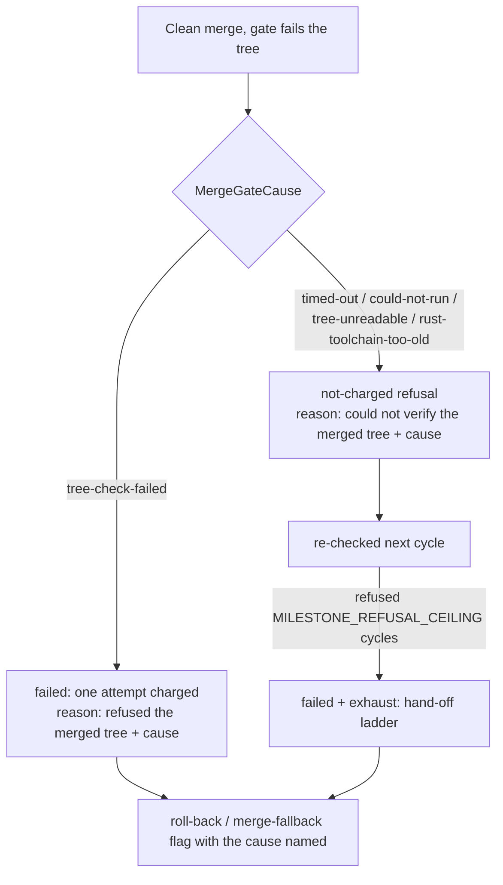

## Summary

The merge gate now records why it failed a merged tree, and a tree it could not
verify is no longer charged to the branch as a bad tree. A genuine check failure
is still charged. Version bump: not part of this change.

Closes #4847.

## Spec

### Intent and Rationale

- The `merge-fallback` record read only "the merge gate refused the merged tree"
  because the ledger reason was one constant, so a failing tree, a timed-out
  check and an unrunnable check were indistinguishable, and all three were
  charged and walked the milestone to the fallback rung.
- The cause is a fixed vocabulary carried on the gate outcome and the gate
  error, then into the ledger reason. This reuses the existing path (ledger
  reason, `mergeFallbackCause`) the public record is built from.
- Unverifiable causes reuse the existing bounded-refusal machinery
  (`refusal: true`, `escalateRepeatedRefusal`, `MILESTONE_REFUSAL_CEILING`)
  instead of a new retry counter.

### Essential Design Decisions

- Causes map to fixed phrases (`describeMergeGateCause`) with no path or tool
  output, so the public issue stays free of private detail.
  `mergeGateFailureCause` rejects any unknown value, so nothing forged reaches a
  ledger reason.
- A failure with no recorded cause keeps the bare
  `the merge gate refused the merged tree` reason and stays charged;
  `isMergeGateRefusedReason` matches both the bare reason (ledger entries
  written by older workers) and the cause-carrying one.
- A repeated unverified refusal goes to the hand-off rather than the roll-back
  rung (the escalated text is `refused N cycles in a row (…)`), the same path a
  repeated resolution refusal takes today.
- A non-cargo timeout is classed unverified. Cargo timeouts, registry gaps and
  remote-module gaps stay left to CI as before.

### Undiscoverable Facts

- The source repository is private and the run logs of the reporting hosts are
  not reachable from this run, so the real cause behind the filed incidents is
  not observed; the issue says the cause must not be assumed to match #4798.

## Evidence

Backend only; no UI file touched. Tests:
`worker/deno/tests/milestone_merge_gate_cause_test.ts` and
`worker/deno/tests/milestone_merge_gate_verdict_test.ts`. `./quality.sh` passed
on the code head (config integration, semgrep, checkov and the release-tag
ruleset were skipped by the gate itself).

## Reproduction

- **symptom** — merge-fallback issues titled "the merge gate refused the merged
  tree" with no cause, filed after milestone syncs failed the merged tree three
  times in a row
- **status** — `partial` — the classification and the charging decision are
  tested through the real `checkMergedTree`, `spawnTypeCheck` and
  `judgeSyncFailure`, but the actual host failure behind the reports was not
  observed
- **regression test** —
  `worker/deno/tests/milestone_merge_gate_verdict_test.ts::syncMilestoneBranches - an unverified merge check is not charged to the ledger and is re-checked (Issue #4847)`
- **reason** — the private repository's run logs are not available, so which
  cause occurred in the field is undiagnosed. Production behaviour changed only
  for the causes the code itself shows to be unavailable verification; the
  genuine-failure path is unchanged.

## Test Plan

- Added `worker/deno/tests/milestone_merge_gate_cause_test.ts` (12 tests): each
  cause from `checkMergedTree`, `spawnTypeCheck` unrunnable versus account
  refusal, `mergeGateFailureCause` round trip and forged-value rejection.
- Added `worker/deno/tests/milestone_merge_gate_verdict_test.ts`:
  `judgeSyncFailure` for the charged, uncharged and no-cause shapes,
  `escalateRepeatedRefusal` at and below the ceiling,
  `isMergeGateRefusedReason`, `mergeFallbackCause` for an unverified tree (no
  path in the body), and two `syncMilestoneBranches` ledger tests (unverified
  not charged and re-checked; rejected tree charged).
- Red checks run by breaking the code on purpose, then restoring it:
  `judgeSyncFailure` ignoring the cause (8 tests red); `spawnTypeCheck` dropping
  `unrunnable` (spawn test red); the timeout mapping dropped (timed-out test
  red); the `checkMergedTree` `unrunnable` branch disabled (unrunnable-runner
  test red).
- No existing test was edited or removed. Existing importers of the merge-gate,
  branch-sync and spawn code were run together with the new files: 421 passed, 0
  failed.
- `./quality.sh < /dev/null`: passed (with the skipped checks named above).
- Twinned rules: `judgeSyncFailure` is shared by the sweep
  (`milestone_branch_sync.ts`) and the pre-cut sync (`milestone_presync.ts`);
  the latter already handles a `not-charged` verdict, so only its comment
  changed. The resolution gate (`milestone_resolution_gate.ts`) and merge-only
  gate (`milestone_merge_only.ts`) call `checkMergedTree` but do not build the
  ledger reason; they are unchanged.
- Docs updated: `docs/INTERNALS.md` (ledger-outcome table, "Only a charged
  failure spends the budget") and `docs/MERGE.md` (charged and not-charged
  rows).

Not done or not checked: the field cause was not observed (above); no fleet-wide
data was read; Spec and Standards reviewers were not dispatched because the
issue states no acceptance-criteria heading.
