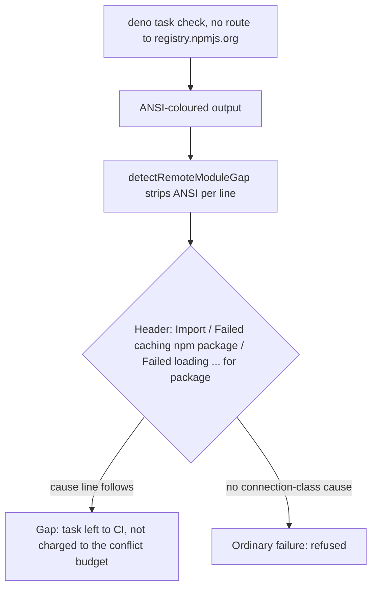

## Summary

The milestone merge and resolution gates now recognise a Deno task that failed
because this host cannot reach the npm registry. Such a task is left to CI as an
environment fault instead of being refused as a bad resolution. Closes #4848.

Version bump: `VERSION` is not touched by this change.

## Spec

### Intent and Rationale

- GRQ-AutoTrader's `web/` `deno task check` imports `playwright-core` from npm.
  On a host with no DNS it printed `error: Failed caching npm package '…'` with
  an ANSI-coloured `error` prefix. `detectRemoteModuleGap` (Issue #4422) matched
  only a plain `error: Import '<url>' failed.` header, so the gap was missed,
  the gate refused the tree, and the refusal repeated every cycle (the wedge in
  the issue).
- The fix is in the detector, not the conflict: the gate was misreading a host
  network fault as a failed tree.

### Essential Design Decisions

- The two npm headers are added beside the existing one and share its rule: a
  gap needs a connection-class cause line after the header. A checksum mismatch
  or a 404 on an npm package stays an ordinary failure.
- ANSI is stripped per line with the existing `stripAnsi`
  (`lib/github_actions_log_fetcher.ts`, which has no imports) rather than a new
  copy. The line is capped before stripping so a hostile line stays bounded.
- `RemoteModuleGap.url` reports `npm:<spec>` for a failed package cache. No
  caller reads `url`; all use `cause`.

### Undiscoverable Facts

- The reported output is from the babysitter host. The plain form was observed
  locally with deno 2.9.8 and an unreachable `NPM_CONFIG_REGISTRY`
  (`error: Failed loading https://registry.invalid/playwright-core for package
  "playwright-core"`
  then `0: error sending request for url …`). Colour did not appear when output
  was piped here, so ANSI tolerance rests on the issue's verbatim output.

## Evidence

Backend-only change. `detectRemoteModuleGap` is used by `checkMergedTree`
(`lib/milestone_merge_gate.ts`), `verifyResolvedTree`
(`lib/milestone_resolution_gate.ts`) and `runMergeFastChecks`
(`lib/merge_fast_checks.ts`); all three read only `.cause`, so all three gain
the behaviour. Docs updated: `docs/INTERNALS.md` and
`docs/workflows/milestones.md` (the Issue #4422 paragraphs, which said the
detector "recognises only that pair").

## Reproduction

- **symptom** — the gate refused a merged tree with `deno task check … failed`
  and `Failed caching npm package … dns error`, repeatedly.
- **status** — `verified` — the new tests were run against the base
  `milestone_merge_gate.ts` and failed (`deno task test in … failed` where
  `passed` was expected), and pass with the fix.
- **regression test** —
  `worker/deno/tests/milestone_merge_gate_test.ts::checkMergedTree - a Deno check whose npm packages the host cannot fetch is left to CI, not failed (Issue #4848)`

## Test Plan

- Added to `worker/deno/tests/milestone_merge_gate_test.ts`: the verbatim
  ANSI-coloured npm output, the plain form, the metadata form, the coloured
  legacy `Import` form, four negatives (checksum cause, 404 cause, connection
  words without header, cause before header), two hostile-line cases, and a
  `checkMergedTree` end-to-end case with a second passing project.
- Added to `worker/deno/tests/milestone_resolution_gate_test.ts`: the npm
  analogue of the Issue #4422 `verifyResolvedTree` test.
- Red checks: npm header matching disabled → the npm detector tests, the
  `checkMergedTree` test and the resolution-gate test red; `stripAnsi` removed →
  the ANSI npm, ANSI legacy and `checkMergedTree` tests red. Both restored.
- `deno task test:unit tests/milestone_merge_gate_test.ts
  tests/milestone_resolution_gate_test.ts`:
  both passes passed (serial pass 88 passed, 0 failed).

- Full gate `./quality.sh`: markdownlint failed once on a wrapped `#4848` line
  (fixed; `check-markdownlint` now passes, 244 files). `deno tests` still fails
  two tests in `completion_phase_repo_formatters_test.ts` ("an unformatted Rust
  change is formatted and committed, then passes the gate" and "cargo fmt stages
  only the branch's .rs files…"), which this change does not touch; every other
  stage passed (semgrep, lint, type check, fmt, manifests).

Not done / risk: ANSI tolerance is tested from the issue's output, not from a
live coloured run; `merge_fast_checks.ts` gets the new detection but has no
npm-specific test of its own.
