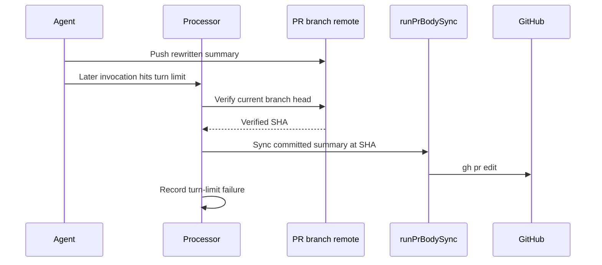

# PR feedback body sync on turn-limit exits

## Summary

PR feedback now checks for a landed push and refreshes the body from the summary
committed at that remote head before recording a turn-limit failure. The failure
result is preserved. Closes #4851.

Version bump: No version change was made for this fix.

## Spec

### Intent and Rationale

- A later agent invocation can hit its turn limit after an earlier invocation
  has pushed a rewritten summary. Syncing before failure accounting keeps the
  live PR description aligned with the landed head.

### Essential Design Decisions

- The failure path uses the existing push verifier and `runPrBodySync`, pinning
  body generation to the verified remote SHA through `committedHeadSha`.
- Unconfirmed pushes and gated-head fix branches remain ineligible for this
  refresh. A single attempt guard prevents a second body edit in one pass.

### Undiscoverable Facts

- The claim comment names host `vibe-coder-10923`, but its run log was not
  available in this workspace. The incident's historical return path remains
  unconfirmed; this change covers the verified-push turn-limit exit reproduced
  by the regression test.

## Evidence

Backend-only change; no browser check applies. The processor calls the existing
body-sync implementation after a real temporary Git push, captures the resulting
`gh pr edit`, and confirms it precedes failure accounting.

## Test Plan

- `worker/deno/tests/pr_feedback_processor_test.ts::processPrFeedback - syncs a landed self-push before a turn-limit failure`
  — passed. The new test uses a temporary bare remote and the production
  `syncPrBodyFromSummary`; it asserts one body edit, the rewritten summary and
  digest, the unchanged `error_max_turns` failure, and
  edit-before-failure-accounting order. Removing
  `await syncBodyFromVerifiedHead()` made this test fail with zero edits.
- `worker/deno/tests/pr_feedback_processor_test.ts` — passed, 44 tests. Existing
  cases retain ordinary push and no-change sync, and skip sync for unpushed
  commits, failed pushes and gated-head fix branches. The existing turn-limit
  cases cover the initial, recovery and retry exits through the shared failure
  handler.
- `worker/deno/tests/pr_body_sync_test.ts` — passed, 59 tests, including stale
  remote-head protection.
- `worker/deno/tests/pr_feedback_review_dismissal_3383_test.ts` — passed, 31
  tests, including the held-review zero-unpushed guard.
- `deno lint lib/pr_feedback_processor.ts tests/pr_feedback_processor_test.ts` —
  passed.
- `deno check tests/pr_feedback_processor_test.ts tests/pr_body_sync_test.ts tests/pr_feedback_review_dismissal_3383_test.ts`
  — passed.
- `deno fmt` on the changed TypeScript files — passed.
- `./quality.sh < /dev/null` — failed at the Deno unit-test time budget. The
  parallel and serial suites passed; the budget audit reported 87 tests over one
  second and failed because both tests in unchanged
  `tests/launcher_harness_reclaim_stub_test.ts` took 3.91 seconds. That file is
  unchanged from `origin/main`. Config integration and Checkov were skipped by
  the environment. All other quality stages passed.
- The documentation edits remove no assertions from existing tests. Existing
  body-sync entry points checked: normal verified-push sync, no-change
  reconciliation, held-review sync, and turn-limit failure handling.

## Deno regression avoided

- Kept implementation, tests and validation on the repository's Deno tooling;
  added no Node tooling or dependencies.
