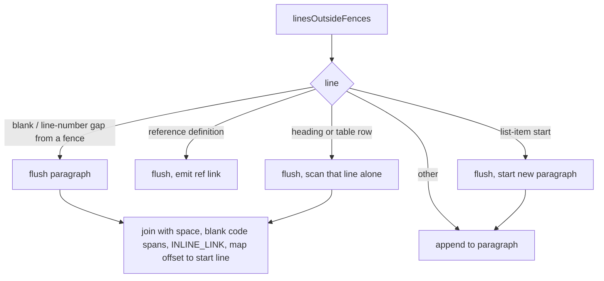

## Summary

`crossFileAnchorLinks()` now matches inline links per paragraph instead of per
physical line, so a link whose text soft-wraps onto a second line is extracted
and checked by the repo-wide anchor sweep. Each link is still reported on the
line its opening `[` sits on. Version bump: not part of this change.

Closes #4870.

## Spec

### Intent and Rationale

- A wrapped link (`[text` / `more](x.md#frag)`) matched on neither line, so the
  sweep from Issue #3337 never checked it. Prose wrapped at 80 columns makes
  this common.
- The issue's primary suggestion is used: join each paragraph's lines, run the
  existing `INLINE_LINK` over the joined text, and map the match offset back to
  its start line. The alternative (failing the sweep on an unmatched
  `](….md#…)`) would force rewrites of valid Markdown.

### Essential Design Decisions

- Paragraphs are never joined across a blank line, a fenced block (detected by a
  gap in line numbers), a heading, a table row or the start of another list
  item, so `- [a` / `- b](x.md#f)` cannot fabricate a link.
- Lines are joined with one space (same length as the newline) and code spans
  are blanked on the joined text, so a code span that wraps is blanked too. This
  follows CommonMark, where a code span may cross a line inside a paragraph.
- `INLINE_LINK`, `parseDestination` and `REF_DEF` are unchanged.

### Undiscoverable Facts

- The issue lists `docs/SPEC-KIT-COMPARISON.md` lines 165-166; the opening `[`
  is on line 164, which is the line the extractor reports.

## Evidence

Backend/test only; no UI file touched. Run on the final head:
`deno task test:unit tests/cross_file_anchors_test.ts tests/markdown_anchors_test.ts tests/agents_md_pointer_anchors_test.ts tests/review_fleet_prs_skill_links_3300_test.ts`
passed. `./quality.sh < /dev/null` passed (config integration and checkov
skipped by the gate itself).

Corpus run of the extractor over every `.md` file the sweep polices (excluding
`docs/archive/`): 509 links on base, 514 at head. The five newly found links
(`docs/SPEC-KIT-COMPARISON.md:116`, `:139`, `:164`, `:194` and
`docs/workflows/grill-me.md:650`) all resolve, so the sweep reports no offenders
and no `.md` file was edited. No false positives from the extra links; no
extractor-skipped input.

## Test Plan

Added to `worker/deno/tests/cross_file_anchors_test.ts` (14 tests; existing
tests unedited, only the header comment gained a mention of this issue):

- Must report: two-line wrap, three-line wrap, wrap inside a list-item
  continuation (reported on the item's line), wrap with angle-bracket
  destination and title, a wrapped link as the second link of a paragraph.
- Must not report or join, each with a positive control (the same input with
  only the separation removed is reported): blank line between the halves, a
  fenced block between them, two list items, a heading, table rows, a code span
  wrapping two lines, and a wrapped link inside a fence.
- Two `assertLinearGrowth` cases with multi-line hostile input (one huge
  paragraph of `[a` lines; lines each holding an unmatched backtick).

Red checks (production code broken on purpose, then restored and byte-compared):

- Original per-line loop: 9 new tests red (the five positives, and the
  blank-line, fence and wrapped-code-span negatives via their positive controls,
  and the wrapped link inside a fence).
- No gap, heading, table or list-item boundaries: 4 red (fence, two list items,
  heading, table rows).
- Blank line does not flush: 1 red (blank-line negative).
- The two growth tests stay green under the per-line code, as expected; they
  guard the new join.

No existing test was edited or removed. Twinned rule: `crossFileAnchorLinks` is
the only extractor of cross-file anchors (`git grep crossFileAnchorLinks`: the
lib and `cross_file_anchors_test.ts`); the other anchor tests use `anchorSet` /
`headingSlugs`, which are unchanged. Docs grep (README, `docs/` excluding the
archive, `worker/deno`) found no prose saying the sweep is per-line; the doc
comments in `markdown_anchors.ts` were updated.

Not done or not checked: Spec and Standards reviewers were not dispatched
because the issue states no acceptance-criteria heading.
