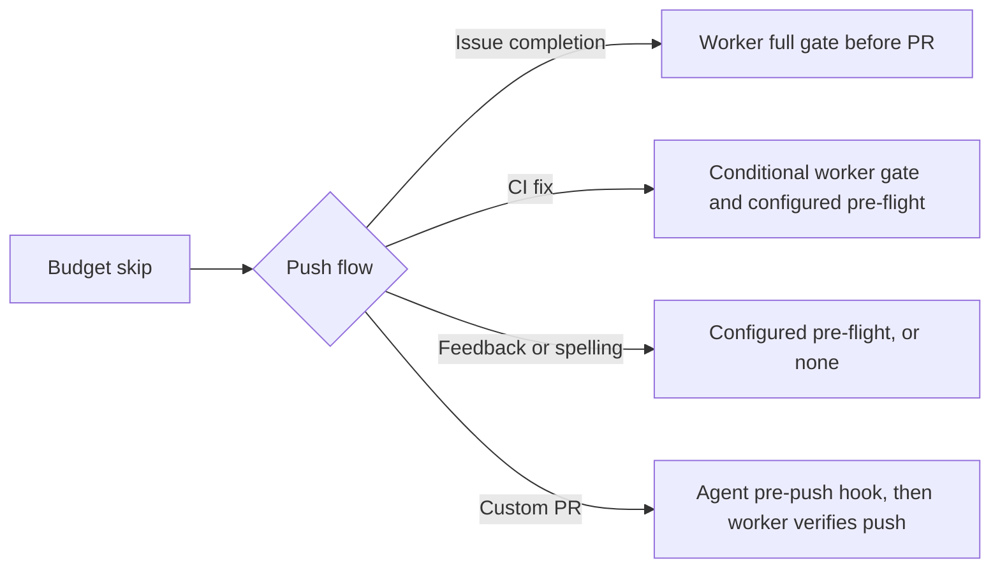

## Summary

Made the budget skip record describe the push checks used by issue completion,
CI fixes, PR feedback and spelling fixes, and custom PR prompts. Updated the
configuration manual and diagram to match those paths. Closes #4876.

Version bump: none for this change.

## Spec

### Intent and Rationale

- A budget skip record must not promise a worker gate before an existing PR-side
  push when that path does not run one.
- Keep the shared prompt builder and make its record follow the caller's push
  path.

### Essential Design Decisions

- Issue completion retains the full-gate record. PR feedback and spelling say
  configured pre-flight commands run before the worker push, or no checks when
  none are configured.
- CI fixes describe the conditional worker gate attempt and configured
  pre-flight commands. Custom PR prompts describe the agent pre-push hook and
  the worker's later push verification.

### Undiscoverable Facts

- The PR feedback and spelling command tests use repository fixtures with no
  configured pre-flight commands to verify that prompts do not claim a full gate
  before push.

## Evidence

Backend prompt and worker-flow change; no screenshot applies.

## Deno regression avoided

- Kept implementation, checks and tests on the repository's Deno toolchain; no
  Node tooling or dependencies were added.

## Test Plan

- `worker/deno/tests/quality_gate_budget_test.ts` — budget fitting and
  insufficient-budget records for full-gate, CI-fix, pre-flight-only and
  custom-agent push paths; passed in the full quality gate.
- `worker/deno/tests/repo_config_test.ts` — shared prompt instruction records
  for each push guarantee; passed in the full quality gate.
- `worker/deno/tests/pr_side_gate_guarantee_4876_test.ts::prFeedbackProcessorCommand - the agent prompt carries the pre-flight-only push guarantee (Issue #4876)`
  — passed; temporarily removing the feedback caller's guarantee made this test
  fail.
- `worker/deno/tests/pr_side_gate_guarantee_4876_test.ts::prSpellingProcessorCommand - the agent prompt carries the pre-flight-only push guarantee (Issue #4876)`
  — passed; temporarily removing the spelling caller's guarantee made this test
  fail.
- `worker/deno/tests/run_core_production_deps_test.ts::run-core PR feedback callback records its pre-flight push guarantee (Issue #4876)`
  — passed; removing this callback's guarantee made the test fail.
- `worker/deno/tests/run_core_production_deps_test.ts::run-core custom PR prompt callback records the agent pre-push guarantee (Issue #4876)`
  — passed; removing this callback's guarantee made the test fail.
- `worker/deno/tests/pr_spelling_processor_test.ts` — 29 passed.
- Full `./quality.sh < /dev/null` — passed. Deno tests, lint, type check,
  formatting, Markdown lint and Semgrep passed. Config integration was skipped
  because Deno or `.config.json` was unavailable; Checkov was skipped because no
  Checkov executable or container runtime image was available.
- `deno.lock` is unchanged.
