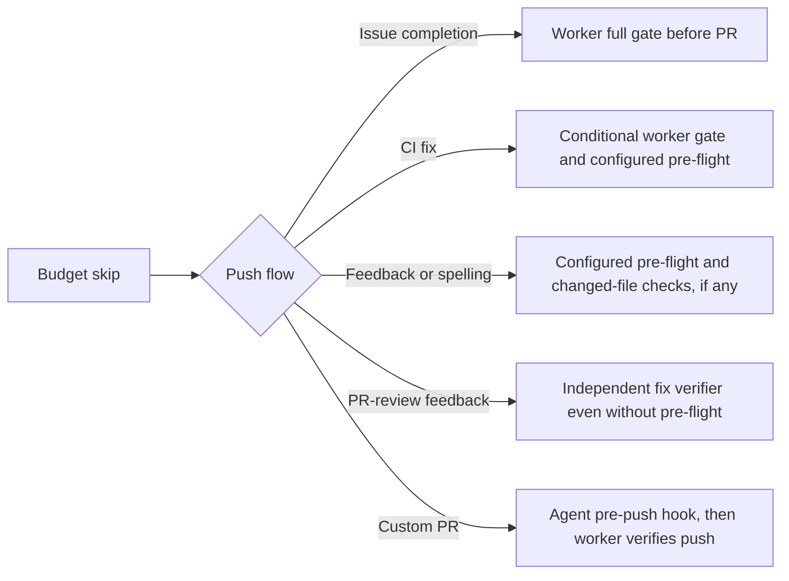

## Summary

Made budget skip records describe the checks used by each push path without
promising a full worker gate for existing PRs. Forwarded repository
configuration through the spelling command so configured pre-flight commands
reach its push helper. Updated the configuration manual and diagram. Closes
#4876.

Version bump: none for this change.

## Spec

### Intent and Rationale

- Agents must record skipped gates accurately, including checks that still run
  before a PR-side push.
- Keep the budget decision and the push-path record in the shared prompt
  builder.

### Essential Design Decisions

- Issue completion keeps the full-gate default. Removed redundant explicit
  `pushGuarantee: "full-gate"` arguments from both execute implementations;
  deleting those arguments cannot change the prompt because they equal the
  default.
- Feedback and spelling records exclude a full gate, describe configured
  pre-flight and changed-file checks, and explain that PR-review feedback also
  runs its independent fix verifier without pre-flight configuration.
- CI fixes describe the conditional worker gate attempt and configured
  pre-flight commands. Custom PR prompts describe the agent pre-push hook and
  the worker's later push verification.
- The spelling command passes `repoConfigs: config.repoConfig` to its processor,
  matching the configuration its prompt describes.

### Undiscoverable Facts

- The CI command test uses a fresh check ID and removes its retry record, so
  repeated test and mutation runs cannot exhaust the worker's retry counter.
- Three broader production-dependency tests fail in this environment on both
  this branch and base commit `5f7c4250`; details are in the Test Plan.

## Evidence

Backend prompt and worker-flow change; no screenshot applies. Read and updated
`docs/CONFIGURATION.md`, section “The full gate is conditional on the budget
left (Issue #1138)”, including its push-path diagram. Also swept the repeated
caller comments and the shared builder's API documentation.

The configured spelling test failed before forwarding `repoConfigs`: the push
helper received `undefined` instead of the configured command. The shared
builder, command and production-callback assertions failed against the old
feedback record. The strengthened persistent-findings test confirms two verifier
attempts with no pre-flight spec, no successful push and no review dismissal.

The corrected shared record reaches `buildQualityInstructions`, the standalone
feedback command and the production feedback callback. The run-core command,
priority dispatch and stall repair reuse that callback; they receive the same
corrected instructions without changing their dispatch behaviour.

## Deno regression avoided

Kept implementation, checks and tests on Deno; no dependencies were added and
`deno.lock` is unchanged.

## Test Plan

- `worker/deno/tests/quality_gate_budget_test.ts` and
  `worker/deno/tests/repo_config_test.ts` cover fitting and refused budgets for
  each push record. The inaccurate no-checks assertion was replaced with the
  verifier and changed-file guarantees; the full-gate exclusion remains pinned.
- `worker/deno/tests/pr_side_gate_guarantee_4876_test.ts` exercises real
  feedback, spelling and CI commands, capturing agent prompts. Spelling covers
  both absent and configured pre-flight commands and checks the spec passed to
  the push helper.
- `worker/deno/tests/run_core_production_deps_test.ts` captures feedback and
  custom PR prompt instructions from the production callbacks. Feedback uses a
  600 s reactive budget distinct from the 3600 s issue budget and a `pr_review`
  input.
- `worker/deno/tests/pr_feedback_review_dismissal_3383_test.ts::review-fix verifier - persistent findings stay outstanding without push or dismissal, and the PR stays armed (Issue #4291)`
  now checks the prompt and absent pre-flight specs while retaining every
  existing assertion about verifier attempts, outstanding findings, pushes and
  dismissal.

The six reported mutation locations are addressed as follows (line numbers are
those in the notice):

| Reported mutation                                                   | Coverage or removal                                                                                                                  |
| ------------------------------------------------------------------- | ------------------------------------------------------------------------------------------------------------------------------------ |
| `commands/pr_ci_processor.ts:157` — remove `runBudgetSeconds`       | CI command test above fails its budget-refusal assertion when the property is removed.                                               |
| `commands/pr_ci_processor.ts:158` — remove `pushGuarantee`          | CI command test fails its conditional worker-gate assertion when the property is removed.                                            |
| `commands/pr_spelling_processor.ts:168` — remove `runBudgetSeconds` | Both spelling command tests fail their budget-refusal assertion when the property is removed.                                        |
| `lib/execute_claude_phase.ts:1181` — remove `pushGuarantee`         | Removed the redundant argument; the existing shared-builder default/full-gate equality test proves the same record for both budgets. |
| `lib/phases/execute_phase.ts:683` — remove `pushGuarantee`          | Removed the redundant property; issue completion still uses the tested full-gate default.                                            |
| `lib/run_core_production_deps.ts:2602` — remove `runBudgetSeconds`  | Production feedback callback test fails its budget-refusal assertion when the property is removed.                                   |

Each of the four retained properties was individually deleted and its named test
failed with an assertion error, then passed after restoration. Removing
spelling's new `repoConfigs` forwarding also made the configured-pre-flight test
fail. No untestable exemptions were used.

Validation for this recovery:

- Focused Issue #4876 tests and the persistent-findings test: passed.
- Affected suites: budget, repository config, PR-side command guarantees, CI,
  spelling, review dismissal, production dependencies and execute-phase budget
  coverage: 290 passed, three failed. The same three failures reproduced on base
  commit `5f7c4250` (30 passed, three failed):
  `isRateLimitActive - returns false when signal has expired`,
  `isRateLimitActive - returns false when no signal file exists`, and
  `production coding dispatch defers actual heartbeat publication through its final landed decision (Issue #3977)`.
  These unrelated failures were left unchanged.
- `deno task check:manifests`: passed, 848 tests passed and one ignored.
- Deno type checks for the affected test modules, lint and formatting: passed.
- Markdown lint: passed.
- Semgrep `p/default` over the 12 changed TypeScript files: passed, zero
  findings.
- Full `./quality.sh` was not rerun in this recovery; the completion worker runs
  the quality gate after these changes.
