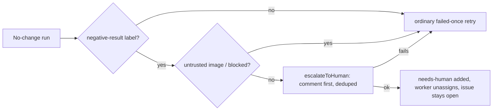

## Summary

The worker no longer auto-closes an issue the run labelled `negative-result`.
On a no-change run it hands the issue to a human instead: `escalateToHuman`
posts the explanation comment first, then adds `needs-human` (a blocking label,
so pickup skips the issue), and the worker unassigns itself. The issue stays
open. The posted comment contains no `#<digits>`. Closes #4911.

Version bump: not applicable to this change.

## Spec

### Intent and Rationale

- The old close posted "(Issue #4298)" into the target repository, where `#4298` links to an unrelated item; it also retired a result that may rest on shared-host timings without anyone reviewing it.
- A hand-off through the existing `escalateToHuman` chokepoint keeps the issue out of the queue (`needs-human` is blocking) without retiring it.

### Essential Design Decisions

- File name `negative_result_close.ts` is kept so the sweep ledger `docs/audits/lib-sweep-coverage/top-up-4298.json` stays valid; only its `definition` text is updated.
- `escalateToHuman` returns `ok` even when the label add failed after the comment posted; the hand-off treats `labelAdded: false` as a failure and returns `false`, so the run falls to the ordinary retry (a later run dedups the comment and re-adds the label).
- The phase passes `deps: { github: { ensureLabelExists } }` from `WorkerDeps` (the pattern in `lib/phases/declared_handoff.ts`), so the phase-level path is testable without a real `gh` call.
- The comment text deliberately asserts no benchmark ran and says shared-host timings are indicative only (milestone-parent owner direction: benchmarks on a shared host are unreliable). Rules narrowing when the agent may apply `negative-result` belong to #4912 and were not added to the prompts.

### Undiscoverable Facts

- The issue's phrase "a correct, tested performance PR proceeds even without a timing gain" in `docs/USAGE.md` was worded as "this path adds no new gate…" because `prompts/coding_guidelines/prompt.md` steps 1–4 still require a demonstrated gain for a PR; changing that is #4912's job.
- `needs-human-custom` is not a usable label name: `worker_label_guard.ts` allowlists only `needs-human` and fixed literals/prefixes, so the custom-label test uses `escalated`.

## Evidence

Backend-only change; no UI. Verified by tests in `worker/deno/tests/negative_result_close_4298_test.ts` and `worker/deno/tests/negative_result_handoff_no_vibecoder_numbers_4911_test.ts`.

Pickup skip: `worker/deno/tests/issue_filter_test.ts` — "issue_filter - filterAndSort excludes needs-human issues (Issue #1470)" (existing test cited per the acceptance criteria).

Docs updated: `docs/USAGE.md` (read "What is never escalated" and the new exception paragraph), `docs/LESSONS-LEARNT.md`, `docs/AGENT-ACCOUNTABILITY.md`, `docs/workflows/label-flows.md`, `DESIGN-PRINCIPLES.md`, `prompts/coding_guidelines/prompt.md`, `prompts/issue/prompt.md`, label description in `worker/deno/setup/content_label_definitions.ts`, doc comment in `worker/deno/lib/worker_label_guard.ts`. Prompts and docs that said an approved issue is "never handed to a human" now name the one worker-side exception.

## Reproduction

- **symptom** — a `negative-result` issue was auto-closed by the worker with a comment citing "(Issue #4298)", which links to an unrelated item in the target repository
- **status** — `partial` — the new tests assert the hand-off and the no-`#N` comment, and fail when the hand-off closes or a `#N` is added; they were not run against the unfixed base-branch code because the old function no longer exists to call from the new tests — reason: not exercised against base
- **regression test** — `worker/deno/tests/negative_result_handoff_no_vibecoder_numbers_4911_test.ts::negative-result hand-off - every posted comment names no VibeCoder number (Issue #4911)`

## Acceptance Criteria

<!-- vibe-spec-review inputs="diff+issue-body" -->

- **met** — A no-change run on an issue carrying `negative-result` leaves the issue open, adds `needs-human` with a paired comment in the same run, unassigns the worker, and never calls `closeIssue` — asserted by a test — evidence: `worker/deno/tests/negative_result_close_4298_test.ts::#4911 - a labelled negative result is handed to a human, comment first, never closed` and the phase-level labelled tests in the same file — reviewer: partial — reason: the reviewer saw only the direct-call test; a phase-level labelled test (early_exit, `negative_result_handed_off`, configured label) was added afterwards
- **met** — A second run on the same issue within the dedup window does not post a second hand-off comment — asserted by a test — evidence: `worker/deno/tests/negative_result_close_4298_test.ts::#4911 - a second hand-off finds its own earlier comment and posts nothing new` — reviewer: met
- **met** — The handed-off issue is skipped by pickup (`needs-human` is a blocking label in `worker/deno/lib/issue_filter.ts`), shown by a new test or an existing filter test cited in the PR's Test Plan — evidence: existing `worker/deno/tests/issue_filter_test.ts` test cited in the Test Plan — reviewer: partial — reason: the reviewer could not see the Test Plan, which cites that test
- **met** — The posted comment contains no `#<digits>`; the regression test fails if a `(Issue #N)` suffix is reintroduced — evidence: `worker/deno/tests/negative_result_handoff_no_vibecoder_numbers_4911_test.ts` — reviewer: met
- **met** — Without the label, and with an untrusted image, behaviour matches today's tests — evidence: `worker/deno/tests/negative_result_close_4298_test.ts` unlabelled and untrusted-image tests — reviewer: met
- **met** — `docs/USAGE.md` and the label description describe the hand-off, not a close — evidence: `docs/USAGE.md`, `worker/deno/setup/content_label_definitions.ts` — reviewer: met
- **partial** — `./quality.sh` passes, including the `needs-human chokepoint` stage — evidence: the gate run reports `needs-human chokepoint PASSED`, and every other stage passed except `deno tests` — reviewer: missing — reason: CI not yet verified — remaining: merge-verification-only; locally eleven tests fail in this sandbox on unrelated network/tooling faults (JSR `@std/yaml` fetch failing, `osascript` absent) in `claude_runner_pre_push_3394_test.ts`, `merge_fast_checks_credentials_4705_test.ts`, `pre_push_hook_test.ts`, `review_fleet_prs_post_claim_4398_test.ts`; none touch this change; CI is the authority
- **unrequested** — the sentences about "only deterministic evidence justifies `negative-result`" the Spec reviewer flagged in `prompts/coding_guidelines/prompt.md` and `docs/LESSONS-LEARNT.md` — reviewer: unrequested — reason: removed again in this diff because that rule belongs to #4912

## Standards Review

<!-- vibe-standards-review inputs="diff+CODING-STANDARDS.md" -->

- **violation** — no phase-level test of the hand-off call site — evidence: `worker/deno/lib/phases/handle_no_changes_phase.ts:317` — reason: fixed in this diff (deps seam threaded; phase tests added; red-checked)
- **violation** — lost `early_exit` assertion on the labelled path — evidence: `worker/deno/tests/negative_result_close_4298_test.ts:1` — reason: fixed in this diff (phase-level labelled tests assert `early_exit` and the reason)
- **violation** — `labelAdded: false` branch unreached — evidence: `worker/deno/lib/negative_result_close.ts:125` — reason: fixed in this diff (rejected-label test; deleting the branch turns it red)
- **violation** — USAGE sentence contradicted the guidelines' performance steps — evidence: `docs/USAGE.md:485` — reason: fixed in this diff (reworded; the prompt rule I had added was removed)
- **violation** — docs and prompts still said an approved issue is never handed to a human — evidence: `prompts/issue/prompt.md:541`, `docs/workflows/label-flows.md:90`, `DESIGN-PRINCIPLES.md:23`, `docs/AGENT-ACCOUNTABILITY.md:928` — reason: fixed in this diff
- **clean** — Australian English, fail-loud catches, comment-first escalation reused not re-implemented, required `needsHumanLabel`, no new persisted shape, no `#N` in posted text; review-enforced rules checked: named tests exist, nothing exists only for a test to read

## Test Plan

- `worker/deno/tests/negative_result_close_4298_test.ts` (rewritten): labelled direct hand-off (comment, then label, then unassign; no close); dedup of a second hand-off; rejected label add returns `false`; phase-level labelled run (`early_exit`, `negative_result_handed_off`, configured label); unlabelled; untrusted image; failed hand-off falls through to the retry. Passed (`deno task test:unit`, 43 passed with the sibling files).
- `worker/deno/tests/negative_result_handoff_no_vibecoder_numbers_4911_test.ts` (new): every posted body matches no `/#\d+/`, with a positive control. Passed.
- Red-checks: phase reason string changed → labelled phase tests red; `needsHumanLabel: ctx.config.needsHumanLabel` replaced by a literal → custom-label test red; `!outcome.value.labelAdded` branch deleted → rejected-label test red; adding `#N` to the comment text → no-numbers test red. Each restored.
- Removed from `worker/deno/tests/negative_result_close_4298_test.ts`: `assert(!calls.addLabel.includes("needs-human"), "nobody is paged")` and `assertStringIncludes(calls.closed[0]!, "negative-result")`.
  Required by: "does **not** close the issue" and "adds `needs-human` with a paired comment in the same run".
- Callers of `handOffNegativeResultIssue`: only `handle_no_changes_phase.ts`, which passes the required `needsHumanLabel` and the `ensureLabelExists` seam.
- Twinned rules: the prompts/docs restating "never handed to a human" were updated (listed above); no other twin found.
- Final gate: `./quality.sh` re-run after the last code edits — every stage passed (including `needs-human chokepoint`, lint, type check, fmt, markdownlint, semgrep) except `deno tests`, where exactly the same 11 tests failed on the sandbox network/tooling faults named above; no test touching this change failed.

Not done / risk: the label description keeps "do not re-attempt without new evidence"; the `negative_result_lesson_docs_test.ts:76` assertion message still says "close-out label" (message text only); the failing sandbox tests were not re-run in a networked environment.
