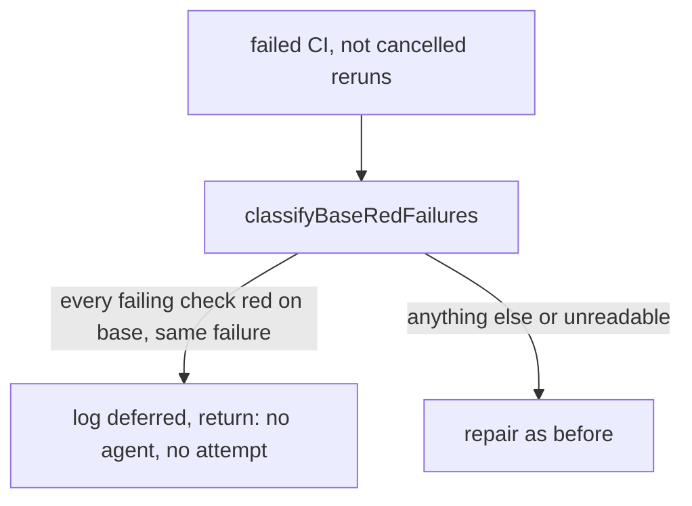

## Summary

The fleet PR babysitter now applies CI-fix's base-failure classification before it starts a `failed CI` repair. When every failing check run on the PR head is verified as already red on the base branch with the same failure, no agent starts and no attempt is charged; the PR is re-read on the next pass, after the base's fix has landed through the ordinary base merge. The repair prompt's host-difference sentence now also covers a failure that is red on the base too. Closes #4921.

Version bump: `VERSION` is not changed by this PR.

## Spec

### Intent and Rationale

- The babysitter is a second path onto a red PR and told its agent to "fix the root cause" of a check that was red on the base too, so each open PR got its own colliding copy of the base's fix.
- It reuses `compareBaseFailure`, `readBaseBranchCheck`, `readCheckIdentity` and `isDependencyAuditCheck` (the CI-fix pieces, Issue #4680) in a new `worker/deno/lib/babysitter_base_failure.ts` rather than copying them.

### Essential Design Decisions

- Defer only when every failing check run is verified `same`; any unknown (API failure, commit-status failure, non-Actions or unreadable log, green/missing/stale base run, different base log, more runs than one page, dependency audit) repairs as before, which is the issue's "handled as it is now".
- The PR-side failure text is the Actions log excerpt only (CI-fix also adds annotations); a check with no readable Actions log repairs as before.
- A throw from the classifier is logged with `console.warn` and treated as repair.

### Undiscoverable Facts

- Assumption: a deferred PR charges no attempt and writes no retry record; the next scan re-evaluates it (each scan costs a few `gh api` reads).

## Evidence

Backend/CLI only: no UI file touched. Real code is exercised with a `gh` stub that answers only the exact `gh api` shapes `ci_base_branch_check.ts` issues and rejects any other call.

- `worker/deno/tests/babysitter_base_failure_4921_test.ts` (13 tests): defer for one and two base-red checks; repair for a green base, a different base log, one of two checks not base-red, a dependency-audit check, a failing commit status, a rejected head read, `total_count` over the page, no failing run, an unreadable log, an empty base, a non-SHA head.
- `worker/deno/tests/babysitter_fix_orchestration_test.ts`: `fix()` defers (no session, no commit, no attempt, classifier called with repo, head, base and rollup), repairs when the classifier says repair, and never consults it for a review repair.

## Test Plan

- Added `worker/deno/tests/babysitter_base_failure_4921_test.ts` and three tests in `worker/deno/tests/babysitter_fix_orchestration_test.ts`.
- Edited `worker/deno/tests/fleet_pr_babysitter_test.ts` "a host-only or base-red failure in an unrelated check is named, not repaired or a blocker": the old pin "unrelated to the files you changed and passes in CI on the base branch" is replaced by pins on "unrelated to the files you changed, whether it passes in CI on the base branch", "or fails there too" and "do not repair it in this PR". Red check: changing "or fails there too" to "or fails there" fails the test.
- Red checks on the lib: dropping the dependency-audit branch, the commit-status branch, allowing a green base, and relaxing the `total` check each fail a named test.
- Red checks on the call site in `fix()`: removing the defer `return`, ignoring the decision, and removing the `=== "failed CI"` guard each fail a test.
- Fixture `worker/deno/tests/fixtures/fleet_babysitter_container_preload.ts` answers the new check-runs read with no runs; `fleet_babysitter_app_test.ts` passes again.
- `docs/audits/lib-sweep-coverage/top-up-4921.json` claims the new module for the sweep ledger.
- Callers of the shared prompt sentence checked: `buildRepairPrompt` is used once, in `fix()`; the reworded sentence applies to all three reasons, as before.
- `./quality.sh` on the final head: every gate passes except `deno tests`, whose parallel pass reports only the 5 `worker/deno/tests/pr_maintenance_command_test.ts` failures; those 5 fail identically on base `d17e53a7` (run in a detached worktree).

## Docs

Updated `docs/workflows/fleet-pr-babysitter.md` ("Scans, retries and failure classification"). The state diagram in the same file still shows `WaitingForChecks --> Repairing: failed check`, a simplification left as is.

## Not checked

- The serial `deno tests` pass did not run, because the parallel pass failed on the 5 pre-existing `pr_maintenance_command_test.ts` failures; the targeted files named above pass.
- No live GitHub run; behaviour against real check-run payloads rests on the stub mirroring `ci_base_branch_check.ts`'s requests.
