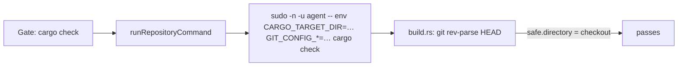

## Summary

The milestone merge and resolution gates run a repository's own commands as the
`agent` account through `sudo`. That account has no `~/.gitconfig`, so git
refused the worker-owned checkout with `detected dubious ownership`. A build
script that runs `git rev-parse HEAD` then failed, `cargo check` exited 101, and
the gate refused every resolution. The commands the gates run as `agent` now
carry `GIT_CONFIG_COUNT=1`, `GIT_CONFIG_KEY_0=safe.directory` and
`GIT_CONFIG_VALUE_0=<the checkout's worktree root>` in argv, so git trusts that
one checkout, including when the command runs in a project directory below it.

Closes #4927.

## Spec

### Intent and Rationale

- The issue is a private-repository merge-fallback report with no cause text.
  The host run log held it:
  `Refused to push the merge of 'Develop' into
  'milestone/…': the merged tree does not pass the repository's own check —
  cargo check --workspace --all-targets --locked … failed (exit 101)`,
  with
  `error: git rev-parse HEAD failed: fatal: detected dubious ownership in
  repository at '/home/vibe/auto-issue-work/GRQ-AutoTrader'`
  from a `build.rs`.
- The fix sits where the commands are built (`runRepositoryCommand`), so the
  merge gate, the resolution gate and the pre-push merge checks all get it.

### Essential Design Decisions

- Only the checkout the command runs in is trusted, never `safe.directory=*`.
  The entry names the worktree root, found by walking up from `cwd` to the
  nearest `.git` (a directory, or the file a linked worktree has), not `cwd`
  itself: git compares `safe.directory` with the top-level worktree, and the
  gates run Cargo and Deno projects up to `MERGE_GATE_MAX_DEPTH` = 2 levels
  below the root. With no `.git` found it falls back to `cwd`. The entry travels
  in argv with the cargo target and the proxy, because `env_reset` strips the
  child environment and the value is not secret.
- A path `CARRIED_ENV_VALUE` rejects (a space, say) gets no entry rather than a
  thrown error, so a gate does not gain a new fault; its build script fails as
  before.
- No `dropped` condition: `carryEnvThroughSudo` already leaves a worker-run
  command's argv alone, so a second check would be dead.

### Undiscoverable Facts

- Observed on this host: `sudo -n -u agent -- git -C <checkout> rev-parse HEAD`
  fails with dubious ownership; with the three `GIT_CONFIG_*` entries after
  `env` it prints the commit. git 2.47.3 honours `safe.directory` from the
  environment config scope.
- The earlier #4748 and #4847 fixes did not cover this cause. The gate in
  `milestone_branch_sync` counts every refusal alike, so the report text is the
  same each time.

## Evidence

- Host log (`/home/vibe/logs/launchagent-stderr.log`, 2026-11-10 05:42): the
  refusal text quoted above.
- Real-sudo test
  `real sudo: an agent git command runs in a worker-owned
  checkout (Issue #4927)`
  failed against the unfixed production code with
  `fatal: detected dubious ownership in repository at '/tmp/issue-4927-…'`
  (exit 128) and passes with the change.
- Documentation: `docs/CONTAINER.md` (new bullet beside the sudo argv-carrying
  bullet, naming the worktree root), doc comments in
  `worker/deno/lib/quality_gate_phase.ts` and
  `worker/deno/lib/untrusted_gate_spawn.ts`.

## Reproduction

- **symptom** — the milestone merge gate refused every resolution because
  `cargo check` failed with `detected dubious ownership` inside a build script.
- **status** — `verified` — the real-sudo regression test failed against the
  unfixed production code with the dubious-ownership error and passes after the
  fix.
- **regression test** —
  `worker/deno/tests/untrusted_gate_spawn_test.ts::real sudo: an agent git command runs in a worker-owned checkout (Issue #4927)`

## Test Plan

- Added in `worker/deno/tests/untrusted_gate_spawn_test.ts`: the dropped cargo
  command carries the three entries (red with the merge removed); the real-sudo
  test above (red with the merge removed); a checkout path with a space gets no
  entry and does not throw (red when the `CARRIED_ENV_VALUE` operand is
  removed); a worker-run command carries no `GIT_CONFIG` entry. The last one
  pins current behaviour: it stays green when the merge is removed from a
  non-sudo run, because `carryEnvThroughSudo` ignores a non-sudo argv, which is
  why the redundant `dropped` condition was deleted.
- Added for the nested-project case (pre-PR verifier finding, a project
  directory below the root named instead of the worktree root), each red when
  `gitSafeDirectoryEnv` uses `cwd` instead of the root:
  `real sudo: an agent git command runs from a subdirectory of a worker-owned
  checkout (Issue #4927)`
  (runs `git rev-parse --show-toplevel` from `<root>/crates/app` as `agent`),
  `a dropped command in a nested project dir
  trusts the worktree root (Issue #4927)`
  and
  `gitSafeDirectoryEnv - a nested project dir trusts the worktree root
  (Issue #4927)`
  (which also covers `gitWorktreeRoot` at the root itself);
  `gitWorktreeRoot - a linked worktree's .git file marks the root, and no .git
  falls back to cwd (Issue #4927)`
  pins the `.git` file and fallback cases.
- Added in `worker/deno/tests/quality_gate_phase_test.ts`:
  `gitSafeDirectoryEnv - a relative path gets no entry (Issue #4927)` (red when
  the `startsWith("/")` operand is dropped, because `CARRIED_ENV_VALUE` accepts
  a relative path) and
  `gitSafeDirectoryEnv - a plain absolute path trusts only that checkout (Issue #4927)`.
- Edited expectations (the new entries are deliberate):
  `worker/deno/tests/untrusted_gate_spawn_test.ts` (two exact-argv tests),
  `worker/deno/tests/merge_fast_checks_credentials_4705_test.ts` (one exact-argv
  test) and `worker/deno/tests/support/gate_child_env.ts` (the three names are
  permitted only when the child ran through the sudo drop). No assertion was
  removed; the credential, proxy and cargo-target assertions are unchanged.
- Callers of `runRepositoryCommand` checked: `milestone_merge_gate.ts`
  (`spawnTypeCheck`), `milestone_resolution_gate.ts` (`spawnTask`), and the
  merge fast checks (`spawnFastCheck`); all pass `cwd` and run through the one
  function, and their test files pass.
- Ran: `deno task test:unit` over the touched files and the neighbouring
  sudo-argv tests: passed. `./quality.sh`: every stage passed except
  `deno
  tests`, which fails only in
  `worker/deno/tests/pr_maintenance_command_test.ts` (three tests at lines 346,
  477 and 496). That file is untouched here and fails the same way on
  `origin/main`.

## Not done

- The `pr_maintenance_command_test.ts` failures on `main` are not addressed.
- Other repositories' build scripts that need a different git config (a
  `safe.directory` for a path with a space) are not covered.
