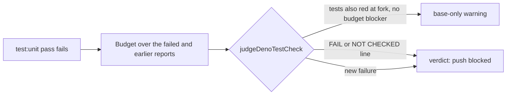

## Summary

Closes the last open item from #4930, which merged PR #5117 left `partial`: the
test-selection and time-budget cases carried over from PR #5034.

- **Time budget over a failed pass.** `deno task test:unit` now applies the
  unit-test time budget to a failed pass's JUnit report, and to any earlier
  passing pass, before it stops. The pre-push gate keeps a `base-only` warning
  only when that output has no budget failure line (`FAIL: every test in …`)
  and no `TIME BUDGET NOT CHECKED` line.
- **Affected-test selection.** A changed `_test.ts` outside `tests/` now runs,
  and so does a source file's `_test.ts` sibling in the same directory. Test
  files outside `tests/` are also scanned for names and imports. A local
  import-map alias runs the directory's whole suite. A file with a computed
  dynamic `import()` is assumed to depend on every changed module.

Closes #4930.

## Spec

### Intent and Rationale

- Before this change, a branch that added a file whose tests were all over
  budget could escape the gate. This happened when the failing tests also
  failed at the fork, because the runner stopped without checking the budget
  and the gate downgraded the failure to a warning. Real Deno writes the
  `--junit-path` report even when a test fails, so the runner can check the
  budget on its way out.
- Two tests at head live outside `tests/`
  (`worker/deno/lib/alert_feeds/*_test.ts`). The gate ran neither, even when
  that test or its source file changed.

### Essential Design Decisions

- A budget line refuses the downgrade only when it starts the trimmed output
  line. The git guard shim's `NOT ENFORCED` line is not a blocker; that is the
  existing #2669 rule.
- An unreadable report becomes a `TIME BUDGET NOT CHECKED` line. That line
  blocks the downgrade, because a check that was not run is not a pass.
- An import-map alias makes the graph impossible to follow, so the whole suite
  runs. A computed `import()` makes only its own file's dependencies unknown.
  That file therefore becomes a seed whenever the push changes a `.ts` file,
  and the tests that import it are selected. Running the whole suite for it
  instead would fire on every push at head: `tests/mod_test.ts` has a real
  computed import.
- A data file read through a path that no name, directory or template-literal
  token reveals can still be missed. Selection stays a heuristic, and CI's
  shards are the backstop.

### Undiscoverable Facts

- Observed: `deno test --junit-path=j.xml` on a file with one failing test
  exits 1 and still writes the report (`tests="2" failures="1"` with
  per-test `time`).

## Evidence

Backend/CLI only.

Real runner probe: a temporary `tests/zz_probe_4930_test.ts` (deleted
afterwards) had two tests over 1 s, one of them failing. The parallel pass
failed, then the runner printed:

```text
=== parallel pass: FAILED in 2.3s
slow unit test (1.11s > 1.00s): tests/zz_probe_4930_test.ts — slow fail
slow unit test (1.10s > 1.00s): tests/zz_probe_4930_test.ts — slow pass
NOT ENFORCED: every test in tests/zz_probe_4930_test.ts (2, 2.22s) is over the 1.00s unit-test budget — the git guard shim is on PATH …
```

The `NOT ENFORCED` form appears because this agent's git guard shim was on
`PATH`. Without the shim, as in CI and the worker's own gate, the same report
prints a `FAIL: every test in …` line. Before this change the runner returned
straight after `FAILED` and printed none of these lines.



## Test Plan

- TEST_PLAN_TBD
