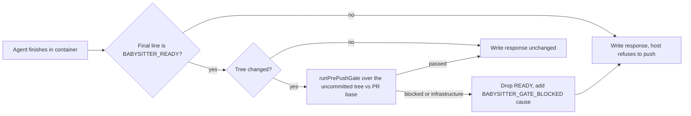

## Summary

PR #5034 put `deno test` (through `deno task test:unit`) and configured
markdownlint into the worker's push paths. The fleet PR babysitter's repair path
was not one of them: its container agent is only asked to run checks, and the
host then stages, commits and pushes after nothing stricter than
`git diff --check` (`validateAndCommit`, `finishBabysitterRepair`). This PR
closes that path inside the container, with no host execution beside the App
credentials.

After the repair agent finishes and ends its final message with the
`BABYSITTER_READY` line, the in-container `babysitter-repair` command runs the
existing `runPrePushGate` over the agent's uncommitted tree
(`worker/deno/lib/babysitter_tree_gate.ts`). The gate is the one the worker's
other repair pushes use: dependency-selected unit tests (or the whole suite for
a prompt, `deno.json` or lock change), configured markdownlint, the ShellCheck
policy and cargo-deny; not the formatters or linters. A failing test that fails
the same way at the merge-base with the PR base is a warning, a module-fetch
outage is an infrastructure fault, and anything else blocks. When the gate
blocks or cannot run, the container removes the `BABYSITTER_READY` line and puts
a `[BABYSITTER_GATE_BLOCKED]` line with the cause first, so the host's existing
completion check refuses to push and quotes the cause. A check that failed is a
`code` failure that spends a repair attempt; a gate that could not run
(`pre-push
checks could not run`, for example a module-fetch outage) is raised
on the host as an `infrastructure` failure, which backs off and spends no repair
attempt. A check that leaves stray files in the clone (which the host's
`git add -A` would push) also blocks. Part of #4930.

## Spec

### Intent and Rationale

- The shift-left report is raised by the babysitter itself, and its repairs were
  the one push path that ran no deterministic test or markdown check. The
  container is the only place the repair may run checks, so the check runs
  there.
- The check reuses `runPrePushGate` rather than a second framework, as the issue
  asks.

### Essential Design Decisions

- The clone's `.git` is mounted read-only, so the gate sees a `PrePushGit`
  adapter: it lists the `git status` paths as the pushed files (new files count
  as tracked), and emulates the baseline `git worktree add` with a fresh
  repository under a temp root that borrows the clone's objects
  (`objects/info/alternates`, plus the clone's `shallow` file), the base commit
  checked out detached with hooks off. Neither writes to `.git`. The baseline
  is a real git checkout: an earlier `git archive` + `tar` extraction had no
  `.git`, so a test that inspects its checkout failed there for that reason
  alone, and a regression the repair caused passed as base-owned (review of
  `d16f355`). A shared clone is not used, because git will not clone a shallow
  repository locally and would fetch only its branches, not the base commit.
- The PR base reaches the container as optional `--base-branch <name>`
  (`BabysitterContainerInput.baseBranch`, set from `pr.baseRefName`, validated
  with `assertSafeGitRef`). Without it there is no baseline and a failing test
  blocks (fail closed). `BABYSITTER_REPAIR_COMMAND` itself is unchanged.
- The gate's kind reaches the host in the headline of the withheld response:
  `isGateInfrastructureResponse` (`lib/babysitter_tree_gate.ts`) recognises
  `[BABYSITTER_GATE_BLOCKED] pre-push checks could not run:` at the start of the
  response, and `fix()` raises it before the generic missing-READY failure.
  Only the gate may write that text: `babysitter-repair` replaces
  `[BABYSITTER_GATE_BLOCKED]` in the agent's own output on every path
  (`neutraliseGateMarker`), so an agent that fails without READY cannot make its
  failure count as infrastructure and dodge the repair cap.
- While the repair holds an uncommitted `git merge --no-commit` of the PR base,
  `git status` lists every file the merge brings in. The gate then keeps only
  the paths that are untracked or differ from `MERGE_HEAD` (the base's content
  is the base's, as the host's `checkBaseline` reads the merged tree), and its
  stdin also names `MERGE_HEAD`, so the merge-base with `origin/<base>` is the
  base tip the merge brings in, not the PR's old fork point. Markdownlint has no
  baseline, so dropping the base-owned paths is also what keeps a base markdown
  error from blocking.
- Withholding the READY line, not failing the container, is the verdict channel:
  the host already refuses a response without it and quotes the response.
  `isBabysitterReady` (`lib/babysitter_ready.ts`) is now the one rule for both
  the host and the container.

### Undiscoverable Facts

- Not verified in a real container: the unit tests run against injected seams
  and real temporary git repositories; the gate's wall-clock inside the 90-minute repair budget were not
  observed.
- The wedge/delivery history: #5014 was closed, #5034 merged as `Part of #4930`.

## Evidence

Backend-only; no UI files. Tests:
`worker/deno/tests/babysitter_tree_gate_test.ts`,
`worker/deno/tests/babysitter_repair_4738_test.ts`,
`worker/deno/tests/babysitter_ready_test.ts`,
`worker/deno/tests/fleet_babysitter_container_4738_test.ts`,
`worker/deno/tests/babysitter_fix_orchestration_test.ts`,
`worker/deno/tests/fleet_pr_babysitter_test.ts`,
`worker/deno/tests/support/babysitter_tree_fixture.ts` (the shared real-git
clone fixture and the uncommitted-merge fixture). Docs:
`docs/workflows/fleet-pr-babysitter.md` (repair flow, diagram step, new
"Pre-push gate" paragraph, merge-in-progress and marker-neutralisation text, READY and missing-marker paragraphs, shift-left
paragraph), `docs/CONFIGURATION.md` (push-guarantee paragraph; the cargo-deny
and ShellCheck items no longer say babysitter repairs are unchecked). Ledger:
`docs/audits/lib-sweep-coverage/top-up-4930.json` claims the two new modules
(`sweptAt` moved to `96824f40`, so drift for the two older modules is measured
from there).

New non-test members have production readers: `runBabysitterTreeGate` and
`withholdReady` are called by `commands/babysitter_repair.ts`;
`isBabysitterReady` by `babysitter_repair.ts`, `babysitter_tree_gate.ts` and
`fleet_pr_babysitter.ts`; `baseBranch` is set at `fix()` in
`fleet_pr_babysitter.ts` and read by `buildBabysitterRunArgs`.

Related rules checked: the repair prompt sentences about checks that do not
withhold `BABYSITTER_READY` (unrelated or base-owned failures) still hold, since
a base-only failing test is a warning; one sentence was added saying the
container runs the unit tests and markdownlint after the agent.

## Acceptance Criteria

<!-- vibe-spec-review inputs="diff+issue-body" -->

- **met** — "Any affected-test selection must retain the checks needed to catch
  the reported regression classes" — evidence:
  `worker/deno/tests/babysitter_tree_gate_test.ts::an uncommitted new test file that fails blocks, naming the failing command, with no formatter or linter run (#4930)`,
  `::a changed markdown file runs markdownlint and its failure blocks (#4930)`,
  `::a changed markdown file with no markdownlint binary available is not a pass (#4930)`
  — reviewer: met — reason: the babysitter calls the unchanged `runPrePushGate`
  selection, so the deno test and markdownlint checks are kept for the agent's
  uncommitted tree (new files included) and an unavailable check is not a pass;
  the selection stays dependency-based, as in #5034.
- **met** — "Use the supported contained pre-push/completion path to run the
  repository's applicable Deno tests and markdown checks before claiming a PR or
  repair is validated" — evidence:
  `worker/deno/tests/babysitter_repair_4738_test.ts` (READY withheld on blocked,
  infrastructure and a throw),
  `worker/deno/tests/babysitter_fix_orchestration_test.ts::a response withheld because the pre-push gate could not run is an infrastructure attempt with backoff, not a substantive one (Issue #4930)`
  — reviewer: met — reason: the gate runs in the container with no host
  execution, preserves the base comparison and infrastructure recovery; a real
  container run was not observed (see the Test Plan).
- **missing** — "Keep this issue open until its requirements are actually
  delivered": a repair run of the fleet PR babysitter in its real container
  showing the gate blocking a failing test and a markdown error before a push —
  reviewer: missing — reason: this needs the deployed babysitter image and a
  live fleet PR, so it can only be observed after merge; the closest evidence
  is the tests above, which drive the real `runPrePushGate` and the real
  completion path with only the command runner faked.

## Standards Review

<!-- vibe-standards-review inputs="diff+CODING-STANDARDS.md" -->

- **clean** — the new tests drive the real `runPrePushGate` with only the
  command runner faked; no test asserts only a mock's arguments. The two tests
  that did (the `--base-branch` forwarding in `babysitter_repair_4738_test.ts`
  and the `startAgent` options in `babysitter_fix_orchestration_test.ts`) now
  assert outcomes: READY is kept with `--base-branch main` over the real gate
  and withheld without it, and the container argv built by the real
  `startBabysitterAgent` ends with `--base-branch <pr.baseRefName>`.

## Test Plan

- `cd worker/deno && deno task test:unit tests/babysitter_tree_gate_test.ts tests/babysitter_repair_4738_test.ts tests/babysitter_ready_test.ts tests/fleet_babysitter_container_4738_test.ts tests/babysitter_fix_orchestration_test.ts tests/fleet_pr_babysitter_test.ts`:
  each file passed when run by its author on the previous head (37, 42, 7, 55,
  76 and 121 tests). On this head the six files were re-run with `deno test`:
  44, 42, 7, 55, 77 and 120 passed. That run had no route to jsr.io, so
  `@std/assert`, `@std/crypto` and `@std/yaml` were local stand-ins
  (`--no-lock`); the one `fleet_pr_babysitter_test.ts` failure, `babysitter
  default heartbeat resolves its checkout revision`, is that subprocess failing
  to fetch `@std/yaml`, and fails the same way on the previous head there.
- `deno fmt`, `deno lint`, `deno check` of the changed files and
  `markdownlint-cli2` of the changed doc passed on the working tree. The full
  `./quality.sh` was not re-run for this review round; CI runs it on the pushed
  head.
- Real-gate tests (`babysitter_tree_gate_test.ts`): `runBabysitterTreeGate`
  drives the real `runPrePushGate` over a clone of a bare remote, with only the
  command runner and the markdownlint lookup faked. An uncommitted new test file
  that fails is `blocked` and names its command, with no `deno fmt` or
  `deno
  lint` run; a test failing identically at the PR base is a warning
  (`passed`); one that passes at the base but fails in the tree blocks; without
  a base branch the same failure blocks; a changed `.md` runs markdownlint and
  its failure blocks; no markdownlint binary is not a pass; a module-fetch
  outage is `infrastructure`. The earlier test that asserted the arguments
  handed to a fake gate was removed (its stdin, `shellcheckOnly` and base-branch
  behaviour is now shown by those outcomes).
- Uncommitted-merge tests (`babysitter_tree_gate_test.ts`, real git and the real
  gate over `git merge --no-commit` of a base holding a red test and a markdown
  error): the base-owned test and markdown error do not block (`clean`, no check
  run); an edit on top of the merge to a base file whose test fails the same way
  at the base tip is a warning (`passed`); a failure the repair adds (a test
  failing only in the tree, a markdown error in a new file) still blocks; a
  conflict on `docs/SHARED.md` that the agent resolves (an unmerged index entry
  under `merge --no-commit`) is linted while the base's own broken `BASE.md` is
  not; an unreadable `MERGE_HEAD` is `infrastructure` with the gate not called.
  Reverting the gate to the previous code turns the first two red; dropping the
  merge scoping turns the first and the conflict test red.
- Baseline checkout tests (`babysitter_tree_gate_test.ts`), from the review of
  `d16f355`: with real nested `deno test` runs and no faked runner, a test that
  needs its checkout to be a git repository and passes on the base still blocks
  the repair's regression, and one that fails the same way on the base checkout
  is still a warning. `defaultCheckoutTree` checks the base commit of a depth-1
  clone with a read-only `.git` out as a git checkout (`ls-files`, `log` and a
  clean `status` work there) while every path and mtime under the clone's `.git`
  stays unchanged; a missing commit and an unreadable object directory fail with
  git's exit code; a `--separate-git-dir` clone checks out; a configured
  `post-checkout` hook does not run (the test hands the hooks path to git as an
  outer `-c` through the git seam, so it sets no process environment and stays
  parallel-safe under Issue #880's rule).
- Marker tests (`babysitter_repair_4738_test.ts`): a non-READY reply, and a READY
  reply, that start with the infrastructure headline are written with the
  marker neutralised, so `isGateInfrastructureResponse` is false; a withheld
  response carries the gate's marker once, also when a check's message quotes
  the marker (`babysitter_tree_gate_test.ts`).
- Host test (`babysitter_fix_orchestration_test.ts`): a response withheld
  because the gate could not run records an `infrastructure` attempt with
  backoff and no substantive attempt; one withheld because a check failed stays
  a substantive `code` attempt; an agent reply that forges the could-not-run
  headline, written by the real `runBabysitterRepair`, is a substantive `code`
  attempt (red when the command writes the agent's output unneutralised).
- Mutation survivors killed: `treeGate` in the production deps
  (`babysitter_repair_4738_test.ts`); `--untracked-files=all` (a file inside a
  new untracked directory is listed by path); `defaultMakeTempDir`'s return (the
  default temp root is a real directory, handed to the adapter, then removed);
  `defaultRemoveTree`'s NotFound branch (a root already gone is not a failure);
  `defaultCheckoutTree`'s copied `shallow` file (history reads in the
  baseline), its empty `--template=` (no hooks directory), its
  `core.hooksPath=/dev/null` (a configured `post-checkout` hook does not run)
  and its absolute object path branch (a `--separate-git-dir` clone). The redundant
  `!isBabysitterReady(response)` operand in `fix()` that survived mutation is
  gone: the infrastructure check is nested under the missing-READY branch.
  Exempt (untestable):
  `worker/deno/lib/babysitter_tree_gate.ts` `--porcelain=v1` (git's `-z` implies
  the porcelain v1 format, so removing it changes nothing);
  `pathsBeyondMerge`'s `--no-optional-locks` (it matters only on the container's
  read-only `.git`, where git skips the optional index refresh anyway) and
  `--no-renames` (an agent's move leaves an unstaged deletion and an untracked
  file, which `git diff <commit>` never pairs as a rename).
- Behaviour tests (names end `(#4930)`): status parsing (modified, deleted,
  renamed, untracked, scratch files); each git interception (`log`, `ls-files`,
  git-common-dir, `worktree add` really extracting the fork commit via
  a real checkout with its own `.git`, `remove`, `prune`, refusal outside the
  temp root);
  outcome mapping (passed, infrastructure, blocked, a throw); redaction and
  1500-character cap; tree-pollution (a stray untracked file turns a pass into
  blocked, keeps the gate's own failure otherwise); `withholdReady`; the command
  withholds READY on blocked, infrastructure and a throw, leaves passed/clean
  unchanged, never calls the gate for a not-ready response, forwards and
  validates `--base-branch`; container argv gains `--base-branch` only when
  given and refuses an unsafe name; `startBabysitterAgent` and the repair flow
  forward `pr.baseRefName`.
- Red checks run by hand and restored: skip the READY check (1 test red); ignore
  the gate outcome (3 red); drop the `ls-files` interception (1 red); drop the
  `log --name-only` interception (1 red); drop the tree comparison (1 red); drop
  the `--base-branch` argv append (2 red); drop the forward in
  `startBabysitterAgent` (1 red); drop the call-site
  `baseBranch: pr.baseRefName` (1 red). Stripping the baseline's `.git` after
  checkout, as the archive extraction left it, turns the real-Deno regression
  test and the two checkout tests red.
- Removed from existing tests: none from the base. This PR's own two
  mock-argument tests were replaced by the outcome tests above (the PR added
  them in an earlier push). `babysitter_repair_4738_test.ts` changed one harness
  `return` line to also return `treeCalls`; no base assertion was edited.
- Callers checked for the new `baseBranch`: `fix()` in `fleet_pr_babysitter.ts`
  (the one production caller of `startBabysitterAgent`) passes it; the
  Apple-helper and plain argv builds in `runBabysitterRepairContainer` both pass
  it.
- Skipped / not checked: a real container run; the sweep-drift baseline move
  noted above.
