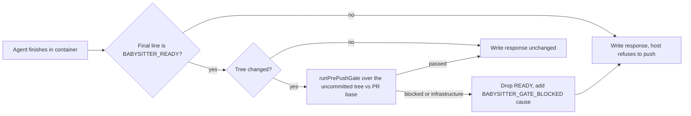

## Summary

PR #5034 put `deno test` (through `deno task test:unit`) and configured
markdownlint into the worker's push paths. The fleet PR babysitter's repair path
was not one of them: its container agent is only asked to run checks, and the
host then stages, commits and pushes after nothing stricter than
`git diff --check` (`validateAndCommit`, `finishBabysitterRepair`). This PR
closes that path inside the container, with no host execution beside the App
credentials.

After the repair agent finishes and ends its final message with the
`BABYSITTER_READY` line, the in-container `babysitter-repair` command runs the
existing `runPrePushGate` over the agent's uncommitted tree
(`worker/deno/lib/babysitter_tree_gate.ts`). The gate is the one the worker's
other repair pushes use: dependency-selected unit tests (or the whole suite for
a prompt, `deno.json` or lock change), configured markdownlint, the ShellCheck
policy and cargo-deny; not the formatters or linters. A failing test that fails
the same way at the merge-base with the PR base is a warning, a module-fetch
outage is an infrastructure fault, and anything else blocks. When the gate
blocks or cannot run, the container removes the `BABYSITTER_READY` line and puts
a `[BABYSITTER_GATE_BLOCKED]` line with the cause first, so the host's existing
completion check refuses to push and quotes the cause. A check that leaves stray
files in the clone (which the host's `git add -A` would push) also blocks. Part
of #4930.

## Spec

### Intent and Rationale

- The shift-left report is raised by the babysitter itself, and its repairs were
  the one push path that ran no deterministic test or markdown check. The
  container is the only place the repair may run checks, so the check runs
  there.
- The check reuses `runPrePushGate` rather than a second framework, as the issue
  asks.

### Essential Design Decisions

- The clone's `.git` is mounted read-only, so the gate sees a `PrePushGit`
  adapter: it lists the `git status` paths as the pushed files (new files count
  as tracked), and emulates the baseline `git worktree add` with `git archive` +
  `tar` into a temp root. Neither writes to `.git`.
- The PR base reaches the container as optional `--base-branch <name>`
  (`BabysitterContainerInput.baseBranch`, set from `pr.baseRefName`, validated
  with `assertSafeGitRef`). Without it there is no baseline and a failing test
  blocks (fail closed). `BABYSITTER_REPAIR_COMMAND` itself is unchanged.
- Withholding the READY line, not failing the container, is the verdict channel:
  the host already refuses a response without it and quotes the response.
  `isBabysitterReady` (`lib/babysitter_ready.ts`) is now the one rule for both
  the host and the container.

### Undiscoverable Facts

- Not verified in a real container: the unit tests run against injected seams
  and real temporary git repositories; `tar` being present in the worker image
  and the gate's wall-clock inside the 90-minute repair budget were not
  observed.
- The wedge/delivery history: #5014 was closed, #5034 merged as `Part of #4930`.

## Evidence

Backend-only; no UI files. Tests:
`worker/deno/tests/babysitter_tree_gate_test.ts`,
`worker/deno/tests/babysitter_repair_4738_test.ts`,
`worker/deno/tests/babysitter_ready_test.ts`,
`worker/deno/tests/fleet_babysitter_container_4738_test.ts`,
`worker/deno/tests/babysitter_fix_orchestration_test.ts`,
`worker/deno/tests/fleet_pr_babysitter_test.ts`. Docs:
`docs/workflows/fleet-pr-babysitter.md` (repair flow, diagram step, new
"Pre-push gate" paragraph, READY and missing-marker paragraphs, shift-left
paragraph), `docs/CONFIGURATION.md` (push-guarantee paragraph; the cargo-deny
and ShellCheck items no longer say babysitter repairs are unchecked). Ledger:
`docs/audits/lib-sweep-coverage/top-up-4930.json` claims the two new modules
(`sweptAt` moved to `96824f40`, so drift for the two older modules is measured
from there).

New non-test members have production readers: `runBabysitterTreeGate` and
`withholdReady` are called by `commands/babysitter_repair.ts`;
`isBabysitterReady` by `babysitter_repair.ts`, `babysitter_tree_gate.ts` and
`fleet_pr_babysitter.ts`; `baseBranch` is set at `fix()` in
`fleet_pr_babysitter.ts` and read by `buildBabysitterRunArgs`.

Related rules checked: the repair prompt sentences about checks that do not
withhold `BABYSITTER_READY` (unrelated or base-owned failures) still hold, since
a base-only failing test is a warning; one sentence was added saying the
container runs the unit tests and markdownlint after the agent.

## Acceptance Criteria

- **missing** — "Any affected-test selection must retain the checks needed to
  catch the reported regression classes" — reason: the selection is
  dependency-based, so dynamic loaders, import-map aliases, `jsr:`/`npm:`
  specifiers and a `_test.ts` outside `tests/` can still be missed (unchanged
  from #5034); the babysitter now uses the same selection.
- **missing** — "Use the supported contained pre-push/completion path to run the
  repository's applicable Deno tests and markdown checks before claiming a PR or
  repair is validated" — reason: the babysitter path is closed and tested
  against seams, but the container run itself (tar in the image, gate time
  against the 90-minute budget) was not observed.

## Test Plan

- `cd worker/deno && deno task test:unit tests/babysitter_tree_gate_test.ts tests/babysitter_repair_4738_test.ts tests/babysitter_ready_test.ts tests/fleet_babysitter_container_4738_test.ts tests/babysitter_fix_orchestration_test.ts tests/fleet_pr_babysitter_test.ts`:
  each file passed when run by its author (21, 40, 7, 55, 74 and 121 tests); the
  full gate re-ran them.
- `./quality.sh < /dev/null` on the head before this summary commit:
  `Result: PASSED (with skipped checks)`; deno tests, lint, type check, fmt,
  markdownlint, semgrep, spawn timeout and completeness checks passed; config
  integration and checkov were skipped by the gate. An earlier run failed
  `spawn timeout` (the `tar` spawn had no signal) and the sweep ledger test;
  both are fixed in the head (`570e38c6`).
- Behaviour tests (names end `(#4930)`): status parsing (modified, deleted,
  renamed, untracked, scratch files); each git interception (`log`, `ls-files`,
  git-common-dir, `worktree add` really extracting the fork commit via
  `git archive`+`tar`, `remove`, `prune`, refusal outside the temp root);
  outcome mapping (passed, infrastructure, blocked, a throw); redaction and
  1500-character cap; tree-pollution (a stray untracked file turns a pass into
  blocked, keeps the gate's own failure otherwise); `withholdReady`; the command
  withholds READY on blocked, infrastructure and a throw, leaves passed/clean
  unchanged, never calls the gate for a not-ready response, forwards and
  validates `--base-branch`; container argv gains `--base-branch` only when
  given and refuses an unsafe name; `startBabysitterAgent` and the repair flow
  forward `pr.baseRefName`.
- Red checks run by hand and restored: skip the READY check (1 test red); ignore
  the gate outcome (3 red); drop the `ls-files` interception (1 red); drop the
  `log --name-only` interception (1 red); drop the tree comparison (1 red); drop
  the `--base-branch` argv append (2 red); drop the forward in
  `startBabysitterAgent` (1 red); drop the call-site
  `baseBranch: pr.baseRefName` (1 red). Not red-checked: the `tar` timeout
  branch (it needs a real five-minute wait); it is covered only by the
  spawn-timeout scan.
- Removed from existing tests: none. `babysitter_repair_4738_test.ts` changed
  one harness `return` line to also return `treeCalls`; no assertion was edited.
- Callers checked for the new `baseBranch`: `fix()` in `fleet_pr_babysitter.ts`
  (the one production caller of `startBabysitterAgent`) passes it; the
  Apple-helper and plain argv builds in `runBabysitterRepairContainer` both pass
  it.
- Skipped / not checked: a real container run; the sweep-drift baseline move
  noted above.
