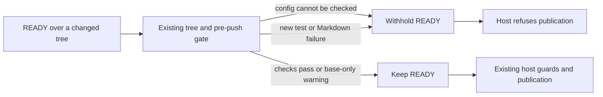

## Summary

Refuse unreadable or malformed Deno configurations instead of silently dropping
unit tests from validation. Add real-tool repair probes to the existing container
containment suite. Closes #4930.

## Spec

### Intent and Rationale

- The contained repair could retain `BABYSITTER_READY` after unit-test discovery
  discarded a malformed config. The shared pre-push gate now reports that fault.
- Reuse the existing gate, sanitised snapshot and repair mount builder; exercise
  real Deno and markdownlint inside the supported worker image.

### Essential Design Decisions

- Configuration faults are code verdicts. Existing module-fetch and missing-Deno
  infrastructure classifications and base-only warnings remain in place.
- Missing primary configs may use `deno.jsonc`; unreadable primary configs may
  not. Valid configs without `test:unit` remain ineligible. Formatter scope
  discovery retains its unfiltered fallback.
- The container probe substitutes agent services and the existing host
  publication harness. Check runners and the production tree adapter remain
  real. The probe uses the fixture owner's UID/GID, as the workflow's other
  in-image checks do, and asserts that `.git` rejects a write as read-only.

### Undiscoverable Facts

- This executor has no supported container runtime; runtime downloads returned
  proxy 403 errors. The supported-container verification therefore runs through
  the repository's existing Container Build workflow.
- Real `deno task --config <fixture> test:unit` accepts null config/task values
  as no task, and rejects array configs and array/string task definitions. The
  discovery checks preserve those observed distinctions.

## Evidence

Backend/CLI only; no UI files or screenshot required.

The Docker containment step passed on code commit `2e0c5e299` in
[Container Build run 43360443672](https://github.com/stSoftwareAU/VibeCoder/actions/runs/43360443672).
Its existing Podman build was still running when this record was written.
`worker/deno/tests/container_containment_test.ts` launches
`worker/deno/tests/support/babysitter_gate_container_probe.ts` using the repair
builder's clone and read-only `.git` mounts and sanitised worker snapshot.

| Real-container fixture | READY | Host-harness pushes |
| --- | --- | --- |
| Failing Deno assertion | withheld | 0 |
| Invalid Markdown (`MD018`) | withheld | 0 |
| Malformed Deno config | withheld | 0 |
| Corrected Deno control | retained | 1 |
| Corrected Markdown control | retained | 1 |
| Identical base-only Deno failure | retained | 1 |

The probe executes `runBabysitterRepair` → `runBabysitterTreeGate` →
`runPrePushGate`, then feeds the resulting response through the real host
`fix()` orchestration with the existing GitHub/git publication fakes. No live
fleet PR is published by these tests. `VIBE_CONTAINMENT_REQUIRED=1` already
makes an unavailable runtime/image fail this CI suite; the ordinary local run
reports that integration test as ignored.

Additional disposable-repository probes in a Linux mount namespace used real
read-only `.git` bind mounts, Deno 2.9.8 and markdownlint-cli2 0.24.1. New tests,
deleted/renamed imports and a prompt-triggered whole suite blocked regressions.
Missing Deno and a real loopback module-fetch 503 withheld READY as
infrastructure; missing markdownlint blocked as code. A WIP response without
READY remained unvalidated and the host refused publication.

The operator sections updated are **Container repairs** in
`docs/workflows/fleet-pr-babysitter.md` and **Agent pre-push hook and the
changed-files check** in `docs/CONFIGURATION.md`.

Provenance: #4930 — Shift left: fleet PRs keep failing CI on `deno test,
markdownlint` that a local gate could catch.

## Test Plan

- Against `origin/main` production code, the new/updated regression tests
  produced 227 passes and seven expected failures. After the correction, the
  two files passed all 234 tests. Tests and doubles were unchanged during the
  base-code run.
- The final targeted `deno task test:unit` run passed 456 tests across:
  `worker/deno/tests/pre_push_gate_test.ts`,
  `worker/deno/tests/babysitter_tree_gate_test.ts`,
  `worker/deno/tests/babysitter_repair_4738_test.ts`,
  `worker/deno/tests/babysitter_fix_orchestration_test.ts`,
  `worker/deno/tests/deno_test_baseline_test.ts`,
  `worker/deno/tests/pre_push_gate_cli_test.ts`,
  `worker/deno/tests/pre_push_gate_failure_category_test.ts`,
  `worker/deno/tests/completion_phase_pre_push_gate_3689_test.ts`,
  `worker/deno/tests/git_push_preflight_test.ts` and
  `worker/deno/tests/pr_feedback_processor_pre_flight_4630_test.ts`.
- New configuration tests cover malformed JSON/JSONC, an unreadable primary
  config beside a valid secondary, invalid root/task shapes, and restored
  passing controls. The ordinary, ShellCheck-only and CI-cargo-only gate modes
  refuse the config as code. Existing `loadDenoScopes` fallback, missing-config,
  no-task, JSONC comment/trailing-comma and primary-config precedence checks
  remain protected in `worker/deno/tests/pre_push_gate_test.ts`.
- The six new integration cases passed in the Docker containment step. The same
  committed probe also passed locally under real read-only bind mounts. The
  local containment/repair regression command passed its runnable tests and
  explicitly ignored the unavailable-runtime integration test.
- `deno task check:manifests`: 866 passed, one existing ignored ancestry check.
  Targeted formatting, lint and type checks passed. The earlier full
  `./quality.sh` passed with config integration and Checkov explicitly skipped;
  the final full-gate run after adding the container probe is not yet run.
- Config corpus: both tracked Deno configs at base and head select only
  `worker/deno`; zero false positives or false negatives (neither corpus has an
  invalid config). Markdown archive/test prose is not this parser's input.
- Callers checked: `readDenoConfigText` serves permissive scope discovery and
  strict unit-test discovery; `loadDenoUnitTestRoots` is consumed by the shared
  `runPrePushGate`. Completion, agent hooks, CI/PR repair modes and the
  babysitter reach that gate. No second copy of this discovery rule was found.
  `createRepairWorkspaceSnapshot` remains used by the production container
  launcher and is now exported for the containment probe.
- Removed from `worker/deno/tests/pre_push_gate_test.ts`:
  `assertEquals(ran, ["deno fmt --check --permit-no-files 'README.md'"]);`
  - Required by: "a skipped or unavailable check is not a pass."
  - Replaced by: `assertEquals(await loadDenoScopes(clone, ["deno.json"]), {})`,
    the exact config-refusal message assertion and
    `assert(!(result.error instanceof PrePushGateInfrastructureError))`, with
    accepted controls before corruption and after restoration in the same file.

## Deno regression avoided

The integration probe uses Deno and the image's existing markdownlint, without
adding a Node test runner or package manifest.

## Merge verification

- Required PR CI, independent review and the existing automatic merge path
  remain required. No workflow or merge policy was changed.
- Container Build's remaining Podman build and the final local gate are pending.

## Remaining risks and checks not performed

Live fleet PR publication and live Apple/Podman repair execution were not
performed. GitHub/git publication is represented by the existing host harness.
Local config integration lacks `.config.json`; local Checkov lacks its binary
and container runtime. Their skipped results are not passes.
