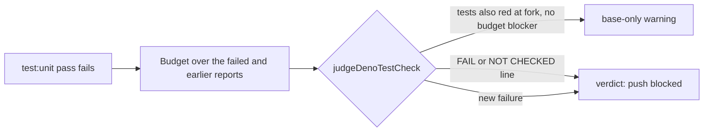

## Summary

Closes the last open item from #4930, which merged PR #5117 left `partial`: the
test-selection and time-budget cases carried over from PR #5034.

- **Time budget over a failed pass.** `deno task test:unit` now applies the
  unit-test time budget to a failed pass's JUnit report, and to any earlier
  passing pass, before it stops. The pre-push gate keeps a `base-only` warning
  only when that output has no budget failure line (`FAIL: every test in …`) and
  no `TIME BUDGET NOT CHECKED` line.
- **Affected-test selection.** A changed `_test.ts` outside `tests/` now runs,
  and so does a source file's `_test.ts` sibling in the same directory. Test
  files outside `tests/` are also scanned for names and imports. A local
  import-map alias runs the directory's whole suite. A file with a computed
  dynamic `import()` is assumed to depend on every changed module.

Closes #4930.

## Spec

### Intent and Rationale

- Before this change, a branch that added a file whose tests were all over
  budget could escape the gate. This happened when the failing tests also failed
  at the fork, because the runner stopped without checking the budget and the
  gate downgraded the failure to a warning. Real Deno writes the `--junit-path`
  report even when a test fails, so the runner can check the budget on its way
  out.
- Two tests at head live outside `tests/`
  (`worker/deno/lib/alert_feeds/*_test.ts`). The gate ran neither, even when
  that test or its source file changed.

### Essential Design Decisions

- A budget line refuses the downgrade only when it starts the trimmed output
  line. The git guard shim's `NOT ENFORCED` line is not a blocker; that is the
  existing #2669 rule.
- An unreadable report becomes a `TIME BUDGET NOT CHECKED` line. That line
  blocks the downgrade, because a check that was not run is not a pass.
- An import-map alias makes the graph impossible to follow, so the whole suite
  runs. A computed `import()` makes only its own file's dependencies unknown.
  That file therefore becomes a seed whenever the push changes a `.ts` file, and
  the tests that import it are selected. Running the whole suite for it instead
  would fire on every push at head: `tests/mod_test.ts` has a real computed
  import.
- A data file read through a path that no name, directory or template-literal
  token reveals can still be missed. Selection stays a heuristic, and CI's
  shards are the backstop.

### Undiscoverable Facts

- Observed: `deno test --junit-path=j.xml` on a file with one failing test exits
  1 and still writes the report (`tests="2" failures="1"` with per-test `time`).

## Evidence

Backend/CLI only.

Real runner probe: a temporary `tests/zz_probe_4930_test.ts` (deleted
afterwards) had two tests over 1 s, one of them failing. The parallel pass
failed, then the runner printed:

```text
=== parallel pass: FAILED in 2.3s
slow unit test (1.11s > 1.00s): tests/zz_probe_4930_test.ts — slow fail
slow unit test (1.10s > 1.00s): tests/zz_probe_4930_test.ts — slow pass
NOT ENFORCED: every test in tests/zz_probe_4930_test.ts (2, 2.22s) is over the 1.00s unit-test budget — the git guard shim is on PATH …
```

The `NOT ENFORCED` form appears because this agent's git guard shim was on
`PATH`. Without the shim, as in CI and the worker's own gate, the same report
prints a `FAIL: every test in …` line. Before this change the runner returned
straight after `FAILED` and printed none of these lines.



## Test Plan

All the following were run on the final code (`1b4dbca5`).

- New tests, each written first and observed red against the unchanged code:
  - `worker/deno/tests/deno_test_baseline_test.ts`:
    `judgeDenoTestCheck: a
    FAIL time budget line in the output blocks a base-only downgrade`,
    `… a
    TIME BUDGET NOT CHECKED line blocks …` and
    `… a FAIL budget line in the
    serial rerun blocks …`. Before the fix each
    got `base-only` where `verdict` was expected. The controls
    `… a NOT ENFORCED line (git guard
    shim) does not block …` and
    `… a budget phrase mid-line does not block …` stay `base-only`. The existing
    base-only tests are the allowed case.
  - `worker/deno/tests/unit_test_time_budget_test.ts`:
    `failedRunBudgetLines -
    a failed pass's all-slow file is a FAIL line naming it`,
    with a fast-file control, and
    `… a missing report is one TIME BUDGET NOT CHECKED line, not a
    pass`.
  - `worker/deno/tests/pre_push_gate_test.ts`:
    - `planChangedFileChecks: a changed test anywhere under the root runs, and
      a source plans its co-located test`
      (control: an untracked sibling is not planned).
    - `loadReferencedUnitTests: a co-located test is selected through its
      imports or the names it reads`.
    - `loadReferencedUnitTests: a computed dynamic import seeds on a .ts change
      under the root; a literal or prose form does not`.
    - `loadReferencedUnitTests: a long run of spaces after the call returns
      promptly, and spaces before the parenthesis do not match`,
      the hostile regex input of 200,000 spaces.
    - `unfollowableImportRoots: a local import-map target in imports or scopes
      is reported; a jsr-only map is not`.
    - `runPrePushGate: a local import-map alias in the root runs the whole unit
      suite`,
      run end to end through the gate. It planned
      `deno task test:unit 'tests/foo_test.ts'` before the fix and plain
      `deno task test:unit` after.
- Edited existing test, `worker/deno/tests/pre_push_gate_test.ts`
  (`planChangedFileChecks: only a tests/ file ending _test.ts is a test …` is
  renamed to `… a file ending _test.ts is a test wherever it lives …`):
  - Removed from `worker/deno/tests/pre_push_gate_test.ts`:
    `denoTestCommands(["worker/deno/lib/x_test.ts"], tracked, roots)` expected
    `[]`.
    - Obsolete: a changed `_test.ts` outside `tests/` was never run, which was
      the hole this change closes.
    - Replaced by: `["deno task test:unit 'lib/x_test.ts'"]` in the same test.
      The helper, non-`.ts` and `tests/` no-sibling assertions are unchanged.
- At the head, `unfollowableImportRoots` returns `[]` for `worker/deno`, so this
  repository keeps its selected lists. For a change to
  `lib/deno_test_baseline.ts`, the computed-import rule selects no test that the
  import walk does not already select. The five files with a computed import at
  the head are all tests.
- `deno task test:unit tests/deno_test_baseline_test.ts
  tests/unit_test_time_budget_test.ts`:
  46 passed. `deno task test:unit tests/pre_push_gate_test.ts`: 182 passed.
  `tests/pre_push_gate_cli_test.ts tests/babysitter_tree_gate_test.ts`: 75
  passed. That run was on the first selection revision, before the
  computed-import rework; the full gate below covers the final code.
- `./quality.sh < /dev/null` exited 0 with
  `Result: PASSED (with skipped
  checks)`. Deno tests passed in both the
  parallel (8m23s) and serial (3m38s) passes. Also passed: markdownlint,
  mermaid, semgrep, gitleaks, lint, type check and fmt. Skipped: config
  integration (no `.config.json`) and checkov (no binary or container runtime).
  These skips are not passes.
- Callers checked: `judgeDenoTestCheck` is called only by `runPrePushGate`.
  `loadReferencedUnitTests` and `plannedUnitTestFiles` feed the shared
  `runPrePushGate`. Completion, the agent hook, the CI/PR repair modes and the
  babysitter all reach it, so each gets the new selection. No second copy of the
  selection rule was found. The runner change keeps the failed pass's exit code,
  so CI's shards fail exactly as before.

## Docs

The `deno test` selection and baseline bullets in `docs/CONFIGURATION.md` were
updated, along with the doc comments in `pre_push_gate.ts`,
`deno_test_baseline.ts`, `unit_test_time_budget.ts` and `unit_test_runner.ts`.
The old sentences saying the budget is "not re-run" and that "import-map aliases
can still be missed" are gone.

## Merge verification

Required PR CI, review and the existing automatic merge path stay unchanged and
are pending on this PR.

## Not done or not checked

- A data file read through a path the scan cannot see is still a heuristic miss.
  CI's shards remain the backstop.
- Under the agent's git guard shim, the budget is still reported as
  `NOT
  ENFORCED`, as #2669 already does. The worker's own gate and CI enforce
  it.
- Checkov and config integration were skipped locally. Live fleet publication
  was not exercised.
