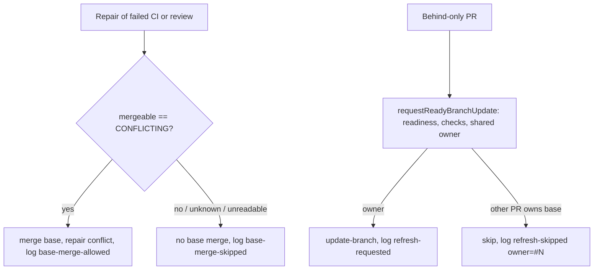

## Summary

Stops the confirmed source of repeated base-merge churn on strict bases and adds
attribution for every base-refresh decision. Part of #4943.

- A CI or review repair now merges the base into the PR branch **only when
  GitHub reports the PR `CONFLICTING`**. Before, `fleet_pr_babysitter.ts` ran
  `mergeBaseForRepair` on every repair, and the CI, feedback and spelling
  processors always ran `syncFeatureBranchWithDefault`, so each repair of a
  merely-behind PR pushed a base merge and restarted CI for a PR that was not
  selected for final integration. Behind-only refresh stays with #4613's
  `requestReadyBranchUpdate` and its shared per-base owner.
- Every refresh and base-merge decision logs one bounded stderr line
  `[base-refresh] source=… outcome=… repo=… pr=#N base=… owner=#N/worker|none reason="…" version=… commit=…`
  (new `worker/deno/lib/repair_base_merge_4943.ts`). Each updater lane passes a
  `source`; the line carries the worker build stamp so a stale deployed worker
  is visible (no lines at all from a worker older than this change).
- A repair's `UNKNOWN` mergeability read follows the existing #4831 recovery
  (`branch_refresh_refusal_streak.ts`): the base merge is skipped, the read is
  counted in the persisted refusal state, one trusted PR comment is posted at
  the second consecutive `UNKNOWN`, and a known read clears the streak and
  updates the comment. No polling loop is added.
- Each decision increments a named counter `baseRefresh.<outcome>.<source>`
  (plus `baseRefresh.repeatedMergeabilityUnknown`). Lanes inside the worker
  process feed the per-cycle `fault_tolerance_summary.json`. The standalone CI,
  feedback, spelling and babysitter commands do not write that summary, so each
  persists its own `base-merge-allowed` / `base-merge-skipped` tally in a
  cumulative `base_refresh_counters.json` (`persistBaseRefreshCounter`).
  Persistence directory per lane: the CI, feedback and spelling commands use the
  worker `config.workDir`; the babysitter uses `babysitterStateDir()` (the
  `fleet-pr-babysitter` state directory).
- The startup banner is extended with
  `[base-refresh] startup repair-base-merge=conflicting-only … version=… commit=…`
  beside `[worker-build]`; `commands/run_core.ts` prints both from
  `formatStartupBuildLines`, which is unit-tested.
- `docs/MERGE.md` documents the guard, the trade-off, the recovery, the counters
  and which update classes are prevented or remain.

Version bump: `VERSION` is not changed by this PR.

## Spec

### Intent and Rationale

- Four code paths merged the base into a PR beside #4613's owner: the babysitter
  repair, and the CI, feedback and spelling processors. The updater lanes
  (branch-update loop, pr-maintenance, sweep, babysitter-behind, reviewer
  script) already funnel through `requestReadyBranchUpdate`, so they were left
  as they are.
- Gating on `mergeable === "CONFLICTING"` is the smallest rule that keeps
  genuine conflicts repairable and stops every other repair adding a merge.

### Essential Design Decisions

- Unreadable or `UNKNOWN` mergeability skips the base merge (fail closed against
  churn); a genuine conflict is picked up on a later cycle once GitHub reports
  it. A repeated `UNKNOWN` is counted by the #4831 refusal streak; an unreadable
  or garbled read is inconclusive and leaves the streak as it was.
- The streak state file `.branch_refresh_refusals_v1` is per state directory.
  The CI, feedback and spelling lanes write it under the worker `workDir`, which
  the auto-merge sweep also loads and saves whole per pass, so a concurrent
  sweep save (or its unconditional `clearRefusal`) can drop or reset a
  processor-lane increment; that only delays the one comment by a read. The
  babysitter repair lane writes it under `babysitterStateDir()`, a separate
  directory the sweep never reads, so the sweep's comment and clear logic never
  sees a babysitter streak and the babysitter lane owns its own comment and
  clear.
- Trade-off accepted: a CI failure that appears only against the newer base is
  not reproduced inside the repair; it surfaces once the PR is refreshed as the
  owner.
- Diagnostics go to stderr (`console.warn`) so commands that print JSON on
  stdout stay parseable (the reviewer script does).
- `source` on `requestReadyBranchUpdate` stays optional (a caller that omits it
  logs `source=unspecified`) so existing seven-argument callers keep compiling;
  all seven production callers pass it.

### Undiscoverable Facts

- Runtime evidence for the two inspected private repositories was not available
  to this run, so the cause is established from the code paths, not from the
  runs.

## Evidence

Observed on the base commit: `mergeBaseForRepair` was called unconditionally in
`fix()`; `syncFeatureBranchWithDefault` was called unconditionally in
`pr_ci_processor.ts`, `pr_feedback_processor.ts` and `pr_spelling_processor.ts`.

Update classes: prevented — base merge added by a CI, review or spelling repair
of a behind or non-conflicting PR; behind-only refresh of a PR that is not the
base owner. Still necessary — genuine conflict repair, the owner's own refresh,
the non-strict-base direct `update-branch` request, merge-queue bases on their
existing path. No production improvement is claimed: the `[base-refresh]` lines,
counted by `source` and `outcome`, are what to watch.

Related existing behaviour checked:
`readRequiredCheckNames`/`requiredChecksPassed` and the approval gate in
`requestReadyBranchUpdate` are unchanged; no admin bypass is added.

## Acceptance Criteria

<!-- vibe-spec-review inputs="diff+issue-body" -->

- **met** — "Handle transient GitHub test-merge/mergeability reads using the
  existing #4831 recovery rather than indefinite polling." for the new
  repair-lane mergeability read — evidence:
  `worker/deno/tests/repair_base_merge_4943_test.ts::trackRepairMergeability posts one waiting notice at the second consecutive UNKNOWN read and one recovered notice after (Issue #4831)`,
  `worker/deno/tests/repair_base_merge_wiring_4943_test.ts::counts consecutive UNKNOWN reads in the #4831 refusal state and clears them on a known read`
  (CI, feedback and spelling lanes),
  `worker/deno/tests/babysitter_base_merge_policy_4943_test.ts::an UNKNOWN mergeability read skips the base merge and counts a #4831 refusal streak that a known read clears (Issue #4943)`
  (babysitter repair lane: `mergeBase` not called, streak reaches 2, a later
  MERGEABLE read clears it) — reviewer: met
- **met** — "runtime counters permit automatic follow-up" — evidence:
  `worker/deno/tests/repair_base_merge_4943_test.ts::logBaseRefreshDecision counts each decision by outcome and source`,
  `worker/deno/tests/repair_base_merge_4943_test.ts::persistBaseRefreshCounter accumulates named decision counters across calls and restarts the tally on a garbled file (Issue #4943)`,
  `worker/deno/tests/repair_base_merge_wiring_4943_test.ts::counts consecutive UNKNOWN reads in the #4831 refusal state and clears them on a known read`
  (asserts each processor's `base_refresh_counters.json` tally),
  `worker/deno/tests/babysitter_base_merge_policy_4943_test.ts::a conflicting repair is tallied as base-merge-allowed in the babysitter state dir (Issue #4943)`
  — reviewer: met (worker-process lanes feed `fault_tolerance_summary.json`; the
  standalone repair commands persist `base_refresh_counters.json`; the
  standalone behind-only refresh callers (babysitter-behind, `pr-maintenance`,
  the reviewer script) remain log-line only)
- **partial** — "Use current code and available redacted runtime evidence ...
  Extend existing startup/version diagnostics" — evidence:
  `worker/deno/tests/repair_base_merge_4943_test.ts::formatStartupBuildLines prints the build banner then the base-refresh policy from one stamp`,
  `worker/deno/tests/repair_base_merge_4943_test.ts::formatBaseRefreshStartup states the policy and the build stamp`
  — reviewer: partial — reason: the startup banner is extended and every
  decision line carries the build stamp, but redacted runtime evidence for the
  inspected repositories was not available to this run, so the cause is
  established from code paths; the `run_core.ts` call site is a loop over the
  tested `formatStartupBuildLines`.

## Standards Review

<!-- vibe-standards-review inputs="diff+CODING-STANDARDS.md" -->

- **violation** — dummy test asserting only a local gh fake — evidence:
  `worker/deno/tests/repair_base_merge_4943_test.ts` — reason: fixed in this
  diff (test deleted; the public-entry-point tests already cover the outcome)
- **clean** — new code reads like its surroundings, Australian English, tests
  drive the production entry points and assert outcomes

## Test Plan

- `worker/deno/tests/repair_base_merge_4943_test.ts` — decision, formatting
  (bounded, redacted), owner parsing, gh read failure and garbled JSON name
  their cause.
- Mutation survivors closed: the wiring tests now capture the logged
  `[base-refresh]` line for all three processors and match `source`, `outcome`,
  `repo`, `pr=#N` and `base`; the babysitter test matches the full allowed and
  skipped lines (`repo`, `pr`, `base`, outcome). New tests cover the tracker
  (threshold, one notice, recovery, inconclusive reads, failing tracker),
  counters and the startup line.
- `worker/deno/tests/repair_base_merge_wiring_4943_test.ts` — real
  `prCiProcessorCommand`, `prFeedbackProcessorCommand` and spelling processor:
  MERGEABLE and read-failure → no sync; CONFLICTING → sync.
- `worker/deno/tests/babysitter_base_merge_policy_4943_test.ts` — `fix()` skips
  `mergeBase` for failed CI and review repairs of a MERGEABLE PR, calls it for
  CONFLICTING; log outcome asserted.
- Mutation closure and #4831 babysitter proof:
  `babysitter_base_merge_policy_4943_test.ts` now drives `fix()` with an
  `UNKNOWN` PR twice (streak 2, `mergeBase` never called, fleet-health line),
  then a `MERGEABLE` read (streak cleared), and asserts the persisted
  `base-merge-allowed` / `base-merge-skipped` tallies in the babysitter state
  directory. Red checks: skipping `trackRepairMergeability` turned the UNKNOWN
  test red; negating the outcome ternary turned the line assertions and both
  tally tests red.
- Counter persistence and startup: `repair_base_merge_4943_test.ts` covers
  `persistBaseRefreshCounter` (accumulation, garbled file restart, no directory,
  unwritable directory) and `formatStartupBuildLines`; the wiring test asserts
  each processor's tally (`baseRefresh.base-merge-skipped.<lane>` = 3 over two
  UNKNOWN reads and one MERGEABLE read).
- `worker/deno/tests/base_refresh_churn_4943_test.ts` — competing lanes against
  one strict base: one owner gets `update-branch`;
  unready/draft/conflicting/unreviewed PRs get none; failed-CI, merged, closed
  and expired owners advance the next PR; newer push during validation;
  merge-queue and non-strict bases.
- `worker/deno/tests/support/babysitter_harness.ts` — harness moved verbatim
  from `babysitter_fix_orchestration_test.ts`, imported by it and the new
  babysitter test.
- Edited expectation: `babysitter_fix_orchestration_test.ts` "an owner-class
  failure journals nothing…" now uses a `CONFLICTING` PR (the base merge it
  guards only runs for one); no assertion removed. Red check: removing the
  babysitter `mergeBase` call turned it red.
- Red checks run: unconditional babysitter `mergeBase` → failed-CI and review
  tests red; unconditional CI/spelling sync → MERGEABLE and read-failure tests
  red; owner guard disabled → two-owner and crash-owner churn tests red;
  dropping the cause from the unreadable reason → two reason tests red.
- Standards reviewer findings left standing: wiring and babysitter tests assert
  the stubbed git/merge call counts because the processors expose no
  state-recording git port; `source` on `requestReadyBranchUpdate` is optional.
- `deno task check:manifests` and `tests/lib_sweep_coverage_test.ts` pass (new
  top-up slice `docs/audits/lib-sweep-coverage/top-up-4943.json`).
- `tests/pr_maintenance_command_test.ts` fails the same 5 cases (23 passed, 5
  failed) on a clean `origin/main` worktree and on this branch, so they are
  pre-existing and not touched by this change.
- `./quality.sh` on the final head: every stage passed except `deno tests`,
  whose only failures are those 5 `pr_maintenance_command_test.ts` cases (33923
  passed, 5 failed); config integration and checkov were skipped.
- `docs/MERGE.md` is hand-wrapped like the base file (the root docs are outside
  the gate's `deno fmt` run); `markdownlint-cli2` reports 0 issues.
- Follow-up run (review findings): the touched and related processor, babysitter
  and run-core test files pass except `run_core_production_deps_test.ts`
  "recheckAgentAuth - an auth failure clears the active provider cache (Issue
  #4267)", which fails identically with this change stashed, so it is
  pre-existing.
