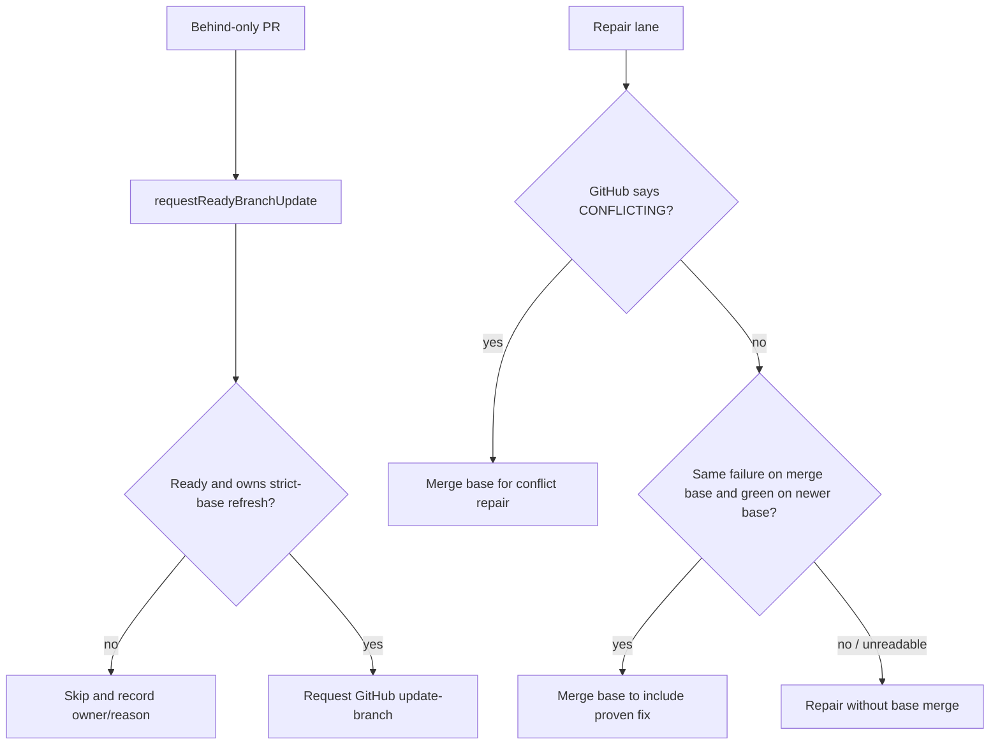

## Summary

Repairs no longer merge the base into a merely-behind PR. A repair merges the base for a real `CONFLICTING` PR, or for a failed check proven red with the same failure on the PR's merge base and green on a newer base. A green check on the current base by itself is not proof that the base fixed the PR's failure. Behind-only refreshes continue through the shared #4613 readiness and ownership path.

The refresh and repair paths log bounded, redacted decisions with their source, outcome, reason, owner and worker build revision. Standalone and in-process lanes with a work directory persist cumulative counters; branch-update-loop and PR-maintenance also record local conflict-merge outcomes. Tests cover the repair entry points, shared ownership decisions, transient mergeability recovery and concurrent counter writes.

Part of #4943.

Version bump: none in this change; the merged commit records the final version.

## Spec

### Intent and Rationale

- PR #5041 and #5050 review history exposed two risks in the first attempt: dropping the base-fix path needed by failed-CI deferral, and treating a green current base as proof that the base fixed a PR's failure.
- Keep behind-only refreshes on `requestReadyBranchUpdate()` and preserve genuine conflict repairs. Require historical failure evidence before a repair merges a base to bring in a fix.

### Essential Design Decisions

- `confirmBaseFailureFixed()` requires the same check identity and failure signature on the PR merge base, a green run on a newer base commit, and a current check run for the PR head. Unreadable or inconclusive evidence refuses the base merge.
- A genuine conflict and a proven base fix are repair actions under the repair lane's PR lease. The shared per-base owner continues to select otherwise-ready PRs for behind-only refresh; native merge queues remain on their existing path.
- Refresh counters are cumulative and updated under a file lock when a counter directory is available. They are diagnostic evidence, not a claim that production churn has fallen.

### Undiscoverable Facts

- Redacted runtime evidence for the two private fleet repositories was not available in this run. The implementation follows the observed production call paths; no production improvement is claimed.
- The runtime is unattended. Independent reviewer sub-agents were not run because this task explicitly prohibited delegation.

## Evidence

The default-branch update sources were traced through `fleet_pr_babysitter.ts`, the CI, feedback and spelling processors, `requestReadyBranchUpdate()`, `pr-maintenance`, the branch-update loop and the review-fleet skill. PR #5041 and #5050 were inspected with `gh`; their rejected green-only base-fix behaviour is not retained.

The merge-base proof uses GitHub's comparison endpoint. Observed command and result:

```text
gh api repos/stSoftwareAU/VibeCoder/compare/16678aba9b8c82d36b7046e4ec1c36e9c69320c4...4a36892a07aede2730617ac6ca3828ffdfc9b533 --jq .merge_base_commit.sha
c69a4b29f02019ec826f6a30739ba9bd83957add
```



Prevented update classes are behind-only refreshes for PRs that are not selected by the shared owner, and base merges added by CI, feedback or spelling repairs when no conflict or proven base fix requires them. Necessary updates remain: the owner's refresh, genuine conflict repair, a proven base-fix integration, eligible non-strict-base updates, and native merge-queue operation. Required-check and approval gates remain in `requestReadyBranchUpdate()`; no admin bypass was added.

Related issue provenance checked with `gh issue view`: #4613, “Branch updates: on a strict base with no merge queue, update only the PR that is ready to merge, not every PR that is behind”; #4831, “Strict-base branch refresh refuses an approved, armed, green PR for hours on a lazily recomputed test merge, and never escalates”; #4921, “Babysitter failed-CI repair fixes a failure already red on the base inside each unrelated PR, bypassing CI-fix's base-branch deferral (three private fleet PRs)”.

## Acceptance Criteria

- **missing** — “Integration tests drive competing updater paths/hosts against the same strict base: one eligible PR receives the final refresh; an unreviewed or otherwise unready behind-only PR does not.” — reason: tests exercise competing callers against the shared ownership helper and readiness outcomes, but do not run independent production updater entry points on separate hosts against one shared store.
- **missing** — “Cover substantive repairs, genuine conflicts, a newer push during validation, owner crash/expiry, failed CI and completion advancing to the next PR.” — reason: repair/conflict, crash/expiry, failed-CI, closure and next-owner cases are covered; the fresh-push case is tested during readiness, not during CI validation after refresh.

## Test Plan

- `worker/deno/tests/repair_base_merge_wiring_4943_test.ts` — 21 tests passed. Drives CI, feedback and spelling processor entry points, including a genuine base fix with matching historical failure evidence, green-current-base-only refusal, conflict repair and #4831 transient recovery. The green-current-base-only case failed against the `main` CI processor (it called the base sync).
- `worker/deno/tests/babysitter_base_merge_policy_4943_test.ts` — 7 tests passed. Drives `fix()` for behind-only, conflict and `UNKNOWN` repair decisions. The behind-only case failed against the `main` babysitter implementation (with `--no-check` because its call signature predates the new required source argument).
- `worker/deno/tests/babysitter_base_failure_4921_test.ts` — 16 tests passed. Includes the matching merge-base failure / newer green-base proof and refuses a green current-base check without historical evidence.
- `worker/deno/tests/repair_base_merge_4943_test.ts` — 33 tests passed. Covers repair decisions, bounded diagnostics, refusal recovery and persistent counters, including concurrent writes.
- `worker/deno/tests/base_refresh_churn_4943_test.ts`, `base_refresh_call_sites_4943_test.ts`, `base_refresh_counter_persist_4943_test.ts` — 23 tests passed. Cover shared ownership, readiness, owner expiry/reconciliation, caller attribution and counter persistence.
- `worker/deno/tests/pr_branch_update_test.ts` — 67 tests passed, including a local conflict repair's diagnostic and durable tally.
- Targeted `deno check` passed for the changed commands, libraries and tests; targeted `deno lint` passed for 21 changed TypeScript files; `deno fmt` passed for the changed TypeScript files.
- `deno task pr-summary-check --base main --issue-body-file /tmp/issue-4943-body.md --labels top-priority,failed-once ../../docs/archive/pr-summaries/pr-summary-4943.md` passed all applicable gates; acceptance-criteria closure and independent review were not applicable to the issue's `## Acceptance` heading.
- `timeout 360 ./quality.sh < /dev/null` — timed out with exit 124 after 360 seconds during the serial Deno test phase; preceding quality checks passed. Config integration and checkov were skipped by the gate (no `.config.json` and `checkov` unavailable on `PATH`).
