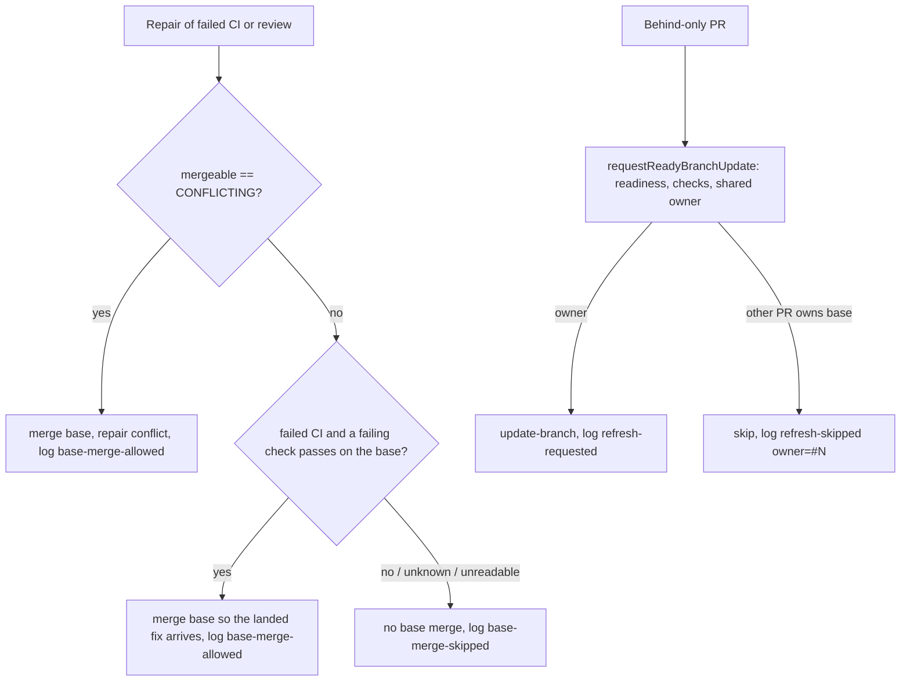

## Summary

Stops the confirmed source of repeated base-merge churn on strict bases and adds
attribution for every base-refresh decision that the shared refresh path makes.

Part of #4943.

This is a redo of the earlier attempt (PR #5041, closed unmerged): that branch
is the base of this one, and this head adds the fixes its two review rounds
asked for (the base-fix route, counter persistence, dummy and "how" tests, a
corrected PR record).

- A CI or review repair now merges the base into the PR branch **only when
  GitHub reports the PR `CONFLICTING`, or (failed-CI repairs in the babysitter
  and the CI processor only) when a failing check already passes on the base**,
  because the base fix has then landed (the route that #4921's deferral relies
  on). Before, `fleet_pr_babysitter.ts` ran `mergeBaseForRepair` on every repair
  and the CI, feedback and spelling processors always ran
  `syncFeatureBranchWithDefault`, so each repair of a merely-behind PR pushed a
  base merge and restarted CI for a PR that was not selected for final
  integration. Behind-only refresh stays with #4613's `requestReadyBranchUpdate`
  and its shared per-base owner.
- Every decision of `requestReadyBranchUpdate` and of the repair merge gate logs
  one bounded stderr line
  `[base-refresh] source=… outcome=… repo=… pr=#N base=… owner=#N/worker|none reason="…" version=… commit=…`
  (`worker/deno/lib/repair_base_merge_4943.ts`). `source` is now a required
  argument of `requestReadyBranchUpdate`, and every production caller passes it.
  The local conflict-repair merge in `performBranchUpdate`/`updatePrBranch`
  (branch-update loop, `pr-maintenance`, `update-pr-branch`) logs and counts
  nothing; `docs/MERGE.md` says so.
- A repair's `UNKNOWN` mergeability read follows the existing #4831 recovery
  (`branch_refresh_refusal_streak.ts`): no polling loop is added; the read is
  counted in the persisted refusal state, one trusted PR comment is posted at
  the second consecutive `UNKNOWN`, and a known read clears the streak and
  updates the comment. The comment for a repair lane has its own wording
  (`lane: "repair"`); the sweep's text is unchanged.
- Each decision increments a named counter `baseRefresh.<outcome>.<source>`
  (plus `baseRefresh.repeatedMergeabilityUnknown`). The standalone CI, feedback,
  spelling, babysitter (repair and behind) and `pr-maintenance` commands persist
  their own tally in a cumulative `base_refresh_counters.json`
  (`persistBaseRefreshCounter`; `pr-maintenance` only when a work directory
  resolves). The in-process `branch-update-loop`, `auto-merge-sweep` and
  `merge-block-repair` lanes pass the worker `workDir` as `counterDir`, so they
  persist to the same file; only `merge-block-escalation` feeds the per-cycle
  `fault_tolerance_summary.json` alone, which keeps only the last cycle of a run
  (#5043, filed by the earlier review, not fixed here).
- The startup banner gains
  `[base-refresh] startup repair-base-merge=conflict-or-base-fixed … version=… commit=…`
  beside `[worker-build]` (`formatStartupBuildLines`, printed by `run_core.ts`).
- `docs/MERGE.md` documents the guard, the trade-off, the recovery, the counters
  and which update classes are prevented or remain.

Version bump: `VERSION` is not changed by this PR.

## Spec

### Intent and Rationale

- Four code paths merged the base into a PR beside #4613's owner: the babysitter
  repair and the CI, feedback and spelling processors. The updater lanes already
  funnel through `requestReadyBranchUpdate`, so they keep that path and gain a
  `source` label and a diagnostic line.
- Gating on `mergeable === "CONFLICTING"` keeps genuine conflicts repairable and
  stops every other repair adding a merge. The base-fix exception exists because
  #4921 defers a red PR until its failure is fixed on the base and says the base
  merge then brings the fix in; with the gate alone no lane would ever merge
  that fix into the red PR.

### Essential Design Decisions

- Unreadable or `UNKNOWN` mergeability skips the base merge (fail closed against
  churn) unless the base-fix reading applies; a genuine conflict is picked up on
  a later cycle. A repeated `UNKNOWN` is counted by the #4831 streak, an
  unreadable or garbled read is inconclusive and leaves it as it was.
- The base-fix reading is narrow: the babysitter takes it only when the first
  failing check that is not red on the base is green there (`baseGreen` from
  `classifyBaseRedFailures`); the CI processor takes it for its own failing
  check. Feedback and spelling repairs have no failing check and merge only on
  `CONFLICTING`. It merges outside the shared owner, because the PR is red and
  `requestReadyBranchUpdate` refuses a PR whose required checks have not passed.
- The streak file `.branch_refresh_refusals_v1` is per state directory: the CI,
  feedback and spelling lanes write it under the worker `workDir`, which the
  sweep also loads and saves whole, so a concurrent sweep save can reset a
  processor increment (it only delays the one comment); the babysitter uses
  `babysitterStateDir()`, which the sweep never reads.
- `source` on `requestReadyBranchUpdate` is required, so the type checker names
  any caller that omits it.

### Undiscoverable Facts

- Redacted runtime evidence for the two inspected private repositories was not
  available to this run, so the cause is established from the code paths, not
  from the runs. No production improvement is claimed.
- `fault_tolerance_summary.json` keeps only the final cycle's named counters
  (#5043), which is why the standalone lanes persist their own file.

## Evidence

Observed on the base commit: `mergeBaseForRepair` was called unconditionally in
`fix()`; `syncFeatureBranchWithDefault` was called unconditionally in
`pr_ci_processor.ts`, `pr_feedback_processor.ts` and `pr_spelling_processor.ts`.

Update classes: prevented — a base merge added by a CI, review or spelling
repair of a behind or non-conflicting PR whose failure is not fixed on the base;
behind-only refresh of a PR that is not the base owner. Still necessary —
genuine conflict repair, the base-fix merge for a red PR, the owner's own
refresh, the non-strict-base direct `update-branch` request, merge-queue bases
on their existing path. `readRequiredCheckNames`/`requiredChecksPassed` and the
approval gate in `requestReadyBranchUpdate` are unchanged; no admin bypass is
added.

Tools observed rather than assumed: `requestReadyBranchUpdate` and the repair
processors were driven through their real entry points with `gh` and `git` seams
(see the Test Plan); `gh issue view 5043` returns "fault_tolerance_summary.json
keeps only the final cycle's named counters: they are reset every cycle but
written once at run end" (OPEN). Issue numbers cited as provenance: #4613
(shared base-refresh ownership), #4831 (transient refusal recovery), #4921
(defer a failure red on the base), #5043 (summary keeps only the last cycle).

## Acceptance Criteria

<!-- vibe-spec-review inputs="diff+issue-body" -->

- **partial** — "Integration tests drive competing updater paths/hosts against
  the same strict base: one eligible PR receives the final refresh; an
  unreviewed or otherwise unready behind-only PR does not." — evidence:
  `worker/deno/tests/base_refresh_churn_4943_test.ts::two ready behind PRs share one owner: #10 refreshes and #11 is refused for every competing caller`
  — reviewer: partial — reason: the competing lanes are distinct `source` labels
  passed to `requestReadyBranchUpdate`; the lane entry points (sweep,
  branch-update loop) are not driven together.
- **partial** — "Cover substantive repairs, genuine conflicts, a newer push
  during validation, owner crash/expiry, failed CI and completion advancing to
  the next PR." — evidence:
  `worker/deno/tests/babysitter_base_merge_policy_4943_test.ts::a conflicting PR merges the base once, and a conflicted merge still reaches the agent (Issue #4943)`,
  `worker/deno/tests/base_refresh_churn_4943_test.ts::an unexpired owner from a crashed worker still blocks the next ready PR`,
  `worker/deno/tests/base_refresh_churn_4943_test.ts::an owner record past its expiry is reconciled away so the next ready PR refreshes`,
  `worker/deno/tests/base_refresh_churn_4943_test.ts::failed required CI on the owner releases the base so the next ready PR refreshes`,
  `worker/deno/tests/base_refresh_churn_4943_test.ts::a merged owner releases the base so the next ready PR refreshes`,
  `worker/deno/tests/base_refresh_churn_4943_test.ts::a newer push seen on the third live read releases the just-acquired owner and sends no update-branch call`
  — reviewer: partial — reason: the newer-push tests move the head during the
  readiness reads; a push during CI validation after the owner's refresh is not
  driven end to end.
- **met** — "Test the production wiring of any confirmed bypass, not just the
  ownership helper. Demonstrate that the repaired scenario fails before the
  fix." — evidence: `worker/deno/tests/repair_base_merge_wiring_4943_test.ts`
  (real `prCiProcessorCommand`, `prFeedbackProcessorCommand` and the spelling
  processor: "does not sync the base for a behind-only (MERGEABLE) PR"),
  `worker/deno/tests/babysitter_base_merge_policy_4943_test.ts::a failed-CI repair on a behind-only (MERGEABLE) PR does not merge the base and still runs the agent (Issue #4943)`;
  red against the unconditional sync/merge, which is the base-commit behaviour —
  reviewer: met
- **met** — "Required checks and approvals still decide merging, native
  merge-queue bases remain on their existing path, and no admin bypass is
  introduced." — evidence:
  `worker/deno/tests/base_refresh_churn_4943_test.ts::a merge-queue base refuses the behind-only refresh and writes no ownership comment`,
  `worker/deno/tests/base_refresh_churn_4943_test.ts::a candidate whose required check failed on its head is refused before any update-branch call`
  — reviewer: met
- **met** — "Identify which observed update classes are prevented and which
  remain necessary. Do not assert a production improvement from synthetic tests
  alone; runtime counters permit automatic follow-up." — evidence:
  `docs/MERGE.md` (Issue #4943 section, "Still necessary"),
  `worker/deno/tests/base_refresh_counter_persist_4943_test.ts::base refresh counters: an accepted and a refused decision persist to counterDir and accumulate`,
  `worker/deno/tests/repair_base_merge_4943_test.ts::persistBaseRefreshCounter accumulates named decision counters across calls and restarts the tally on a garbled file (Issue #4943)`
  — reviewer: met — reason: the counters are persisted per standalone lane; the
  in-process lanes' last-cycle limit is #5043 and is stated in `docs/MERGE.md`.
- **partial** — "Trace the remaining update sources ... Use current code and
  available redacted runtime evidence ... Extend existing startup/version
  diagnostics" — evidence:
  `worker/deno/tests/repair_base_merge_4943_test.ts::formatStartupBuildLines prints the build banner then the base-refresh policy from one stamp`
  — reviewer: partial — reason: the startup banner is extended and every
  decision line carries the build stamp, but redacted runtime evidence for the
  inspected repositories was not available, so the cause is established from
  code paths only.
- **partial** — "Ensure every fleet writer observes the appropriate PR lease and
  final-integration ownership. ... record why their refresh was necessary and
  validate the resulting tree through the supported contained path." — evidence:
  `worker/deno/tests/babysitter_base_merge_policy_4943_test.ts` — reviewer:
  partial — reason: the four repair lanes no longer add a gratuitous merge and
  log why each merge was taken; the local `updatePrBranch` conflict merge
  records no reason and no counter, and the base-fix and conflict repair merges
  are not taken under the shared owner.
- **met** — "Handle transient GitHub test-merge/mergeability reads using the
  existing #4831 recovery rather than indefinite polling." — evidence:
  `worker/deno/tests/repair_base_merge_4943_test.ts::trackRepairMergeability posts one waiting notice at the second consecutive UNKNOWN read and one recovered notice after (Issue #4831)`,
  `worker/deno/tests/branch_refresh_refusal_streak_test.ts::the repair tracker posts one repair-lane comment and edits it to recovered, through createRepairMergeabilityTracker (Issue #4943)`,
  `worker/deno/tests/babysitter_base_merge_policy_4943_test.ts::an UNKNOWN mergeability read skips the base merge and counts a #4831 refusal streak that a known read clears (Issue #4943)`
  — reviewer: met
- **unrequested** — the base-fix route (`baseGreen`, the `fixedOnBase` probe and
  its tests) — reviewer: unrequested — reason: a blocking review finding on the
  earlier PR; without it a red PR deferred by #4921 never receives the base fix.
  Kept deliberately and documented as a still-necessary update class.
- **unrequested** — the babysitter harness moved to
  `worker/deno/tests/support/babysitter_harness.ts` and the lib-sweep top-up
  `docs/audits/lib-sweep-coverage/top-up-4943.json` — reviewer: unrequested —
  reason: the harness is shared by two test files, and the top-up is required by
  the completeness gate for the new module.

## Standards Review

<!-- vibe-standards-review inputs="diff+CODING-STANDARDS.md" -->

- **violation** — docs said an `UNKNOWN` read always skips the base merge and
  that the base-fix route reports every green check — evidence:
  `docs/MERGE.md:413` — reason: fixed in this diff
- **violation** — module doc claimed every lane logs a line — evidence:
  `worker/deno/lib/repair_base_merge_4943.ts:12` — reason: fixed in this diff
- **violation** — the shared PR comment said a strict-base refresh was refused,
  which is false for a repair lane — evidence:
  `worker/deno/lib/branch_refresh_refusal_streak.ts:48` — reason: fixed in this
  diff (`lane: "repair"` wording, sweep text pinned unchanged)
- **violation** — counter persistence and the decision logging swallowed errors
  silently — evidence: `worker/deno/lib/repair_base_merge_4943.ts:218` and
  `worker/deno/lib/required_branch_checks_4613.ts:511` — reason: fixed in this
  diff (each logs one redacted warning; the result is unchanged)
- **violation** — probe call-count assertions — evidence:
  `worker/deno/tests/repair_base_merge_4943_test.ts:515` — reason: fixed in this
  diff (removed; the decision and reason carry the outcome)
- **violation** — changed call sites with no test that goes red without them —
  evidence: `worker/deno/lib/merge_block_escalation.ts:346` and the other
  `source` arguments — reason: fixed in this diff
  (`worker/deno/tests/base_refresh_call_sites_4943_test.ts`; callers without a
  test are listed in the Test Plan)
- **clean** — the reviewer's `syncCalls` finding on
  `worker/deno/tests/repair_base_merge_wiring_4943_test.ts` is disputed, not a
  violation: the processors expose no state-recording git port, so whether
  `syncFeatureBranchWithDefault` ran is the repair gate's only observable
  outcome at that seam (every other call-count assertion was removed).
  Australian English, no dummy tests, edited expectations still go red without
  their guard, every named test exists, all production callers of
  `requestReadyBranchUpdate` pass `source`, secrets are redacted in reasons and
  errors.

## Test Plan

- `worker/deno/tests/repair_base_merge_4943_test.ts` — decision (conflict,
  base-fix, every other value), bounded and redacted formatting, owner parsing,
  gh read failure and garbled JSON naming their cause, tracker streak over a
  temp directory, counter persistence (accumulation, garbled file, no directory,
  unwritable directory; each failure logs its cause), startup lines.
- `worker/deno/tests/repair_base_merge_wiring_4943_test.ts` — real
  `prCiProcessorCommand`, `prFeedbackProcessorCommand` and spelling processor:
  MERGEABLE and read-failure → no sync; CONFLICTING → sync; CI processor syncs
  once when its failing check passes on the base and not when it reads
  red/no-run/unavailable or the probe throws; feedback and spelling keep their
  gate for such a PR; persisted streak and counter tallies.
- `worker/deno/tests/babysitter_base_merge_policy_4943_test.ts` — real `fix()`:
  failed-CI and review repairs of a MERGEABLE PR do not merge; CONFLICTING does;
  a MERGEABLE PR whose failing check is green on the base merges and the merge
  reaches the agent; UNKNOWN twice builds the streak and a later known read
  clears it. The merge is observed through the repair prompt ("has already
  merged the latest main") and the persisted tally, not a stub call count.
- `worker/deno/tests/babysitter_base_failure_4921_test.ts` — `baseGreen` is set
  exactly when the stopping check is green on the base and is undefined for
  every other repair reading.
- `worker/deno/tests/base_refresh_churn_4943_test.ts` — competing lanes against
  one strict base: one owner gets `update-branch`; unready/draft/conflicting/
  unreviewed PRs get none; failed-CI, merged, closed and expired owners advance
  the next PR; a crashed unexpired owner still blocks; newer push during the
  readiness reads; merge-queue and non-strict bases.
- `worker/deno/tests/base_refresh_counter_persist_4943_test.ts` — real
  `requestReadyBranchUpdate`: accepted and refused decisions persist to
  `counterDir`; without it nothing is written; an unwritable directory never
  changes the Result.
- `worker/deno/tests/branch_refresh_refusal_streak_test.ts` — the sweep's
  comment text unchanged for the default lane; repair-lane wording; the repair
  tracker posts one comment and edits it to recovered.
- `worker/deno/tests/base_refresh_call_sites_4943_test.ts` — production callers
  that pass a `source`: see the callers listed as covered and skipped below.
- Edited existing tests: `babysitter_fix_orchestration_test.ts` — "an
  owner-class failure journals nothing…" now uses a `CONFLICTING` PR (the base
  merge it guards runs only for one); no assertion removed; red check: removing
  the babysitter `mergeBase` call turned it red. The harness moved verbatim to
  `tests/support/babysitter_harness.ts` (plus a configurable merge result).
  `required_branch_checks_4613_test.ts`, `base_refresh_ownership_4613_test.ts`,
  `auto_merge_sweep_keeps_armed_test.ts` and `pr_maintenance_command_test.ts`
  only pass the now-required `source`; no assertion changed.
- Red checks run: unconditional babysitter `mergeBase` → failed-CI and review
  tests red; unconditional CI/spelling sync → MERGEABLE and read-failure tests
  red; ignoring the base-fix probe/`baseGreen` → five tests red; owner guard
  disabled → two-owner and crash-owner churn tests red; removing the counter
  persist call → two counter tests red; removing the persistence warnings → the
  garbled-file and unwritable-directory tests red; forcing the refresh wording
  for a repair lane → the repair-lane tests red, the default-lane test stays
  green; changing each covered caller's `source` string → its call-site test
  red.
- Covered through their production entry point (source string reverted → red):
  `review-fleet-prs` (`branch_update.ts`), `babysitter-behind` (`fix()`, with
  the tally in the state directory) and `merge-block-repair`
  (`run_core_production_deps.ts`). Not covered: `merge-block-escalation`
  (`handleMergeAttempt`'s default updater reads `CONFIG_PATH`/`GITHUB_USER` with
  no seam, and a test that sets them is barred by the parallel-safety cap),
  `branch-update-loop` and `auto-merge-sweep` (no existing test builds those
  lanes with a `gh` fake), and `pr-maintenance` (`source` and the work-directory
  argument; the command tests never reach the refresh). The required `source`
  parameter makes the type checker name any omission.
- `deno task check:manifests` and `tests/lib_sweep_coverage_test.ts` pass (the
  top-up slice is `docs/audits/lib-sweep-coverage/top-up-4943.json`).
- Doc comment and manual sections read: the `repair_base_merge_4943.ts` module
  doc, the `baseGreen` type doc, `docs/MERGE.md` (Issue #4943 section and the
  #4613 paragraphs around it).
- `./quality.sh < /dev/null` on the final head: PASSED (with skipped checks):
  every stage passed, including all unit tests, `deno lint`, `deno check`,
  `deno fmt`, markdownlint, mermaid, semgrep and the completeness checks; config
  integration and checkov were skipped (no `.config.json`, no checkov on PATH).
  `tests/pr_maintenance_command_test.ts` passes 28 of 28 here, so the earlier
  PR's claim of five pre-existing failures there was wrong and is withdrawn.
- Verifier finding `run_core_production_deps.ts:3164` (and the sites at 3743 and
  3872): fixed. The three in-process callers now pass `workDir` as `counterDir`;
  `base_refresh_call_sites_4943_test.ts::production merge-block repair lane logs
  source=merge-block-repair`
  now also reads the persisted
  `baseRefresh.refresh-requested.merge-block-repair` tally from `workDir`, and
  went red with the `workDir` argument removed. The other two sites are the same
  one-argument change and are not separately driven.
- Mutation finding `fleet_pr_babysitter.ts:3124` (negated ternary on the logged
  `babysitter-repair` outcome): disputed with evidence. Applying the mutation
  and running `babysitter_base_merge_policy_4943_test.ts` turns 5 of 7 tests red
  (the `ALLOWED_LINE`/`SKIPPED_LINE` assertions), so a test does kill it; the
  gate's run stopped after 7 of 351 mutants on its 300 s budget.
- Not done or not checked: no runtime evidence from the inspected repositories;
  the lane entry points are not driven together in one test; the local
  `updatePrBranch` conflict merge is neither logged nor counted;
  `merge-block-escalation`, `branch-update-loop`, `auto-merge-sweep` and
  `pr-maintenance` `source` labels have no production-entry test.
