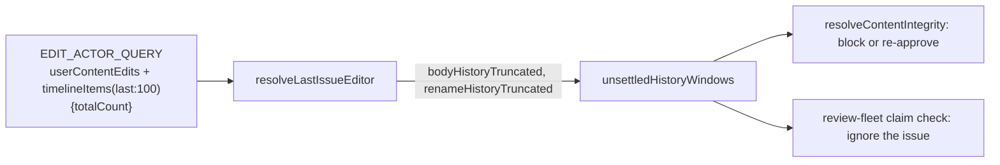

## Summary

The content-integrity edit-actor lookup read only the newest 100 title renames
(`timelineItems(last:100, …)`) and could not tell when older renames had been
dropped. It now asks for the connection's `totalCount`, reports
`renameHistoryTruncated` beside `bodyHistoryTruncated`, and the gate treats a
truncated rename window exactly like a truncated body window: it is settled only
when its oldest returned rename predates the snapshot; otherwise it fails closed
through the `content-edit-history-truncated` path. Closes #4947.

## Spec

### Intent and Rationale

- An approved issue with more than 100 renames after the snapshot, the oldest
  from an untrusted account, showed the gate only trusted renames, so it took
  the trusted-editor path and re-baselined. This is the title-side twin of #4804.
- The settle rule lives once, in `unsettledHistoryWindows`
  (`worker/deno/lib/issue_edit_actor.ts`), and both callers use it: the gate
  (`worker/deno/lib/work_on_content_integrity.ts`) and the review-fleet claim
  check (`.claude/skills/review-fleet-prs/scripts/test_change_policy.ts`), which
  carried a copy of the body-only rule.

### Essential Design Decisions

- A missing, non-integer or too-small `timelineItems.totalCount` is a malformed
  response and fails the lookup, as `userContentEdits.totalCount` already does,
  so the gate blocks as `content-editor-unresolved`. A truncated rename window
  with an unparseable `createdAt` also fails the lookup. A complete window still
  skips a node with a bad timestamp, as before.
- Each window is judged on its own: a settled body window does not settle an
  unsettled rename window, and the reverse. A trusted re-approval is honoured
  only when every unsettled window holds a returned edit; an empty truncated
  window cannot be re-approved until a new edit of that kind enters it.
- Body-only output (log line, comment, next step, dedup key) is unchanged.

### Undiscoverable Facts

- Observed on real GitHub (`gh api graphql`, stSoftwareAU/VibeCoder issue #234):
  with `itemTypes:[RENAMED_TITLE_EVENT]`, `totalCount` counts only renames (2,
  against 28 timeline items without the filter). `last:1` returned one node with
  `totalCount` 2 and `pageInfo.hasPreviousPage` true, so `totalCount` greater
  than the node count marks hidden older renames.

## Evidence

Backend only; no UI file is touched.

- Documentation: `SECURITY.md` section "TOCTOU Protection for Issue Content"
  (both the resolver paragraph and the truncated-history bullet, now "Truncated
  body or rename history"), and the doc comments in `issue_edit_actor.ts`,
  `work_on_content_integrity.ts` and `issue_finder_logger.ts`.
- `./quality.sh < /dev/null` on the final code: passed (config integration and
  checkov skipped by the gate itself).

## Test Plan

- `worker/deno/tests/issue_edit_actor_test.ts`: the query asks for
  `timelineItems(last:100,itemTypes:[RENAMED_TITLE_EVENT]){totalCount`; 150
  renames keep the newest 100 and report `renameHistoryTruncated`; a complete
  history does not; a missing or too-small `totalCount` is rejected; a truncated
  window with an unparseable `createdAt` fails while a complete one skips the
  node; ten `unsettledHistoryWindows` cases (body, rename, both, settled,
  empty, oldest exactly at the snapshot, complete).
- `worker/deno/tests/work_on_content_integrity_truncated_history_4804_test.ts`:
  eight gate tests, each with its own fake (it serves the newest 100 renames and a
  `totalRenames` override): blocked when every visible rename post-dates the
  snapshot; proceeds when the oldest predates it; an untrusted rename inside a
  settled window is judged as untrusted; body-settled and rename-unsettled
  blocks, and the reverse; a trusted `work-on` re-add clears it; an empty window
  cannot be re-approved; a complete three-rename history is the control.
- `worker/deno/tests/review_fleet_prs_test_policy_4655_test.ts`: four claim-rule
  tests through `resolveGoverningIssues` (rename window unsettled, settled,
  empty, and a body window, which had no test for this message).
- Fixtures: every fake edit-actor response in eleven other test files gained
  `timelineItems.totalCount`. No assertion was removed or weakened.
- Red checks (each break made on purpose in the lib, the named tests went red,
  then restored): rename flag forced false (7 red); rename window dropped from
  `unsettledHistoryWindows` (9 red); rename `totalCount` validation removed (2
  red); truncated-window `createdAt` check removed (1 red); rename window reading
  the body edits' times (10 red); the claim check ignoring the rename window (2
  red); gate `canReapprove` forced true (4 red).
- Ran: `deno task test:unit` over the three touched test files passed;
  `./quality.sh < /dev/null` passed.
- Twinned rule found and changed: the review-fleet claim check
  (`test_change_policy.ts`) now calls the shared helper. Callers of
  `resolveLastIssueEditor` checked: the gate, that claim check, and the fixtures
  above; no other production caller exists.

## Not done

- One existing test, "claim rule: newest body edits are checked beyond the
  100-edit window", uses a window the body-only rule already treated as
  unsettled (visible oldest edit after the label), so it reaches the
  incomplete-history message first. This predates this change and was left as is.
