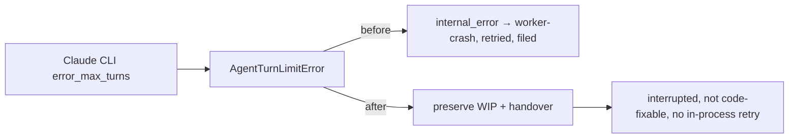

## Summary

A Claude CLI run stopped at its per-run turn cap (`error_max_turns`) in the
execute phase was recorded as `internal_error`, so it was classified
`worker-crash` (code-fixable) and auto-filed as a worker fault, re-run once by
the in-process infrastructure retry although the cap is documented as "without a
retry", and its uncommitted work was not preserved. The execute phase now treats
the turn-cap stop as an interruption: it preserves the work on the issue branch
with a handover note, releases the run as `interrupted` (not code-fixable, never
auto-filed) and skips the in-process retry. Every other agent error still maps
to `internal_error` exactly as before. Closes #4949.

## Spec

### Intent and Rationale

- The issue body withholds its source (private repo), so the cause was found in
  the source issue's release comment. The run on host
  `vibe-coder-16110-2a87290b…` (stSoftwareAU/GRQ-AutoTraderBackTesting#205,
  released 2026-11-09T01:27Z) reads: "no PR (`infrastructure-error`, phase
  `execute`) — Claude execution failed: The Claude CLI reached its per-run turn
  limit (error_max_turns)". 5343 s fits two capped attempts, the second being
  the in-process retry.
- `quality_gate_remediation_phase.ts` already maps `AgentTurnLimitError` to
  `interrupted`; the execute phase was the one caller that did not.

### Essential Design Decisions

- Category `interrupted` (as in the precedent), not `criteria_unmet`: both are
  non-fixable and neither is auto-filed. `interrupted` is a transient class in
  `coding_failure_ladder.ts`, as `worker-crash` already was, so the issue's
  `failed-once` ladder behaves as before: an issue that exhausts the cap on
  every run still takes no `failed-once` mark.
- The no-retry rule keys on a worker-written heading (`TURN_LIMIT_HEADING`) in
  the reason, the way `USAGE_LIMIT_HEADING` does, so quoted agent text cannot
  trigger it.
- WIP is preserved before the result is returned, with a new `turn-limit` cause
  on the commit subject and handover note
  (`wip: execute hit the agent turn limit …`). The tree is inspected using the
  error's own `executionResult.output`, because `state.claudeOutput` is never
  set from a failed invocation.

### Undiscoverable Facts

- The release comment quoted above is in a private repository and is the only
  place the cause was recorded; the filed issue carries only class, phase and
  elapsed time.

## Evidence

Backend only; no UI file is touched.

- Documentation: `docs/CONFIGURATION.md`, row "Claude turn cap" (the issue-work
  sentence added; the rest of the row read and still true). Cause lists in
  `wip_checkpoint_test.ts`, `handover_note_test.ts` and
  `wip_commit_marker_test.ts` now include `turn-limit`. Siblings grepped:
  `usage-limit`, `external-sigterm`.
- `./quality.sh < /dev/null`: every stage passed except `deno tests`, whose
  parallel pass failed only in
  `worker/deno/tests/pr_maintenance_command_test.ts` (five tests, lines 346, 477
  and 496; unrelated to this change and failing on `origin/main`); the serial
  pass did not run because the parallel pass failed.

## Reproduction

- **symptom** — a run stopped at the Claude turn cap in the execute phase was
  released as `infrastructure-error` / `worker-crash`, retried once and
  auto-filed.
- **status** — `verified` — the regression test was observed failing against the
  unfixed code and passing after the fix: with the new `AgentTurnLimitError`
  branch disabled (`if (false && …)`, which restores the base behaviour of
  mapping every error to `internal_error`) two of the four tests fail (category
  `internal_error`, two invocations); with it enabled all four pass. Against the
  literal base file the test does not compile, because `TURN_LIMIT_HEADING` is
  new.
- **regression test** —
  `worker/deno/tests/execute_phase_turn_limit_4949_test.ts::execute_phase #4949 - a turn-capped run with a clean tree is released as interrupted and not retried`

## Test Plan

- `worker/deno/tests/execute_phase_turn_limit_4949_test.ts` (new, four tests):
  clean-tree turn cap is `interrupted`, one invocation, `classifyRunFailure`
  gives `not_code_fixable` / `interrupted`; dirty-tree turn cap commits
  `wip: execute hit the agent turn limit after …` and writes the handover note;
  a plain `Error("spawn failed")` still gives `internal_error` with two
  invocations (control); the new commit-subject builder.
- Cause lists extended in `worker/deno/tests/wip_checkpoint_test.ts`,
  `worker/deno/tests/handover_note_test.ts` and
  `worker/deno/tests/wip_commit_marker_test.ts`; no assertion removed.
- Red checks (break made on purpose, then restored): whole new branch disabled →
  2 red; only the retry bypass disabled → 2 red (invocation count and the
  dirty-tree test's retry); only the tree inspection pointed back at
  `state.claudeOutput` → 1 red (dirty-tree test).
- Ran: `deno task test:unit` over the new file,
  `execute_phase_handover_test.ts`, `execute_phase_usage_limit_test.ts`,
  `execute_phase_failed_run_4147_test.ts`, `handover_note_test.ts`,
  `wip_checkpoint_test.ts` and `wip_commit_marker_test.ts`: 78 passed, 0 failed.
- Callers checked: the only production caller of the new `"turn-limit"` cause is
  the execute phase; `buildInterruptedWipCommitMessage` and `describeWipCause`
  take it through the existing `Record<WipPreservationCause, string>`.

## Not done

- The capped invocation's token stats are not recorded on this path
  (pre-existing for every `!claudeResult.ok` return).
- No PR self-heal after a turn cap (the timeout and kill paths have one); a run
  that already has an open PR is not looked up here.
- An issue that hits the cap on every run is not laddered (unchanged:
  `worker-crash` was also transient).
