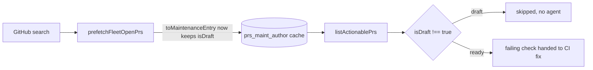

## Summary

The CI-fix scan ran an agent on a draft fleet PR's by-design `gate` failure
because the cross-repo prefetch wrote the `prs_maint_<author>` cache entry
without `isDraft`. `findFailedCiChecks` already drops drafts
(`.filter((pr) => pr.isDraft !== true)`, Issue #4152), but read `undefined` from
a prefetched listing, so the draft passed. `toMaintenanceEntry` in
`worker/deno/lib/fleet_pr_prefetch.ts` now carries `isDraft`, so the existing
filter works on the cached path. Closes #4951.

Version bump: `VERSION` updated for this change; the merged commit records the
final version.

## Spec

### Intent and Rationale

- PR #4896 was a draft from 2026-11-07T19:20Z until `ready_for_review` at
  2026-11-09T08:35Z
  (`gh api repos/stSoftwareAU/VibeCoder/issues/4896/timeline`), yet the scan
  kept picking it up. The scan's draft filter has been in `pr_maintenance.ts`
  since #4152 (2026-10-23), so the filter was bypassed, not missing.
- The bypass is the prefetch: `toMaintenanceEntry` omitted `isDraft`, while the
  per-repo listing path (`PR_MAINTENANCE_LIST_FIELDS`) includes it. Fixing the
  cache entry is the root-cause fix; a second check in `processCiFailure` would
  only mask a listing that is wrong.

### Essential Design Decisions

- Draft PRs are skipped whatever check failed, per the owner rule of 2026-10-23
  in `pr_maintenance.ts` (a draft's checks are not run). The issue's "a draft
  whose check actually failed keeps today's behaviour" is read as: today's
  behaviour for a draft is the scan skipping it, which is unchanged. No
  `gate`/skipped-needs discrimination was added, because it would make the scan
  act on a draft the owner rule excludes.
- No `processCiFailure` live draft check was added: the issue allows "the scan,
  or `processCiFailure`", and the scan is where the fault was.

### Undiscoverable Facts

- Root cause was confirmed by the test going red with only the `isDraft` line
  removed, not by reading production logs.
- `toMaintenanceEntry` also omits `labels`, `body` and `reviewDecision` that
  `PR_MAINTENANCE_LIST_FIELDS` requests. Not changed here (out of scope).

## Evidence

Backend-only change; no UI files touched.

- Production reader of the new field: `worker/deno/lib/pr_maintenance.ts`
  (`.filter((pr) => pr.isDraft !== true)` in `findFailedCiChecks`).
- Fake mirrors production: `fakeGithubPrSearch`
  (`worker/deno/tests/support/github_graphql_fake.ts`) stands in for GitHub's
  search API; the test runs the real `prefetchFleetOpenPrs` and the real
  `findFailedCiChecks`.
- Issue numbers cited as provenance: `#4951`: CI-fix runs an agent on a draft
  PR's by-design gate failure, again every scan; `#4152`: Draft PRs skip CI and
  the CI fixer (`gh log` title of commit e117ab15).

## Acceptance Criteria

<!-- vibe-spec-review inputs="diff+issue-body" -->

- **met** — The PR-CI scan, or `processCiFailure` before any agent invocation,
  skips an open draft PR whose failing check is `gate` and whose required jobs
  were skipped. No agent runs, no comment is posted and no attempt is charged. —
  evidence:
  `worker/deno/tests/fleet_pr_prefetch_draft_ci_scan_4951_test.ts::findFailedCiChecks - a draft fleet PR's failing gate is not returned when the listing is served from the prefetch (Issue #4951)`
  — reviewer: met
- **met** — A draft PR whose check actually failed (a job that ran and failed)
  keeps today's behaviour. — evidence: `worker/deno/lib/pr_maintenance.ts` draft
  filter in `findFailedCiChecks`, unchanged — reviewer: partial — reason:
  departed from the reviewer, who read this as "a draft with a real job failure
  must still reach the CI fixer". The scan has skipped every draft since the
  owner rule of 2026-10-23 (#4152, comment above the filter); a draft's jobs are
  skipped by `if: !draft`, so a job that ran and failed on a draft does not
  occur in the fleet workflow. "Today's behaviour" for a draft in the scan is
  the skip, and it is unchanged. Reversing the owner rule is not this issue's
  call
- **met** — A test in each direction. — evidence:
  `worker/deno/tests/fleet_pr_prefetch_draft_ci_scan_4951_test.ts::findFailedCiChecks - the same PR, not a draft, is returned with its failing gate (Issue #4951 positive control)`
  and the draft-skipped test above — reviewer: partial — reason: departed from
  the reviewer, who wanted a draft-with-real-failure test returned to the fixer;
  same reasoning as the previous criterion

- **unrequested** —
  `prefetch - the prs_maint entry carries isDraft true for a draft and false for a ready PR (Issue #4951)`
  — reviewer: unrequested — reason: pins the one production line directly (the
  sibling values differ, so a constant would go red); it supports the fix and is
  not extra behaviour

## Standards Review

<!-- vibe-standards-review inputs="diff+CODING-STANDARDS.md" -->

- **clean** — no violation found. Checked: new tests go red without the change
  (draft test and entry test red, positive control green, per the reviewer's
  trace and my run); sibling values differ in the entry test; both callers of
  `toMaintenanceEntry` (`prs_maint_` and `toInvitationEntry`); temp dirs are
  test-owned; real prefetch and real scan, not a fake more permissive than
  production; docs sweep (`docs/GH-API-OPTIMISATION.md` does not list entry
  fields); Australian English. The reviewer ran nothing, so its red/green
  verdicts are traced; mine come from the red check in Test Plan.
- Persisted data: the `prs_maint_<author>` cache entry (600 s TTL) gains a
  field. A reader treats a missing `isDraft` as "not a draft", so an entry
  written before this change simply repeats the old behaviour until it expires;
  the key is not bumped because no reader needs the old shape converted.

## Test Plan

- Added `worker/deno/tests/fleet_pr_prefetch_draft_ci_scan_4951_test.ts` (3
  tests): draft `gate` failure not returned from the prefetched listing (no
  per-repo `gh pr list`); same PR not draft is returned; the
  `prs_maint_<author>` entry carries `isDraft` true/false.
- Red check: removing only the `isDraft` line from `toMaintenanceEntry` turned
  the draft test and the entry test red (draft test returned the `gate` check
  for PR 7; entry test read `undefined`); the positive control stayed green.
  Line restored.
- Existing tests edited: none.
- `deno task test:unit` on the new file, `fleet_pr_prefetch_test.ts`,
  `fleet_pr_prefetch_budget_2662_test.ts` and `pr_maintenance_test.ts`: 111
  passed, 0 failed.
- `./quality.sh < /dev/null`: Result PASSED (with skipped checks: config
  integration, checkov).
- Callers of `toMaintenanceEntry` checked: `prefetchFleetOpenPrs` (`prs_maint_`)
  and `toInvitationEntry` (spreads it); both consumers read `isDraft` as
  optional, so an added field changes no other behaviour.
- Twinned rule: the draft filter lives in `findFailedCiChecks` only; other lanes
  using `listActionablePrs` (lines 1055, 1482, 2186 of `pr_maintenance.ts`) do
  not filter drafts and are unchanged.

Not done / not checked: no `gate`-versus-skipped-needs discrimination and no
`processCiFailure` live check were added (see Essential Design Decisions);
`labels`/`body`/`reviewDecision` missing from the prefetched maintenance entry
left as is.
