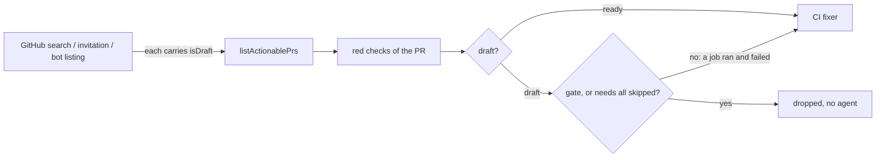

## Summary

The CI-fix scan ran an agent on a draft fleet PR's by-design `gate` failure
because drafts reached `findFailedCiChecks` without `isDraft` on three of its
listing sources. Closes #4951.

- `toMaintenanceEntry` (`worker/deno/lib/fleet_pr_prefetch.ts`) now carries
  `isDraft`, so the prefetched `prs_maint_<author>` entries say which PRs are
  drafts.
- `INVITATION_CACHE_FIELDS` (`pr_invitation_lookup.ts`) and the bot door's
  `OPEN_PR_LIST_FIELDS` / `toPrEntry` (`issue_query.ts`, `pr_bot_lookup.ts`)
  carry `isDraft` too, so the per-repo invitation listing and the bot listing no
  longer hide a draft.
- `findFailedCiChecks` no longer drops every draft. It drops a draft's red check
  only when it cannot pass there (`worker/deno/lib/draft_ci_by_design.ts`): the
  check is `gate`, or its `needs:` (the existing `jobNeeds` topology) were all
  skipped on that head (one `skipped` check-run read, only when a non-`gate` red
  check has `needs:`). A job that ran and failed on a draft goes to the CI fixer
  as before. The scan logs `draft-by-design-ci` for each drop.

## Spec

### Intent and Rationale

- PR #4896 was a draft from 2026-11-07T19:20Z until `ready_for_review` at
  2026-11-09T08:35Z
  (`gh api repos/stSoftwareAU/VibeCoder/issues/4896/timeline`), yet the scan
  kept picking it up. #4152 added a draft filter in `pr_maintenance.ts`, but the
  prefetched listing omitted `isDraft`, so it read `undefined` and the draft
  passed.
- The issue's Expected section limits the skip to a failing check "that cannot
  pass on a draft: `gate`, or any check whose `needs` were all skipped" and says
  a draft whose job ran and failed "keeps today's behaviour". The blanket filter
  from #4152 contradicted that, so this PR replaces it with the per-check rule
  above; the reviewer of PR #5030 asked for exactly this.

### Essential Design Decisions

- Per-check, not per-PR: `dropDraftByDesignFailures` is pure and takes the
  skipped-check read as an injected function, so the rule is tested without
  `gh`.
- "Needs all skipped" is one level: the check's own `needs:` entries must all
  appear among the head's skipped check names. A check with no `needs:` entry
  (or no clone to read the topology from) is never excused, except `gate`, which
  is excused by name.
- Fail toward the fixer: when the skipped-check read fails
  (`fetchFailedCheckRuns` returns `[]`), a non-`gate` check is kept, so a real
  failure is never hidden by a failed read.
- Fix at the listing sources, not a `processCiFailure` live check: every source
  now carries `isDraft`, and the scan is where the decision is made.

### Undiscoverable Facts

- `listInvitedHumanPrs` skips a human's listing when a cached `prs_open_all`
  proves they have no open PR, so the invitation test leaves `prs_open_all`
  unseeded.
- `toMaintenanceEntry` also omits `labels`, `body` and `reviewDecision` that
  `PR_MAINTENANCE_LIST_FIELDS` requests. Not changed here.

## Evidence

Backend-only change; no UI files touched.

- Production readers of the new field: `pr_maintenance.ts`
  (`pr.isDraft === true` in `findFailedCiChecks`).
- Fakes: `fakeGithubPrSearch` stands in for GitHub's search API (the prefetch
  tests run the real prefetch and the real scan); the invitation test's `gh`
  stub answers only the `--json` fields it is asked for, as `gh` does; the draft
  scan test's stub answers `check-runs` by the `.conclusion` named in the `--jq`
  filter, as GitHub's would.
- Issue numbers cited as provenance: `#4951`: CI-fix runs an agent on a draft
  PR's by-design gate failure, again every scan; `#4152`: Draft PRs skip CI and
  the CI fixer; CI runs once when marked ready.

## Acceptance Criteria

<!-- vibe-spec-review inputs="diff+issue-body" -->

- **met** — The PR-CI scan, or `processCiFailure` before any agent invocation,
  skips an open draft PR whose failing check is `gate` and whose required jobs
  were skipped. No agent runs, no comment is posted and no attempt is charged. —
  evidence:
  `worker/deno/tests/fleet_pr_prefetch_draft_ci_scan_4951_test.ts::findFailedCiChecks - a draft fleet PR's failing gate is not returned when the listing is served from the prefetch (Issue #4951)`,
  `worker/deno/tests/fleet_pr_prefetch_draft_ci_scan_4951_test.ts::findFailedCiChecks - an invited human's draft served from the invitation listing has its failing gate skipped (Issue #4951)`,
  `worker/deno/tests/pr_bot_lookup_test.ts::listBotPrs - asks for isDraft and carries it onto the entry (Issue #4951)`
  and
  `worker/deno/tests/pr_maintenance_draft_ci_4951_test.ts::findFailedCiChecks - a draft's red check whose needs were all skipped is not returned (Issue #4951)`
- **met** — A draft PR whose check actually failed (a job that ran and failed)
  keeps today's behaviour. — evidence:
  `worker/deno/tests/fleet_pr_prefetch_draft_ci_scan_4951_test.ts::findFailedCiChecks - a draft fleet PR whose job ran and failed is still returned (Issue #4951 criterion 2)`
  and
  `worker/deno/tests/pr_maintenance_draft_ci_4951_test.ts::findFailedCiChecks - a draft's red check with a need that ran is returned (Issue #4951)`
- **met** — A test in each direction. — evidence: the skip tests above and the
  returned-failure tests above, with positive controls
  `worker/deno/tests/fleet_pr_prefetch_draft_ci_scan_4951_test.ts::findFailedCiChecks - the same PR, not a draft, is returned with its failing gate (Issue #4951 positive control)`
  and
  `worker/deno/tests/pr_maintenance_draft_ci_4951_test.ts::findFailedCiChecks - the same red check on a ready PR is returned though its needs were skipped (Issue #4951 positive control)`

## Standards Review

<!-- vibe-standards-review inputs="diff+CODING-STANDARDS.md" -->

- **clean** — no violation found. Checked: new tests go red without the change
  (red checks in Test Plan); sibling values differ in the entry test; callers of
  `toMaintenanceEntry` (`prs_maint_` and `toInvitationEntry`); real prefetch and
  real scan; Australian English.
- Persisted data: the `prs_maint_<author>`, `prs_invited_<author>` and
  `prs_open_all` cache entries (short TTL, per cycle) gain an `isDraft` field. A
  reader treats a missing `isDraft` as "not a draft", so an entry written before
  this change repeats the old behaviour until it expires; the keys are not
  bumped because no reader needs the old shape converted.
- Docs sweep: `CONTRIBUTING.md` ("An incomplete PR is a draft") said the CI
  fixer ignores a draft; reworded to name the by-design failures. The
  `PrEntry.isDraft` doc comment in `pr_maintenance.ts` is updated.
- Twinned rule: the draft rule lives in `findFailedCiChecks` only; other lanes
  using `listActionablePrs` do not filter drafts and are unchanged.
- Existing callers of the changed shared pieces: `listActionablePrs` (all lanes)
  now receive `isDraft` on invited and bot entries; only `findFailedCiChecks`
  and `auto_merge_sweep` read it, and the latter already skips drafts.
  `fetchAllOpenPRs` gains `isDraft` on `OpenPRWithBody`, which `OpenPR` already
  declared. `getBlockingPRForIssue` also reads `pr.isDraft` (Issue #4146: the
  fleet's own draft for an issue does not hold it), and its open-PR input
  includes the `fetchAllOpenPRs` listing that feeds the idle-decision census, so
  that reader now sees `isDraft` on those rows too: a fleet draft for the issue
  stops counting as a blocking PR there, which is the #4146 rule it was already
  meant to apply. Pinned for the listing by
  `worker/deno/tests/issue_query_test.ts`.

## Test Plan

- Tests at head:
  `worker/deno/tests/fleet_pr_prefetch_draft_ci_scan_4951_test.ts` (6 tests at
  head), `worker/deno/tests/pr_maintenance_draft_ci_4951_test.ts` (4 tests at
  head), `worker/deno/tests/draft_ci_by_design_4951_test.ts` (6 tests at head),
  one added to `worker/deno/tests/pr_bot_lookup_test.ts`, and one added to
  `worker/deno/tests/issue_query_test.ts` (`fetchAllOpenPRs` carries `isDraft`
  only when `gh` reported a boolean; red when the `typeof` condition at
  `issue_query.ts:1289` is negated).
- Red checks (each flip run on the head tests, then restored):
  - `pr.isDraft === true` forced false in `findFailedCiChecks`: 3 tests red.
  - skipped read changed to `["failure"]`: 1 test red.
  - `needs.every` changed to `needs.some`: 2 tests red.
  - the `gate` name rule deleted: 3 tests red.
  - the `isDraft` line removed from `toMaintenanceEntry`: 2 tests red.
  - `isDraft` removed from `INVITATION_CACHE_FIELDS`: the invitation draft test
    red.
- Branch outcomes: `gate` dropped by name (`draft_ci_by_design_4951_test.ts`);
  needs all skipped dropped; a need that ran kept (operand `every` flipped to
  `some`); no `needs:` entry kept; no topology kept; skipped list read once
  across several checks; draft with a real job failure returned
  (`fleet_pr_prefetch_draft_ci_scan_4951_test.ts`); ready PR unaffected
  (positive controls). The bot door's `isDraft` is covered by
  `pr_bot_lookup_test.ts`; an unreadable skipped-check read keeps the check for
  the fixer (`pr_maintenance_draft_ci_4951_test.ts`, no red flip run: it pins
  current behaviour, which `fetchFailedCheckRuns` already provides).
- `deno task test:unit` over the 58 test files that touch the scan, listings or
  drafts: 1334 passed, 0 failed (before the unreadable-read test was added; that
  file's 4 tests pass).
- `./quality.sh < /dev/null`: not re-run after this round's changes (run budget
  spent on the targeted checks above); `deno fmt`, `deno lint` and `deno check`
  were run on the changed files, and markdownlint on `CONTRIBUTING.md`.

Not done / not checked: `labels`/`body`/`reviewDecision` missing from the
prefetched maintenance entry left as is; "needs all skipped" is judged one level
deep, not transitively.
