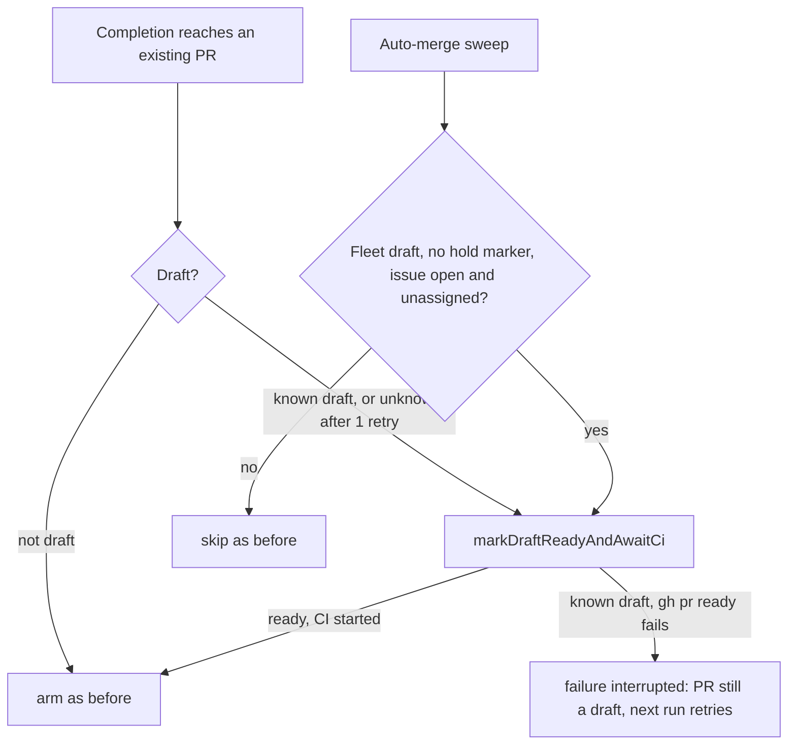

## Summary

A completed run could release its claim as "raised #N" while the PR it had
reached was still a draft and unarmed (PR #4896 sat so for about 28 hours).
Completion now retries an unreadable draft state once, marks a draft ready, and
fails the run (`interrupted`, retried, never filed) when `gh pr ready` fails on
a known draft instead of continuing. The REST-fallback creation path, which can
return an already-open draft, runs the same ready step when the REST draft flag
says draft or cannot be read. The fallback is entered on any primary rate-limit
message, and while the GraphQL quota is latched `gh pr view` and `gh pr ready`
are skipped, so the draft flag is read over REST and a REST-confirmed draft is
treated as known. The auto-merge sweep also readies an orphaned fleet draft (no
continuation or mutation-hold marker, open issue with no fleet assignee) and
arms it in the same pass. Two criteria are `partial` (the documented fail-open
paths where the draft state cannot be read), so this is `Part of #4952`.

## Spec

### Intent and Rationale

- `recoverAndFinaliseExistingPr` marked a draft ready only when `lookupPrState`
  said `isDraft`; a null lookup, a failed `gh pr ready` (only logged) and the
  REST-fallback path left the draft, and the claim was still released. After
  that no lane owned it: the babysitter and sweep skip drafts.
- Fix at the completion paths that reach an existing PR, plus a sweep self-heal
  for any draft that still slips through.

### Essential Design Decisions

- A failed ready on a **known** draft returns `failure` / `interrupted`: the run
  outcome then names the PR with the failure attached, not a plain raise.
  `interrupted` is transient and never auto-filed; the next run retries.
  A failed post-PR ready step skips the whole-body infrastructure retry.
- Unknown state (lookup null after one retry): the ready helper's own `isDraft`
  read decides. Draft → same rules as a known draft (CI-start guard of Issue
  #4160 and failure on a failed ready). Not draft or unreadable → the old
  behaviour (arm as before; a failed ready only warns), so a wholly failing `gh`
  is not turned into a failed run.
- The self-heal reads the hold marker only at the anchored position the worker
  writes it (start of the body), so a quotation mid-body does not hold a draft.
  "Unclaimed" means no assignee among the fleet logins (claim = assignee,
  `claim_issue.ts`); an omitted `assignees` key is a malformed response and
  refuses.
- The hold survives a body rewrite (PR #5033 review).
  `buildSyncedPrBodyCandidate` (`pr_body_sync.ts`) adopts a marker-less
  continuation draft on its own `issue-N` branch and rebuilds the body with
  `assemblePrBody`, which carries over the milestone section, bump notes,
  sub-agent tier marker and assignment id but not a leading hold marker; it now
  also keeps a leading `DRAFT_CONTINUATION_MARKER` when the live body opens with
  it. Self-heal and sync share `opensWithDraftContinuationMarker`
  (`draft_continuation_pr.ts`) so they cannot disagree on what a hold is. Both
  rewrite paths use that builder: the merge-conflict repair sync and the
  completion-exit `adoptAgentRaisedPrBody`.
- The REST-fallback path reads `GET repos/<repo>/pulls/<n>` `.draft`
  (`readPrDraftViaRest`, `pr_create_rest.ts`; PR #5033 review) because that path
  is entered on any primary rate-limit message, which usually means the quota is
  latched, and `spawnGh` (`gh_spawn.ts`) skips every non-`gh api` call while it
  is. `true` → `readyDraftBeforeArming` with a known draft, so a ready the latch
  skips fails the run `interrupted` instead of releasing the claim as raised;
  `false` → left alone and armed; unreadable → the unknown-state fail-open rule.
  GitHub has no REST ready-for-review endpoint, so a latched draft is retried by
  the next run, not readied here.
- `markDraftReadyAndAwaitCi` replaces the boolean `markReadyAndAwaitCi`
  (removed; its only remaining caller was a test) and returns
  `{ready, ciStarted, draft}`.

### Undiscoverable Facts

- The issue's example run was on a private-repo timeline; the code path was
  found by reading `completion_phase.ts`, not from logs.

## Evidence

Backend only; no UI file is touched.

- `./quality.sh < /dev/null` on the final head: PASSED (with skipped checks:
  config integration, checkov). An earlier run failed only
  `lib_sweep_coverage_test.ts` for the new module; fixed by
  `docs/audits/lib-sweep-coverage/top-up-4952.json`.
- Docs: `docs/MERGE.md` (the auto-merge sweep draft bullets),
  `docs/workflows/issue-processing.md` (the two draft-completion bullets) and
  `docs/GH-API-OPTIMISATION.md` (the `isDraft` sentence) were read and updated.
  Siblings grepped: `markReadyAndAwaitCi` (no remaining mention outside
  `docs/archive`), "skipping draft PR", "draft continuation".
- Fakes: the gh fakes mirror `gh pr view --json headRefOid,isDraft` and
  `gh issue view --json state,assignees` output shapes the production code
  already parses (`lib/issue_query.ts`, `lib/claim_issue.ts`); the arming call
  is observed through `deps.pr.finalisePr`, the production seam.
- Twin check: no second copy of a changed rule found (`pr_summary_check.ts` is
  unaffected).

## Acceptance Criteria

<!-- vibe-spec-review inputs="diff+issue-body" -->

- **partial** — A test drives completion with an existing draft PR on every path
  that ends with the claim released ("raised #N"), and asserts `gh pr ready` and
  the auto-merge arming — evidence:
  `worker/deno/tests/completion_draft_ready_4952_test.ts` (recover path,
  creation-error path, REST fallback via `workOnIssueCompletion` with the
  latch's skip behaviour modelled) — reviewer: partial — reason: two paths still
  release the claim as raised with the draft neither readied nor armed, both the
  documented fail-open: the unknown-state path (lookup, head read and
  `gh pr ready` all fail), and the REST-fallback path when its REST draft-flag
  read also fails; a REST-confirmed draft on the fallback path now fails the run
  `interrupted` instead
- **met** — A self-healing pass marks ready (and arms) an open fleet draft PR
  that has no draft-continuation or mutation-hold marker in its body and whose
  issue is unclaimed. Covered by a test. — evidence:
  `worker/deno/tests/draft_pr_self_heal_4952_test.ts`,
  `worker/deno/tests/auto_merge_sweep_draft_heal_4952_test.ts`,
  `worker/deno/tests/auto_merge_ensure_draft_heal_wiring_4952_test.ts` —
  reviewer: met
- **partial** — `markReadyAndAwaitCi` failures are logged as WARNING with the PR
  number. The release comment does not claim that the PR was raised ready when
  it was not. — evidence:
  `worker/deno/tests/completion_draft_ready_4952_test.ts` (failed ready fails
  the run and names the PR) — reviewer: partial — reason: the WARNING and the
  failed run are done for a known draft; when the lookup, the helper's own read
  and `gh pr ready` all fail, the run still continues (documented fail-open);
  the rendered release-comment text was not read, only the run outcome category
  and reason
- **unrequested** — `docs/audits/lib-sweep-coverage/top-up-4952.json` —
  reviewer: unrequested — reason: the repository's completeness gate requires
  every new lib module to be claimed by a sweep slice

## Standards Review

<!-- vibe-standards-review inputs="diff+CODING-STANDARDS.md" -->

- **violation** — unknown-state completion path armed without the CI-start guard
  — evidence: `worker/deno/lib/phases/completion_phase.ts:991` — reason: fixed
  in this diff
- **violation** — missing `assignees` key read as "no assignees" — evidence:
  `worker/deno/lib/draft_pr_self_heal.ts:131` — reason: fixed in this diff
- **violation** — marker read with `includes()` over a mixed body — evidence:
  `worker/deno/lib/draft_pr_self_heal.ts:102` — reason: fixed in this diff
- **violation** — `markReadyAndAwaitCi` export read only by tests — evidence:
  `worker/deno/lib/draft_continuation_pr.ts:338` — reason: fixed in this diff
- **violation** — hook wiring with no test that goes red without it — evidence:
  `worker/deno/lib/run_core_production_deps.ts:3856` — reason: fixed in this
  diff
- **violation** — new branches without tests (issue-view failure, non-string
  body, listing head fallback) — evidence:
  `worker/deno/lib/draft_pr_self_heal.ts:123` — reason: fixed in this diff
- **violation** — changed shared helper's `isDraft:false` result untested
  through its completion caller — evidence:
  `worker/deno/lib/phases/completion_phase.ts:984` — reason: fixed in this diff
- **violation** — local copy of `errText` — evidence:
  `worker/deno/lib/draft_pr_self_heal.ts:169` — reason: fixed in this diff
- **clean** — Australian English, fail-loud logging with PR numbers, no
  persisted-shape change, no secrets staged, new parameters have production
  setters, review-enforced "check where you insert" and "over-engineering" rules
  checked. The fixes after this review were not re-reviewed by a second reviewer
  run.

## Test Plan

- New: `worker/deno/tests/completion_draft_ready_4952_test.ts`,
  `worker/deno/tests/draft_pr_self_heal_4952_test.ts`,
  `worker/deno/tests/auto_merge_sweep_draft_heal_4952_test.ts`,
  `worker/deno/tests/auto_merge_ensure_draft_heal_wiring_4952_test.ts`.
- Body-sync hold (PR #5033 review), in
  `worker/deno/tests/draft_pr_self_heal_4952_test.ts`: a continuation draft
  (marker-less adoption path) and a worker-marked hold draft are run through the
  real `syncPrBodyFromSummary`, then `readyOrphanedDraftPr` still declines both;
  a control shows a draft that never had the marker gets none and is healed.
  Sync marker keep disabled → the two hold tests red, control green.
- Edited: `worker/deno/tests/draft_ready_ci_4160_test.ts` calls
  `markDraftReadyAndAwaitCi` and asserts `.ciStarted`; every assertion is kept,
  none removed.
- Red-checks (one break each, restored byte-for-byte): null-lookup branch
  disabled → unknown-state tests red; no retry → retry test red; failed ready
  still continues → failed-ready test red; unknown-state failure rule and
  `ciStarted` overwrite → three tests red; REST draft read removed (the old
  `readyDraftBeforeArming(..., true, ...)` call) → the latched REST-draft and
  REST-ready tests red; the `draft === null` operand forced to `false` → the
  unreadable-flag test red; whole ready branch disabled → the three
  `workOnIssueCompletion` path tests red; self-heal: marker check dropped → red,
  fleet-assignee check dropped → red, OPEN check dropped → red, branch guard
  dropped → red, omitted `assignees` treated as `[]` → red, unanchored
  `includes` → look-alike tests red, listing head preferred over live → red;
  sweep: hook result ignored → red, hook throw uncaught → red; wiring line
  removed from `run_core_production_deps.ts` → wiring test red.
- Callers checked for the changed `markDraftReadyAndAwaitCi`: completion
  recovery and creation paths, the sweep self-heal;
  `worker/deno/tests/completion_draft_ready_4952_test.ts` (21 tests at head) and
  `worker/deno/tests/draft_ready_ci_4160_test.ts` (5 tests at head) exercise the
  unknown-state default. Also for the REST draft read:
  `worker/deno/tests/pr_create_rest_test.ts` (22 tests at head; two new ones pin
  `readPrDraftViaRest`) and five REST-fallback tests in the completion file
  (latched + REST draft, latched + REST ready, latched + unreadable flag,
  recovered quota + draft, recovered quota + draft + failed ready); the latched
  fakes reject every non-`gh api` call with the latch's skip message.
- On the final head: `deno task test:unit` over the completion and
  `pr_create_rest` test files, 43 passed, 0 failed; formatter and linter run on
  the changed files. Against the earlier head's production code, the latched
  REST-draft and REST-ready tests fail ("the run fails, not continues", "gh pr
  ready is not called").

## Not done

- The rendered claim-release comment text was not read; the outcome carries the
  PR with the failure attached (`deriveRunOutcome`).
- A held draft is re-read by `gh pr view` each sweep pass (per-cycle cost).
- The self-heal ignores a claim held only by a heartbeat with no assignee.
- A draft that is readied but whose CI has not yet started is armed by a later
  sweep pass, not this one.

## Mutation check follow-up

- `worker/deno/lib/auto_merge_sweep.ts:377` (deleted `repo` property) — killed
  by `worker/deno/tests/auto_merge_sweep_draft_heal_4952_test.ts` ("a hook that
  throws..."), which now asserts the warning context carries `repo`.
- `worker/deno/lib/auto_merge_sweep.ts:385` (deleted `clearRefusal` call) —
  killed by the new test "a skipped draft clears its recorded branch-refresh
  refusal" in the same file.

### PR #5033 review revision

- A known draft whose ready step fails records a per-attempt flag. Completion
  returns its interrupted result without repeating the whole completion body;
  the next run retries normally. The flag is cleared at the next attempt.
- Four completion scenarios (REST quota latch, recovered quota, branch recovery,
  and create-error recovery) assert one verifier invocation, one issue-link
  operation, one ready attempt and one advisory comment, with auto-merge unarmed.
  The regression failed before the guard; all 22 draft-completion tests pass.
- The clean-verifier fixture does not manufacture a pre-PR review record:
  current completion resets that field and has no production setter. No
  exactly-once claim is made for that dormant record path.
- Formatting, lint and diff checks passed. Tests use checksum-verified local
  copies of the locked dependencies because Deno cannot connect to JSR here.
  Full quality gate not rerun on this revision; CI remains required.
