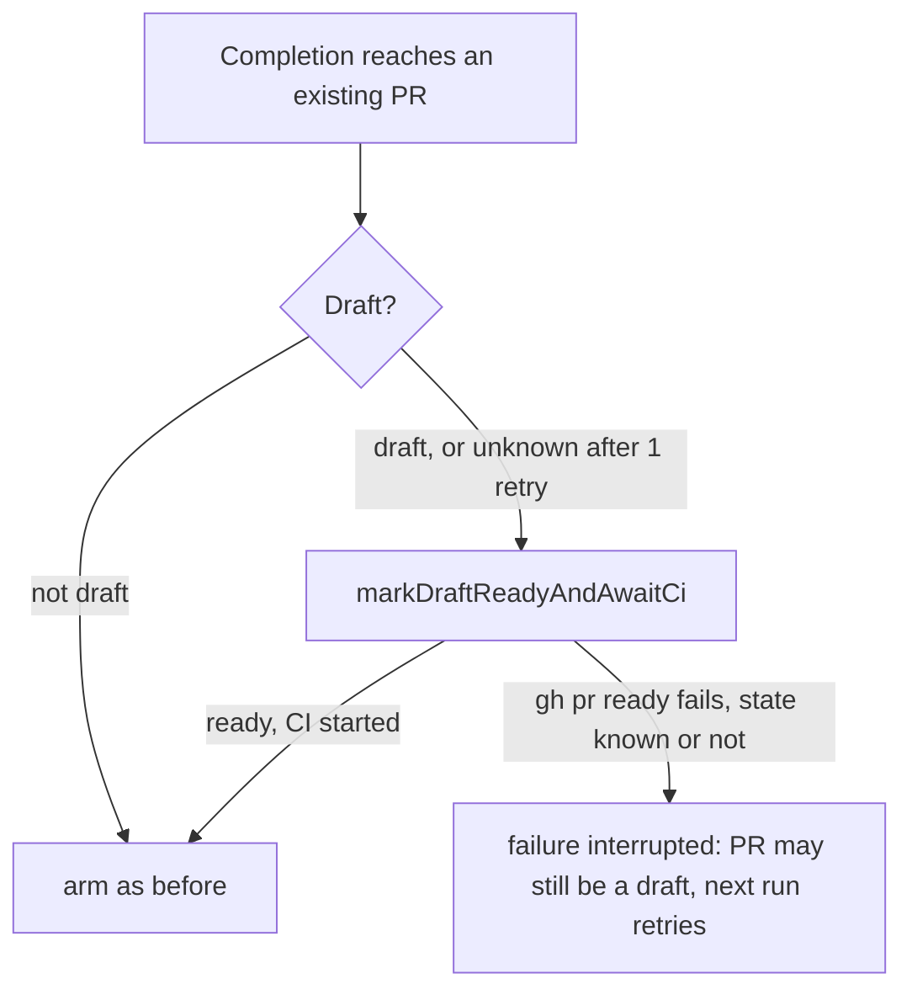

## Summary

PR #5033 landed the main fix for #4952 (completion marks a reachable draft ready,
the REST-fallback path does the same, and the auto-merge sweep readies an
orphaned fleet draft). This branch closes the one fail-open path #5033 left: when
the draft state could not be read, a failed `gh pr ready` only logged a warning,
armed auto-merge and released the claim as "raised #N" while the PR might still
be a draft. Now any failed `gh pr ready` on a possible draft fails the run
(`interrupted`, retried, never filed), names the PR, and never arms. Every
stated criterion is met. Closes #4952.

## Spec

### Intent and Rationale

- Acceptance criterion 3 says the claim must not be released as "raised #N" when
  marking ready failed. An unreadable draft state is exactly the case where we
  cannot show the PR is ready, so a failed `gh pr ready` must fail the run.

### Essential Design Decisions

- `readyDraftBeforeArming` (`worker/deno/lib/phases/completion_phase.ts`) fails
  on any failed ready and returns `draftStateKnown`, so the failure reason and
  the advisory say "is still a draft" for a known draft and "may still be a
  draft" for an unknown state. `gh pr ready` on an already-ready PR succeeds, so
  a failure means the PR may still be a draft.
- Trade-off accepted: a wholly failing `gh` now fails the run (retried) rather
  than arming and releasing the claim.
- A successful ready on an unknown state arms as before, unless the helper's own
  `isDraft` read says draft (the CI-start guard of Issue #4160).

### Undiscoverable Facts

- None.

## Evidence

Backend only; no UI file is touched.

- Docs read and updated: `docs/workflows/issue-processing.md` (the draft
  completion bullets) and the module doc of
  `worker/deno/lib/draft_continuation_pr.ts`.
- Callers of `readyDraftBeforeArming` checked: `recoverAndFinaliseExistingPr`
  and the REST-fallback path in `completionBody`; both use `stillDraftFailure`
  and `postCompletionAdvisory` with `draftStateKnown`.
- Twin check: no second copy of a changed rule found.

## Acceptance Criteria

<!-- vibe-spec-review inputs="diff+issue-body" -->

- **met** — A test drives completion with an existing draft PR on every path
  that ends with the claim released ("raised #N"), and asserts `gh pr ready` and
  the auto-merge arming. — evidence:
  `worker/deno/tests/completion_draft_ready_4952_test.ts` — reviewer: met
- **met** — A self-healing pass marks ready (and arms) an open fleet draft PR
  that has no draft-continuation or mutation-hold marker in its body and whose
  issue is unclaimed. Covered by a test. — evidence:
  `worker/deno/tests/draft_pr_self_heal_4952_test.ts` (delivered by PR #5033,
  unchanged here) — reviewer: met
- **met** — `markReadyAndAwaitCi` failures are logged as WARNING with the PR
  number. The release comment does not claim that the PR was raised ready when
  it was not. — evidence:
  `worker/deno/tests/completion_draft_ready_4952_test.ts` (failed ready on a
  known and on an unknown draft state fails the run, names the PR, and the
  advisory says the PR may still be a draft) — reviewer: met

## Standards Review

<!-- vibe-standards-review inputs="diff+CODING-STANDARDS.md" -->

- **violation** — unknown-state failed ready was fail-open, and its comments and
  wording still said "is still a draft" — evidence:
  `worker/deno/lib/phases/completion_phase.ts` — reason: fixed in this diff
- **violation** — known-draft test matched "may still be a draft" as well as
  "is still a draft" — evidence:
  `worker/deno/tests/completion_draft_ready_4952_test.ts` — reason: fixed in this
  diff
- **clean** — Australian English, fail-loud logging with PR numbers, no secrets
  staged, no persisted-shape change. The fixes after this review were not
  re-reviewed by a second reviewer run.

## Test Plan

- Edited `worker/deno/tests/completion_draft_ready_4952_test.ts`: the
  unknown-state failed-ready and latched-unreadable-flag tests now expect
  `interrupted`, the PR named, nothing armed and "may still be a draft"; the
  known-draft test expects "is still a draft"; a new advisory test covers the
  unknown-state comment. The old `continue` + armed assertions are replaced
  (required by "If marking it ready fails, the claim is not released with
  'raised #N'").
- Edited fixture only in `worker/deno/tests/issue_worker_test.ts`
  ("completion - self-heals when PR creation fails but PR exists"): its mock
  threw for every `gh` call, so the new failed-ready rule failed it; it now
  throws only for `gh pr create` and answers `gh pr view` with a ready PR. All
  assertions are kept.
- Red-checks: old warn-only branch restored → both unknown-state tests red;
  unknown-state wording forced to the known wording → the reason tests red.
- On the head: `deno task test:unit` over
  `tests/completion_draft_ready_4952_test.ts`,
  `tests/draft_ready_ci_4160_test.ts`, `tests/draft_continuation_4146_test.ts`
  (40 passed, 0 failed) and `tests/issue_worker_test.ts` (128 passed, 0 failed).

## Not done

- The rendered claim-release comment text was not read; the outcome carries the
  PR with the failure attached (`deriveRunOutcome`).
