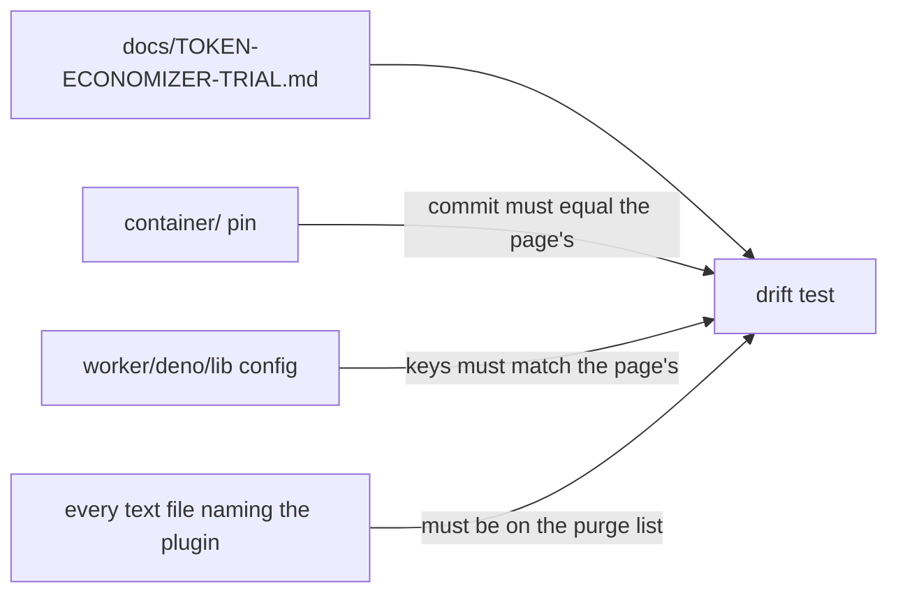

## Summary

Adds the TokenEconomizer trial protocol, `docs/TOKEN-ECONOMIZER-TRIAL.md`,
written before the window opens, and a drift test that keeps it honest against
the repository. The page sets out the pinned candidate commit and the
mechanisms switched on and off, the trial host (GRQ-25), the window (7 days or
60 completed switched-on implementation runs, whichever comes later), the bar,
the comparison rule, the stop rules, where every figure is read from, and the
purge list. Its Status says *not started*. It is linked from the README
Documentation table and from the related-documentation lists of the RTK and
Repo-context trial pages. Closes #4954.

Version bump: `VERSION` updated for this change; the merged commit records the
final version.

## Spec

### Intent and Rationale

- A verdict judged against a bar written after the figures exist is an
  argument. The page fixes the bar, host, window, comparison and stop rules
  first, in the shape of the RTK and Repo-context trial pages.
- The code the page describes does not exist yet (#4955 to #4958 are open), so
  the drift test is one pure function over a map of repo paths to text. It is
  run against the live repository and against fixtures that break one rule at
  a time. It engages automatically as each sibling lands.

### Essential Design Decisions

- **Pinned commit.** The issue says the SHA is "pinned by the container
  sub-issue", which has not landed. The page names upstream `main` at
  `264e7a7f32f0112a06aa83a97b9c2c4681563968` (read with `gh api`), says "Not yet:
  #4955 pins this commit", and the test holds the page to a test-local
  `INTERIM_PINNED_COMMIT` only while no file under `container/` pins one. Once
  a pin exists the test compares the page to the pin, ignores the constant, and
  fails if the page still says "Not yet". #4955 deletes the constant and the
  sentence together.
- **Which comparison decides.** The concurrent comparison (other hosts, same
  window, same repositories) decides, because it shares the window's dates; the
  14-day before comparison is reported beside it.
- **Trial host GRQ-25.** Its RTK window never opened (RTK was made the fleet
  default first), and GRQ-23 is reserved for the Graft and CodeGraph windows.
- **Stop rule 1 also names the gitleaks catch** that #4957 plans before a sync
  commit (#4957 asks for that to be a stop rule).
- The page stays after a purge as the record of the negative result (#4959's
  own scope), so it is not itself a purge-list row.

### Undiscoverable Facts

- cspell has no repository config; the page carries one inline
  `cspell:ignore` line for the plugin's identifiers instead of a config file.
- The window opens when the first switched-on run completes, not when the key
  is set (the issue's wording).

## Evidence

Documentation and test only; no UI files touched.

- Commands run on the final head: `deno task test:unit
  tests/token_economizer_trial_docs_test.ts` (27 passed, 0 failed),
  `markdownlint-cli2 docs/TOKEN-ECONOMIZER-TRIAL.md README.md` (0 issues),
  `cspell --no-progress docs/TOKEN-ECONOMIZER-TRIAL.md` (0 issues).
- Facts the page states about other components were read in the repository:
  RTK §5 and §6 for cost and success, RTK §8 for the unopened window,
  `fleet_run_archive` in `docs/CONFIGURATION.md`, the issue bodies of #4955 to
  #4959 for the key names, environment variables and stop rules.
- Production readers: none of the added members is code; the test's constants
  (`INTERIM_PINNED_COMMIT`, `BLOCK_KEYS`) are read by the test only, by design,
  and are not part of production code.
- Issue numbers cited as provenance (each run through `gh issue view` this
  run): `#4953`: Trial microsoft/TokenEconomizer with learnings persisted to a
  repository across runs; `#4954`: TokenEconomizer trial protocol; `#4955`:
  Vendor TokenEconomizer at a pinned SHA behind a `token_economizer` config
  block; `#4956`: Load TokenEconomizer into Claude runs with learned facts
  fenced as untrusted data; `#4957`: Persist TokenEconomizer learnings to a
  private git repository; `#4958`: Record TokenEconomizer's actions and cost in
  run stats and the callback; `#4959`: TokenEconomizer trial verdict.

## Acceptance Criteria

<!-- vibe-spec-review inputs="diff+issue-body" -->

- **met** — `docs/TOKEN-ECONOMIZER-TRIAL.md` exists with every section above, and its Status says *not started*. — evidence: `docs/TOKEN-ECONOMIZER-TRIAL.md`, `worker/deno/tests/token_economizer_trial_docs_test.ts::structure pins: the Status cell must say not started` — reviewer: met
- **met** — The drift test passes and goes red when the pinned SHA in the doc is changed. — evidence: `worker/deno/tests/token_economizer_trial_docs_test.ts::SHA drift: with no image pin, a doc commit other than the interim commit is refused` and `SHA drift: a commit changed everywhere on the page is refused by the pin file` — reviewer: met
- **met** — markdownlint and cspell pass. — evidence: `markdownlint-cli2` and `cspell` on the page, both 0 issues; the gate's markdownlint stage PASSED — reviewer: partial — reason: the reviewer could not run either tool; both were run here on the final head
- **unrequested** — "Changing the host after the window opens restarts the window" (§2) — reviewer: unrequested — reason: a protocol rule needed so a host swap cannot mix two populations; one sentence
- **unrequested** — extra exclusions in §5 (a host with another trial open, or with RTK or the executor split set differently, is not a concurrent control; runs from before the flag exists) — reviewer: unrequested — reason: the issue asks for a concurrent comparison on the same repositories; these keep it like for like
- **unrequested** — stop rule 1 also names the gitleaks catch before a sync commit — reviewer: unrequested — reason: #4957's scope says a finding "is a stop rule in the protocol doc"
- **unrequested** — the drift test also pins phrases in the candidate, host, window, bar, comparison and stop-rule sections, and checks that every text file naming the plugin is on the purge list — reviewer: unrequested — reason: this is how the test reads "the doc's purge list disagrees with the code"; the section pins keep the protocol from being edited away silently

## Standards Review

<!-- vibe-standards-review inputs="diff+CODING-STANDARDS.md" -->

- **violation** — a whole-page `flatWholeFile` positive pin for "not started" — evidence: `worker/deno/tests/token_economizer_trial_docs_test.ts:473` — reason: fixed in this diff (now a structured read of the Status table cell)
- **violation** — link test read whole files with `includes` — evidence: `worker/deno/tests/token_economizer_trial_docs_test.ts:1122` — reason: fixed in this diff (each link is checked inside its own section)
- **violation** — page claimed the drift test covers every file naming the plugin, but the corpus was a fixed list of roots — evidence: `docs/TOKEN-ECONOMIZER-TRIAL.md:194` — reason: fixed in this diff (the corpus is the whole repository outside `docs/archive` and `docs/audits`, and the page states that scope)
- **violation** — page said `git grep` finds only the page after a purge — evidence: `docs/TOKEN-ECONOMIZER-TRIAL.md:220` — reason: fixed in this diff (the page names the historical records a purge leaves alone)
- **violation** — page said RTK and the executor split are alike on every host — evidence: `docs/TOKEN-ECONOMIZER-TRIAL.md:77` — reason: fixed in this diff (they are on by default; a host that differs is excluded as a concurrent control)
- **violation** — page put the verdict issue's work in the present tense — evidence: `docs/TOKEN-ECONOMIZER-TRIAL.md:192` — reason: fixed in this diff ("Not yet: #4959 ... will remove")
- **clean** — Documentation-drift conditions (section-scoped pins, no typed-in value a module holds, each pinned phrase new with the page, positive control beside every negative fixture), review-enforced rules checked, Australian English, sibling-issue wording uses "Not yet: #N", no hidden paths staged, no dynamic RegExp, no wall-clock thresholds.

## Test Plan

- Added `worker/deno/tests/token_economizer_trial_docs_test.ts` (27 tests): the
  live page passes every rule; the corpus walk reads the whole repository; SHA
  drift (page against a `container/` pin, interim commit while no pin exists,
  fail-closed on a pin with no commit, re-wrapped JSON pin); config-key drift;
  purge-list drift in both directions; section-scoped structure pins; the
  Status cell; and the links from the README and the two sibling pages.
- Ran on the final head: `deno task test:unit
  tests/token_economizer_trial_docs_test.ts` passed (27 passed, 0 failed);
  with `tests/rtk_output_trial_docs_test.ts` and
  `tests/repo_context_trial_docs_test.ts` the three files passed (48 passed,
  0 failed, run before the final RegExp-free rewrite of two helpers; the file
  alone was re-run after it).
- Red checks on the page, restored and `cmp`-checked after each: SHA changed in
  the candidate section only → red; SHA changed in both places → red
  (`interim commit` problem); the "Not yet: #4955 pins this commit" sentence
  deleted → red; the README purge row deleted → red; the Learnings directory
  row deleted → red; "another repository" changed in Stop rules → red; "five
  well-ended turns" changed in The window → red; Status cell set to `kept` →
  red; the sibling link renamed in `docs/RTK-OUTPUT-TRIAL.md` → red.
- Existing tests edited: none. No assertion removed.
- Twinned rules: the page restates the bar shape of
  `docs/RTK-OUTPUT-TRIAL.md` and `docs/REPO-CONTEXT-TRIAL.md` (cost and
  success rules are cited there by section, not copied). Their own drift tests
  were re-run and pass.
- Docs sweep: grep of README.md, `docs/` (excluding archive and audits) and the
  repository for the plugin's name finds only the page, its links and the
  test; each is on the purge list. Sibling members grepped: the RTK and brief
  trial rows in the README table.
- Rule applied to this PR's own diff: the "behaviour another issue delivers is
  planned, not present" rule was applied to every sentence on the page naming
  #4955 to #4959; each reads "Not yet: #N". No hit left.
- `./quality.sh < /dev/null` on the final head's code: Result PASSED (with
  skipped checks: config integration, checkov). An earlier run failed the
  semgrep stage on two dynamic `RegExp` calls in the test; both were replaced
  and the stage passes.

Not done / not checked: the image pin, config block, spawn wiring, sync, stats
line and report section do not exist yet (#4955 to #4958), so the drift test's
live checks of them are vacuous until they land; their rules are exercised by
fixtures only. The page's SHA was not checked against the tarball sha256 (that
is #4955's recorded checksum).
