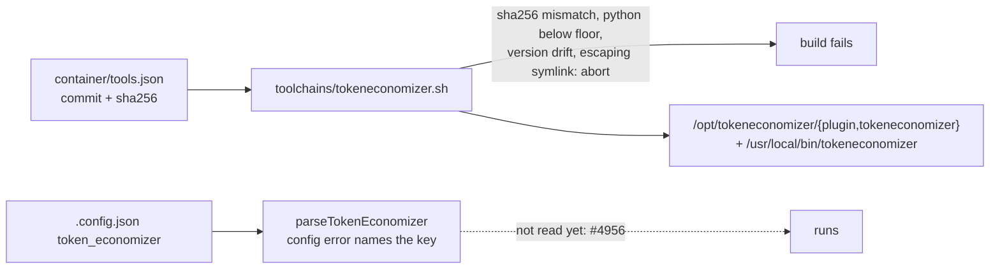

## Summary

Vendors microsoft/TokenEconomizer into the container image at one pinned commit
and adds the `token_economizer` config block, both off by default. The image
installs the plugin from a source tarball whose sha256 is recorded and checked
(a wrong sha256 aborts the build); the block parses and validates, and nothing
reads it yet. The trial page now quotes upstream's supported-version table
beside the image's Claude Code version, and its drift test follows the landed
pin.

Closes #4955.

Version bump: `VERSION` updated for this change; the merged commit records the
final version.

## Spec

### Intent and Rationale

- The trial needs the plugin in the image, pinned and switchable per host, with
  no change to any run while the switch is off. Nothing reads the block until
  #4956 wires it into runs, so a disabled host is unchanged by construction; the
  tests pin that.
- The image layer follows the fragment pattern the rtk, codegraph and floci
  toolchains use, not Containerfile `ARG`s, because the stripped Containerfile
  is capped at 14,600 bytes.

### Essential Design Decisions

- **Pin location (deviation from the issue's wording).** The issue says the
  sha256 is recorded "in `container/Containerfile`". It is recorded in
  `container/tools.json` (`commit`, `sha256.noarch`, `licence`) and read by
  `container/toolchains/tokeneconomizer.sh`; the Containerfile names only the id
  `tokeneconomizer` in the toolchain install list. That is how the other
  fetch-verify-extract tools are pinned, and the Containerfile has 57 stripped
  bytes of headroom after this change.
- **A `tokeneconomizer` wrapper.** The manifest requires a toolchain to declare
  a command or a Python module. The module route is closed: the workflow's
  module loop compares `__version__` with the pin and the package has none. So
  `/usr/local/bin/tokeneconomizer` prints `tokeneconomizer 0.1.0 (commit <sha>)`
  for `--version` and otherwise runs the plugin's `te` launcher (the floci
  precedent).
- **Allowed values.** `microskills`: `off`, `envfacts`, `distiller`,
  `envfacts+distiller` (default); `loopguard`: `off`, `nudge` (default).
  Upstream's `on` alias and the deprecated `stop` are refused so the stored
  value is explicit. `learnings_repo` is validated whenever present, even when
  disabled, so a typo does not wait for the switch.
- **Off-state test limit.** The spawn builders take no config, so equality
  across disabled configs holds by construction. The literal golden argv and
  added-env keys for Claude and Codex carry the "unchanged" claim, and #4956
  must keep them and add an `enabled: true` case that differs.

### Undiscoverable Facts

- GitHub does not guarantee archive-tarball bytes are stable. The pinned archive
  hashed identically on two downloads (`4ace6dc1…`); a GitHub-side gzip change
  would fail the build loudly at the checksum, not install different bytes.
- The image's `python3` is 3.13; the fragment reads the floor from the pinned
  `pyproject.toml` (`requires-python = ">=3.10"`) rather than restating it.

## Evidence

Backend, docs and tests only; no UI files touched.

- Observed: both downloads of
  `https://github.com/microsoft/TokenEconomizer/archive/264e7a7f32f0112a06aa83a97b9c2c4681563968.tar.gz`
  hash to `4ace6dc1c945e79841163279d0d54a58fab71cbcab08569e6941b63c26154f9a`;
  the real fragment ran against that real archive (stubbed curl, scratch paths):
  it verified the checksum, passed Python 3.13 against `>=3.10`, imported the
  package by both paths, and `tokeneconomizer --version` printed
  `tokeneconomizer 0.1.0 (commit 264e7a7f…)`.
- Upstream's supported-version table was fetched from the pinned commit's README
  and quoted verbatim; the Claude Code row reads `2.1.300 to 2.1.310` and the
  image pins Claude Code 2.1.310 (`container/tools.json` provider `claude`).
- Production readers: `parseTokenEconomizer` (`worker/deno/lib/config.ts`),
  `TOKEN_ECONOMIZER_KEYS` (`worker/deno/lib/config_unknown_keys.ts`).
  `WorkerConfig.tokenEconomizer` has no production reader yet by design: the
  issue asks for the block to parse, and #4956 is the issue that reads it. It is
  the public config surface the issue names, so it is exempt from the "only a
  test reads it" rule; every doc row says "accepted and validated, but not read
  yet".
- Issue numbers cited as provenance (each run through `gh issue view`): `#4953`:
  Trial microsoft/TokenEconomizer with learnings persisted to a repository
  across runs; `#4954`: TokenEconomizer trial protocol; `#4956`: Load
  TokenEconomizer into Claude runs with learned facts fenced as untrusted data;
  `#4957`: Persist TokenEconomizer learnings to a private git repository;
  `#4958`: Record TokenEconomizer's actions and cost in run stats and the
  callback; `#4959`: TokenEconomizer trial verdict.
- Docs sweep: updated `docs/CONFIGURATION.md` (config row),
  `docs/CONTAINER-IMAGE.md` (install list and paragraph), `docs/CONTAINER.md`
  (tool table and fragment lists), `docs/TOKEN-ECONOMIZER-TRIAL.md`, and the
  generated `docs/audits/dependency-inventory.md`; the README and
  `docs/INTERNALS.md` carry no tool list.

### Existing callers of changed functions

- `manifest_field` is a new function private to
  `container/toolchains/tokeneconomizer.sh`. `floci.sh` (lines 58, 72) and
  `rtk.sh` (lines 52, 66) call their own `manifest_field`, defined in their own
  files (`floci.sh:47`, `rtk.sh:41`) and not touched by this diff; each fragment
  runs in its own shell, so none of those callers can reach the new one:
  **unchanged**.
- `loadConfig` (`worker/deno/lib/config.ts`) gains one step: it parses
  `token_economizer` and throws only when that key is present and malformed. No
  existing caller or test config sets the key (a search of `*.ts` finds it only
  in the new block's own files and tests), so every existing caller gets the
  off-by-default value and the same behaviour as before: **unchanged**. The new
  field `WorkerConfig.tokenEconomizer` is added, not altered; the new throw is
  **changed and tested** in `worker/deno/tests/token_economizer_config_test.ts`
  (`loadConfig` throws on a malformed block).

## Acceptance Criteria

<!-- vibe-spec-review inputs="diff+issue-body" -->

- **met** — The image contains the plugin at the pinned SHA, the build verifies
  the checksum, and a wrong sha256 fails the build. — evidence:
  `container/toolchains/tokeneconomizer.sh`, `container/tools.json`,
  `worker/deno/tests/install_toolchains_test.ts::container/toolchains/tokeneconomizer.sh - a checksum mismatch aborts before anything is installed`
  — reviewer: met
- **met** — `token_economizer` parses; an unknown mechanism value, or
  `enabled: true` without `learnings_repo`, is a config error naming the key. —
  evidence: `worker/deno/lib/token_economizer_config.ts`,
  `worker/deno/tests/token_economizer_config_test.ts` — reviewer: met
- **met** — A test proves a disabled host's agent argv and env are unchanged,
  for both providers. — evidence:
  `worker/deno/tests/token_economizer_off_spawn_test.ts` — reviewer: partial —
  reason: the reviewer saw the version whose equality compared the builders with
  themselves; the golden argv and added-env-key literals for Claude and Codex
  were added after, each shown red against an unrelated added flag or env key
- **met** — The upstream supported-version table is quoted in the protocol doc,
  with the image's actual Claude Code version beside it. — evidence:
  `docs/TOKEN-ECONOMIZER-TRIAL.md`,
  `worker/deno/tests/token_economizer_trial_docs_test.ts` — reviewer: met
- **unrequested** — the Playwright `RUN` block's indentation in
  `container/Containerfile` — reviewer: unrequested — reason: whitespace only,
  to bring the stripped file back under the 14,600-byte cap after the id was
  added
- **unrequested** — `docs/audits/lib-sweep-coverage/top-up-4955.json` and the
  `docs/audits/dependency-inventory.md` row — reviewer: unrequested — reason:
  the new lib module and the new manifest entry fail
  `lib_sweep_coverage_test.ts` and `supply_chain_gate_test.ts` without them
- **unrequested** — `learnings_repo` validated when disabled, an explicit `null`
  refused, and extra build checks (pyproject version equals the pin, symlink
  containment, import smoke test) — reviewer: unrequested — reason: fail-loud
  choices recorded under Essential Design Decisions
- **unrequested** — the `tokeneconomizer` wrapper and the fragment's entry in
  `CONTAINER_IMAGE_INPUTS` — reviewer: unrequested — reason: the manifest needs
  a command to verify, and `container_image_hash_test.ts` requires every
  fragment listed
- **unrequested** — the drift-test and page updates and the Host config row
  becoming `planned #4956` — reviewer: unrequested — reason: the #4954 drift
  test pinned the pre-landing state, and the pin and block have now landed

## Standards Review

<!-- vibe-standards-review inputs="diff+CODING-STANDARDS.md" -->

- **violation** — `readlink -f` in the symlink guard (GNU only) — evidence:
  `container/toolchains/tokeneconomizer.sh:153` — reason: fixed in this diff
  (portable `os.path.realpath` through python3)
- **violation** — `sed` `q}` without `;` (BSD sed rejects it) — evidence:
  `container/toolchains/tokeneconomizer.sh:117` — reason: fixed in this diff
  (`q;}`); not run on macOS
- **violation** — the block credited to #4956 instead of #4955 — evidence:
  `docs/TOKEN-ECONOMIZER-TRIAL.md:49` — reason: fixed in this diff (and the
  fragment header comment)
- **violation** — Host config purge row marked `present` with nothing to show it
  — evidence: `docs/TOKEN-ECONOMIZER-TRIAL.md:266` — reason: fixed in this diff
  (`planned #4956`, and the page defines a no-path row as planned)
- **violation** — self-comparing off-state test — evidence:
  `worker/deno/tests/token_economizer_off_spawn_test.ts:376` — reason: fixed in
  this diff (golden argv and added-env keys; renamed)
- **violation** — symlink guard tested with an absolute link only — evidence:
  `worker/deno/tests/install_toolchains_test.ts:1863` — reason: fixed in this
  diff (relative `..` link, `missing/../..` combined case, positive control)
- **violation** — typed-in Claude Code version in drift tests — evidence:
  `worker/deno/tests/token_economizer_trial_docs_test.ts:1187` — reason: fixed
  in this diff (read from `container/tools.json`, bumped by computation)
- **violation** — PR summary absent from the diff — evidence:
  `docs/archive/pr-summaries/pr-summary-4955.md:1` — reason: fixed in this diff
  (this file)
- **clean** — regexes on untrusted text (character classes behind length caps,
  hostile case per field), "accepted but not read yet" wording, Australian
  English, no hidden paths, parser fails loud, temp directories via
  `Deno.makeTempDir`.

## Test Plan

- Added `worker/deno/tests/token_economizer_config_test.ts` (34 tests: defaults,
  full block, each refusal naming its key with the same input made legal
  accepted, unknown inner key warning, `loadConfig` throws, hostile input),
  `worker/deno/tests/token_economizer_off_spawn_test.ts` (13 tests) and six
  cases plus the relative-symlink cases in
  `worker/deno/tests/install_toolchains_test.ts` (47 pass).
- Edited `worker/deno/tests/token_economizer_trial_docs_test.ts` (31 pass) and
  `worker/deno/tests/toolchain_selfcheck_test.ts` (fixture for the new
  toolchain, built from the committed manifest entry).
- Removed from `worker/deno/tests/token_economizer_trial_docs_test.ts`: the
  interim-commit and "Not yet: #4955 pins this commit" assertions. Obsolete: the
  pin has landed, so the page no longer says the image carries nothing. Still
  covered by:
  `worker/deno/tests/token_economizer_trial_docs_test.ts::SHA drift: no container file pins the commit, so the page's pin is refused`.
- Red checks (each restored and `cmp`-checked): config parser — dropped
  required-when-enabled (3 red), accepted `"on"` (3), accepted `..` (1),
  validated only when enabled (5), null took default (3), loader swallowed the
  error (4); fragment — dropped checksum check, python floor, version check,
  symlink guard (each 1+ red; guard always-pass: 3 red); spawn — an unrelated
  flag added to the Claude builder, to the Codex builder, and an env key added
  (each turns only its provider's golden red); drift — page SHA changed,
  `tools.json` commit changed, page's Claude version changed, a purge row
  deleted, a section phrase changed (each red).
- Pins new with this change were checked against
  `git show 2ad72b7a:docs/TOKEN-ECONOMIZER-TRIAL.md` (`drift-pins-on-base`): the
  `container/tools.json` pin, the Claude Code row and the image-version line are
  absent on base.
- Existing tests that needed fixture changes for the new toolchain:
  `lib_sweep_coverage_test.ts` (top-up file), `supply_chain_gate_test.ts`
  (regenerated inventory), `toolchain_selfcheck_test.ts`,
  `container_image_hash_test.ts` (fragment listed), and the two Containerfile
  cap tests (now 14,543 of 14,600 stripped bytes).
- `./quality.sh < /dev/null` on the head after merging `origin/main`: every
  stage PASSED (deno tests parallel and serial, lint, type check, fmt,
  markdownlint, mermaid, semgrep); config integration and checkov were SKIPPED
  (no checkov on PATH; the CI checkov job stays authoritative).

Not done / not checked: no image was built (no container runtime here), so the
fragment was exercised with a stubbed `curl`, and once against the real archive
outside the suite; the BSD `sed` form is unverified on macOS; the wrapper is not
safe for an install path holding `"`, `$`, a backtick or `\`; the runs do not
read the block (#4956), so the "unchanged" proof is the trace scan plus the
literal goldens, not a with-and-without-plugin comparison.
