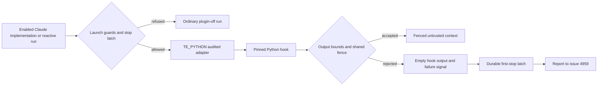

## Summary

Load the pinned TokenEconomizer plugin for enabled Claude implementation,
PR-feedback and CI-fix runs. The plugin's hook output is bounded and fenced.
Hook faults fall back to an ordinary plugin-off run and latch a durable trial
stop, which is reported to #4959. Closes #4956.

## Spec

### Intent and Rationale

- Reuse the pinned launcher's `TE_PYTHON` interface for an audited Deno adapter,
  so the vendored archive and its pin stay unchanged. The adapter reuses
  `fenceUntrustedIssueText()` rather than adding another prompt boundary.
- Use the issue's permitted `envfacts` fallback: the uncapped distiller proposer
  stays disabled, and the protocol doc records why.
- A hook fault never fails the run. The trial is latched off before the report
  is attempted, and a pending report is retried without re-enabling the plugin.

### Essential Design Decisions

- Each launch gets a fresh state directory outside the checkout. Paths are
  resolved and confined before anything is created, so a symlink alias cannot
  redirect state into the checkout.
- Cached facts are capped at four bullets and 600 characters. Notices are capped
  at 4,096 characters and the output protocol at 64 KiB. Malformed or oversized
  output is rejected, never injected on a best-effort basis.
- `stopTokenEconomizerTrial()` and `tokenEconomizerMaySync()` are the one shared
  finding and sync-permission contract the issue asks #4957 to consume.
  `tokenEconomizerMaySync` therefore has no production reader yet: it is the
  public API the issue requires, which the "nothing exists only for a test"
  standard exempts.
- Any hook fault, including a correct rejection of oversized facts, latches the
  trial off. This fails safe, and is broader than "a hook error that ends a
  run". A same-UID agent can still modify the local stop record. That is
  recorded as residual risk R17 and is not claimed as protection.

### Undiscoverable Facts

- Claude Code 2.1.322 loaded `SessionStart` hooks with `--plugin-dir` and
  `--setting-sources ""` against a local Messages API fixture with a dummy
  credential. This was not a paid production run.
- #4955 is closed. #4957, #4958 and #4959 are open, so persistence producers,
  accounting and the verdict scheduler are absent from this head, by design.

## Evidence

Backend and CLI changes only, so no screenshot is required.

- Real CLI check: the command and its result are recorded in
  `docs/TOKEN-ECONOMIZER-TRIAL.md` §1. It emitted `hook_started` and
  `hook_response` for `SessionStart:startup` with outcome success. The fixture
  checkout's staged, modified and untracked files were unchanged.
- The hook monitor now logs the redacted cause when it cannot start, or when it
  cannot persist the stop record (`worker/deno/lib/claude_runner.ts`).
- The five spawn sites take an optional `tokenEconomizerPluginDir` seam
  (`worker/deno/lib/issue_worker_wiring.ts`, `ExecuteClaudePhaseDeps`). The
  enabled-path call-site tests now run against a temporary fixture plugin where
  `/opt/tokeneconomizer/plugin` is absent, so CI exercises them too.
- Issues cited, checked with `gh issue view`:
  - #4952: A completed run leaves its draft continuation PR a draft and unarmed
  - #4955: Vendor TokenEconomizer at a pinned SHA
  - #4957: Persist TokenEconomizer learnings
  - #4958: Record TokenEconomizer's actions and own cost
  - #4959: TokenEconomizer trial verdict

## Acceptance Criteria

<!-- vibe-spec-review inputs="diff+issue-body" -->

- **met** — With the host enabled, the Claude argv carries `--plugin-dir` and
  the env carries the settings above, for the three run kinds. Without it,
  neither is present (both directions tested) — evidence:
  `worker/deno/tests/token_economizer_impl_callsites_test.ts`,
  `worker/deno/tests/token_economizer_reactive_callsites_test.ts`,
  `worker/deno/tests/token_economizer_plugin_wiring_test.ts` — reviewer: met
- **met** — A recorded real-CLI check shows the hooks firing on the image's
  Claude Code version — evidence: `docs/TOKEN-ECONOMIZER-TRIAL.md` §1 (2.1.322)
  — reviewer: met
- **met** — Deterministic positive and negative tests exercise untrusted-fact
  fencing and exclusion of plugin-owned files through the real hook path,
  including preservation of legitimate implementation edits — evidence:
  `worker/deno/tests/token_economizer_plugin_wiring_test.ts` — reviewer: met
- **met** — `docs/THREAT-MODEL.md` updated — evidence: `docs/THREAT-MODEL.md`
  learned-facts row, AP-19/AP-20, C37–C41, R16/R17 — reviewer: met
- **met** — Hook failure falls back safely; a stop-rule finding inhibits
  subsequent plugin use across restart without weakening the container boundary
  or requiring a human. #4959 owns the verdict and purge, and #4958 owns
  accounting — evidence: `worker/deno/lib/token_economizer_control.ts`,
  `worker/deno/tests/token_economizer_plugin_test.ts` — reviewer: met
- **unrequested** — Test-budget repairs in
  `worker/deno/tests/auto_merge_ensure_draft_heal_wiring_4952_test.ts`,
  `worker/deno/tests/pr_side_gate_guarantee_4876_test.ts` and
  `worker/deno/tests/support/pr_branch_lock_stub.ts` — reviewer: unrequested —
  reason: the worker's pre-push gate reported these tests over the 1 s unit-test
  budget, blocking this branch. Their assertions are unchanged.
- **unrequested** — Test seams `acquireLockFn` in
  `worker/deno/commands/pr_ci_processor.ts` and `phaseDeps` in
  `worker/deno/commands/execute_claude_phase.ts` — reviewer: unrequested —
  reason: they let the command-level caller tests drive the enabled host block
  through the real commands.
- **unrequested** — `docs/audits/lib-sweep-coverage/top-up-4956.json` —
  reviewer: unrequested — reason: the sweep-coverage test requires a claim for
  each new lib module.

## Standards Review

<!-- vibe-standards-review inputs="diff+CODING-STANDARDS.md" -->

- **violation** — Never Fail Silently: the monitor close and start catches
  dropped the cause — evidence: `worker/deno/lib/claude_runner.ts` — reason:
  fixed in this diff (the redacted error is now logged)
- **violation** — Every changed call site needs a test that goes red without it:
  the enabled-path call-site tests were ignored where the plugin is not
  installed (CI) — evidence:
  `worker/deno/tests/token_economizer_impl_callsites_test.ts`,
  `worker/deno/tests/token_economizer_reactive_callsites_test.ts` — reason:
  fixed in this diff (fixture plugin through the `tokenEconomizerPluginDir`
  seam; zero ignores remain)
- **violation** — Nothing exists only for a test to read: the
  `tokenEconomizerMaySync` export — evidence:
  `worker/deno/lib/token_economizer_control.ts` — reason: required by #4956,
  whose stop-handling scope asks for one shared mechanism that persistence
  (#4957) consumes; this is the standard's public-API exemption
- **clean** — Path confinement with `..`/symlink negative tests, secret
  redaction, fail-closed stop reads, named tests exist, no workflow change, and
  edited existing tests still go red without their code. The reviewer checked
  the review-enforced rules "Check where you insert", drift pins from live
  values, and dummy/"how" tests.

## Test Plan

- Targeted run on the pre-merge head: 221 passed, 0 failed across the 12
  TokenEconomizer, threat-model, sweep-coverage and repaired test files.
- After the seam change: call-site, production-deps and wiring files passed (49
  passed, 0 ignored). With the fixture forced, both call-site files passed (19
  passed, 0 ignored).
- `worker/deno/tests/token_economizer_trial_docs_test.ts`: 31 passed, after
  adding the purge-list row for `worker/deno/lib/issue_worker_wiring.ts`.
- The full `./quality.sh` before the merge failed only in `deno tests`:
  - the trial-docs purge row, fixed above;
  - `worker/deno/tests/pr_maintenance_command_test.ts`, which also passed 28/28
    on `origin/main`, and which `main` fixed. `main` was merged into the branch.
- Removed assertions: none. The call-site tests now expect the plugin directory
  actually passed, instead of the constant.

<!-- vibe-quality-gate-skipped reason="the full gate took 520s; the rerun after merging main did not fit in the remaining run budget, so only the affected test files were rerun" -->

## Deno regression avoided

The adapter and its tests use Deno. No Node tooling was added.

## Merge verification

- CI is pending. No host was enabled.
- Not checked: a paid production judge call and its cost, which is #4958's.
  Protection of the stop record from a hostile same-UID agent remains residual
  risk R17.
