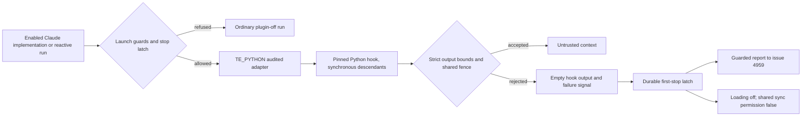

## Summary

Load the pinned TokenEconomizer plugin for enabled Claude implementation,
PR-feedback and CI-fix runs, with bounded, fenced hook output and automatic
fault latching/reporting. Add coverage through the three standalone commands and
repair the reproduced pre-push test-budget failure. Part of #4956: protection of
the stop controller from a same-UID agent and production nested-call accounting
remain incomplete.

## Spec

### Intent and Rationale

- Reuse the pinned launcher's `TE_PYTHON` interface for an audited Deno adapter;
  the vendored archive and its pin stay unchanged. Reuse
  `fenceUntrustedIssueText()` rather than inventing another prompt boundary.
- Keep the issue's permitted `envfacts` fallback: the uncapped distiller
  proposer remains disabled. Fencing limits authority; it does not establish
  fact truth.
- Keep ordinary work running when a hook fails. Latch the trial before
  attempting notification, and retry a pending report without re-enabling the
  plugin.

### Essential Design Decisions

- A fresh state directory belongs to each launch. Resolve and confine paths
  before creating anything; a symlink alias cannot redirect state into the
  checkout. Pass the checked canonical checkout to the Python dispatcher.
- SessionStart cached text allows four bullet facts and 600 characters (the
  pinned plugin's estimate for 150 tokens). Non-fact context and notices allow
  4,096 characters; the complete output protocol allows 64 KiB. Reject
  malformed, unsupported or oversized output before returning context.
- `stopTokenEconomizerTrial()` and `tokenEconomizerMaySync()` are the shared
  finding/sync contract for open #4957. Hook failures already call the
  controller; persistence transfers do not exist at this head. A first stop wins
  atomically and remains latched until authorised recovery or purge, including
  healthy runs.
- The local stop file is still writable by an agent sharing the worker UID. File
  modes are not a security boundary. No host was enabled and no container
  privilege was expanded. This gap prevents claiming the automatic-stop
  criterion complete.

### Undiscoverable Facts

- Claude Code 2.1.322 loaded SessionStart hooks with `--setting-sources ""`. A
  local Messages API fixture used a dummy credential; this was not a paid
  production run or trial measurement. The separate real nested CLI call used
  that same fixture endpoint and credential.
- #4955 is closed and its pinned plugin is installed. #4957, #4958 and #4959 are
  open; persistence producers, accounting integration and the normal verdict
  scheduler are absent from this head. Depending on them here would create a
  cycle because their issues depend on #4956.
- `setpriv --no-new-privs --landlock-access fs --landlock-rule
  path-beneath:read-file,read-dir,execute:/ /usr/bin/true`
  failed with `landlock_create_ruleset failed: Function not implemented`. A
  separate `unshare --user --map-root-user --mount /usr/bin/true` probe
  succeeded; filesystem/PID namespace confinement of the agent is not
  implemented here.
- The review verdicts below are the actual historical review record retained
  from checkpoint `6f84491ee`, with departures explained by new evidence. No
  fresh reviewer was dispatched: this executor was explicitly told “Do not
  delegate.” Current additions await independent review.

## Evidence

Backend/CLI changes; no UI surface or screenshot requirement.

- Real command:
  `claude -p "Reply OK" --model haiku --plugin-dir
  /opt/tokeneconomizer/plugin --setting-sources "" --tools ""
  --strict-mcp-config --mcp-config '{"mcpServers":{}}'
  --no-session-persistence --max-turns 1 --output-format stream-json --verbose`.
  Version 2.1.322 emitted `hook_started` and `hook_response` for
  `SessionStart:startup`, exit 0 / success; the plugin appeared in init output
  and the run returned `OK`. The fixture checkout retained exactly
  `A  staged.txt`, `M tracked.txt`, `?? untracked.txt` before and after.
- A separate call through the installed plugin's
  `sidecall.claude_call("Reply OK", model="haiku", timeout=30)` invoked the real
  nested Claude CLI and returned `OK` and 20 effective units. Both requests used
  the same dummy credential and local endpoint. The outer fixture reported 10
  input / 2 output tokens; its estimated dollar amount is synthetic and is not
  evidence that nested usage reaches worker totals.
- `worker/deno/tests/token_economizer_plugin_wiring_test.ts` drives the real
  vendored dispatcher through the executable adapter, including Store-produced
  cached injection, the real loop-guard writer's 1,200-character output, clean
  and dirty checkouts, missing Python and invalid hook events. Required-plugin
  checks fail on a stamped container image or when
  `REQUIRE_TOKENECONOMIZER_PLUGIN=1`; they cannot silently skip in this image.
- The exact completion pre-push gate was reproduced with `runPrePushGate()`
  against `origin/main`. Its first failure was the unit-budget audit:
  `every test in tests/auto_merge_ensure_draft_heal_wiring_4952_test.ts
  (1, 1.51s) is over the 1.00s unit-test budget`.
  The existing readiness fixture continued into real merge work. It now ends
  after observing readiness; its original assertion remains. The historical
  attempt's full stderr was unavailable, so this is the reproduced gate fault,
  not a claim about unseen historical output.
- Documentation read and updated: trial protocol §§1, 3, 6 and purge inventory;
  configuration's `token_economizer` row; container image's plugin section;
  threat-model learned-facts row, AP-19/AP-20, C37–C41 and R16/R17. The source
  contracts are `worker/deno/lib/token_economizer_hook.ts`,
  `worker/deno/lib/token_economizer_plugin.ts` and
  `worker/deno/lib/token_economizer_control.ts`. No prompt rule changed.
- Issue provenance checked with `gh issue view`: #4952, “A completed run leaves
  its draft continuation PR a draft and unarmed, then releases the claim, so
  nothing ever un-drafts it”; #4953, “Trial microsoft/TokenEconomizer with
  learnings persisted to a repository across runs: keep it or purge it”; #4955,
  “Vendor TokenEconomizer at a pinned SHA in the container image behind a
  token_economizer config block, off by default”; #4956, “Load TokenEconomizer
  into Claude implementation, PR-feedback and CI-fix runs on an enabled host,
  with learned facts fenced as untrusted data”; #4957, “Persist TokenEconomizer
  learnings to a private git repository across runs, with gitleaks before every
  push”; #4958, “Record TokenEconomizer's actions and own cost in run stats, the
  run callback (additive only) and the weekly report”; #4959, “TokenEconomizer:
  run the agreed trial to an automatic keep-or-purge verdict”.

## Acceptance Criteria

The provenance markers retain the earlier reviews, not a new review of the
resumed additions. The current closure statuses distinguish their verdicts from
the evidence obtained since that review.

<!-- vibe-spec-review inputs="diff+issue-body" -->

- **met** — With the host enabled, the Claude argv carries `--plugin-dir` and
  the env carries the settings above, for the three run kinds. Without it,
  neither is present (both directions tested) — evidence:
  `worker/deno/tests/token_economizer_plugin_wiring_test.ts`,
  `worker/deno/tests/token_economizer_impl_callsites_test.ts`,
  `worker/deno/tests/token_economizer_reactive_callsites_test.ts`,
  `worker/deno/tests/token_economizer_production_deps_test.ts` — reviewer:
  partial — reason: the previous missing command coverage is now present;
  enabled/disabled command handlers and individual caller reverts were
  exercised.
- **met** — A recorded real-CLI check shows the hooks firing on the image's
  Claude Code version — evidence: the 2.1.322 command/output above and
  `docs/TOKEN-ECONOMIZER-TRIAL.md` §1 — reviewer: met
- **met** — The fencing test and the clean-checkout test pass, and each turns
  red with its guard removed — evidence:
  `worker/deno/tests/token_economizer_plugin_wiring_test.ts`,
  `worker/deno/tests/token_economizer_plugin_test.ts` — reviewer: partial —
  reason: the adapter now fences actual hook output; removing the fence or
  checkout guard turns tests red. A complete real-CLI fixture run also preserves
  pre-existing checkout changes.
- **met** — `docs/THREAT-MODEL.md` updated — evidence: `docs/THREAT-MODEL.md`
  learned facts, AP-20, C39/C40, R16/R17 — reviewer: met
- **partial** — Hook failure falls back safely; a stop-rule finding inhibits
  subsequent plugin use across restart without weakening the container boundary
  or requiring a human. #4959 owns the verdict and purge, and #4958 owns
  accounting — evidence: `worker/deno/tests/token_economizer_plugin_test.ts`,
  `worker/deno/tests/token_economizer_plugin_wiring_test.ts` — reviewer: partial
  — reason: hook monitoring, plugin-off fallback, durable first-stop/restart
  inhibition and notification retry are implemented; protection against
  deliberate same-UID controller modification is not. #4957's persistence
  producers and #4958's accounting remain absent.
- **missing** — Confirm those calls run under the same egress, credentials
  channel and timeline as the run, and that they are counted in the run's cost —
  reviewer: missing — reason: the fixture verifies endpoint/credential
  inheritance and the adapter keeps Python descendants synchronous, but a paid
  judge call within a full production run, production egress/lifetime
  enforcement and #4958 worker accounting were not observed.
- **met** — Report the failed trial to #4959 — evidence:
  `worker/deno/lib/token_economizer_control.ts`,
  `worker/deno/tests/token_economizer_plugin_test.ts` — reviewer: missing —
  reason: the new controller attempts the fixed outcome report immediately after
  latching and retries denied/offline notifications while staying off. A denied
  write is recorded as pending; no GitHub permission is widened.
- **unrequested** — The DeepSeek descriptor drops `pluginDir` — reviewer:
  unrequested — reason: preserves the Claude-only trial boundary; other-provider
  argv coverage demonstrates the exclusion.
- **unrequested** — First-stop-wins record, bounded redacted reason and
  notification receipt — reviewer: unrequested — reason: concrete choices for
  the durable controller requested by the issue; the receipt is not an authority
  to re-enable loading.

## Standards Review

<!-- vibe-standards-review inputs="diff+CODING-STANDARDS.md" -->

- **clean** — The historical reviewer checked Australian English, secret/hidden
  staging safety, named-test existence, unchanged workflow files, redacted stop
  reasons and the distiller clamp. Its earlier findings on per-process state,
  environment mutation, missing caller coverage, external-orchestration guards
  and silent real-plugin skips were repaired on this branch.
- Current resumed additions have not received an independent Standards review.
  This is pending, not a clean verdict on those additions. The same-UID stop
  protection gap is explicitly retained as unfinished acceptance scope.

## Test Plan

- Targeted final production/type checks passed. With
  `REQUIRE_TOKENECONOMIZER_PLUGIN=1`, the twelve relevant unit files passed: 221
  tests, zero failures. They are the five TokenEconomizer launch/caller files
  named above, plus `worker/deno/tests/token_economizer_config_test.ts`,
  `worker/deno/tests/token_economizer_off_spawn_test.ts`,
  `worker/deno/tests/token_economizer_trial_docs_test.ts`,
  `worker/deno/tests/threat_model_docs_test.ts`,
  `worker/deno/tests/lib_sweep_coverage_test.ts`,
  `worker/deno/tests/auto_merge_ensure_draft_heal_wiring_4952_test.ts` and
  `worker/deno/tests/pr_side_gate_guarantee_4876_test.ts`.
- Caller red checks: remove each standalone command's config wiring
  (`execute-claude-phase`, PR-feedback, CI-fix), each of the five spawn spreads
  (fleet implementation, standalone implementation, feedback, initial CI-fix,
  retry CI-fix), and each of the two run-core callback properties separately:
  the corresponding caller test fails. Reviewer/verifier, external orchestration
  and other-provider exclusions remain covered.
- Adapter red checks: remove `TE_PYTHON` wiring, shared context fence, notice
  fence, fact-count bound, context bound, protocol byte cap or envfacts clamp:
  the relevant plugin/wiring tests fail. Misclassifying real writer output as
  facts or applying the 600-character fact cap to it also fails its
  real-producer regression. Allowing coercible event arrays or dropping the
  canonical cwd handoff fails the corresponding schema/real-hook regression.
- Confinement red checks: remove pre-creation confinement, controller-directory
  guard or real dirty-checkout guard: tests fail. Fixtures cover `..` after a
  missing component, symlink aliases and their combination. The dirty-checkout
  regression reaches the actual conflicting path and asserts status
  preservation.
- Controller red checks: remove restart inhibition, sync inhibition, pending
  report retry, adapter file/executable guard, final scan or recorded cause:
  tests fail. The final-scan fixture predates watcher creation, so it cannot be
  satisfied by live monitoring. Replacing atomic creation with overwrite makes
  the concurrent first-writer test fail. A persisted credential-bearing reason
  fails the receipt test without read-side redaction. Old timestamp receipts
  trigger a fresh report rather than suppressing it.
- The trial-doc pin's source key changed from `learnings_repo` to
  `learnings_store` → red; remove only the new protocol sentence → red. The
  expected key comes from `TOKEN_ECONOMIZER_KEYS`. The changed existing drift
  expectation still guards the code/docs mismatch.
- Removed behaviour assertions from existing tests: none. The PR branch-lock
  fake moved unchanged into `worker/deno/tests/support/pr_branch_lock_stub.ts`
  and uses the real lock acquisition with an injected scheduler; the existing
  command assertions remain. The readiness fixture stops unrelated merge work
  after the original readiness assertion's event. Config/off-spawn test changes
  are documentation only.
- `deno task check:manifests`: passed, 866 tests, one documented ignore.
- `deno task drift-pins-on-base` confirms the new `learnings_repo` sentence
  is absent from the base protocol’s “The candidate” section.
- `deno task pr-summary-check --base origin/main`: zero gates blocked and
  zero not checked. This validates summary structure, not a fresh review.

## Deno regression avoided

The audited adapter and contract tests use Deno; no Node tooling or dependency
was added. The adapter invokes the already-vendored Python plugin.

## Merge verification

Independent review of the resumed additions and remote CI remain pending. No
host was enabled and no issue or PR lifecycle was changed.

Skipped or remaining: same-UID controller protection, #4957 persistence finding
producers/transfers, #4958 worker accounting, #4959 normal verdict/purge
execution, and a paid production judge/egress/lifetime measurement. These are
not reported as completed trial evidence.
