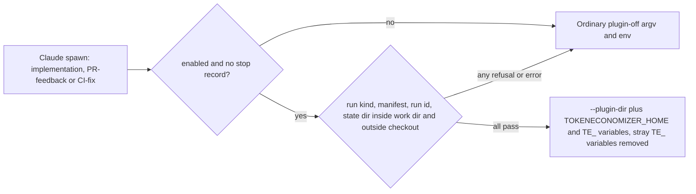

## Summary

On a host with `token_economizer.enabled: true`, the Claude implementation,
PR-feedback and CI-fix runs now load the vendored TokenEconomizer plugin through
`--plugin-dir`, with the plugin's environment set in the agent's spawn
environment. Reviewer and verifier calls, external orchestration role calls and
the other providers get neither. The launch decision is
`worker/deno/lib/token_economizer_plugin.ts`; `buildClaudeCliArgs` emits the
flag; `runClaude` overlays the environment. Learned facts cannot be fenced (the
pinned archive cannot be patched), so the issue's stated fallback applies: only
the environment-facts mechanism injects, capped at 4 facts and 150 tokens. A
durable stop record switches the plugin off across restarts. Part of #4956.

## Spec

### Intent and Rationale

- The plugin is a supply-chain component and its facts are cross-run injected
  text, so every trust check rejects the plugin (plugin off) rather than
  injecting on a best-effort basis, and a plugin fault never fails a run.
- Fencing was not possible: the pinned plugin injects facts as plain `- ` bullets
  under a fixed header. The issue's fallback (`microskills=envfacts` only) is
  taken, and the reason is in `docs/TOKEN-ECONOMIZER-TRIAL.md` §1.

### Essential Design Decisions

- `microskills` is clamped: `off` stays `off`; `distiller`, `envfacts` and
  `envfacts+distiller` all launch as `envfacts`. The proposer's facts are the
  distiller path, so the clamp switches it off instead of capping it.
- Each spawn gets its own state directory (`<work>/.token-economizer/runs/<uuid>`),
  not one per worker process: `VIBE_RUN_ID` is set once per process, so using it
  would have shared one home across runs. The overlay also deletes any `TE_` or
  `TOKENECONOMIZER_` variable the worker's own environment carries, so the host
  cannot steer the plugin.
- `tokenEconomizer?` on the processor deps and phase options is optional on
  purpose: absent means plugin off, the safe direction for an opt-in security
  feature, and making it required would change every test fixture. All five
  production callers pass it (the factory's two closures, the three commands) and
  the two closures plus the four spawn sites are tested.
- `recordTokenEconomizerStop` has no production caller yet: the issue asks for the
  shared durable mechanism and for #4957's findings to use it, and #4957 is open.
  It is the public API the issue asks for.

### Undiscoverable Facts

- The real-CLI check ran on Claude Code 2.1.310 with no model credentials, so the
  plugin's model calls (loop-guard judge) were not observed.
- The enabled-launch tests that need the real plugin at `/opt/tokeneconomizer`
  are `ignore`d where it is absent; `REQUIRE_TOKENECONOMIZER_PLUGIN=1` makes a
  missing plugin fail loudly, but no CI job sets it yet.

## Evidence

Backend-only; no UI files. Real-CLI check (version, command and outputs):
`docs/TOKEN-ECONOMIZER-TRIAL.md` §1 "Checked on this image". Threat model:
`docs/THREAT-MODEL.md` (learned-facts row, AP-19, AP-20, C37 to C41, R16, R17).

Production readers of the new members: `resolveTokenEconomizerLaunch` and
`tokenEconomizerSpawnOptions` are called by `lib/phases/execute_phase.ts`,
`lib/execute_claude_phase.ts`, `lib/pr_feedback_processor.ts` and
`lib/pr_ci_processor.ts`; `pluginDir` is read by `buildClaudeCliArgs`;
`tokenEconomizer` (run option) by `runClaudeWithTimeoutBody`;
`overlayTokenEconomizerEnv` by `claude_runner.ts`.

Issue numbers cited: #4953: Trial microsoft/TokenEconomizer with learnings
persisted to a repository across runs: keep it or purge it; #4955: Vendor
TokenEconomizer at a pinned SHA in the container image behind a token_economizer
config block, off by default; #4957: Persist TokenEconomizer learnings to a
private git repository across runs, with gitleaks before every push; #4958:
Record TokenEconomizer's actions and own cost in run stats, the run callback
(additive only) and the weekly report; #4959: TokenEconomizer: run the agreed
trial to an automatic keep-or-purge verdict.

## Acceptance Criteria

<!-- vibe-spec-review inputs="diff+issue-body" -->

- **met** — With the host enabled, the Claude argv carries `--plugin-dir` and the env carries the settings above, for the three run kinds. Without it, neither is present (both directions tested) — evidence: `worker/deno/tests/token_economizer_plugin_wiring_test.ts::an enabled implementation run reaches the Claude child with --plugin-dir and the eight variables (Issue #4956)` (and the pr-feedback and ci-fix variants), `::a disabled host spawns the Claude child with neither --plugin-dir nor a launch variable (Issue #4956)`, `worker/deno/tests/token_economizer_impl_callsites_test.ts`, `worker/deno/tests/token_economizer_reactive_callsites_test.ts`, `worker/deno/tests/token_economizer_production_deps_test.ts` — reviewer: partial — reason: the reviewer saw no test through the four spawn sites; they were added after its review and each spread was removed in turn and a test went red. The three command entry points (`commands/execute_claude_phase.ts`, `commands/pr_feedback_processor.ts`, `commands/pr_ci_processor.ts`) pass the block untested.
- **met** — A recorded real-CLI check shows the hooks firing on the image's Claude Code version — evidence: `docs/TOKEN-ECONOMIZER-TRIAL.md` §1 "Checked on this image" (2.1.310, `--setting-sources ""`) — reviewer: met
- **partial** — The fencing test and the clean-checkout test pass, and each turns red with its guard removed — evidence: `worker/deno/tests/token_economizer_plugin_test.ts::microskills is clamped to envfacts for every configured value`, `worker/deno/tests/token_economizer_plugin_wiring_test.ts::the real vendored te-hook leaves a clean checkout clean and writes only to the state directory (Issue #4956)` — reviewer: partial — reason: no fencing exists (the issue's `envfacts` fallback is the guard, and the clamp test is red without it); the clean-checkout test drives the vendored hook, not a full agent run, and removing the state-directory confinement does not turn it red.
- **met** — `docs/THREAT-MODEL.md` updated — evidence: `docs/THREAT-MODEL.md` AP-19, AP-20, C37 to C41, R16, R17 — reviewer: met
- **partial** — Hook failure falls back safely; a stop-rule finding inhibits subsequent plugin use across restart without weakening the container boundary or requiring a human — evidence: `worker/deno/tests/token_economizer_plugin_test.ts::the stop record is durable: a fresh call is still off, and the file holds the stop`, `::a corrupt or malformed stop record fails closed as unreadable`, `::an unexpected error falls back to plugin off rather than throwing`; `worker/deno/tests/token_economizer_plugin_wiring_test.ts::the real vendored te-hook fails open to {} when no Python is on PATH (Issue #4956)` — reviewer: partial — reason: nothing calls `recordTokenEconomizerStop` until #4957 lands, and no code detects a plugin hook failing during a run; the stop file sits in the work directory the agent can write.
- **missing** — "Confirm those calls run under the same egress, credentials channel and timeline as the run, and that they are counted in the run's cost" — reviewer: missing — reason: no model credentials in the check; the doc records this as a design reading, not an observation (cost accounting is #4958).
- **missing** — "Report the failed trial to #4959" — reviewer: missing — reason: nothing writes the stop to #4959 yet; the verdict is #4959's and the findings come from #4957.
- **unrequested** — The DeepSeek descriptor drops `pluginDir` — reviewer: unrequested — reason: keeps the plugin's hooks off a provider the Claude-only trial does not cover; pinned by `::deepseek argv strips --plugin-dir, so the argv is the one it built before`.
- **unrequested** — Stop-record details (first stop wins, 300-character redacted reason) — reviewer: unrequested — reason: choices for a durable record the issue asks for.

## Standards Review

<!-- vibe-standards-review inputs="diff+CODING-STANDARDS.md" -->

- **violation** — One state directory per worker process, not per spawn — evidence: `worker/deno/lib/token_economizer_plugin.ts:344` — reason: fixed in this diff (a fresh UUID per launch)
- **violation** — A test mutated the process environment — evidence: `worker/deno/tests/token_economizer_plugin_test.ts:277` — reason: fixed in this diff (the test no longer reads `VIBE_RUN_ID`)
- **violation** — No test went red when a spawn site's spread was removed — evidence: `worker/deno/lib/pr_feedback_processor.ts:1497` — reason: fixed in this diff (`worker/deno/tests/token_economizer_reactive_callsites_test.ts`, `worker/deno/tests/token_economizer_impl_callsites_test.ts`, `worker/deno/tests/token_economizer_production_deps_test.ts`); the three command entry points remain untested because they have no processor seam
- **violation** — `tokenEconomizer?` optional on the deps — evidence: `worker/deno/lib/pr_ci_processor.ts:333` — reason: fixed in this diff (decision recorded under Essential Design Decisions; every production caller passes it and is tested)
- **violation** — External-orchestration guard untested — evidence: `worker/deno/lib/execute_claude_phase.ts:1730` — reason: fixed in this diff (`worker/deno/tests/token_economizer_impl_callsites_test.ts`, each operand removed in turn went red)
- **violation** — Real-plugin tests skipped in silence — evidence: `worker/deno/tests/token_economizer_plugin_wiring_test.ts:66` — reason: fixed in this diff (`REQUIRE_TOKENECONOMIZER_PLUGIN=1` fails loudly); no CI job sets it yet
- **clean** — Australian English, no hidden or secret paths staged, named tests exist, no workflow file touched, recorded stop reasons are redacted, `distiller` clamped.

## Test Plan

- `cd worker/deno && deno task test:unit tests/token_economizer_plugin_test.ts tests/token_economizer_plugin_wiring_test.ts tests/token_economizer_impl_callsites_test.ts tests/token_economizer_reactive_callsites_test.ts tests/token_economizer_production_deps_test.ts tests/token_economizer_config_test.ts tests/token_economizer_off_spawn_test.ts tests/token_economizer_trial_docs_test.ts tests/threat_model_docs_test.ts tests/lib_sweep_coverage_test.ts`: run by the authors of each file, all passed.
- Red checks: remove `...tokenEconomizer` at each of `lib/phases/execute_phase.ts`, `lib/execute_claude_phase.ts`, `lib/pr_feedback_processor.ts`, `lib/pr_ci_processor.ts` (both spawns) → a test red each time; drop the `externalOrchestration` guard in the two implementation sites → red; remove either `tokenEconomizer: config.tokenEconomizer` line in `lib/run_core_production_deps.ts` → red; remove the `TE_` deletion loop in `overlayTokenEconomizerEnv` → overlay and wiring tests red.
- Removed from existing tests: none. `token_economizer_trial_docs_test.ts` changed `BLOCK_LANDED` to the new sentence (goes red without the sentence). `token_economizer_off_spawn_test.ts` and `token_economizer_config_test.ts` changed comments only.
- Callers checked for `tokenEconomizer`: `execute_phase.ts`, `execute_claude_phase.ts`, both spawns in `pr_ci_processor.ts`, `pr_feedback_processor.ts` pass it; reviewer and verifier calls and external orchestration deliberately do not.
- `./quality.sh < /dev/null`: see the gate line below.
- Not checked: model calls inside the real plugin; the three command entry points; a CI job that sets `REQUIRE_TOKENECONOMIZER_PLUGIN=1`.
