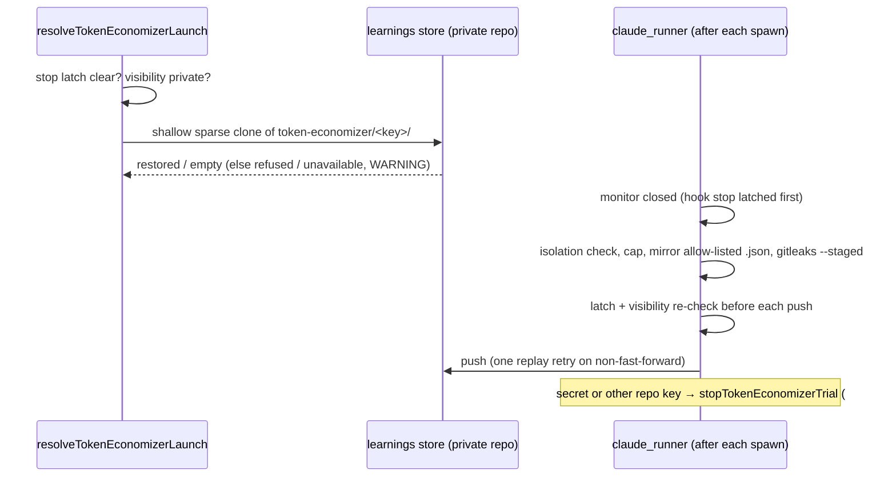

## Summary

TokenEconomizer's learnings now persist across runs in the private repository
named by `token_economizer.learnings_repo`. Each run pulls
`token-economizer/<repo-key>/` into its `TOKENECONOMIZER_HOME`. The pull is
shallow and sparse, with a timeout, and happens after a fresh check that the
store is private. After each spawn that loaded the plugin, the run pushes what
changed. Before each commit, gitleaks scans the staged learnings. A secret or
another repository's state latches the shared #4956 stop. Pull and push faults
are WARNINGs and never change the run's result. Closes #4957.

## Spec

### Intent and Rationale

- Fleet containers are recreated every launch, so without a store each run
  starts with nothing learned and the trial measures nothing.
- A new module, `worker/deno/lib/token_economizer_learnings.ts`, does the git
  work through the worker's chokepoints: git via `runGitCommand`, gitleaks via
  `spawnWithDeadline`, and gh via `runGhCommandRaw`. The launch and the runner
  each gain one call: the pull in `resolveTokenEconomizerLaunch`, and
  `syncTokenEconomizerLearnings` after the hook monitor closes.

### Essential Design Decisions

- **Shared `config.json` cap.** The pulled `token-economizer/config.json` is
  checked from its `lstat` size against `LEARNINGS_CONFIG_CAP_BYTES` (256 KiB)
  before it is read. An over-cap file makes the pull `unavailable` with nothing
  copied, as an over-cap key does.

- **Repository key.** `<repo-key>` is the upstream plugin's own key
  (`<slug(name)>-<sha1(normalised origin)[:10]>`). The normalised origin remote
  has its scheme, user and credential removed. A test checks it against the
  pinned plugin's `paths.py` for seven URL shapes.
- **Visibility.** It is checked before the pull and again before every push
  attempt, including the retry (the retry has its own test). The read runs
  inside `withTokenScopedRepo`, so an App-authenticated host's installation
  token can reach the store (read reach only, as `cross_repo_pr_handoff.ts`
  does); the write allowlist is unchanged. The store counts as private only when
  it is `private: true` with `visibility: "private"`. A public or unverifiable
  store is `refused`. A clone or validation fault is `unavailable`, never an
  empty store, and nothing is pushed from either state. The plugin still loads.
- **The "rebase" retry.** On a non-fast-forward push, the run fetches the new
  tip and replays its own commit onto it with `cherry-pick --no-commit`. A
  shallow clone has no merge-base for `git rebase`. A conflict drops the later
  run's update and logs it.
- **What syncs.** Only allow-listed regular `.json` files under the key are
  synced, up to 1 MiB per key. The launcher, `errors.log`, `*.jsonl` transcripts
  and `sessions/` never sync. The scratch clone is kept after a pushed or
  unchanged push so later spawns of the same run can push, and is removed on
  every other outcome.

### Undiscoverable Facts

- Observed with gitleaks 8.30.1:
  `gitleaks git --staged --report-format json
  --report-path - .` exits 1 with
  `[{"RuleID":"github-pat",…,"Secret":"REDACTED"}]` for a planted PAT. A clean
  scan exits 0 with `[]` and `INF no leaks found`.
- Observed with git: a non-fast-forward push prints
  `! [rejected] HEAD -> master (fetch first)`. A sparse clone of an empty bare
  repository exits 0 with an unborn HEAD. `cherry-pick --no-commit` in a shallow
  clone replays cleanly or reports `CONFLICT (content)`.
- Observed with gh: `gh api repos/stSoftwareAU/VibeCoder` returns
  `{"private":false,"visibility":"public"}`.

## Evidence

This is a backend change, so there is no UI to screenshot.

Issues cited as provenance: #4957 (this issue: persist TokenEconomizer learnings
to a private git repository, with gitleaks before every push); #4956 (load
TokenEconomizer into Claude runs, which owns the shared stop path); #4958
(record TokenEconomizer's actions and own cost in run stats, still open); #4959
(run the trial to a keep-or-purge verdict, still open).

## Acceptance Criteria

<!-- vibe-spec-review inputs="diff+issue-body" -->

- **met** — Integration test (real git, local bare repository as the store): run
  1 starts empty and pushes; run 2 on the same repository key starts with run
  1's state; a run on another key does not see it. — evidence:
  `worker/deno/tests/token_economizer_learnings_test.ts::acceptance: a run pushes its state, a later run restores it, and another key stays isolated`
  — reviewer: partial — reason: the reviewer found that the test did not prove
  another key's blobs were never fetched. The test now enables server filters on
  the bare store and asserts that key A's blob is absent from run B's clone,
  with a positive control in run 2's clone.
- **met** — A public `learnings_repo` is refused, with the reason logged. —
  evidence:
  `worker/deno/tests/token_economizer_learnings_test.ts::refused: a public or unverifiable learnings repository is never transferred`,
  `worker/deno/tests/token_economizer_plugin_wiring_test.ts::a public learnings store is refused: the plugin still loads, the refusal is logged and nothing is pushed (Issue #4957)`
  — reviewer: met
- **met** — A planted fake secret in the state is caught by gitleaks and never
  committed. — evidence:
  `worker/deno/tests/token_economizer_learnings_test.ts::stopped: a planted GitHub PAT, scanned by the real gitleaks, stops the trial and is never recorded`
  (real binary) and
  `…::stopped: an injected gitleaks report of the planted PAT stops the trial, is not committed and keeps the token out`
  — reviewer: met
- **met** — Pull/push failures are WARNINGs that leave the run outcome unchanged
  (tested). — evidence:
  `worker/deno/tests/token_economizer_plugin_wiring_test.ts::a failed learnings push leaves the run's result unchanged and is logged as a WARNING (Issue #4957)`,
  `…::an unreachable learnings store is unavailable, logged as a WARNING, and nothing is pushed (Issue #4957)`,
  `worker/deno/tests/token_economizer_learnings_test.ts::unavailable: a missing store is a warning carrying the git cause, never an empty store`
  — reviewer: met
- **met** — `docs/CONFIGURATION.md` describes the store layout and how to purge
  only this trial's namespace. — evidence: `docs/CONFIGURATION.md` section
  "TokenEconomizer learnings" — reviewer: met
- **met** — A secret/isolation finding reaches #4956's shared stop path; public
  or unreadable visibility never permits a push. #4958 records the real
  persistence/plugin status, and #4959 owns the keep-or-purge outcome. —
  evidence:
  `worker/deno/tests/token_economizer_learnings_test.ts::stopped: the real stop record latches, notifies issue 4959 and keeps the token out`,
  `…::stopped: state for another repository in the home stops the push before anything moves`,
  `…::refused: a public or unverifiable learnings repository is never transferred`.
  The real pull/push outcomes are aggregated across launches and retries into
  the run statistics and callback; the real-git wiring regression checks both.
  — reviewer: met
- **unrequested** — `docs/THREAT-MODEL.md`: new control C42 and edits to AP-20,
  C40, R16 and the Learned-facts row — reviewer: unrequested — reason: those
  rows said persistence was not delivered yet, so this change made them false.
  They now describe the shipped controls.
- **unrequested** — `docs/TOKEN-ECONOMIZER-TRIAL.md` stop-rule row narrowed to
  the pre-commit scan — reviewer: unrequested — reason: reverted. The row is
  restored to its base wording.
- **unrequested** — Path limits (8 segments, 100-character allow-listed
  segments). A pull rejects the whole key when the store holds a
  non-allow-listed entry or is over the cap, and a scanner fault skips the push.
  — reviewer: unrequested — reason: these follow the issue's rule that untrusted
  state is never an ordinary empty store, and a scan that did not finish is not
  clean (fail loud).
- **unrequested** — The scratch clone is kept after a pushed or unchanged push,
  behind an `isOwnClone` guard — reviewer: unrequested — reason: a re-run or
  retry spawn shares the launch and must still be able to push. The guard stops
  `git -C` from reaching a parent repository once the clone is gone.
- **unrequested** — `learningsStoreUrl`, `checkLearningsVisibility` and
  `scanLearnings` on the launch options — reviewer: unrequested — reason: these
  are injected seams whose production default is the real store URL, the gh
  check and gitleaks, so tests reach the real launch and runner paths.

## Standards Review

<!-- vibe-standards-review inputs="diff+CODING-STANDARDS.md" -->

- **violation** — Unit tests self-contained: push tests needed a host `gitleaks`
  binary — evidence: `worker/deno/tests/token_economizer_learnings_test.ts`
  (`CLEAN_SCAN`, `cleanScan`) — reason: fixed in this diff. Clean scans now
  inject the observed clean output, and only the real-binary secret test is
  ignored when gitleaks is absent (21 passed, 1 ignored with gitleaks hidden
  from `PATH`).
- **violation** — Every outcome of a branch needs a test: the scanner-fault
  outcomes had none — evidence: `worker/deno/lib/token_economizer_learnings.ts`
  (`parseReport` and the scan faults) — reason: fixed in this diff
  (`skipped: a scanner fault fails closed (timeout, unreadable report, unexpected exit, a throw), with nothing committed`).
- **violation** — Path Confinement negative tests: `isSafeKey` and the
  scratch-directory guard had none — evidence:
  `worker/deno/lib/token_economizer_plugin.ts:590` — reason: fixed in this diff
  (`refused: an unsafe repository key is refused on pull and push, with nothing cloned or written`,
  plus
  `a learnings scratch directory symlinked outside the work root is refused…`
  with its control).
- **violation** — A refusal test must be refused by the rule it names: the
  store-validation test asserted only the status — evidence:
  `worker/deno/tests/token_economizer_learnings_test.ts` (the store-validation
  test) — reason: fixed in this diff. Each case now asserts its allow-list or
  cap reason.
- **violation** — Prose about the PR's own change: C42's "Only allow-listed …
  files are synced" ignored the pulled `config.json` — evidence:
  `docs/THREAT-MODEL.md:220` — reason: fixed in this diff. C42 now says the
  settings file is pulled outside the key, uncounted, unscanned and never
  pushed.
- **violation** — Change every copy of a twinned rule: the key derivation copies
  upstream with no disagreement test — evidence:
  `worker/deno/lib/token_economizer_learnings.ts` (`learningsRepoKey`) — reason:
  fixed in this diff
  (`repo keys: learningsRepoKey matches the upstream plugin for seven URL shapes`
  runs the pinned plugin).
- **clean** — The reviewer checked fail-loud failure reasons (the first
  `fatal:`/`remote:`/`ssh:` line is quoted and asserted), secret redaction, log
  levels, the destructive-operation guard (`isOwnClone`), the required `subject`
  reaching all five production callers, shallow-history independence,
  temp-directory and parallel safety, Australian English, and the
  review-enforced documentation-drift-test and check-where-you-insert rules.

## Test Plan

- New `worker/deno/tests/token_economizer_learnings_test.ts` (23 tests at head,
  real git with local bare stores). It covers the acceptance round trip and
  isolation, clone reuse, a removed clone inside a parent repository, public and
  unverifiable refusals, and the planted secret, with both the real binary and
  an injected observed report. It also covers the real stop latch (notifying
  4959), the cross-repository stop, a missing store, a failed push, the replay
  (clean and conflicting), the cap, an untrusted store key, the latch, unsafe
  keys, scanner faults and the repository-key goldens with upstream parity. PR
  #5158 review round 2 added three: the retry push re-checking visibility and
  the latch
  (`refused: a store that turns public, or a stop that latches, between the first push and its replay uploads nothing`;
  its change takes effect once the other run's commit reaches the clone, not
  after a number of checks, and an unchanged control case proves the replay
  pushes),
  the default visibility check reading under a token-scope grant that is
  released afterwards (it runs against a small fake of GitHub's repository
  read that answers 404 unless the named repository is in the current token
  scope, so it does not pin the `gh` argument spelling or order)
  (`default visibility check: the learnings repository is in the token scope while it reads, and is released afterwards`),
  and a `config.json` exactly at its cap restoring
  (`restored: a config.json exactly at the cap is copied into the home`). The
  store-validation test also gained an over-cap `config.json` case, which
  asserts the reason and that no `config.json` reaches the home. Each of the
  three fixes was removed in turn and its test failed.
- `worker/deno/tests/token_economizer_plugin_wiring_test.ts`: seven new tests
  covering the round trip through `resolveTokenEconomizerLaunch` and
  `syncTokenEconomizerLearnings`, and a public store. They also cover an
  unreachable store, and a failed push through `runClaudeWithTimeout`, whose
  `ClaudeResult` equals the baseline. The rest are no learnings repository, and
  the symlinked scratch directory with its control.
- Edited existing tests: `subject` and `runId` were added to fixtures in
  `worker/deno/tests/token_economizer_plugin_test.ts` and the wiring test,
  because the field is now required. The exact-env test in
  `worker/deno/tests/token_economizer_plugin_test.ts` now sets
  `learningsRepo: undefined`, because its checkout has no origin and the pull
  would add a warning. Its expected env and empty-warning assertion are
  unchanged. `BLOCK_LANDED` in
  `worker/deno/tests/token_economizer_trial_docs_test.ts` follows the reworded
  page sentence. No assertion was removed.
- Gitleaks hidden from `PATH`:
  `deno test -A
  tests/token_economizer_learnings_test.ts` ran 21 passed and 1
  ignored (the real-binary secret test).
- Gitleaks absent from `PATH` is not repeated for the round-2 tests: they use
  the injected clean scan.
  `deno task test:unit tests/token_economizer_learnings_test.ts` before this repair ran
  22 passed, 0 failed (gitleaks present).
- `./quality.sh < /dev/null` after the round-2 fixes (code commit `f9520caa`)
  exited 0 with `Result: PASSED (with skipped checks)`; config integration and
  checkov were skipped, and these skips are not passes.
- `./quality.sh < /dev/null` on the earlier code (`f504ca77`, before the round-2
  fixes) exited 0 with `Result: PASSED (with skipped checks)`. Deno tests passed
  in both the parallel (8m33s) and serial (3m43s) passes. Completeness,
  markdownlint, mermaid, semgrep, gitleaks, lint, type check and fmt also
  passed. Config integration (no `.config.json`) and checkov (no binary) were
  skipped, and these skips are not passes. The first run failed only on the
  unregistered sweep slice, now
  `docs/audits/lib-sweep-coverage/top-up-4957.json`, whose `sweptAt` is the
  merge base with `origin/main` (`fccd1182c`), so it stays reachable after the
  squash merge. `deno run mod.ts sweep-drift` against `origin/main` exits 0.
- Callers checked: every production caller of `tokenEconomizerSpawnOptions`
  passes `subject`. Those are `execute_claude_phase.ts`,
  `phases/execute_phase.ts`, `pr_feedback_processor.ts` and `pr_ci_processor.ts`
  (two sites). `parseReport` in `gitleaks_check.ts` is now exported with no
  behaviour change, and its existing tests pass.
- The set/clear pairs checked: the stop latch is the existing #4956 record,
  which a healthy run deliberately does not clear. This change adds no new
  persistent failure record.

## Docs

- `docs/CONFIGURATION.md`: the TokenEconomizer row is updated, and the new
  "TokenEconomizer learnings" section covers the layout, pull, push, scratch
  clone and purge.
- `docs/TOKEN-ECONOMIZER-TRIAL.md` and `docs/THREAT-MODEL.md` no longer describe
  persistence as planned.
- The "not read yet" comments in `config.ts`, `config_defaults.ts`,
  `token_economizer_config.ts`, `types.ts` and the config test are reworded.

## Merge verification

Required PR CI, review and the existing automatic merge path are unchanged, and
are pending on this PR.

## Not done or not checked

- Kept scratch clones under `<work>/.token-economizer/store/<runId>` are not
  removed at the end of a run, just as the per-run homes were not before.
- Pull and push outcomes now feed the run statistics and callback, including
  retries; unavailable transfers are not reported as persisted.
- Upstream's `*.jsonl` ledgers and `sessions/` records are not synced, by the
  issue's transcript rule. I did not establish whether a later fold relies on
  them.
- A live push to a real private GitHub store was not exercised. The tests use
  local bare repositories and stubbed visibility.

## Replay reuse repair

A replay previously advanced only the retained scratch clone. A later spawn
mirrored its stale home over that clone and could undo another run's changes.
After a successful or unchanged replay, admitted home state now follows the
replayed baseline, including remote deletions. Logs and sessions stay local.
Destinations are checked before replacement so a symlink cannot redirect a
restored file; a refresh fault discards the clone and warns.

The real-git replay regression was extended before the fix. Its second push
failed with `pushed` instead of `unchanged`, reproducing the overwrite. With the
fix, the unchanged push creates no commit; a subsequent local edit preserves
both runs' files and the other run's content. The fixture also checks remote
deletion and preservation of a local session. A new test covers file and
directory symlink destinations, asserting outside content remains unchanged
and the unsafe clone is discarded. No previous assertions were removed.

## Retry test decoupled from call counts

The retry visibility/latch test turned the store public, or latched the stop,
on the third callback and asserted exactly three calls. That tied it to the
internal check sequence. The transition now follows an external event: the
fake flips once the other run's commit exists in the retrying run's scratch
clone, which only the replay's fetch causes. The call-count assertion is gone.
A third, unchanged case acts as the positive control: the replay runs and the
store gains one commit with both runs' files. The `public` and `latch` cases
assert the `refused` ("is public") or `skipped` ("latched") outcome and that
the remote tip, commit count and files are unchanged. The test was added in
this PR, so no base behaviour changed.

Validation in this repair environment:

- After the retry-test rewrite, the learnings suite
  (`deno test -A tests/token_economizer_learnings_test.ts`) passed 23, failed 0.
  Format, lint and type check of the test file passed.

- Learnings and plugin-wiring suites, run again on the merged head with
  `deno test -A`: 60 passed, 0 failed, none ignored. An earlier run without the
  gitleaks binary and vendored plugin passed 47 and ignored 13 behind their
  existing optional-tool guards.
- Formatting, lint and `git diff --check` passed.
- Deno's direct JSR downloads failed here. Tests used a temporary local import
  map to the locked published dependency versions, downloaded with curl and
  verified against their manifest SHA-256 checksums. Repository dependency
  files and lockfile are unchanged.
- Full quality was attempted; this environment cannot establish a full pass.
  Required CI and independent review remain authoritative.

## Review repair: home ancestors and replay evidence

Normal push now validates the home and repos directories before inspecting or
reading repository state. Initial pull validates home, repos, key, every
incoming parent directory and each destination file before its first write;
shared configuration receives the same destination checks. Replay reuses that
validator. Static symlink redirection is refused rather than reading/uploading
outside state or overwriting an outside destination. The agent is stopped during
transfers; this change does not claim race-safe handle-based filesystem access.

A real-store regression reproduced the initial-pull escape before repair and
now verifies refused pull, skipped push, unchanged outside bytes and unchanged
remote commit/content. Ordinary-directory pull and push controls remain in the
suite. The latched test no longer counts visibility callbacks. Replay refusal
uses the existing no-lazy-fetch object probe, proves the competing commit absent
before the first push, and records its arrival before the refusal; private and
unlatched control still pushes. These verify state and outcomes, not call order.

Validation: all 22 persistence tests pass, with 2 existing optional tests
ignored; changed source and tests pass type checking and formatting. Hosted CI
remains required. Both earlier test-interaction findings and the static ancestor
symlink finding are addressed.

## Final review repair

The visibility fake resolves exact repository targets and denies unknown or
out-of-scope repositories. The notification fake stores delivered comments
on the intended issue and refuses unknown targets; assertions check the
redacted report, real stop latch and unchanged store, not request text or
callback counts.

The sync controller retains actual transfer outcomes by launch identity. The
implementation phase carries all launch identities into run statistics. A run
is persisted only when every launch pulled successfully and every attempted
push succeeded; any failure or unfinished launch keeps it unavailable. The
real-git round-trip regression checks stats, rendered text and callback, plus
an unfinished second launch and a failed retry after successful persistence.
The public-store and runner push-failure tests check unavailable statistics.

Local validation uses Deno 2.9.6 and cached published dependencies through a
temporary import map; repository dependencies are unchanged. Optional tests
requiring the vendored plugin or gitleaks are skipped by their existing guards.
Full hosted CI and fresh independent review remain required.

Validation: 94 focused persistence, wiring, stats and trial-documentation tests
pass; 13 existing optional-tool tests are ignored. The successful-persistence
regression fails against the original statistics implementation (unavailable
instead of available).
