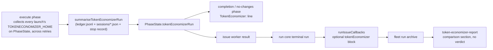

# PR Summary — Issue #4958

## Summary

An implementation run now records what TokenEconomizer did and what its own
model calls cost. After the agent invocations, the worker reads the plugin's own
state (its `ledger.jsonl` and `sessions/*.json` under each launch's
`TOKENECONOMIZER_HOME`). The result is shown in three places:

- a `- **TokenEconomizer:**` line in the run-stats comment, after the `RTK:`
  line;
- an optional `tokenEconomizer` block on the run callback. It is emitted only on
  a host with the switch on, and `schemaVersion` stays 2;
- a new read-only `token-economizer-report` command. It renders the trial
  comparison section from archived run documents.

Closes #4958.

## Spec

### Intent and Rationale

- The trial verdict (#4959) has to read, per run, whether the plugin ran, what
  it did and what it cost, from the run archive rather than host logs. The
  plugin's structured state is read directly (upstream `accounting.summarize`'s
  own definitions), never its free text.
- Status comes from evidence, not from the config flag:
  - `on`: the state shows a session.
  - `fallback`: switched on, no evidence the plugin ran.
  - `stopped`: a stop record is in force.
  - `not-run`: the run ended before the agent spawned.
  - `off`: the switch is off, or a non-Claude provider served the run.
- Persistence is recorded as `unavailable` until #4957 lands the learnings
  store.

### Essential Design Decisions

- **Cost:** `telemetry.estimatedCostUsd` keeps its agent-only meaning, so
  existing archive readers (the RTK trial) are unaffected. The plugin's cost
  travels as `pluginCostUsd`, plus `runCostUsd` (agent + plugin, present only
  when both are known). The stats line shows `(run incl. plugin ~$X)`. The
  issue's cumulative total line is unchanged.
- **Pricing and double counting:** the plugin's side calls run on upstream's
  `paid_model` (default `haiku`; the worker sets no `TE_PAID_MODEL`). They are
  separate `claude -p` processes, so they are not in the agent's stream totals
  and nothing is counted twice. The cost is priced as effective tokens ×
  `haiku`'s input price.
- **Every launch in the run is summed:** the launch homes are kept on
  `PhaseState.tokenEconomizerHomes` for the whole run, not per execute body. The
  infrastructure retry, the sonnet refusal retry and the prompt-too-long
  fallback re-run the body in the same run, and a credential switch launches a
  second agent inside one body. Every attempt's plugin calls were billed, so the
  recorded stats sum every home any of them used.
- **Absent figures and the off-host callback:** a figure that cannot be read is
  absent ("unavailable"), never 0. A switched-off host's callback document is
  byte-identical to today's.
- **The report:** there is no weekly-report generator in the repository to
  extend, so the "weekly report section" is a new on-demand command. Its
  populations are as follows:
  - The switched-on population is intention-to-treat: every status on an enabled
    Claude run, so failed and stopped attempts stay in.
  - Merge rate is merged over PRs with a final state.
  - It renders no verdict: not yet: #4959 will apply the bar.
  - Accounting for billed capped and unfinished-executor invocations belongs to
    open #5029. That shared stats path does not exist at this head, so it is not
    reused here, and the trial doc says the measured trial must not be judged
    until it lands.

### Undiscoverable Facts

- Upstream's state layout and cost definitions were read from the vendored
  plugin at `/opt/tokeneconomizer/tokeneconomizer`:
  - `plugin/accounting.py` `summarize`, `ledger.py` `OVERHEAD_KEYS`,
    `plugin/fold.py` (session record) and `plugin/judge.py` `run_job` (one
    `overhead` ledger record per paid judge job);
  - `plugin/sidecall.py` `claude_call(…, model="haiku")`.
- Only issue runs fire post-run callbacks (`invokeRunCallbacks` is called from
  `runIssueCallbacks` in `run_core_production_deps.ts` and from the conformance
  command). PR-feedback and CI-fix rounds therefore get neither the line nor the
  block. The trial is judged on implementation runs (trial doc §4).

## Evidence

Backend/CLI change; no UI files touched.

- Reader, line and block: `worker/deno/tests/token_economizer_run_stats_test.ts`
- Report and command: `worker/deno/tests/token_economizer_trial_report_test.ts`
- Wiring through the real phases and deps:
  - `worker/deno/tests/token_economizer_impl_callsites_test.ts`
  - `worker/deno/tests/rtk_callback_2386_test.ts`
  - `worker/deno/tests/run_core_callbacks_test.ts`
  - `worker/deno/tests/token_economizer_production_deps_test.ts`
  - `worker/deno/tests/run_callback_context_test.ts`
  - `worker/deno/tests/completion_phase_run_stats_test.ts`
  - `worker/deno/tests/handle_no_changes_phase_test.ts`
  - `worker/deno/tests/issue_run_stats_comment_test.ts`
  - `worker/deno/tests/execute_phase_rtk_test.ts`
- Issue numbers this diff cites:
  - #4953: Trial microsoft/TokenEconomizer with learnings persisted to a
    repository across runs: keep it or purge it
  - #4957: Persist TokenEconomizer learnings to a private git repository across
    runs, with gitleaks before every push
  - #4959: TokenEconomizer: run the agreed trial to an automatic keep-or-purge
    verdict
  - #5029: Record billed capped and unfinished-executor invocations in run
    totals and the lifecycle ledger
- Docs updated:
  - `docs/TOKEN-ECONOMIZER-TRIAL.md`: the §1 loop-guard row and "Not observed"
    paragraph, §7 (figures, line shapes, report), and the §8 purge list, where
    every file that now names the plugin is `present`.
  - `docs/CALLBACKS.md`: the `tokenEconomizer` block section and the Reference
    row.

## Acceptance Criteria

<!-- vibe-spec-review inputs="diff+issue-body" -->

- **met** — Tests for the stats line and the callback fields, both on and off.
  An off run's callback is byte-identical to today's apart from absent optional
  fields. — evidence:
  `worker/deno/tests/token_economizer_run_stats_test.ts::stats line - exact strings for every status`,
  `worker/deno/tests/token_economizer_run_stats_test.ts::callback document - a switched-off host is byte-identical`,
  `worker/deno/tests/token_economizer_production_deps_test.ts::production runIssueCallbacks omits the block when the switch is off`
  — reviewer: met
- **met** — `schemaVersion` is unchanged (a test pins it). — evidence:
  `worker/deno/tests/token_economizer_run_stats_test.ts::callback document - an on run carries the block and the schema stays 2`
  — reviewer: met
- **met** — The weekly report renders the comparison from archived runs, with
  explicit populations and unavailable data. #4959 applies the predeclared
  verdict; this issue does not add another verdict or trial controller. —
  evidence:
  `worker/deno/tests/token_economizer_trial_report_test.ts::rendered section shows explicit populations and no verdict`,
  `worker/deno/tests/token_economizer_trial_report_test.ts::switched-on population keeps failed, stopped and plugin-off attempts`,
  `worker/deno/tests/token_economizer_trial_report_test.ts::runs with no pull request are outside the merge-rate denominator`
  — reviewer: met — reason: the reviewer's population findings (asymmetric
  switched-on set, no-PR runs in the merge denominator, unchecked §5 exclusions)
  were fixed in this diff before the summary was written
- **unrequested** — `--format json` and `--mode` options on
  `token-economizer-report` — reviewer: unrequested — reason: JSON lets #4959
  read the figures without parsing Markdown; `--mode` names the implementation
  label, which is configurable (`work-on` by default)
- **unrequested** — the "relative cost difference" lines in the report section —
  reviewer: unrequested — reason: a figure derived from the two costs shown,
  rendered without any pass/fail against the bar
- **unrequested** — the `pluginEffectiveTokens` callback field — reviewer:
  unrequested — reason: the raw plugin figure behind `pluginCostUsd`, so a
  reader can re-price it if the side-call model changes
- **unrequested** — a standalone `token-economizer-report` command instead of a
  section in an existing weekly report — reviewer: unrequested — reason: the
  repository has no weekly-report generator to extend; the command renders the
  section the issue asks for
- **unrequested** — the re-wrap of the hard-kill paragraph in
  `docs/CALLBACKS.md` and the unused `tokenEconomizer` parameters in
  `worker/deno/lib/phase_run_stats.ts` — reviewer: unrequested — reason: both
  were reverted to origin/main in this diff and are no longer in it

## Standards Review

<!-- vibe-standards-review inputs="diff+CODING-STANDARDS.md" -->

- **violation** — Check where you insert: the new declarations split the
  `invokeAgent` comment from its function — evidence:
  `worker/deno/lib/phases/execute_phase.ts:1341` — reason: fixed in this diff
  (moved above the comment block)
- **violation** — Check where you insert: import placed inside the documented
  side-effect import block — evidence: `worker/deno/lib/issue_worker.ts:88` —
  reason: fixed in this diff (moved to the ordinary imports)
- **violation** — Behaviour another issue delivers described as present (#4959's
  verdict) — evidence: `worker/deno/lib/token_economizer_trial_report.ts:9` —
  reason: fixed in this diff (planned form "not yet: #4959 will apply the bar"
  here, in the rendered section, in
  `worker/deno/commands/token_economizer_report.ts` and in
  `docs/TOKEN-ECONOMIZER-TRIAL.md`)
- **violation** — Stale doc comment: `rtk` described as emitted last — evidence:
  `worker/deno/lib/run_callbacks.ts:687` — reason: fixed in this diff
- **violation** — Unused parameters added to `reportPhaseDegradation` and
  `postPrRoundRunStats` — evidence: `worker/deno/lib/phase_run_stats.ts:213` —
  reason: fixed in this diff (file restored to origin/main; doc claim about the
  degraded-run comment dropped)
- **violation** — Changed call sites without a test through the production path
  — evidence: `worker/deno/lib/run_core_production_deps.ts:5496` — reason: fixed
  in this diff (tests added through the execute phase with the switch on, the
  issue worker result, the run core terminal run and the production deps'
  `processIssue` and `runIssueCallbacks`)
- **violation** — Merge-rate prose did not match the code (no-PR runs counted as
  known) — evidence: `docs/TOKEN-ECONOMIZER-TRIAL.md:387` — reason: fixed in
  this diff (code now excludes no-PR runs; the doc states the definition)
- **clean** — additive-only callback contract with a byte-identical off test;
  persisted archive shape read with and without the block; fail-loud reads with
  path and cause; temp-directory-only tests; Australian English; no hidden files
  staged. Review-enforced rules checked: Check where you insert, forward
  references to another issue, documentation-drift tests, dummy and "how" tests.

## Test Plan

- Added `worker/deno/tests/token_economizer_run_stats_test.ts` (12 tests). They
  cover the reader over fixture state, including imported-record exclusion, the
  sum over two populated homes, a ledger-only home, a malformed ledger, the stop
  record and missing homes. They also cover every stats-line shape, the comment
  placement, and the callback document both off (byte-identical) and on
  (`schemaVersion` 2).
- Added `worker/deno/tests/token_economizer_trial_report_test.ts` (13 tests).
  They cover populations, the intention-to-treat switched-on set, the cost rule,
  unavailable cost with a lower bound, the merge-rate denominator, the absence
  of verdict wording, and command failures on a missing or empty archive and bad
  options.
- Extended existing tests with TokenEconomizer analogues next to the RTK ones.
  No existing assertion was removed or changed:
  - `worker/deno/tests/token_economizer_impl_callsites_test.ts`: fallback, on,
    and the non-Claude off case through the real execute phase. Two multi-launch
    tests drive `workOnIssueExecuteClaude` with each launch writing ledger
    overhead and a session under its own `TOKENECONOMIZER_HOME`:
    - an in-process infrastructure retry (a SIGKILL, then a clean run);
    - a credential switch (exit 2 with `usageLimit`, then a clean run).

    Each asserts the summed `judgeCalls`, `redirects`, `factsInjected`,
    `pluginEffectiveTokens` and `pluginCostUsd`. Red-checked:
    - resetting the homes at the start of each body fails the retry test;
    - reading only the first launch's home fails both tests.
  - `worker/deno/tests/rtk_callback_2386_test.ts`
  - `worker/deno/tests/run_core_callbacks_test.ts`
  - `worker/deno/tests/token_economizer_production_deps_test.ts`
  - `worker/deno/tests/run_callback_context_test.ts`
  - `worker/deno/tests/completion_phase_run_stats_test.ts`
  - `worker/deno/tests/handle_no_changes_phase_test.ts`
  - `worker/deno/tests/issue_run_stats_comment_test.ts`
  - `worker/deno/tests/execute_phase_rtk_test.ts`: two new assertions on the
    disabled slot.
- `worker/deno/tests/mod_test.ts`: the command count goes from 162 to 163
  because this diff registers `token-economizer-report`.
- New sweep slice `docs/audits/lib-sweep-coverage/top-up-4958.json` for the
  three new modules.
- Messages the stats comment already renders: the existing lines (models, cost,
  Graft, CodeGraph, gate, split, RTK, issue total) are unchanged and still true.
  The new line is added after the RTK line. The issue total still sums the agent
  cost lines only, as the trial doc states.
- Results:
  - The touched and related unit tests passed: 444 passed, 0 failed.
  - After the multi-launch fix, the TokenEconomizer, execute-phase, refusal
    retry, infra retry, completion and no-changes suites gave 455 passed and 1
    failed. The failure is
    `execute_phase_assignment_3718_test.ts::automatic Codex worker dispatch uses Codex role models`.
    It fails identically at the unfixed head, because this container image
    installs no `codex` provider.
  - `./quality.sh < /dev/null` PASSED (with skipped checks: config integration,
    checkov) on `eee814ae`.
  - `worker/deno/tests/token_economizer_production_deps_test.ts` passed (9
    passed, 0 failed) after the final test commit.
