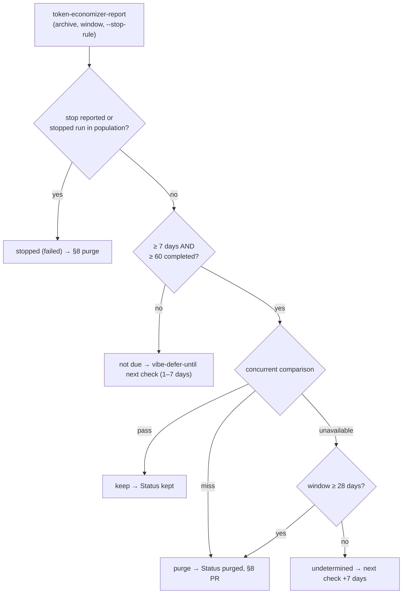

# PR summary — Issue #4959

## Summary

This PR adds the TokenEconomizer trial's keep-or-purge verdict.
`worker/deno/lib/token_economizer_verdict.ts` applies the bar the protocol fixed
in advance to the trial report:

- a stop overrides the window;
- the verdict is due only after 7 days and 60 completed switched-on runs, and
  until then it prints a next check 1 to 7 days ahead;
- the three-clause bar is applied to both comparisons, and the concurrent one
  decides;
- a concurrent figure still missing on day 28 of the window is a purge.

`token-economizer-report` now prints a `## TokenEconomizer trial verdict`
section, adds a `verdict` field to `--format json`, and accepts
`--stop-rule <rule>`. `docs/TOKEN-ECONOMIZER-TRIAL.md` §3 and §7 replace the
"not present yet: #4959 owns them" wording with the delivered procedure and an
action table per verdict.

The trial window has not opened, so no verdict could be recorded and no keep or
purge was done. Part of #4959.

## Spec

### Intent and Rationale

- All four dependencies (#4955–#4958) and #5029 are closed, but the protocol's
  Status is still "not started". No switched-on run exists to judge, so this run
  delivers the step the issue still lacked: turning the archived figures into a
  reproducible verdict that a later #4959 run applies unattended.
- The verdict is a pure function over the existing report
  (`buildTokenEconomizerTrialReport`). Its populations, exclusions and cost
  rules are reused rather than redefined, which the issue requires ("Do not
  redefine thresholds, exclusions or denominators").

### Essential Design Decisions

- **Completed runs.** "60 completed switched-on implementation runs" is read as
  the report's `switchedOn.completed`, i.e. runs with a success outcome, the
  same figure as the report's "Completed" row. This is the stricter reading. It
  is an assumption, because the protocol does not define "completed" separately
  from the success outcome.
- **Concurrent comparison missing.** The issue says "missing data is not a
  successful trial", so an unavailable concurrent comparison never yields
  `keep`. Until day 28 of the window (`MISSING_DATA_LIMIT_DAYS`) it is
  `undetermined` with a 7-day next check; from day 28 it is `purge`. This limit
  is new, set before any result exists.
- **Next check.** The next check is clamped to 1–7 days (`MAX_NEXT_CHECK_DAYS`),
  inside the worker's 30-day `vibe-defer-until` cap. A stop comment posted while
  the issue is parked is therefore read within 7 days.
- **Where a stop comes from.** A stop is read from the archive (any
  switched-on-population run with status `stopped`) or from `--stop-rule`, the
  rule named in the controller's `TokenEconomizer trial stopped: <rule>.`
  comment on #4959.

### Undiscoverable Facts

- On 2026-11-17, `gh issue view` showed #4955, #4956, #4957, #4958 and #5029 all
  CLOSED.
- The protocol's header still says Status "not started" and "Window opened: —
  (not yet opened)". GRQ-25's opt-in is the owner's configuration step.

## Evidence

Backend/CLI change; no UI files. Verified by the tests below.

Issue numbers cited: #4959 "TokenEconomizer: run the agreed trial to an
automatic keep-or-purge verdict"; #4958 "Record TokenEconomizer's actions and
own cost in run stats, the run callback (additive only) and the weekly report".

## Acceptance Criteria

<!-- vibe-spec-review inputs="diff+issue-body" -->

- **partial** — The verdict is reproducible from archived run data and the
  predeclared protocol. — evidence:
  `worker/deno/tests/token_economizer_verdict_test.ts` — reviewer: partial —
  reason: the bar is applied deterministically from the archive, but
  `--window-start` and `--stop-rule` are still supplied by the #4959 run, and
  the three section 5 exclusions the archive cannot apply stay not checked.
- **partial** — A stop before the normal window is handled automatically; normal
  waiting resumes automatically without routine `needs-human`. — evidence:
  `worker/deno/tests/token_economizer_verdict_test.ts::stopped overrides the window, by option and by a stopped record`
  — reviewer: partial — reason: the verdict puts a stop ahead of the window and
  gives a bounded next check, but nothing in the worker calls the command by
  itself. A stop comment is only read at the next check, and the worker's
  three-deferral ceiling (`MAX_TIME_DEFERRALS`) is unchanged.
- **missing** — Keep and purge outcomes above have concrete evidence; purge
  builds without the plugin and passes the required checks. — reviewer: missing
  — reason: the trial window has not opened (Status "not started"), so no
  figures exist to keep or purge on.
- **met** — Implementation and outcome PRs follow ordinary CI, review and
  automatic merge/completion. There is no additional sign-off tracker. —
  evidence: `docs/TOKEN-ECONOMIZER-TRIAL.md` (the action table under "The
  verdict" adds no sign-off step) — reviewer: met
- **partial** — Unavailable host/store operations use existing authorised
  recovery and precise deferred status, never a false claim that the trial was
  enabled, stopped or purged. — evidence:
  `worker/deno/commands/token_economizer_report.ts` — reviewer: partial —
  reason: the command still fails loud on an unreadable or empty archive, and an
  unavailable figure gives `undetermined`, never `keep`. Nothing new covers an
  unavailable host or learnings store during a purge.
- **unrequested** — the `MISSING_DATA_LIMIT_DAYS = 28` limit and the
  `undetermined` state — reviewer: unrequested — reason: needed so that "missing
  data is not a successful trial" ends in a recorded outcome rather than an
  unbounded wait; set before any result exists.
- **unrequested** — `--format json` now carries an added `verdict` field —
  reviewer: unrequested — reason: makes the verdict machine-readable for the
  #4959 run; the change only adds a field.

## Standards Review

<!-- vibe-standards-review inputs="diff+CODING-STANDARDS.md" -->

- **violation** — a new `lib/` module that no sweep slice claims — evidence:
  `worker/deno/lib/token_economizer_verdict.ts:1` — reason: fixed in this diff
  (`docs/audits/lib-sweep-coverage/top-up-4959.json`)
- **violation** — the precedence test did not build a miss beside an unavailable
  clause — evidence: `worker/deno/tests/token_economizer_verdict_test.ts:325` —
  reason: fixed in this diff (a literal-based `compareAgainst` test with a
  control)
- **violation** — the unclamped next-check estimate and the zero-run fallback
  were not covered — evidence:
  `worker/deno/tests/token_economizer_verdict_test.ts:239` — reason: fixed in
  this diff (exact `nextCheck` literals at 4 days and at the 7-day fallback)
- **violation** — the JSON `verdict` field and the `deps.now` wiring had no test
  that fails when they are wrong — evidence:
  `worker/deno/commands/token_economizer_report.ts:224` — reason: fixed in this
  diff (a command test asserts `verdict.kind` and an exact `nextCheck` from the
  injected clock)
- **violation** — "no human opens or closes the window" overclaimed what the
  head runs — evidence: `docs/TOKEN-ECONOMIZER-TRIAL.md:236` — reason: fixed in
  this diff (now says the #4959 run computes the verdict, and states the
  deferral ceiling and the 7-day stop latency)
- **violation** — "any switched-on run in the archive" was wider than the
  population the code reads — evidence: `docs/TOKEN-ECONOMIZER-TRIAL.md:456` —
  reason: fixed in this diff (now names the switched-on population)
- **violation** — "the verdict says so" missed the `stopped` exception —
  evidence: `docs/TOKEN-ECONOMIZER-TRIAL.md:473` — reason: fixed in this diff
- **clean** — Review-enforced rules checked: dummy tests and "how" tests (rules
  1–4), documentation-drift review findings, and "Check where you insert". Also
  checked: the refusal test is refused by the rule it names, every named test
  exists, issue numbers were cited after looking them up, `--stop-rule` is
  allow-listed, tests use a fixed clock and private temp directories, Australian
  English, and the JSON field is additive and never cached.

## Test Plan

- Added `worker/deno/tests/token_economizer_verdict_test.ts`. It covers:
  - keep;
  - purge on a 5% saving;
  - exactly 10% cheaper is a keep;
  - purge on a merge or success miss;
  - a disagreement, which the concurrent comparison decides;
  - not due on too few runs or too few days, with exact next-check literals;
  - the unclamped 4-day estimate;
  - the 7-day fallback at zero completed runs;
  - a stop, by option and by a stopped record, with a not-due control;
  - undetermined at day 10 and purge at day 28;
  - `compareAgainst` precedence: a miss beside an unavailable clause gives
    `miss`, with an `unavailable` control;
  - the stop-rule allow-list;
  - the formatted verdict lines.
- Added to `worker/deno/tests/token_economizer_trial_report_test.ts`:
  - a `--stop-rule cross-repo-fact` run gives a stopped verdict, and
    `--stop-rule bogus` is refused with the exact message (otherwise valid
    input);
  - a `--format json` run carries `verdict.kind` `not-due` and a `nextCheck`
    taken from the injected clock.
- Changed one existing assertion in
  `worker/deno/tests/token_economizer_trial_report_test.ts`:
  - Removed from `worker/deno/tests/token_economizer_trial_report_test.ts`:
    `"It renders no verdict; not yet: #4959 will apply the bar.",`
    - Required by: "Record the figures, source queries, comparison and verdict
      in the protocol."
    - Replaced by:
      `"This section reports figures only; the verdict section that follows applies the bar."`
      in the same test. The test still asserts that the comparison section
      contains no keep, purge or fail wording.
- `deno test -A tests/token_economizer_verdict_test.ts tests/token_economizer_trial_report_test.ts`
  (from `worker/deno`): passed, 30 tests.
- `deno test -A tests/token_economizer_trial_docs_test.ts`: passed, 31 tests. It
  needs the purge-list rows for the two new files, which this diff adds.
- `deno test -A tests/lib_sweep_coverage_test.ts`: passed, 39 tests.
  `deno task check:manifests`: passed.
- `./quality.sh < /dev/null`: failed, on deno tests only, with 2 of 35105 tests
  failing. Neither test imports a changed file:
  - `worker/deno/tests/ephemeral_root_telemetry_5105_test.ts:375` fails under
    the parallel pass and passes alone (20 of 20);
  - `worker/deno/tests/pr_summary_ci_workflow_3768_test.ts` fails because this
    container cannot download npm packages from `registry.npmjs.org`.

  Every other stage passed, including semgrep, gitleaks, lint, type check, fmt,
  markdownlint and mermaid.
- Rules checked against existing ones: none. This diff adds no prompt or
  standards rule.
- Not done or not checked:
  - no verdict was recorded, because the window is not open;
  - nothing in the worker calls the report command by itself;
  - the `MAX_TIME_DEFERRALS` ceiling and the `Deferred until` record cleared on
    a stop are unchanged;
  - the `definition` in `docs/audits/lib-sweep-coverage/top-up-4958.json` still
    says the report renders no verdict; it is a historical audit record and was
    left alone.
