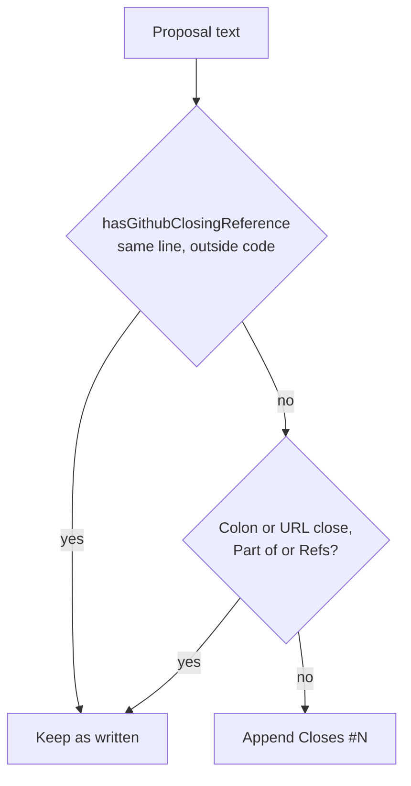

## Summary

The babysitter PR-description guard no longer counts a line-wrapped (`Closes` /
`#N`) or code-split (``Closes `x` #N``) keyword as the governing issue's close,
so a completed run's description keeps a close GitHub honours.

Closes #4964.

Version bump: `VERSION` is untouched by this change.

## Spec

### Intent and Rationale

- `guardPrBodyProposal` skipped appending `Closes #N` when `closingRefs` found a
  keyword, but `CLOSING_KEYWORD_RE` joins keyword and `#N` with `\s+` and the
  code mask blanks to spaces, so both forms matched. The guard does not restore
  the live body's governing reference, so the published body lost its only
  effective close.
- The guard now asks the same question as `ensurePrReferencesIssue`
  (`hasGithubClosingReference`: same-line `[ \t]+`, code masked by a non-space
  placeholder), exported from `worker/deno/lib/pr_body.ts` rather than a third
  pattern.

### Essential Design Decisions

- `hasGithubClosingReference` gained an optional `repo`: a same-repository
  `owner/repo#N` still counts for the guard (as before), a qualified reference
  never counts when `repo` is omitted, so `ensurePrReferencesIssue` is
  unchanged.
- `assertWithheld` (the withheld-state backstop) now reads code with the
  placeholder mask, keeping the loose `\s+` pattern. Without this, the withheld
  code-split form ``Closes `x` #N`` threw "still closes" for a reference GitHub
  does not honour. A line-wrapped form still throws there (the conservative
  side). `assertWithheld` is exported so a test can reach the backstop, because
  the withhold rewrite runs first and no proposal reaches the throw through the
  guard.
- Only the governing issue's append decision changed. The kept/restored
  closing-reference logic for other issues still uses `closingRefs` (not asked
  for).

### Undiscoverable Facts

- #4936 / PR #5021 (suppressing real closes when work is partial) landed before
  this run (commit 74ca6622); the withheld-state tests here pin that the shared
  parser leaves no effective close for the line-wrapped, code-split, colon and
  full-URL forms.

## Evidence

This is pure text matching, so no external tool was observed; the failure is
pinned by the red checks in the Test Plan.

## Acceptance Criteria

The issue states no Acceptance Criteria or Definition of done heading, and
nothing it asks is left undone, so no block is required. Its asks and where they
land:

- Same check as `ensurePrReferencesIssue`, exported from `pr_body.ts`:
  `hasGithubClosingReference` in `worker/deno/lib/pr_body.ts`.
- Guard tests for line-wrapped and code-split proposals, plain same-line close
  unchanged: `worker/deno/tests/babysitter_pr_body_guard_test.ts`.
- Both states end to end, including colon and full-URL forms, with a quoted or
  code-formatted example never an effective close: the withheld-state tests in
  the same file.

## Test Plan

Tests added in `worker/deno/tests/babysitter_pr_body_guard_test.ts` (names
contain "Issue #4964"):

- line-break split close gets `Closes #N` appended;
- code-split close gets `Closes #N` appended;
- same-repository qualified close honoured with no duplicate, another
  repository's not;
- tab-joined and `Fixes` same-line closes left unchanged;
- withheld state: line-wrapped, code-split, colon and full-URL forms leave no
  effective close;
- `assertWithheld` still throws for real closes and not for code-formatted ones.

Tests added in `worker/deno/tests/pr_body_test.ts`: `hasGithubClosingReference`
with and without `repo`, and the line-break split.

Results on the final head: `deno task test:unit` on the three touched test files
(`babysitter_pr_body_guard_test.ts`, `pr_body_test.ts`, `pr_body_sync_test.ts`)
passed (123 and 41); `tests/fleet_pr_babysitter_test.ts` passed (120);
`./quality.sh < /dev/null` result: PASSED (config integration and checkov
skipped by the gate itself).

Red checks:

- `namesClosingOrPartOf` plain operand restored to
  `closingRefs(masked, repo).some(...)`: the line-break and code-split append
  tests went red; the qualified same-repository test stayed green.
- `assertWithheld` restored to `maskMarkdownCode`: the withheld-state test and
  the backstop test went red.

Callers of the changed helpers checked: `ensurePrReferencesIssue` (calls
`hasGithubClosingReference` without `repo`; `pr_body_test.ts` #4808 cases still
pass) and the babysitter guard (`fleet_pr_babysitter_test.ts` passes).
Twinned-rule search: the loose `CLOSING_KEYWORD_RE` copy in
`missing_criterion_close_guard.ts` is intentionally kept for the withhold
rewrite (conservative).

Docs: `docs/workflows/fleet-pr-babysitter.md` item 4 updated (the closing
keyword counts only when same-line and outside code).

Not done: the kept/restored closing-reference comparison for issues other than
the governing one still reads the loose pattern; not asked for here. Shell
portability is not touched.
