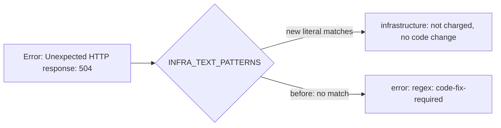

## Summary

The CI failure classifier now reads a terminal tool-download 502/503/504
(`Error: Unexpected HTTP response: 504`,
`##[error]Unexpected HTTP response: 504`,
`curl: (22) The requested URL returned error: 502` ending in exit code 22) as
`infrastructure`, so the CI-fix run no longer treats a download outage as a code
change. Closes #4965.

Version bump: `VERSION` is untouched by this change.

## Spec

### Intent and Rationale

- `INFRA_TEXT_PATTERNS` only held the reason-phrase forms
  (`504 gateway timeout`). The bare-code forms fell through to the generic
  `error:` regex and were routed `code-fix-required`, which charges an attempt
  and pushes the agent to edit the repository's CI workflow. The fix adds the
  setup-deno phrasing to the existing table and a per-line reader,
  `findDownloadOutageSignals`, for the other download-client phrasings, with no
  new gate, rule or prompt text.

### Essential Design Decisions

- Only 502, 503 and 504 are added, matching the table's existing scope; a bare
  `500` or a 4xx stays `code-fix-required` because a repo's own server under
  test can return those.
- Two of the three bare-code forms are read per line by
  `findDownloadOutageSignals`, so a recovered retry cannot masquerade as the
  failure (PR #5042 reviews):
  - `error: unexpected http response: 50x` (denoland/setup-deno, which reports
    the HTTPError object itself) stays a literal in `INFRA_TEXT_PATTERNS`.
    `@actions/tool-cache` logs the bare `Unexpected HTTP response: 504` as an
    info line on every failed attempt, so the bare message alone is not read.
  - setup-node and setup-python call `core.setFailed(err.message)`, so their
    terminal failure has no `Error:` prefix: it counts only as an annotation
    message or a `##[error]`/`::error::` log line.
  - curl prints `curl: (22) The requested URL returned error: 50x` on every
    failed attempt, before it retries. It counts only when it is the last curl
    error line of its block (a later `curl: (N)` line means it was a recovered
    attempt, which matters for `-s` runs that print no notice), no
    `will retry in` notice follows it, and either the block reports
    `exit code 22` (read from anywhere in the block) or the line ends the block.

### Undiscoverable Facts

- Evidence is NEAT-AI-Refinery#86 (heads `ff423bb`, `dc45743`), where a
  `denoland/setup-deno` 504 led CI-fix to add an unrequested workflow step.

## Evidence

Pure text matching, so no external tool was run; the strings are the issue's
exact annotation texts. Twinned-rule search: `transient_network_failure.ts`
holds a similar gateway list but classifies the worker's own `gh` failures, not
CI checks, so it is not a copy of this rule.

## Acceptance Criteria

The issue states no Acceptance Criteria or Definition of done heading, and
nothing it asks is left undone, so no block is required. Its two asks:

- Recognise terminal 502/503/504 in the `unexpected http response: 50[234]` and
  `the requested url returned error: 50[234]` shapes:
  `worker/deno/lib/ci_failure_classifier.ts` (`INFRA_TEXT_PATTERNS`,
  `findDownloadOutageSignals`).
- Classifier unit tests with the exact annotation strings asserting
  `infrastructure` and outranking the `error:` regex:
  `worker/deno/tests/ci_failure_classifier_test.ts`.

## Test Plan

Added to `worker/deno/tests/ci_failure_classifier_test.ts`:

- download-client 502/503/504 annotations route to `infrastructure`, with the
  matching `text:` signal and no `regex:(^|\s)error:` signal;
- the same texts in the log excerpt route to `infrastructure`;
- a recovered tool-cache retry (`Unexpected HTTP response: 504` /
  `Waiting 14 seconds before trying again`) followed by a real
  `error: no-unused-vars` finding stays `code-fix-required`, as does the bare
  line without `##[error]`; the `##[error]Error: Unexpected HTTP response: 504`
  line routes to `infrastructure`;
- setup-node/setup-python terminal shapes (annotation message and
  `##[error]Unexpected HTTP response: 50x` log line, no `Error:`) route to
  `infrastructure`;
- a recovered curl 504 (with and without a `Will retry in` notice) followed by a
  real lint failure stays `code-fix-required`; a curl 504 followed by a retry
  notice then a 404 with exit code 22 stays `code-fix-required`, as does a
  silent recovered 504 followed by a `curl -fsSL` 404 and exit code 22 (with and
  without timestamps); the terminal curl 504 with
  `Process completed with exit code 22` routes to `infrastructure`;
- `Unexpected HTTP response: 500` / `404` and curl `returned error: 404` stay
  `code-fix-required` (negative control for the bare-500 scope).

Results on the final head:
`deno task test:unit tests/ci_failure_classifier_test.ts` passed (65 at head, 0 failed);
the full `./quality.sh` gate was not re-run after the review fix.

Red check: against the pre-fix classifier the setup-node and recovered-curl
tests went red (2 failures). Reverting only the later-curl-error-line operand of
`retried` turned the silent 504/404 test red (64 passed, 1 failed); reverting only the retry-notice operand turned the retry-notice-only test red (64 passed, 1 failed). Per-branch
flips on the head: dropping the `!retried` operand turned the retry-then-404
test red; dropping `exit22` turned the terminal-curl test red; dropping the
`last line` operand turned the download-client tests red; dropping the `errored`
gate turned the recovered tool-cache and bare-line tests red.

Docs: the file header's "5xx" example was narrowed to "502/503/504" so it
matches what the table holds. No other doc names these patterns.

Not done: none.
