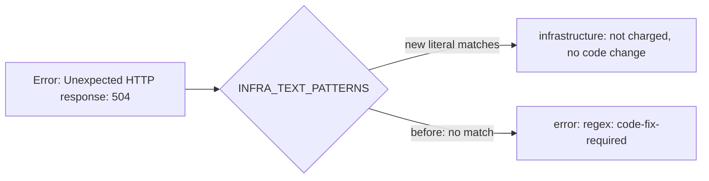

## Summary

The CI failure classifier now reads a tool-download 502/503/504 printed as a
bare status code (`Error: Unexpected HTTP response: 504`,
`curl: (22) The requested URL returned error: 502`) as `infrastructure`, so the
CI-fix run no longer treats a download outage as a code change. Closes #4965.

Version bump: `VERSION` is untouched by this change.

## Spec

### Intent and Rationale

- `INFRA_TEXT_PATTERNS` only held the reason-phrase forms
  (`504 gateway timeout`). The bare-code forms fell through to the generic
  `error:` regex and were routed `code-fix-required`, which charges an attempt
  and pushes the agent to edit the repository's CI workflow. Adding the two
  download-client phrasings to the existing table keeps the fix to the table,
  with no new gate, rule or prompt text.

### Essential Design Decisions

- Only 502, 503 and 504 are added, matching the table's existing scope; a bare
  `500` or a 4xx stays `code-fix-required` because a repo's own server under
  test can return those.
- Literal lowercase substrings, like the rest of the table, rather than a regex.
- The `@actions/tool-cache` forms are anchored to the terminal `error:` line
  (`error: unexpected http response: 50x`). The library's retry helper logs the
  bare `Unexpected HTTP response: 504` as an info line even when the next
  attempt succeeds, so the bare message must not route a real later failure to
  infrastructure (PR #5042 review). The curl form is unchanged: curl prints
  `The requested URL returned error: 50x` for a failed transfer, and its retry
  notices use different wording.

### Undiscoverable Facts

- Evidence is NEAT-AI-Refinery#86 (heads `ff423bb`, `dc45743`), where a
  `denoland/setup-deno` 504 led CI-fix to add an unrequested workflow step.

## Evidence

Pure text matching, so no external tool was run; the strings are the issue's
exact annotation texts. Twinned-rule search: `transient_network_failure.ts`
holds a similar gateway list but classifies the worker's own `gh` failures, not
CI checks, so it is not a copy of this rule.

## Acceptance Criteria

The issue states no Acceptance Criteria or Definition of done heading, and
nothing it asks is left undone, so no block is required. Its two asks:

- Recognise 502/503/504 in the `error: unexpected http response: 50[234]` and
  `the requested url returned error: 50[234]` shapes:
  `worker/deno/lib/ci_failure_classifier.ts` (`INFRA_TEXT_PATTERNS`).
- Classifier unit tests with the exact annotation strings asserting
  `infrastructure` and outranking the `error:` regex:
  `worker/deno/tests/ci_failure_classifier_test.ts`.

## Test Plan

Added to `worker/deno/tests/ci_failure_classifier_test.ts`:

- download-client 502/503/504 annotations route to `infrastructure`, with the
  matching `text:` signal and no `regex:(^|\s)error:` signal;
- the same texts in the log excerpt route to `infrastructure`;
- a recovered tool-cache retry (`Unexpected HTTP response: 504` /
  `Waiting 14 seconds before trying again`) followed by a real
  `error: no-unused-vars` finding stays `code-fix-required`, while the
  `##[error]Error: Unexpected HTTP response: 504` line routes to
  `infrastructure`;
- `Unexpected HTTP response: 500` / `404` and curl `returned error: 404` stay
  `code-fix-required` (negative control for the bare-500 scope).

Results on the final head:
`deno task test:unit tests/ci_failure_classifier_test.ts` passed (58 at head);
the full `./quality.sh` gate was not re-run after the review fix.

Red check: removing the six new literals turned the annotation and log-excerpt
tests red; the negative-control test stayed green, as it should. Reverting only
the `error:` anchor (back to the bare `unexpected http response: 50x`) turned
the annotation and log-excerpt tests and the recovered-retry look-alike test red
(4 failures).

Docs: the file header's "5xx" example was narrowed to "502/503/504" so it
matches what the table holds. No other doc names these patterns.

Not done: none.
