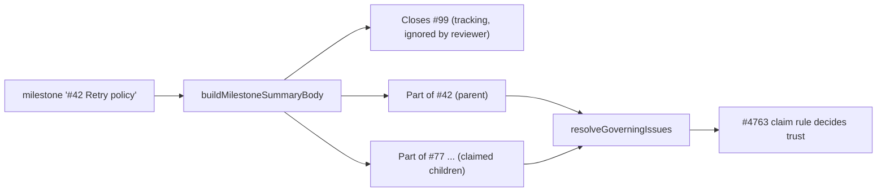

## Summary

A milestone roll-up PR now names the issues the reviewer's test-change policy
can use. `buildMilestoneSummaryBody` writes anchored `Part of #N` lines directly
under `Closes #<tracking>`: one for the parent issue (the leading `#N` of the
milestone title) and one for each claimed delivered child, up to 10. The
reviewer's candidate cap rises from 5 to 12 so it reads the tracking issue, the
parent and all 10 children. No trust rule changes, and `Part of` never closes
anything. Closes #4967.

## Spec

### Intent and Rationale

- Roll-ups were sent back on "no usable governing issue" and "requirement quote
  is not found" findings because the only linked issue was the service-account
  tracking issue. The parent and the delivered children carry
  `work-on`/`top-priority`, so the #4763 claim rule already accepts them once
  they are linked.
- Children are linked as well as the parent, because a quote held only in a
  delivered child is not fixed by the parent link (a control test pins this).

### Essential Design Decisions

- Numbers come only from the title (`trackingIssueFromMilestoneTitle`) and the
  worker's own `closedIssues`; flagged (`claimProblem`) issues get no line.
  Children are linked whether or not the title leads with `#N`; a title with no
  `#N` and no claimed children keeps today's body byte for byte.
- `MAX_GOVERNING_ISSUES` 5 → 12 (tracking + parent +
  `MILESTONE_PROVENANCE_MAX_CHILDREN` = 10). It still bounds per-PR `gh` reads.
  A milestone with more than 10 claimed children links the 10 lowest-numbered;
  the rest stay in "Issues addressed".
- The rollup fingerprint is stamped in the live PR body, so the body shape is
  persisted data. The payload now leads with `rollup-provenance-v2`: a body
  stamped with the old fingerprint is refreshed once and gains the lines. This
  chooses bump-the-key over reading the old shape.

### Undiscoverable Facts

- The evidence PRs are in a private fleet repository. No runtime output from it
  was inspected here; the fix follows from the issue's reading of
  `resolveGoverningIssues`.

## Evidence

Backend-only change; no UI files. Tests (all under `worker/deno/tests/`):

- `milestone_completion_test.ts`: body lines, no fabricated parent, children
  rules and cap, a roll-up body fed through the real
  `resolveGoverningIssues`/`assessTestChanges`, two controls, and the
  old-fingerprint refresh.
- `review_fleet_prs_test_policy_4655_test.ts`: the raised cap, with a
  roll-up-shaped body.

## Acceptance Criteria

The issue states no acceptance-criteria heading and nothing it asks is left
undone, so no reviewer block is required.

## Test Plan

- `milestone_completion_test.ts`: leading `#42` gives a line reading exactly
  `Part of #42` straight after `Closes #99` and no closing keyword for 42;
  titles `v1.0 release` and `Fix #42 later` give no `Part of` line and the body
  is byte-identical to today's; claimed children ascending, deduplicated,
  flagged and unsafe numbers excluded; exactly 10 children for 12 claimed;
  production-path test where tracking #99 is ignored, parent #42 and child #77
  are accepted and the child-only quote is found; control: without the child
  line the quote is not found; control: an untrusted fleet-filed child is still
  ignored; old-fingerprint rollup refreshed once, not again on the next scan.
- `review_fleet_prs_test_policy_4655_test.ts`: renamed `at most five are read`
  to `at most twelve are read` (14 refs, 12 reads; the invalid-input half is
  unchanged), and added a roll-up body test (12 candidates read, the 11th child
  not read).
- Mutation check (survivors on the `Part of` guards): the parent and child
  guards now share one `isLinkable` predicate (safe integer, positive, not the
  tracker); the old `parentNumber !== null` and `parentNumber > 0` operands were
  dead (`isSafeInteger(null)` is false; the title parser only returns positive
  numbers) and were removed. New tests pin the rest: a parent equal to the
  tracker, a parent beyond the safe-integer range, and zero or negative child
  numbers each get no `Part of` line. Dropping `isSafeInteger`, `n > 0` or the
  tracker check from the predicate turns a test red.
- Red checks: no child lines → children, cap, production-path, untrusted-child
  and fingerprint tests red; no parent line → leading-`#N`, children and
  production-path tests red; fingerprint tag removed → refresh test red;
  reviewer cap set to 5 or 13 → both cap tests red.
- Edited expectation: the cap test's expectation 5 → 12 goes red at cap 5 and at
  cap 13.
- Callers/siblings: the only production caller of `buildMilestoneSummaryBody` is
  `milestone_completion.ts` (passes the title and `closedIssues`);
  `security_untrusted_ingestion_1249_test.ts` still passes.
- Docs read and updated: `docs/INTERNALS.md` (summary PR body paragraph),
  `docs/workflows/milestones.md` (Final PR step and fingerprint bullet).
  `CONFIGURATION.md`'s test-change section concerns the reviewer only and names
  no count.
- `./quality.sh < /dev/null` on the final head: PASSED (config integration and
  checkov skipped: no config, no checkov). `deno task pr-summary-check`: 0
  blocked, 0 not checked.

Not done or not checked: the real review path against a private fleet PR; the
10-child cap means a larger milestone links only its 10 lowest-numbered
children. #4763: Reviewer's test-change policy refuses an owner-approved,
fleet-filed issue as the governing issue.
