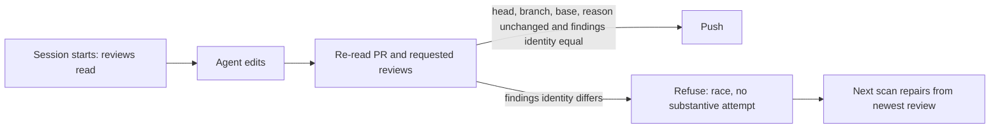

## Summary

A babysitter review repair is no longer pushed when a newer change request with
different findings landed on the same head during the session.
`finishBabysitterRepair` now re-reads the requested reviews before `git push`
and refuses with the existing "PR changed during the fix; refusing to push"
error when their findings identity differs from the one the session started
from. That error is already classed as a `race`, so no substantive attempt is
charged and the next scan repairs from the newest review. CI and conflict
repairs pass no reviews and are unchanged. Closes #4968.

Version bump: no `VERSION` change made by this PR.

## Spec

### Intent and Rationale

- The existing re-read compared only head, branch names, base and
  `reason(current)`, none of which move when a second CHANGES_REQUESTED review
  arrives on the same head. Comparing `repairFailureIdentity` over the re-read
  requested reviews is the same identity the retry record already uses, so no
  new notion of "same review" is introduced.

### Essential Design Decisions

- The comparison is by findings identity, not review id: a newer review that
  repeats the same findings still pushes, matching the existing rule that a new
  review id is not a new defect.
- The refusal reuses the existing error text so `classifyBabysitterBlocker`
  keeps classing it `race`.
- Existing fake `gh` helpers in two test files now answer the reviews read, and
  the dismissal test's `review()` helper gives each review its own login,
  because `requestedReviews` keeps one review per login.

### Undiscoverable Facts

- Evidence is from stSoftwareAU/VibeCoder#4896 (2026-11-09): a push at 15:13
  carried the 12:22 review's identity four minutes after a different review
  landed at 15:09.

## Evidence

Backend change; evidence is the tests below.

## Test Plan

- Added
  `worker/deno/tests/babysitter_fix_orchestration_test.ts::a newer change request landing mid-repair refuses the push as a race and the next pass repairs from it (Issue #4968)`:
  nothing pushed or dismissed, no marker, record `race` with
  `{infrastructure: 1, substantive: 0}`, then the next pass pushes and its
  record carries the new review's identity.
- Added
  `worker/deno/tests/babysitter_fix_orchestration_test.ts::a newer change request with the same findings mid-repair still pushes (Issue #4968)`
  (guards over-refusal).
- Red check: with the new comparison removed, the race test fails
  (`Expected function to reject.`) and the same-findings test stays green;
  restored and green.
- Fixture changes so existing tests reach the new reviews read (no assertion
  removed): `worker/deno/tests/fleet_pr_babysitter_test.ts` (two fake `gh`
  helpers answer the reviews read) and
  `worker/deno/tests/babysitter_review_dismissal_4657_test.ts` (`runFinish`
  answers the reviews read with the reviews under test; `review()` uses one
  login per review).
- `deno task test:unit` on the five babysitter test files: 223 passed, 0 failed.
- `./quality.sh < /dev/null`: PASSED (config integration and checkov skipped).
- Callers of `finishBabysitterRepair` checked: `fix()` (passes the started-from
  reviews) and `resumePendingPublication` (never pushes, so the new read is not
  reached).
- Docs: `docs/workflows/fleet-pr-babysitter.md` updated (recheck paragraph and
  the race-classification paragraph).
